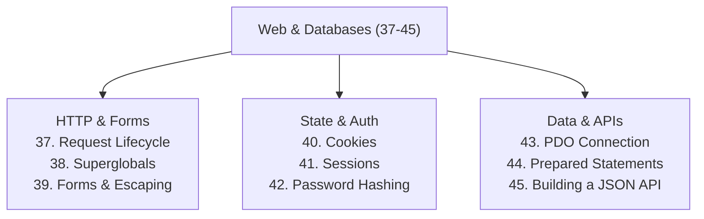

---
tags:
  - php
  - overview
  - web
  - database
  - beginner
---

# Overview: Web & Databases

## TL;DR

This folder covers how PHP handles HTTP requests from scratch, reads URL and form inputs safely, manages cookies and sessions, hashes passwords, queries SQL databases with **PDO**, and serves JSON APIs.

> [!NOTE] Prerequisites: 37, 38, 39, 40, 41, 42, 43, 44, 45
> New terms: None (all terms introduced in notes 37 through 45)

> [!abstract] Core Idea
> Validate request data from **superglobal**s, escape HTML output against **XSS**, store state in `$_SESSION`, hash passwords with `password_hash()`, and run SQL exclusively through **PDO** **prepared statement**s.
> Unlike long-running Python or Node servers, PHP wipes memory after every HTTP request, making **cookie**s, **session**s, and databases essential for persistent state.

## Concept Map

## Folder Cheat Sheet

| Note                          | Core Syntax / Tool                                            | Key Rule to Remember                                                                |
| ----------------------------- | ------------------------------------------------------------- | ----------------------------------------------------------------------------------- |
| `37. Request Lifecycle`       | `php -S localhost:8000`, `header()`, `http_response_code()`   | Send headers before any output; always `exit;` after `Location:` redirects          |
| `38. Superglobals`            | `$_GET`, `$_POST`, `$_SERVER`                                 | Use `??` defaults; JSON bodies come from `php://input`, not `$_POST`                |
| `39. Forms & Output Escaping` | `htmlspecialchars($v, ENT_QUOTES, 'UTF-8')`                   | Escape at HTML output time to stop **XSS**; validate on the server                  |
| `40. Cookies`                 | `setcookie()`, `$_COOKIE`                                     | Set `httponly` + `samesite`; new cookies appear in `$_COOKIE` on the _next_ request |
| `41. Sessions`                | `session_start()`, `$_SESSION`, `session_regenerate_id(true)` | Call `session_start()` before output; regenerate ID after login                     |
| `42. Password Hashing`        | `password_hash(..., PASSWORD_DEFAULT)`, `password_verify()`   | Store in `VARCHAR(255)`; never compare `password_hash()` with `===`                 |
| `43. PDO Connection`          | `new PDO($dsn, ...)`, `PDOException`                          | Set `FETCH_ASSOC` and `ERRMODE_EXCEPTION`; log errors, never echo them              |
| `44. Prepared Statements`     | `$pdo->prepare()`, `$stmt->execute([...])`, `fetch()`         | Never interpolate user input into SQL; `fetch()` returns `false` on no row          |
| `45. Building a JSON API`     | `Content-Type: application/json`, `php://input`               | Return JSON for errors too; never run `htmlspecialchars()` before `json_encode()`   |

## Boss Quiz

**Q1: Why is `$_POST` empty when a JavaScript client sends `fetch()` with `Content-Type: application/json`?**

- [ ] A) PHP blocks JavaScript `fetch()` requests
- [ ] B) `$_POST` only parses HTML form data; JSON payloads must be read from `php://input`
- [ ] C) JSON requests go into `$_GET`
- [ ] D) You must call `session_start()` first

**Q2: Where should you call `htmlspecialchars($text, ENT_QUOTES, 'UTF-8')`?**

- [ ] A) Right before outputting text into an HTML template
- [ ] B) Right before passing strings to `json_encode()` in a JSON API
- [ ] C) Inside `password_hash()`
- [ ] D) Before saving into SQLite

**Q3: What happens if you check a login password with `password_hash($input, PASSWORD_DEFAULT) === $storedHash`?**

- [ ] A) It works if the password is correct
- [ ] B) It always returns `false` because `password_hash()` generates a new random **salt** every time; use `password_verify()`
- [ ] C) It throws a `TypeError`
- [ ] D) It updates the database automatically

**Q4: Why should you call `session_regenerate_id(true)` immediately after a user logs in?**

- [ ] A) To clear `$_SESSION`
- [ ] B) To issue a fresh **session ID** and prevent session fixation attacks
- [ ] C) To convert `$_SESSION` into `$_COOKIE`
- [ ] D) Because `session_start()` deletes the old ID automatically

**Q5: What does `$stmt->fetch()` return when zero rows match a `SELECT` query?**

- [ ] A) `[]`
- [ ] B) `null`
- [ ] C) `false`
- [ ] D) `0`

**Q6: Which statement about `header('Location: /books.php');` is true?**

- [ ] A) It stops script execution automatically
- [ ] B) It can be called after `echo`
- [ ] C) It must run before any output and should be followed immediately by `exit;`
- [ ] D) It sets status code `404`

◈ View Answers & Explanations

1. **B** - `$_POST` is populated only for `application/x-www-form-urlencoded` and `multipart/form-data`; read raw JSON from `file_get_contents('php://input')`. A, C, and D are false.

2. **A** - Escape at the HTML output boundary to prevent **XSS**, while keeping stored database text and JSON API responses clean. B, C, and D are wrong.

3. **B** - Each call to `password_hash()` uses a fresh random **salt**, so two hashes of the same password never match with `===`; always verify with `password_verify()`. A, C, and D are false.

4. **B** - Regenerating the **session ID** on login prevents an attacker from hijacking a pre-login session ID. A, C, and D are false.

5. **C** - `PDOStatement::fetch()` returns `false` when no row is found (whereas `fetchAll()` returns `[]`). A, B, and D are false.

6. **C** - `header()` must be called before any output is sent, and you must call `exit;` right after `Location:` so PHP does not keep executing the rest of the script. A, B, and D are false.

> [!quote] Sources
>
> - [Superglobals - PHP Manual](https://www.php.net/manual/en/language.variables.superglobals.php)
> - [password_verify - PHP Manual](https://www.php.net/manual/en/function.password-verify.php)
> - [PDO::prepare - PHP Manual](https://www.php.net/manual/en/pdo.prepare.php)
