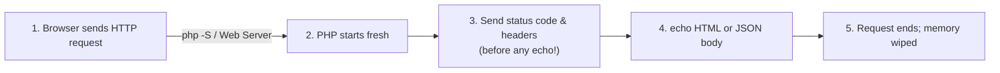

---
tags:
  - php
  - web
  - beginner
---

# Request Lifecycle

## TL;DR

Unlike Node or Python web servers that stay running in memory between visitors, PHP starts fresh for every single HTTP request, sends its **HTTP header**s and body, and wipes everything clean at the end. You can test this whole cycle locally with `php -S localhost:8000`.

> [!NOTE] Prerequisites: 01, 30
> New terms: HTTP header, status code

> [!abstract] Core Idea
> Every HTTP request boots your PHP script from scratch, sends **status code** and **HTTP header** lines before any body output, and tears down all variables when the response finishes.
> Unlike Python's Flask or Node's Express where global variables persist across requests, PHP's shared-nothing lifecycle resets memory completely after each response.

## Mental Model

Think of PHP like a clean whiteboard in a library booth. Each visitor who knocks (an HTTP request) gets a brand-new, blank whiteboard: PHP writes the **HTTP header**s on top, writes the HTML or JSON body below, hands the response back, and erases the board completely before the next visitor arrives.



- An **HTTP header** (`header(...)`) is a metadata line sent before the response body—such as `Content-Type: application/json` or `Location: /books.php`.
- A **status code** (`http_response_code(...)`) is the 3-digit HTTP number telling the browser whether the request succeeded (`200`), redirected (`302`), or failed (`404`).

## Minimal Example

```php
<?php
// Start local dev server in PowerShell: php -S localhost:8000
http_response_code(200);
header('Content-Type: application/json; charset=utf-8');

echo json_encode(['book' => 'Dune', 'pages' => 412], JSON_THROW_ON_ERROR);
```

Expected output:

```text
{"book":"Dune","pages":412}
```

- `php -S localhost:8000` starts PHP's built-in development web server in the current folder.
- `http_response_code(200)` sets the HTTP **status code** (defaults to `200` on success, or `404` for not found).
- `header('Content-Type: application/json; charset=utf-8')` tells the browser or API client to expect JSON instead of HTML.
- Both `http_response_code()` and `header()` run _before_ `echo` sends any response body.

## Compare

| Aspect                  | PHP Request Lifecycle            | Long-Running Server (Flask / Express) |
| ----------------------- | -------------------------------- | ------------------------------------- |
| Memory between requests | Wiped clean after every request  | Shared in process memory              |
| Local dev server        | `php -S localhost:8000`          | `flask run` / `node server.js`        |
| Crashed request impact  | Affects only that single request | Can crash the whole server process    |

## ◈ Edge Case Analysis

✗ **Mistake 1:** Calling `header()` after `echo`, HTML output, or even a blank line before `<?php` triggers a _"Cannot modify header information - headers already sent"_ warning.

```php
<p>Loading...</p>
<?php
header('Location: /books.php'); // Warning: headers already sent!
```

✓ **Fix:** Always call `header()` and `http_response_code()` before any HTML, whitespace, or `echo` output.

```php
<?php
header('Location: /books.php');
exit;
```

✗ **Mistake 2:** Sending a `Location:` redirect header without calling `exit;` lets PHP keep executing the rest of the script underneath.

```php
header('Location: /login.php');
// Code below STILL runs on the server!
```

✓ **Fix:** Always follow a `Location:` redirect with `exit;` immediately.

```php
header('Location: /login.php');
exit;
```

✗ **Mistake 3:** Running `php -S localhost:8000` as your public production server makes your site slow and unsafe because the built-in server handles requests sequentially for local testing only.

```powershell
php -S 0.0.0.0:80   # Do NOT use in production
```

✓ **Fix:** Use `php -S localhost:8000` only for local development, and use Nginx or Apache with PHP-FPM in production.

```powershell
php -S localhost:8000
```

## Try It

1. Write a tiny `status.php` script that sets `http_response_code(404)`, sends `header('Content-Type: text/plain')`, and echoes `"Book not found"`.
2. Write the PowerShell command to serve the current folder locally on port `8080`.

<details>
<summary>◈ View Solution</summary>

1. Sending a `404` status and plain-text header before output:

```php
<?php
http_response_code(404);
header('Content-Type: text/plain; charset=utf-8');
echo 'Book not found';
```

2. Starting PHP's built-in development server on port `8080`:

```powershell
php -S localhost:8080
```

</details>

## Topic Mastery Quiz

**Q1: What happens to ordinary PHP variables when an HTTP request finishes?**

- [ ] A) They stay in memory for the next visitor
- [ ] B) PHP wipes all script memory clean after each request
- [ ] C) They are saved to `composer.lock`
- [ ] D) They turn into `static` properties

**Q2: Why must `header()` be called before any `echo` or HTML tag?**

- [ ] A) `echo` deletes all HTTP headers
- [ ] B) Once any body output is sent, PHP sends the headers first and can no longer modify them
- [ ] C) `header()` only works inside functions
- [ ] D) HTML tags disable PHP

**Q3: What happens if you call `header('Location: /books.php');` and forget `exit;`?**

- [ ] A) PHP automatically stops the script anyway
- [ ] B) The browser redirects, but PHP continues running the rest of the script on the server
- [ ] C) PHP throws a syntax error
- [ ] D) The redirect is cancelled

**Q4: What does `php -S localhost:8000` do?**

- [ ] A) Checks PHP syntax without running code
- [ ] B) Starts PHP's built-in web server for local development
- [ ] C) Deploys your app to production
- [ ] D) Installs Composer packages

**Q5: Which call sets the HTTP status code to `404`?**

- [ ] A) `http_status(404)`
- [ ] B) `http_response_code(404)`
- [ ] C) `echo 404`
- [ ] D) `status_code(404)`

**Q6: Which statement about PHP's built-in web server (`php -S`) is true?**

- [ ] A) It is designed for high-traffic production websites
- [ ] B) It is intended for local development and testing only
- [ ] C) It requires Apache to run
- [ ] D) It cannot serve `.php` files

<details>
<summary>◈ View Answers & Explanations</summary>

1. **B** — PHP uses a shared-nothing request lifecycle: every request starts fresh and clears all script variables when the response ends. A, C, and D are false.
2. **B** — HTTP requires headers to appear before the response body; the moment any body output (even whitespace) is sent, headers are flushed and cannot be changed. A, C, and D are false.
3. **B** — `header('Location: ...')` only queues the redirect header; it does not stop PHP execution, so code below it still runs unless you call `exit;`. A, C, and D are false.
4. **B** — `php -S localhost:8000` launches PHP's built-in CLI development server. Syntax checking is `php -l` (A), and it is not for production (C) or packages (D).
5. **B** — `http_response_code(404)` sets the HTTP **status code** to `404`. A, C, and D do not set HTTP status codes.
6. **B** — The PHP manual explicitly notes that the built-in CLI server is for development only and must not be used on a public production network. A, C, and D are false.

</details>

## One-Liner

> [!tip] Headers Before Body

> [!quote] Sources
>
> - [Built-in web server - PHP Manual](https://www.php.net/manual/en/features.commandline.webserver.php)
> - [header - PHP Manual](https://www.php.net/manual/en/function.header.php)
> - [http_response_code - PHP Manual](https://www.php.net/manual/en/function.http-response-code.php)
