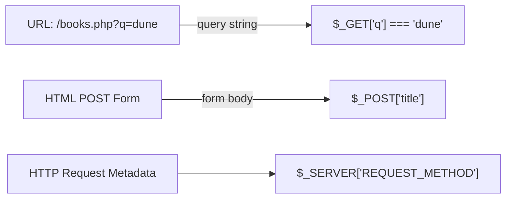

---
tags:
  - php
  - web
  - beginner
---

# Superglobals

## TL;DR

When a browser requests `/books.php?q=dune` or submits a form, PHP automatically packs the incoming request data into built-in arrays called **superglobals**. You can read `$_GET`, `$_POST`, and `$_SERVER` anywhere—even inside functions—without using `global`.

> [!NOTE] Prerequisites: 09, 13, 37
> New terms: superglobal, query string

> [!abstract] Core Idea
> **Superglobals** (`$_GET`, `$_POST`, `$_SERVER`, `$_REQUEST`) are built-in associative arrays available in every scope that hold incoming HTTP request data.
> Like Flask's `request.args` and `request.form`, PHP exposes URL and form inputs automatically, except it places them in global `$_GET` and `$_POST` arrays.

## Mental Model

Think of **superglobals** as labeled intake trays that PHP places on every desk before your script starts. URL parameters land in `$_GET`, HTML form submissions land in `$_POST`, and server/method details land in `$_SERVER`—and every function in your app can reach straight into those trays.



- A **superglobal** is a predefined PHP variable (like `$_GET`, `$_POST`, or `$_SERVER`) that is automatically accessible in all scopes without `global`.
- A **query string** is the key-value part of a URL after `?` (such as `?q=dune&page=2`).

## Minimal Example

```php
<?php
function readSearchQuery(): string
{
    return trim($_GET['q'] ?? '');
}

$method = $_SERVER['REQUEST_METHOD'] ?? 'GET';
$query = readSearchQuery();

echo "Method: {$method}, Query: {$query}" . PHP_EOL;
```

Expected output (for `GET /books.php?q=dune`):

```text
Method: GET, Query: dune
```

- `$_GET['q'] ?? ''` safely reads the `q` **query string** parameter and defaults to `''` if `q` is missing.
- `readSearchQuery()` reads `$_GET` directly inside a function without `global $_GET;` because `$_GET` is a **superglobal**.
- `$_SERVER['REQUEST_METHOD']` holds `'GET'`, `'POST'`, and so on during web requests (and `?? 'GET'` keeps CLI tests safe).

> [!warning] Security angle
> Never trust values from `$_GET`, `$_POST`, or `$_SERVER` HTTP headers blindly. Visitors can edit URLs, form fields, and spoofed request headers—always validate and escape them before use.

## Compare

| Superglobal | What It Holds                              | Common Use                                 |
| ----------- | ------------------------------------------ | ------------------------------------------ |
| `$_GET`     | Parameters from the URL **query string**   | Search filters, pagination (`?page=2`)     |
| `$_POST`    | Form fields sent via HTTP `POST`           | Creating/updating books                    |
| `$_SERVER`  | Request method, path, headers, server info | Checking `$_SERVER['REQUEST_METHOD']`      |
| `$_REQUEST` | Combined `$_GET`, `$_POST`, and cookies    | Avoid; prefer explicit `$_GET` or `$_POST` |

## ◈ Edge Case Analysis

✗ **Mistake 1:** Reading `$_GET['q']` directly when `?q=` is not in the URL triggers an `Undefined array key "q"` warning.

```php
$q = $_GET['q']; // Warning if URL is just /books.php
```

✓ **Fix:** Always pair superglobal lookups with `??` to provide a safe fallback.

```php
$q = $_GET['q'] ?? '';
```

✗ **Mistake 2:** Expecting `$_POST` to hold a JSON body sent by JavaScript `fetch()` leaves `$_POST` empty, because `$_POST` only parses HTML form content types.

```php
// Client sent Content-Type: application/json
$title = $_POST['title'] ?? ''; // Always ''!
```

✓ **Fix:** Read raw JSON request bodies from `php://input` and pass the string to `json_decode()`.

```php
$data = json_decode(file_get_contents('php://input'), true, flags: JSON_THROW_ON_ERROR);
```

✗ **Mistake 3:** Naming a function parameter `$_GET` or `$_POST` throws a fatal error because PHP forbids shadowing superglobals.

```php
function search(array $_GET): void {} // Fatal error: Cannot re-assign auto-global variable _GET
```

✓ **Fix:** Use a normal parameter name such as `$query` or `$input`.

```php
function search(array $query): void {}
```

## Try It

1. Write a helper `isPost(): bool` that checks whether `($_SERVER['REQUEST_METHOD'] ?? '') === 'POST'`.
2. Read `page` from `$_GET` safely, cast it to `int`, and default to `1` if missing.

<details>
<summary>◈ View Solution</summary>

1. Checking the request method inside a function:

```php
<?php
function isPost(): bool
{
    return ($_SERVER['REQUEST_METHOD'] ?? '') === 'POST';
}
```

2. Reading an integer page parameter with a default:

```php
<?php
$page = (int) ($_GET['page'] ?? 1);
echo $page . PHP_EOL;
```

</details>

## Topic Mastery Quiz

**Q1: Why can you read `$_GET` inside a function without writing `global $_GET;`?**

- [ ] A) `$_GET` is a constant
- [ ] B) `$_GET` is a **superglobal**, available automatically in every scope
- [ ] C) Functions in PHP share all variables by default
- [ ] D) `$_GET` is a static property

**Q2: For the URL `/books.php?genre=scifi&page=2`, where does `'scifi'` live?**

- [ ] A) `$_POST['genre']`
- [ ] B) `$_GET['genre']`
- [ ] C) `$_SERVER['genre']`
- [ ] D) `$GLOBALS['genre']`

**Q3: Why is `$_POST` empty when a JavaScript client sends `Content-Type: application/json`?**

- [ ] A) PHP blocks all JSON requests
- [ ] B) `$_POST` only parses `application/x-www-form-urlencoded` and `multipart/form-data`; raw JSON must be read from `php://input`
- [ ] C) JSON requests go into `$_GET` instead
- [ ] D) You must call `global $_POST;` first

**Q4: What happens if you write `function load(array $_POST) {}`?**

- [ ] A) It passes `$_POST` by value cleanly
- [ ] B) It throws a fatal error because superglobals cannot be used as function parameters
- [ ] C) It clears `$_POST`
- [ ] D) It converts `$_POST` into an indexed array

**Q5: Which expression safely reads `$_GET['sort']` without a warning if `sort` is missing from the URL?**

- [ ] A) `$_GET['sort']`
- [ ] B) `$_GET['sort'] ?? 'title'`
- [ ] C) `$_POST['sort']`
- [ ] D) `$_SERVER['sort']`

**Q6: Why is `$_GET` or `$_POST` preferred over `$_REQUEST`?**

- [ ] A) `$_REQUEST` does not exist in PHP 8.4
- [ ] B) `$_REQUEST` mixes `GET`, `POST`, and cookies together, hiding where the input actually came from
- [ ] C) `$_REQUEST` is always empty
- [ ] D) `$_REQUEST` throws an exception on strings

<details>
<summary>◈ View Answers & Explanations</summary>

1. **B** — Superglobals are built-in variables accessible in all scopes without `global`. They are arrays (not constants, A, or static properties, D), and normal PHP functions still use local scope (C).
2. **B** — URL query string parameters (`?genre=scifi&page=2`) are placed in `$_GET`. `$_POST` (A) is for POST form bodies, and `$_SERVER` (C) holds server/request metadata.
3. **B** — PHP populates `$_POST` only for standard HTML form encodings; JSON payloads must be read from `php://input` via `file_get_contents('php://input')`. A, C, and D are false.
4. **B** — PHP forbids shadowing superglobal names in function parameters and throws a fatal error. A, C, and D are false.
5. **B** — The null coalescing operator (`??`) returns `'title'` without emitting an `Undefined array key` warning when `'sort'` is absent. A warns, and C/D check the wrong superglobals.
6. **B** — `$_REQUEST` merges multiple sources (`GET`, `POST`, `COOKIE`), making it ambiguous where data originated; reading `$_GET` or `$_POST` explicitly is clearer and safer. A, C, and D are false.

</details>

## One-Liner

> [!tip] Explicit & Guarded
> **Read `$_GET`, `$_POST`, and `$_SERVER` with `??` defaults, and never trust any incoming request value without validation.**

> [!quote] Sources
>
> - [Superglobals - PHP Manual](https://www.php.net/manual/en/language.variables.superglobals.php)
> - [$\_POST - PHP Manual](https://www.php.net/manual/en/reserved.variables.post.php)
> - [$\_SERVER - PHP Manual](https://www.php.net/manual/en/reserved.variables.server.php)
