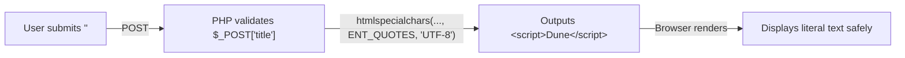

---
tags:
  - php
  - web
  - security
  - beginner
---

# Forms & Output Escaping

## TL;DR

When a user submits a book title through an HTML form, two rules keep your app safe: validate the data on the PHP server, and escape it before printing it back into HTML. Without escaping, someone can type `<script>` tags into a book title and run malicious JavaScript in other users' browsers.

> [!NOTE] Prerequisites: 20, 38
> New terms: XSS, HTML escaping

> [!abstract] Core Idea
> Handle form submissions on `$_SERVER['REQUEST_METHOD'] === 'POST'`, validate `$_POST` in PHP, and wrap every dynamic value in `htmlspecialchars($text, ENT_QUOTES, 'UTF-8')` before echoing into HTML.
> Unlike React JSX or Jinja2 which escape text automatically, raw PHP `echo` outputs HTML verbatim, so **HTML escaping** is up to you.

## Mental Model

Think of `htmlspecialchars()` as putting a visitor's handwritten note inside a clear display sleeve before pinning it to the library bulletin board. Even if the note says `<script>alert(1)</script>`, the browser prints those exact characters as harmless text instead of running them as HTML or JavaScript.


- **HTML escaping** converts special HTML characters (`<`, `>`, `&`, `"`, `'`) into safe HTML entities (`&lt;`, `&gt;`, `&amp;`, `&quot;`, `&#039;`) so the browser shows them as plain text.

## Minimal Example

```php
<?php
$title = '';
$error = '';

if (($_SERVER['REQUEST_METHOD'] ?? '') === 'POST') {
    $title = trim($_POST['title'] ?? '');
    if ($title === '') {
        $error = 'Please enter a book title.';
    }
}
?>
<form method="POST">
    <input name="title" value="<?= htmlspecialchars($title, ENT_QUOTES, 'UTF-8') ?>">
    <button type="submit">Save</button>
</form>
<?php if ($error !== ''): ?>
    <p><?= htmlspecialchars($error, ENT_QUOTES, 'UTF-8') ?></p>
<?php endif; ?>
```

- `($_SERVER['REQUEST_METHOD'] ?? '') === 'POST'` runs form processing only when the form is submitted via `POST`.
- `trim($_POST['title'] ?? '')` safely reads and cleans the submitted field on the server.
- `<?= ... ?>` is PHP's short echo tag (`<?php echo ... ?>`).
- `htmlspecialchars($title, ENT_QUOTES, 'UTF-8')` escapes `<`, `>`, `&`, `"`, and `'` so the value cannot break out of `value="..."` or inject tags.

> [!warning] Security angle
> Never echo raw `$_GET` or `$_POST` values into HTML. Always wrap every dynamic string in `htmlspecialchars($value, ENT_QUOTES, 'UTF-8')` right at the HTML output point to prevent **XSS**.

## Compare

| Output Expression                                      | Input: `<b>Dune</b>` | Browser Renders              | Safe Against XSS? |
| ------------------------------------------------------ | -------------------- | ---------------------------- | ----------------- |
| `<?= $title ?>`                                        | `<b>Dune</b>`        | **Dune** (executed as HTML!) | ✗ No              |
| `<?= htmlspecialchars($title, ENT_QUOTES, 'UTF-8') ?>` | `<b>Dune</b>`        | `<b>Dune</b>` (literal text) | ✓ Yes             |

## ◈ Edge Case Analysis

✗ **Mistake 1:** Echoing `$_POST['title']` directly into HTML lets attackers inject `<script>` tags or break out of HTML attributes (**XSS**).

```php
<input name="title" value="<?= $_POST['title'] ?? '' ?>">
```

✓ **Fix:** Always pass every dynamic string through `htmlspecialchars(..., ENT_QUOTES, 'UTF-8')` when printing into HTML.

```php
<input name="title" value="<?= htmlspecialchars($title, ENT_QUOTES, 'UTF-8') ?>">
```

✗ **Mistake 2:** Relying only on HTML `<input required>` without checking `$_POST` in PHP lets anyone submit empty or invalid data directly via HTTP requests.

```html
<!-- Browser-only check; easily bypassed -->
<input name="title" required />
```

✓ **Fix:** Always validate required fields, types, and lengths in PHP on the server as well.

```php
if (trim($_POST['title'] ?? '') === '') {
    $error = 'Title is required.';
}
```

✗ **Mistake 3:** Escaping a value _before_ saving it to JSON or a database pollutes your stored data with `&amp;` and `&quot;` everywhere.

```php
$savedTitle = htmlspecialchars($_POST['title'], ENT_QUOTES, 'UTF-8'); // Wrong place!
```

✓ **Fix:** Validate input on arrival, store clean raw text, and call `htmlspecialchars()` only when outputting into HTML.

```php
// Store clean $title; escape only inside HTML templates:
echo htmlspecialchars($savedTitle, ENT_QUOTES, 'UTF-8');
```

## Try It

1. Write a helper function `e(string $text): string` that returns `htmlspecialchars($text, ENT_QUOTES, 'UTF-8')`.
2. Use `e()` to safely print `$title = 'Dune & "Messiah"'` inside `<p>...</p>`.

<details>
<summary>◈ View Solution</summary>

1. Short HTML-escaping helper:

```php
<?php
function e(string $text): string
{
    return htmlspecialchars($text, ENT_QUOTES, 'UTF-8');
}
```

2. Safely rendering in HTML:

```php
<?php
$title = 'Dune & "Messiah"';
echo '<p>' . e($title) . '</p>' . PHP_EOL;
// Outputs: <p>Dune &amp; &quot;Messiah&quot;</p>
```

</details>

## Topic Mastery Quiz

**Q1: What does `htmlspecialchars('<script>', ENT_QUOTES, 'UTF-8')` return?**

- [ ] A) `'<script>'`
- [ ] B) `'&lt;script&gt;'`
- [ ] C) `''` (it deletes tags)
- [ ] D) `'script'`

**Q2: What vulnerability occurs when you echo unescaped user input like `<script>...</script>` into an HTML page?**

- [ ] A) Type juggling
- [ ] B) XSS (Cross-Site Scripting)
- [ ] C) Fallthrough
- [ ] D) Name collision

**Q3: Why is HTML `<input required>` not enough on its own?**

- [ ] A) `<input required>` does not work with `POST`
- [ ] B) Users or scripts can bypass browser validation and send any HTTP POST request directly to your PHP script
- [ ] C) PHP deletes `<input required>` attributes
- [ ] D) `<input required>` only works in Chrome

**Q4: When should you call `htmlspecialchars()`?**

- [ ] A) Right before outputting a string into HTML
- [ ] B) Before counting its string length
- [ ] C) Before encoding it to JSON for an API
- [ ] D) Only on integer values

**Q5: What does `<?= $name ?>` mean in PHP?**

- [ ] A) A comment
- [ ] B) Short syntax for `<?php echo $name ?>`
- [ ] C) An escaped echo tag
- [ ] D) A strict comparison

**Q6: Which flag ensures both double quotes (`"`) and single quotes (`'`) are converted by `htmlspecialchars()`?**

- [ ] A) `ENT_NOQUOTES`
- [ ] B) `ENT_QUOTES`
- [ ] C) `JSON_THROW_ON_ERROR`
- [ ] D) `LOCK_EX`

<details>
<summary>◈ View Answers & Explanations</summary>

1. **B** — `htmlspecialchars()` converts `<` to `&lt;` and `>` to `&gt;` so the browser displays them as text instead of running a tag. It does not strip tags (C, D) or leave them raw (A).
2. **B** — Rendering unescaped user input as live HTML/JavaScript allows **XSS** (Cross-Site Scripting). A, C, and D are unrelated concepts.
3. **B** — Client-side HTML attributes only help well-behaved browsers; anyone can send raw HTTP requests directly to your server, so PHP must always validate `$_POST` itself. A, C, and D are false.
4. **A** — Escape at the HTML output boundary so your stored data and JSON APIs stay clean (`&` stays `&`), while HTML pages render safely. B, C, and D are wrong.
5. **B** — `<?= $name ?>` is PHP's short echo tag (`<?php echo $name ?>`); it does NOT escape HTML automatically (C). A and D are false.
6. **B** — `ENT_QUOTES` converts both double and single quotes, protecting both `"..."` and `'...'` HTML attributes. `ENT_NOQUOTES` (A) leaves quotes unconverted, while C and D are unrelated flags.

</details>

## One-Liner

> [!tip] Validate In, Escape Out
> **Validate `$_POST` on the server, store clean text, and wrap every HTML output in `htmlspecialchars($v, ENT_QUOTES, 'UTF-8')`.**

> [!quote] Sources
>
> - [htmlspecialchars - PHP Manual](https://www.php.net/manual/en/function.htmlspecialchars.php)
> - [$\_POST - PHP Manual](https://www.php.net/manual/en/reserved.variables.post.php)
