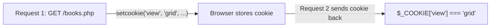

---
tags:
  - php
  - web
  - beginner
---

# Cookies

## TL;DR

Because PHP wipes memory after every request, you need a way to remember small preferences—like whether a reader prefers list or grid view in your Book Tracker. **Cookies** let your server ask the browser to store a small key-value pair and send it back on future visits.

> [!NOTE] Prerequisites: 37, 38
> New terms: cookie, HttpOnly

> [!abstract] Core Idea
> Send a **cookie** to the browser with `setcookie()` before any output, and read it on later requests from `$_COOKIE`.
> Like Flask's `response.set_cookie()` and `request.cookies`, PHP sends cookies in **HTTP header**s and exposes incoming ones in the `$_COOKIE` **superglobal**.

## Mental Model

Think of a **cookie** like a library bookmark your browser keeps for a specific website. On your first visit, PHP hands the browser a bookmark (`setcookie()`). On every later visit, the browser automatically brings that bookmark back inside the request (`$_COOKIE`).



- A **cookie** is a small key-value piece of data stored in the user's browser and automatically sent back to your server on matching requests.
- **HttpOnly** (`'httponly' => true`) is a cookie flag that blocks browser JavaScript from reading the cookie, protecting it if **XSS** ever happens.

## Minimal Example

```php
<?php
setcookie('shelf_view', 'grid', [
    'expires' => time() + 86400,
    'path' => '/',
    'secure' => true,
    'httponly' => true,
    'samesite' => 'Lax',
]);

$view = $_COOKIE['shelf_view'] ?? 'list';
echo htmlspecialchars($view, ENT_QUOTES, 'UTF-8') . PHP_EOL;
```

- `setcookie('shelf_view', 'grid', [...])` queues a `Set-Cookie` **HTTP header** that expires in 24 hours (`time() + 86400`).
- `'path' => '/'` makes the cookie available across the entire site, not just the current folder.
- `'secure' => true` tells the browser to send the cookie only over HTTPS (omit or set `false` only on plain `http://localhost` during local tests).
- `'httponly' => true` and `'samesite' => 'Lax'` harden the cookie against script theft and unwanted cross-site requests.
- `$_COOKIE['shelf_view'] ?? 'list'` reads the cookie sent by the browser on _this_ request (defaulting to `'list'` on the very first visit).

> [!warning] Security angle
> Cookies live on the user's machine and can be viewed or edited by the user. Never store passwords or admin flags in cookies, always escape `$_COOKIE` values before HTML output, and enable `httponly` and `samesite`.

## Compare

| Option     | Value                 | What It Protects Against                   |
| ---------- | --------------------- | ------------------------------------------ |
| `httponly` | `true`                | Blocks `document.cookie` JavaScript access |
| `secure`   | `true`                | Sends cookie only over encrypted HTTPS     |
| `samesite` | `'Lax'` or `'Strict'` | Limits cross-site cookie sending           |

## ◈ Edge Case Analysis

✗ **Mistake 1:** Reading `$_COOKIE['shelf_view']` immediately after `setcookie()` on the very same request returns nothing, because `$_COOKIE` only holds cookies sent _by_ the browser at the start of the request.

```php
setcookie('shelf_view', 'grid');
echo $_COOKIE['shelf_view'] ?? 'missing'; // Prints "missing" on the first visit!
```

✓ **Fix:** Use your local variable (`$view = 'grid'`) for the current response, and read `$_COOKIE` on subsequent requests.

```php
$view = 'grid';
setcookie('shelf_view', $view);
```

✗ **Mistake 2:** Calling `setcookie()` after `echo` or HTML output fails with a _"headers already sent"_ warning because cookies travel inside HTTP headers.

```php
<h1>Books</h1>
<?php setcookie('shelf_view', 'grid'); // Warning: headers already sent
```

✓ **Fix:** Always call `setcookie()` before any HTML, `echo`, or whitespace is sent.

```php
<?php
setcookie('shelf_view', 'grid');
?>
<h1>Books</h1>
```

✗ **Mistake 3:** Setting `'expires' => 0` to delete a cookie actually keeps it alive until the user closes their browser.

```php
setcookie('shelf_view', '', ['expires' => 0, 'path' => '/']); // Browser-session cookie!
```

✓ **Fix:** Set `'expires'` to a timestamp in the past (such as `time() - 3600`) with the same `'path'` to delete a cookie.

```php
setcookie('shelf_view', '', ['expires' => time() - 3600, 'path' => '/']);
```

## Try It

1. Write a `setcookie()` call for `'theme'` with value `'dark'` that lasts 7 days (`7 * 86400`), applies to `'/'`, and sets `'httponly' => true` and `'samesite' => 'Lax'`.
2. Write the `setcookie()` call to delete `'theme'`.

<details>
<summary>◈ View Solution</summary>

1. Setting a 7-day cookie:

```php
<?php
setcookie('theme', 'dark', [
    'expires' => time() + (7 * 86400),
    'path' => '/',
    'httponly' => true,
    'samesite' => 'Lax',
]);
```

2. Deleting the cookie by expiring it in the past:

```php
<?php
setcookie('theme', '', [
    'expires' => time() - 3600,
    'path' => '/',
]);
```

</details>

## Topic Mastery Quiz

**Q1: On the very first visit when `setcookie('theme', 'dark')` runs, what is `$_COOKIE['theme']` right below that line in the same script?**

- [ ] A) `'dark'`
- [ ] B) Undefined (not in `$_COOKIE` until the browser sends it on the next request)
- [ ] C) `true`
- [ ] D) `'theme'`

**Q2: What does `'httponly' => true` do on a cookie?**

- [ ] A) Blocks HTTPS connections
- [ ] B) Prevents browser JavaScript from reading the cookie
- [ ] C) Deletes the cookie after 1 second
- [ ] D) Encrypts the cookie value automatically

**Q3: Why must `setcookie()` be called before `echo` or HTML tags?**

- [ ] A) `echo` clears `$_COOKIE`
- [ ] B) Cookies are sent inside HTTP headers, which must precede any body output
- [ ] C) `setcookie()` only works in JSON responses
- [ ] D) HTML disables cookies

**Q4: How do you delete an existing cookie named `'theme'`?**

- [ ] A) `unset($_COOKIE['theme'])`
- [ ] B) Call `setcookie()` with `'expires' => time() - 3600` (a past timestamp) and matching `'path'`
- [ ] C) Call `setcookie('theme', '', ['expires' => 0])`
- [ ] D) Call `delete_cookie('theme')`

**Q5: What does `'expires' => 0` (or omitting `'expires'`) mean in `setcookie()`?**

- [ ] A) The cookie expires immediately
- [ ] B) The cookie lasts until the browser is closed (a session cookie)
- [ ] C) The cookie never expires
- [ ] D) PHP throws a `ValueError`

**Q6: Why should you never store `is_admin=1` directly inside an ordinary cookie?**

- [ ] A) Cookies can only hold numbers
- [ ] B) Users control their own browser and can freely edit any cookie value before sending it back
- [ ] C) `$_COOKIE` converts `'1'` to `false`
- [ ] D) `setcookie()` rejects underscores

<details>
<summary>◈ View Answers & Explanations</summary>

1. **B** — `setcookie()` sends a `Set-Cookie` header in the response; `$_COOKIE` only contains cookies sent by the browser in the incoming request, so it appears on the next page load. A, C, and D are false.
2. **B** — `'httponly' => true` hides the cookie from client-side JavaScript (`document.cookie`), helping protect it from XSS. A, C, and D are false.
3. **B** — Cookies travel in HTTP response headers, which cannot be modified after any response body output has started. A, C, and D are false.
4. **B** — Setting the expiration timestamp in the past tells the browser to remove the cookie. `unset($_COOKIE['theme'])` (A) only removes it from PHP's local array for the current request, `'expires' => 0` (C) creates a browser-session cookie, and `delete_cookie()` (D) does not exist.
5. **B** — An expiration of `0` creates a browser-session cookie that disappears when the browser closes. A, C, and D are false.
6. **B** — Because cookies are stored in the user's browser, any visitor can inspect and modify them via DevTools; sensitive state belongs in server-side sessions instead. A, C, and D are false.

</details>

## One-Liner

> [!tip] Browser Bookmarks

> [!quote] Sources
>
> - [setcookie - PHP Manual](https://www.php.net/manual/en/function.setcookie.php)
> - [$\_COOKIE - PHP Manual](https://www.php.net/manual/en/reserved.variables.cookies.php)
