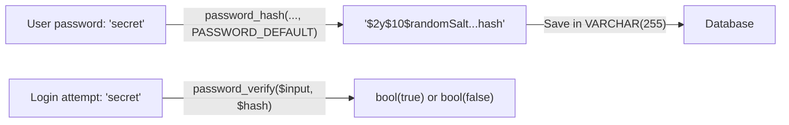

---
tags:
  - php
  - security
  - beginner
---

# Password Hashing

## TL;DR

Storing user passwords as plain text—or with fast hashes like `md5()`—puts every account at risk if your database is leaked. PHP builds slow, salted **password hashing** right into the language with `password_hash()` and `password_verify()`.

> [!NOTE] Prerequisites: 05, 39
> New terms: hash, salt

> [!abstract] Core Idea
> Hash passwords on signup with `password_hash($password, PASSWORD_DEFAULT)` and verify logins with `password_verify($password, $hash)`.
> Unlike Python where you install `bcrypt` or `argon2-cffi`, PHP includes `password_hash()` and `password_verify()` out of the box.

## Mental Model

Think of `password_hash()` like sealing a password inside a tamper-proof safe with a random **salt** mixed in. Because each safe gets a different random **salt**, two readers with the exact same password produce completely different **hash** strings—and `password_verify()` knows how to read the algorithm and salt back out of the stored string to check a login.



- A **hash** is a one-way scrambled string produced from a password; you cannot reverse a hash back into the original password.
- A **salt** is random data mixed into the password before hashing so identical passwords still produce unique hashes.

## Minimal Example

```php
<?php
$password = 'reader-pass-99';
$hash = password_hash($password, PASSWORD_DEFAULT);

echo $hash . PHP_EOL;
var_dump(password_verify('reader-pass-99', $hash));
var_dump(password_verify('wrong-pass', $hash));

if (password_needs_rehash($hash, PASSWORD_DEFAULT)) {
    // Re-hash and save the updated $hash on login
}
```

Expected output (exact hash changes every run):

```text
$2y$10$...60-char-bcrypt-hash...
bool(true)
bool(false)
```

- `password_hash($password, PASSWORD_DEFAULT)` creates a strong one-way **hash** using PHP's current default algorithm (bcrypt) and a random **salt**.
- `password_verify($input, $hash)` extracts the algorithm, cost, and **salt** from `$hash` and compares safely in constant time.
- `password_needs_rehash($hash, PASSWORD_DEFAULT)` checks whether an older stored hash should be upgraded to newer defaults when a user logs in.

> [!warning] Security angle
> Always store `PASSWORD_DEFAULT` hashes in a `VARCHAR(255)` column (not `VARCHAR(60)`), because future PHP versions may switch `PASSWORD_DEFAULT` to a longer algorithm. Never use `md5()`, `sha1()`, or `hash('sha256', ...)` for passwords.

## Compare

| Approach                               | Random Salt Included? | Deliberately Slow?               | Safe for Passwords? |
| -------------------------------------- | --------------------- | -------------------------------- | ------------------- |
| `password_hash(..., PASSWORD_DEFAULT)` | ✓ Automatic           | ✓ Yes (tunable cost)             | ✓ Yes               |
| `md5()` / `sha1()` / `sha256`          | ✗ No                  | ✗ Too fast (easily brute-forced) | ✗ Never             |

## ◈ Edge Case Analysis

✗ **Mistake 1:** Comparing `password_hash($input, PASSWORD_DEFAULT) === $storedHash` always returns `false` because `password_hash()` picks a brand-new random salt each time it runs.

```php
if (password_hash($input, PASSWORD_DEFAULT) === $storedHash) { // Always false!
    // Never matches: password_hash() generates a new salt every time
}
```

✓ **Fix:** Always pass the plain input and the stored hash to `password_verify()`.

```php
if (password_verify($input, $storedHash)) { /* Login OK */ }
```

✗ **Mistake 2:** Using `md5($password)` or `hash('sha256', $password)` lets attackers crack weak passwords at billions of guesses per second.

```php
$bad = hash('sha256', $password); // Fast, unsalted, unsafe for passwords
```

✓ **Fix:** Use `password_hash()` with `PASSWORD_DEFAULT` (or `PASSWORD_ARGON2ID` if compiled in).

```php
$good = password_hash($password, PASSWORD_DEFAULT);
```

✗ **Mistake 3:** Creating a `VARCHAR(60)` database column for `$hash` truncates hashes if PHP upgrades `PASSWORD_DEFAULT` beyond bcrypt, breaking `password_verify()`.

```sql
password_hash VARCHAR(60)  -- Too short for future defaults!
```

✓ **Fix:** Always use `VARCHAR(255)` for the password hash column.

```sql
password_hash VARCHAR(255)
```

## Try It

1. Hash `'my-book-secret'` twice using `password_hash(..., PASSWORD_DEFAULT)` and verify that both strings are different even though the input is identical.
2. Check both hashes against `'my-book-secret'` using `password_verify()` and confirm both return `true`.

<details>
<summary>◈ View Solution</summary>

1. Generating two salted hashes from the same password:

```php
<?php
$h1 = password_hash('my-book-secret', PASSWORD_DEFAULT);
$h2 = password_hash('my-book-secret', PASSWORD_DEFAULT);
var_dump($h1 === $h2); // bool(false)
```

2. Verifying both hashes:

```php
var_dump(password_verify('my-book-secret', $h1)); // bool(true)
var_dump(password_verify('my-book-secret', $h2)); // bool(true)
```

</details>

## Topic Mastery Quiz

**Q1: Why does `password_hash('secret', PASSWORD_DEFAULT)` return a different string every time you call it?**

- [ ] A) It has a random bug
- [ ] B) It generates a fresh random **salt** on every call and embeds it in the output
- [ ] C) It includes the current timestamp
- [ ] D) It changes the user's password

**Q2: Which function checks whether a login password matches a stored hash?**

- [ ] A) `password_check()`
- [ ] B) `password_verify()`
- [ ] C) `password_hash() === $stored`
- [ ] D) `hash_equals()`

**Q3: Do you need a separate `salt` column in your database when using `password_hash()`?**

- [ ] A) Yes, always store the salt separately
- [ ] B) No—the algorithm, cost, and **salt** are already included inside the returned hash string
- [ ] C) Only for `PASSWORD_DEFAULT`
- [ ] D) Only on Windows

**Q4: Why is `VARCHAR(255)` recommended over `VARCHAR(60)` for storing `PASSWORD_DEFAULT` hashes?**

- [ ] A) `password_hash()` pads hashes with spaces
- [ ] B) `PASSWORD_DEFAULT` can change to longer algorithms in future PHP versions, and truncating a hash breaks verification
- [ ] C) SQL requires 255 characters for strings
- [ ] D) `password_verify()` only accepts 255-byte strings

**Q5: Why should you never use `md5()` or `sha256` for user passwords?**

- [ ] A) They are too slow
- [ ] B) They are fast, unsalted general-purpose hashes that attackers can brute-force rapidly
- [ ] C) They were removed from PHP 8.4
- [ ] D) They only accept numbers

**Q6: What does `password_needs_rehash($hash, PASSWORD_DEFAULT)` tell you?**

- [ ] A) Whether the user's password is too short
- [ ] B) Whether `$hash` was created with older algorithm or cost settings and should be re-hashed
- [ ] C) Whether the database is connected
- [ ] D) Whether the password matches the user's email

<details>
<summary>◈ View Answers & Explanations</summary>

1. **B** — `password_hash()` generates a cryptographically random **salt** on each call and stores it inside the hash string so identical passwords never share the same hash. A, C, and D are false.
2. **B** — `password_verify($password, $hash)` extracts the salt/algorithm from `$hash` and performs a timing-safe check. A does not exist, C always fails due to different salts, and D compares two raw hashes without re-running bcrypt.
3. **B** — `password_hash()` packages the algorithm ID, cost, **salt**, and digest into one self-contained string, so one database column is all you need. A, C, and D are false.
4. **B** — While bcrypt hashes are 60 characters, `PASSWORD_DEFAULT` is designed to evolve to stronger algorithms with longer outputs; `VARCHAR(255)` prevents silent truncation. A, C, and D are false.
5. **B** — `md5()` and `sha256` are built for speed on files and checksums, making password guessing vastly easier than slow password-hashing algorithms like bcrypt/Argon2. A, C, and D are false.
6. **B** — `password_needs_rehash()` returns `true` when the stored hash does not match your current algorithm or cost options, letting you upgrade it seamlessly during login. A, C, and D are false.

</details>

## One-Liner

> [!tip] Built-In Password Safety
> **Hash with `password_hash(..., PASSWORD_DEFAULT)`, store in `VARCHAR(255)`, and check logins only with `password_verify()`.**

> [!quote] Sources
>
> - [password_hash - PHP Manual](https://www.php.net/manual/en/function.password-hash.php)
> - [password_verify - PHP Manual](https://www.php.net/manual/en/function.password-verify.php)
> - [password_needs_rehash - PHP Manual](https://www.php.net/manual/en/function.password-needs-rehash.php)
