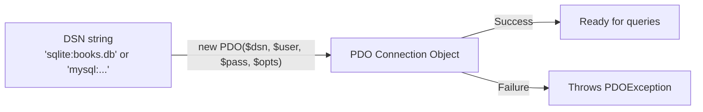

---
tags:
  - php
  - database
  - pdo
  - beginner
---

# PDO Connection

## TL;DR

JSON files work for small demos, but a real Book Tracker needs a database like SQLite or MySQL. **PDO** (PHP Data Objects) gives you one consistent object interface to connect to databases and catch connection failures cleanly.

> [!NOTE] Prerequisites: 23, 31
> New terms: PDO, DSN

> [!abstract] Core Idea
> Open a database connection with `new PDO($dsn, $user, $pass, $options)`, configuring `PDO::ERRMODE_EXCEPTION` and `PDO::FETCH_ASSOC`, and wrap it in `try...catch (PDOException $e)`.
> Like Python's DB-API or Java's JDBC, **PDO** provides one unified API across SQLite, MySQL, and PostgreSQL.

## Mental Model

Think of **PDO** as a universal power adapter for databases. You plug in a **DSN** (the address card saying _which_ database driver and file/host to use), and once `new PDO(...)` succeeds, your queries work the same way whether the backend is a local SQLite file or a MySQL server.



- **PDO** (PHP Data Objects) is PHP's built-in database abstraction layer that works across multiple database engines using one consistent API.
- A **DSN** (Data Source Name) is the connection string that tells PDO which driver, host or file path, database name, and character set to use.

## Minimal Example

```php
<?php
$dsn = 'sqlite:' . __DIR__ . '/books.db';

try {
    $pdo = new PDO($dsn, options: [
        PDO::ATTR_ERRMODE => PDO::ERRMODE_EXCEPTION,
        PDO::ATTR_DEFAULT_FETCH_MODE => PDO::FETCH_ASSOC,
    ]);
    echo 'Connected to Book Tracker DB' . PHP_EOL;
} catch (PDOException $e) {
    error_log($e->getMessage());
    http_response_code(500);
    echo 'Database unavailable.' . PHP_EOL;
}
```

Expected output:

```text
Connected to Book Tracker DB
```

- `'sqlite:' . __DIR__ . '/books.db'` is a **DSN** pointing to a local SQLite database file (for MySQL, it looks like `'mysql:host=localhost;dbname=books;charset=utf8mb4'`).
- `PDO::ATTR_ERRMODE => PDO::ERRMODE_EXCEPTION` ensures database errors throw `PDOException` (already the default since PHP 8.0, shown explicitly for clarity).
- `PDO::ATTR_DEFAULT_FETCH_MODE => PDO::FETCH_ASSOC` makes query rows return as clean associative arrays (`$row['title']`) instead of duplicated numeric + named keys.
- `catch (PDOException $e)` catches connection errors and logs them privately instead of printing database details to the browser.

> [!warning] Security angle
> Never echo `$e->getMessage()` from a `PDOException` to web visitors. Connection error messages can reveal file paths, database hostnames, or usernames—always log them with `error_log()` and show a generic message.

## Compare

| Driver     | Sample **DSN**                                        | Needs `$user` / `$pass`? |
| ---------- | ----------------------------------------------------- | ------------------------ |
| SQLite     | `'sqlite:' . __DIR__ . '/books.db'`                   | ✗ No (uses local file)   |
| MySQL      | `'mysql:host=localhost;dbname=books;charset=utf8mb4'` | ✓ Yes                    |
| PostgreSQL | `'pgsql:host=localhost;dbname=books'`                 | ✓ Yes                    |

## ◈ Edge Case Analysis

✗ **Mistake 1:** Leaving `charset=utf8mb4` out of a MySQL **DSN** can corrupt emojis or non-ASCII book titles.

```php
$dsn = 'mysql:host=localhost;dbname=books'; // Missing charset=utf8mb4
```

✓ **Fix:** Always include `charset=utf8mb4` in MySQL DSNs.

```php
$dsn = 'mysql:host=localhost;dbname=books;charset=utf8mb4';
```

✗ **Mistake 2:** Expecting `PDO::ERRMODE_SILENT` to stop `new PDO(...)` from throwing an exception fails because `PDO::__construct()` _always_ throws `PDOException` when connecting fails.

```php
// Still throws PDOException if connection fails!
$pdo = new PDO($badDsn, options: [PDO::ATTR_ERRMODE => PDO::ERRMODE_SILENT]);
```

✓ **Fix:** Always wrap `new PDO(...)` in `try...catch (PDOException $e)` to handle connection failures gracefully.

```php
try { $pdo = new PDO($dsn); } catch (PDOException $e) { /* handle */ }
```

✗ **Mistake 3:** Hardcoding real database passwords directly inside PHP files committed to Git exposes your credentials.

```php
$pdo = new PDO($dsn, 'root', 'my-real-password'); // Unsafe in Git!
```

✓ **Fix:** Load database credentials from environment variables (`getenv()` / `$_ENV`) or an untracked config file.

```php
$pass = $_ENV['DB_PASS'] ?? '';
```

## Try It

1. Write a `new PDO(...)` connection to an in-memory SQLite database using the **DSN** `'sqlite::memory:'` with `PDO::FETCH_ASSOC` as the default fetch mode.
2. Write the MySQL **DSN** string for host `127.0.0.1`, database `book_tracker`, and UTF-8 (`utf8mb4`) support.

<details>
<summary>◈ View Solution</summary>

1. In-memory SQLite connection:

```php
<?php
$pdo = new PDO('sqlite::memory:', options: [
    PDO::ATTR_ERRMODE => PDO::ERRMODE_EXCEPTION,
    PDO::ATTR_DEFAULT_FETCH_MODE => PDO::FETCH_ASSOC,
]);
echo 'SQLite ready' . PHP_EOL;
```

2. MySQL DSN with `utf8mb4`:

```php
<?php
$dsn = 'mysql:host=127.0.0.1;dbname=book_tracker;charset=utf8mb4';
```

</details>

## Topic Mastery Quiz

**Q1: What does the `$dsn` string in `new PDO($dsn, ...)` specify?**

- [ ] A) The SQL `SELECT` query to run
- [ ] B) The database driver, location/host, database name, and options like charset
- [ ] C) The user's password hash
- [ ] D) The PHP version

**Q2: What exception class does `new PDO(...)` throw if the connection fails?**

- [ ] A) `JsonException`
- [ ] B) `PDOException`
- [ ] C) `ValueError`
- [ ] D) `UnhandledMatchError`

**Q3: What does `PDO::ATTR_DEFAULT_FETCH_MODE => PDO::FETCH_ASSOC` do?**

- [ ] A) Makes queries return rows as associative arrays keyed by column name
- [ ] B) Automatically encrypts all database columns
- [ ] C) Turns off exceptions
- [ ] D) Closes the connection after one query

**Q4: In PHP 8.4, what is the default `PDO::ATTR_ERRMODE`?**

- [ ] A) `PDO::ERRMODE_SILENT`
- [ ] B) `PDO::ERRMODE_WARNING`
- [ ] C) `PDO::ERRMODE_EXCEPTION`
- [ ] D) `PDO::ERRMODE_IGNORE`

**Q5: Why should you never echo `$e->getMessage()` from a `PDOException` directly on a public web page?**

- [ ] A) `PDOException` has no `getMessage()` method
- [ ] B) Database error messages can leak server paths, hostnames, or usernames to visitors
- [ ] C) `echo` crashes PHP inside `catch` blocks
- [ ] D) It deletes the database

**Q6: Which option is recommended in a MySQL **DSN** to support full Unicode and emojis?**

- [ ] A) `charset=latin1`
- [ ] B) `charset=utf8mb4`
- [ ] C) `encoding=ascii`
- [ ] D) `unicode=true`

<details>
<summary>◈ View Answers & Explanations</summary>

1. **B** — The **DSN** (Data Source Name) tells PDO which driver (`sqlite`, `mysql`, `pgsql`), file/host, database name, and charset to connect to. A, C, and D are false.
2. **B** — `PDO::__construct()` always throws a `PDOException` when a connection attempt fails, regardless of `ATTR_ERRMODE`. A, C, and D are unrelated exception/error types.
3. **A** — `PDO::FETCH_ASSOC` returns each row as a clean associative array (`['title' => 'Dune']`) instead of duplicating columns under both numeric and string keys (`FETCH_BOTH`). B, C, and D are false.
4. **C** — Since PHP 8.0, `PDO::ERRMODE_EXCEPTION` is the default error mode in PDO. A was the default prior to PHP 8.0.
5. **B** — Connection and SQL error messages can expose internal paths, hostnames, or usernames; log them privately with `error_log()` instead. A, C, and D are false.
6. **B** — `charset=utf8mb4` supports full 4-byte UTF-8 characters (including emojis and international scripts) in MySQL. A, C, and D are wrong or incomplete.

</details>

## One-Liner

> [!tip] One Interface, Any SQL DB
> **Connect with `new PDO($dsn, ...)` using `FETCH_ASSOC` and `try...catch (PDOException $e)`, and log errors privately.**

> [!quote] Sources
>
> - [PDO::\_\_construct - PHP Manual](https://www.php.net/manual/en/pdo.construct.php)
> - [Connections and Connection management - PHP Manual](https://www.php.net/manual/en/pdo.connections.php)
> - [Errors and error handling - PHP Manual](https://www.php.net/manual/en/pdo.error-handling.php)
