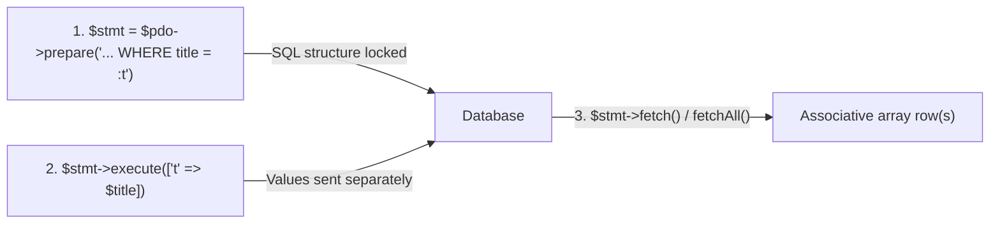

---
tags:
  - php
  - database
  - pdo
  - security
  - beginner
---

# Prepared Statements

## TL;DR

Putting user input straight into an SQL string with string interpolation lets attackers rewrite your query and steal or delete data. **Prepared statements** send the SQL template and the user values separately so user input is always treated as data, never as SQL commands.

> [!NOTE] Prerequisites: 43
> New terms: prepared statement, SQL injection

> [!abstract] Core Idea
> Use `$pdo->prepare($sql)` with `?` or `:name` placeholders, pass values to `$stmt->execute([...])`, and read rows with `fetch()` or `fetchAll()`.
> Like Python's `cursor.execute("... WHERE id = ?", (id,))`, PHP separates the query structure from its values to stop **SQL injection**.

## Mental Model

Think of a **prepared statement** like a fill-in-the-blank library slip. You hand the database the locked form first (`SELECT * FROM books WHERE title = ?`), and then you hand over the user's text separately (`['Dune']`)—even if the user types SQL keywords, they stay inside the blank box and can never change the form itself.



- A **prepared statement** is a pre-parsed SQL template with placeholders (`?` or `:name`) whose values are bound separately at execution time.
- **SQL injection** is an attack where unescaped user input alters the structure of an SQL query (for example, `' OR '1'='1`).

## Minimal Example

```php
<?php
$pdo = new PDO('sqlite::memory:', options: [
    PDO::ATTR_DEFAULT_FETCH_MODE => PDO::FETCH_ASSOC,
]);
$pdo->exec('CREATE TABLE books (id INTEGER PRIMARY KEY, title TEXT, pages INTEGER)');

$insert = $pdo->prepare('INSERT INTO books (title, pages) VALUES (:title, :pages)');
$insert->execute(['title' => 'Dune', 'pages' => 412]);

$select = $pdo->prepare('SELECT title, pages FROM books WHERE pages >= ?');
$select->execute([300]);
print_r($select->fetchAll());
```

Expected output:

```text
Array
(
    [0] => Array
        (
            [title] => Dune
            [pages] => 412
        )
)
```

- `$pdo->prepare('... VALUES (:title, :pages)')` sends the SQL template with named placeholders to the database.
- `$insert->execute(['title' => 'Dune', 'pages' => 412])` binds the values safely and runs the statement.
- `?` is a positional placeholder; `$select->execute([300])` matches values in left-to-right order.
- `$select->fetchAll()` returns all matching rows as an array (or `[]` if none match).

> [!warning] Security angle
> Never concatenate or interpolate `$_GET` or `$_POST` into SQL (`"WHERE title = '$title'"`). Always use **prepared statement** placeholders for values, and allowlist any dynamic column or table names.

## Compare

| Method              | Returns When Rows Found     | Returns When No Rows Found | Best For                               |
| ------------------- | --------------------------- | -------------------------- | -------------------------------------- |
| `$stmt->fetch()`    | One row (associative array) | `false`                    | Single-record lookups (`WHERE id = ?`) |
| `$stmt->fetchAll()` | Array of all rows           | `[]` (empty array)         | Small lists of matching rows           |

## ◈ Edge Case Analysis

✗ **Mistake 1:** Mixing `?` and `:name` placeholders in the same SQL query throws an error because PDO only allows one style per statement.

```php
$stmt = $pdo->prepare('SELECT * FROM books WHERE title = ? AND pages > :pages'); // Error!
```

✓ **Fix:** Pick either positional (`?`) or named (`:name`) placeholders for the entire query.

```php
$stmt = $pdo->prepare('SELECT * FROM books WHERE title = :title AND pages > :pages');
```

✗ **Mistake 2:** Trying to put a placeholder in place of a table name or column name fails because placeholders only hold _values_, not SQL identifiers.

```php
$stmt = $pdo->prepare('SELECT * FROM :table'); // Invalid SQL syntax!
```

✓ **Fix:** Keep table and column names fixed in SQL (or check them against a strict `match` allowlist).

```php
$col = match ($_GET['sort'] ?? 'title') { 'pages' => 'pages', default => 'title' };
```

✗ **Mistake 3:** Treating the return value of `$stmt->fetch()` as an array without checking fails when zero rows match, because `fetch()` returns `false`.

```php
$book = $stmt->fetch();
echo $book['title']; // Warning if no row matched ($book is false)
```

✓ **Fix:** Check `if ($book === false)` (or `if (!$book)`) before reading columns from `fetch()`.

```php
$book = $stmt->fetch();
if ($book !== false) { echo $book['title']; }
```

## Try It

1. Prepare and execute a `SELECT` query with `:title` to find a single book from `$pdo`, then handle the case where `fetch()` returns `false`.
2. Prepare an `UPDATE books SET pages = ? WHERE id = ?` statement and execute it with `(450, 1)`.

<details>
<summary>◈ View Solution</summary>

1. Single-row lookup with `fetch()` check:

```php
<?php
$stmt = $pdo->prepare('SELECT title, pages FROM books WHERE title = :title');
$stmt->execute(['title' => 'Dune']);
$book = $stmt->fetch();

echo ($book !== false) ? $book['title'] : 'Not found';
```

2. Positional `UPDATE`:

```php
<?php
$stmt = $pdo->prepare('UPDATE books SET pages = ? WHERE id = ?');
$stmt->execute([450, 1]);
```

</details>

## Topic Mastery Quiz

**Q1: How do prepared statements prevent SQL injection?**

- [ ] A) They delete all quotes from user input
- [ ] B) They send the SQL structure and the parameter values separately so values are never parsed as SQL commands
- [ ] C) They encrypt the database file
- [ ] D) They convert all inputs to lowercase

**Q2: What does `$stmt->fetch()` return when no rows match the query?**

- [ ] A) `[]`
- [ ] B) `null`
- [ ] C) `false`
- [ ] D) It throws a `PDOException`

**Q3: What does `$stmt->fetchAll()` return when no rows match the query?**

- [ ] A) `false`
- [ ] B) `[]` (an empty array)
- [ ] C) `null`
- [ ] D) `0`

**Q4: Can you mix `?` and `:name` placeholders in a single `prepare()` call?**

- [ ] A) Yes, in any order
- [ ] B) No—you must use either `?` or `:name` placeholders in one statement
- [ ] C) Only in `INSERT` queries
- [ ] D) Only in SQLite

**Q5: Why does `$pdo->prepare('SELECT * FROM ?')` fail?**

- [ ] A) SQLite does not support `SELECT *`
- [ ] B) Placeholders can only represent column/filter _values_, never table or column identifiers
- [ ] C) `?` only works with integers
- [ ] D) `prepare()` does not accept `SELECT`

**Q6: Which call executes `$stmt = $pdo->prepare('SELECT * FROM books WHERE id = :id');`?**

- [ ] A) `$stmt->execute([1])`
- [ ] B) `$stmt->execute(['id' => 1])`
- [ ] C) `$pdo->query(['id' => 1])`
- [ ] D) `$stmt->fetch(['id' => 1])`

<details>
<summary>◈ View Answers & Explanations</summary>

1. **B** — `prepare()` compiles the SQL template first, and `execute()` binds values separately as data rather than SQL syntax. A, C, and D are false.
2. **C** — `PDOStatement::fetch()` returns `false` when there are no more rows (whereas `fetchAll()` returns `[]`). A, B, and D are false.
3. **B** — `PDOStatement::fetchAll()` always returns an array—empty `[]` when zero rows match. A, C, and D are false.
4. **B** — PDO forbids mixing positional (`?`) and named (`:name`) placeholders in the same SQL statement. A, C, and D are false.
5. **B** — Prepared statement placeholders only bind data values (like `'Dune'` or `412`), never table names, column names, or SQL keywords. A, C, and D are false.
6. **B** — Named placeholder `:id` expects an associative array `['id' => 1]` in `execute()`. A is for `?`, and C/D are wrong methods.

</details>

## One-Liner

> [!tip] Data Never Becomes SQL
> **Always `prepare()` SQL with `?` or `:name` placeholders and pass user values to `execute([...])`.**

> [!quote] Sources
>
> - [PDO::prepare - PHP Manual](https://www.php.net/manual/en/pdo.prepare.php)
> - [PDOStatement::execute - PHP Manual](https://www.php.net/manual/en/pdostatement.execute.php)
> - [PDOStatement::fetch - PHP Manual](https://www.php.net/manual/en/pdostatement.fetch.php)
