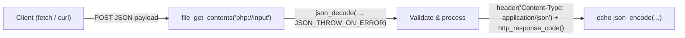

---
tags:
  - php
  - api
  - json
  - beginner
---

# Building a JSON API

## TL;DR

Instead of returning HTML pages for humans, a **JSON API** lets your Book Tracker serve structured data to JavaScript frontends or mobile apps. In PHP, one **endpoint** script reads JSON from `php://input`, sets a `Content-Type: application/json` header and **status code**, and echoes `json_encode()`.

> [!NOTE] Prerequisites: 21, 37, 38
> New terms: endpoint, payload

> [!abstract] Core Idea
> Build a PHP JSON **endpoint** by reading the raw **payload** from `php://input`, setting `header('Content-Type: application/json')` and `http_response_code()`, and printing `json_encode(...)`.
> Like a Flask route using `request.get_json()` and `jsonify()`, PHP handles JSON APIs cleanly once you remember to read `php://input` instead of `$_POST`.

## Mental Model

Think of an API **endpoint** as an automated book-drop window. A client slides a JSON **payload** through the slot (`php://input`), PHP validates it and picks a **status code** (`200`, `201`, or `400`), stamps the envelope `Content-Type: application/json`, and slides a JSON response back out.



- An **endpoint** is a server URL (such as `/api/books.php`) that accepts HTTP requests and returns a structured response, usually JSON.
- A **payload** is the raw data body sent inside an HTTP request or response.

## Minimal Example

```php
<?php
header('Content-Type: application/json; charset=utf-8');

$method = $_SERVER['REQUEST_METHOD'] ?? 'GET';
if ($method === 'POST') {
    try {
        $data = json_decode(file_get_contents('php://input'), true, flags: JSON_THROW_ON_ERROR);
        $title = trim($data['title'] ?? '');
        if ($title === '') {
            http_response_code(400);
            echo json_encode(['error' => 'Title is required'], JSON_THROW_ON_ERROR);
            exit;
        }
        http_response_code(201);
        echo json_encode(['created' => $title], JSON_THROW_ON_ERROR);
    } catch (JsonException) {
        http_response_code(400);
        echo json_encode(['error' => 'Invalid JSON payload'], JSON_THROW_ON_ERROR);
    }
}
```

- `header('Content-Type: application/json; charset=utf-8')` tells clients the response body is JSON, not HTML.
- `file_get_contents('php://input')` reads the raw JSON request **payload** because `$_POST` is empty for `application/json` requests.
- `http_response_code(201)` sets `201 Created` on success, or `400` (`Bad Request`) when JSON is invalid or `title` is missing.
- `catch (JsonException)` catches malformed JSON and returns a clean JSON error instead of crashing with HTML output.

> [!warning] Security angle
> Keep `display_errors` off (`'0'`) in production so PHP warnings never leak server paths or break your JSON output. Always return structured JSON error messages (`['error' => '...']`) instead of raw exception traces.

## Compare

| Aspect                | HTML Page             | JSON API **Endpoint**                   |
| --------------------- | --------------------- | --------------------------------------- |
| `Content-Type` header | `text/html` (default) | `application/json; charset=utf-8`       |
| Input source (`POST`) | `$_POST`              | `file_get_contents('php://input')`      |
| Output escaping       | `htmlspecialchars()`  | `json_encode(..., JSON_THROW_ON_ERROR)` |

## ◈ Edge Case Analysis

✗ **Mistake 1:** Reading `$_POST['title']` in a JSON API returns nothing because PHP leaves `$_POST` empty for `Content-Type: application/json`.

```php
$title = $_POST['title'] ?? ''; // Empty when client sends JSON!
```

✓ **Fix:** Read the raw body from `php://input` and decode it with `json_decode(..., true, flags: JSON_THROW_ON_ERROR)`.

```php
$data = json_decode(file_get_contents('php://input'), true, flags: JSON_THROW_ON_ERROR);
```

✗ **Mistake 2:** Wrapping strings in `htmlspecialchars()` before calling `json_encode()` turns `&` into `&amp;` inside your JSON data.

```php
echo json_encode(['title' => htmlspecialchars('Dune & Messiah')]); // Corrupts text!
```

✓ **Fix:** Pass clean strings to `json_encode()`; JSON encoding handles its own escaping.

```php
echo json_encode(['title' => 'Dune & Messiah'], JSON_THROW_ON_ERROR);
```

✗ **Mistake 3:** Echoing any text, HTML, or blank line before `header('Content-Type: application/json')` breaks JSON parsing on the client and triggers _"headers already sent"_.

```php
// Leading space before <?php breaks headers and makes invalid JSON!
```

✓ **Fix:** Start the file cleanly with `<?php` on line 1, call `header()` and `http_response_code()` first, and emit only valid JSON.

```php
<?php
header('Content-Type: application/json; charset=utf-8');
```

## Try It

1. Write a `GET` handler that sets `Content-Type: application/json`, sets `http_response_code(200)`, and echoes `['books' => [['title' => 'Dune', 'pages' => 412]]]` as JSON.
2. Return a `405` (`Method Not Allowed`) JSON response `['error' => 'Method not allowed']` if `$_SERVER['REQUEST_METHOD']` is neither `'GET'` nor `'POST'`.

<details>
<summary>◈ View Solution</summary>

1. Returning a JSON list on `GET`:

```php
<?php
header('Content-Type: application/json; charset=utf-8');
$method = $_SERVER['REQUEST_METHOD'] ?? 'GET';

if ($method === 'GET') {
    http_response_code(200);
    echo json_encode([
        'books' => [['title' => 'Dune', 'pages' => 412]],
    ], JSON_THROW_ON_ERROR);
    exit;
}
```

2. Handling unsupported HTTP methods:

```php
http_response_code(405);
echo json_encode(['error' => 'Method not allowed'], JSON_THROW_ON_ERROR);
```

</details>

## Topic Mastery Quiz

**Q1: Which header should a PHP JSON API endpoint send before outputting JSON?**

- [ ] A) `header('Content-Type: text/html')`
- [ ] B) `header('Content-Type: application/json; charset=utf-8')`
- [ ] C) `header('Location: /json')`
- [ ] D) `header('Accept: json')`

**Q2: How do you read a JSON request body sent to a PHP endpoint?**

- [ ] A) `$_POST`
- [ ] B) `$_GET`
- [ ] C) `file_get_contents('php://input')`
- [ ] D) `$_JSON`

**Q3: Which HTTP status code is best when a `POST` endpoint successfully creates a new book?**

- [ ] A) `201`
- [ ] B) `400`
- [ ] C) `404`
- [ ] D) `500`

**Q4: What happens if you call `htmlspecialchars()` on a book title before passing it to `json_encode()`?**

- [ ] A) It makes JSON safer
- [ ] B) It corrupts characters like `&` and `"` into `&amp;` and `&quot;` inside the JSON string
- [ ] C) `json_encode()` strips the HTML entities automatically
- [ ] D) It throws a `JsonException`

**Q5: What should your endpoint do when `json_decode(file_get_contents('php://input'), true, flags: JSON_THROW_ON_ERROR)` throws a `JsonException`?**

- [ ] A) Let PHP print a full stack trace in HTML
- [ ] B) Catch `JsonException`, set `http_response_code(400)`, and echo a JSON error object
- [ ] C) Return `http_response_code(200)` with an empty string
- [ ] D) Redirect to `index.html`

**Q6: Why is `php -S localhost:8000` helpful while building your JSON API?**

- [ ] A) It lets you test real HTTP `GET` and `POST` requests locally without installing Apache or Nginx
- [ ] B) It automatically generates your database tables
- [ ] C) It converts `$_POST` into JSON automatically
- [ ] D) It disables `JsonException`

<details>
<summary>◈ View Answers & Explanations</summary>

1. **B** — `Content-Type: application/json; charset=utf-8` tells clients to parse the response as UTF-8 JSON. A sets HTML, C redirects, and D is a request header.
2. **C** — Raw JSON payloads are not parsed into `$_POST` (A) or `$_GET` (B), and `$_JSON` (D) does not exist; read `file_get_contents('php://input')` instead.
3. **A** — `201` (`Created`) indicates a new resource was created. `400` (B) is Bad Request, `404` (C) is Not Found, and `500` (D) is Internal Server Error.
4. **B** — `htmlspecialchars()` is for HTML output only; using it before `json_encode()` leaves literal `&amp;` entities in your API data. A, C, and D are false.
5. **B** — Catching `JsonException`, setting `400`, and returning `json_encode(['error' => '...'])` keeps the API response valid JSON even on bad client input. A breaks JSON clients, and C/D are wrong.
6. **A** — `php -S localhost:8000` spins up PHP's built-in development server so you can test HTTP endpoints locally right away. B, C, and D are false.

</details>

## One-Liner

> [!tip] Clean JSON Endpoints
> **Read `php://input`, set `Content-Type: application/json` and `http_response_code()`, and always return JSON—even on errors.**

> [!quote] Sources
>
> - [json_encode - PHP Manual](https://www.php.net/manual/en/function.json-encode.php)
> - [header - PHP Manual](https://www.php.net/manual/en/function.header.php)
> - [$\_POST - PHP Manual](https://www.php.net/manual/en/reserved.variables.post.php)
