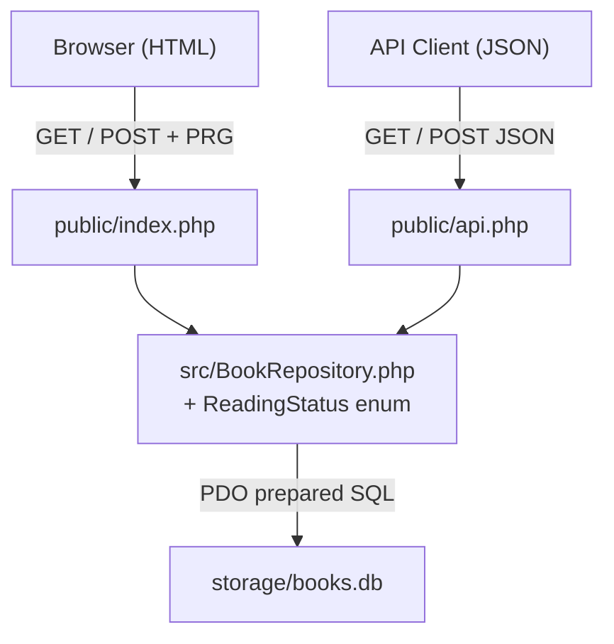

---
tags:
  - php
  - overview
  - capstone
  - beginner
---

# Overview: Capstone — Book Tracker

## TL;DR

This final folder brings the entire curriculum together into one working **Book Tracker** web app: **PSR-4** autoloading, a `ReadingStatus` backed **enum**, SQLite storage in `BookRepository`, **CRUD** forms with **PRG**, and a JSON API **endpoint**.

> [!NOTE] Prerequisites: 46, 47, 48
> New terms: None (all terms introduced in notes 46 through 48)

> [!abstract] Core Idea
> Keep `src/` and `storage/books.db` outside `public/`, share `BookRepository` between your HTML (`index.php`) and JSON (`api.php`) entry points, and format/escape strictly at each output edge.
> Like a clean Python or Node MVC split, separating storage (`BookRepository`) from presentation (`index.php` vs `api.php`) keeps SQL, validation, and escaping in their proper places.

## Concept Map

## Folder Cheat Sheet

| Note                                 | Core Component                                          | Key Rule to Remember                                                            |
| ------------------------------------ | ------------------------------------------------------- | ------------------------------------------------------------------------------- |
| `46. Book Tracker Setup & Storage`   | `public/`, `src/`, `storage/books.db`, `ReadingStatus`  | Serve `php -S localhost:8000 -t public`; keep `books.db` outside `public/`      |
| `47. Book Tracker CRUD & Validation` | `add()`, `all()`, `updateStatus()`, `delete()`, **PRG** | Validate `$_POST` in PHP, use `tryFrom()`, redirect with `exit;`, escape HTML   |
| `48. Book Tracker JSON & Polish`     | `public/api.php`, `php://input`, `Throwable` catch      | Never call `htmlspecialchars()` in `api.php`; catch `Throwable` and return JSON |

## Boss Quiz

**Q1: Why is `storage/books.db` placed outside `public/` when running `php -S localhost:8000 -t public`?**

- [ ] A) SQLite refuses to open files inside `public/`
- [ ] B) Keeping `books.db` outside the document root prevents anyone from downloading your raw database over HTTP
- [ ] C) Composer deletes `.db` files inside `public/`
- [ ] D) `vendor/autoload.php` requires `storage/`

**Q2: What happens if a `POST` form handler in `public/index.php` renders HTML directly without `header('Location: /'); exit;`?**

- [ ] A) Clicking Refresh in the browser re-submits the `POST` and inserts a duplicate book
- [ ] B) `BookRepository` deletes the table
- [ ] C) `htmlspecialchars()` stops working
- [ ] D) `PDO` switches to `ERRMODE_SILENT`

**Q3: Why does `BookRepository` use `ReadingStatus::tryFrom($_POST['status'] ?? '')` instead of `ReadingStatus::from(...)`?**

- [ ] A) `tryFrom()` returns `null` on invalid input instead of crashing with an uncaught `ValueError`
- [ ] B) `from()` does not exist on string-backed enums
- [ ] C) `tryFrom()` runs an SQL `SELECT`
- [ ] D) `tryFrom()` escapes HTML

**Q4: Why should `public/index.php` use `htmlspecialchars()` while `public/api.php` must NOT?**

- [ ] A) `api.php` cannot call built-in string functions
- [ ] B) `index.php` outputs HTML (needs **HTML escaping** against **XSS**), whereas `api.php` outputs JSON (where `&amp;` would corrupt the data)
- [ ] C) `json_encode()` escapes HTML tags into `<script>`
- [ ] D) `PDO` already escapes HTML

**Q5: What should `public/api.php` do if a `PDOException` or `Error` occurs while handling a request?**

- [ ] A) Print the raw `$e->getMessage()` in HTML - [ ] B) Catch `Throwable $e`, log it with `error_log()`, set `http_response_code(500)`, and return `json_encode(['error' => 'Server error'])`
- [ ] C) Return `200 OK` with an empty body
- [ ] D) Redirect to `/index.php`

**Q6: Which PowerShell command runs a quick `POST` smoke test against your running `api.php`?**

- [ ] A) `php -l public/api.php`
- [ ] B) `Invoke-RestMethod -Method Post -Uri http://localhost:8000/api.php -ContentType 'application/json' -Body '{"title":"Dune","pages":412}'`
- [ ] C) `composer dump-autoload`
- [ ] D) `php -r 'echo $_POST;'`

◈ View Answers & Explanations

1. **B** - Files inside the `-t public` document root are directly reachable over HTTP, so keeping `books.db` in `storage/` protects it from direct download. A, C, and D are false.

2. **A** - Without **PRG** (`header('Location: /'); exit;`), refreshing the browser repeats the last `POST` request and duplicates the action. B, C, and D are false.

3. **A** - `tryFrom()` safely returns `null` for tampered or unknown status strings so you can fall back or show a validation error cleanly. B, C, and D are false.

4. **B** - HTML templates must escape strings with `htmlspecialchars()` to prevent **XSS**, while JSON APIs must encode raw strings via `json_encode()`. A, C, and D are false.

5. **B** - Catching `Throwable` logs the real cause privately and guarantees the API client still receives valid JSON with a `500` status code. A leaks internals and breaks JSON parsing, and C/D are wrong.

6. **B** - `Invoke-RestMethod -Method Post ...` sends a real HTTP `POST` with a JSON **payload** to test `api.php` end-to-end. A checks syntax only, C rebuilds autoloading, and D runs CLI without HTTP.

> [!quote] Sources
>
> - [Built-in web server - PHP Manual](https://www.php.net/manual/en/features.commandline.webserver.php)
> - [PDO::prepare - PHP Manual](https://www.php.net/manual/en/pdo.prepare.php)
> - [json_encode - PHP Manual](https://www.php.net/manual/en/function.json-encode.php)
