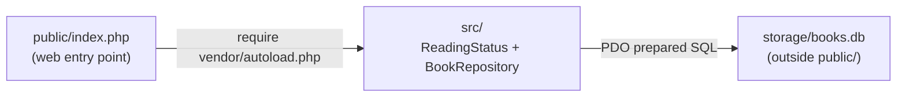

---
tags:
  - php
  - capstone
  - pdo
  - beginner
---

# Book Tracker Setup & Storage

## TL;DR

Before adding forms or API routes, your Book Tracker needs a clean folder layout and a reliable place to store books. In this first capstone step, you wire up **PSR-4** autoloading with Composer, model reading status with a backed **enum**, and create a SQLite **repository** using **PDO**.

> [!NOTE] Prerequisites: 27, 34, 43
> New terms: repository

> [!abstract] Core Idea
> Separate public web files (`public/`) from PHP classes (`src/`) and SQLite storage (`storage/`), and wrap database setup inside a `BookRepository` class.
> Like a Python package layout (`src/` + `sqlite3`), keeping database code in one **repository** class keeps SQL out of your HTML templates.

## Mental Model

Think of your project folders like a bookstore: `public/` is the front counter visitors can see, `src/` is the staff-only back office holding your `BookRepository` and `ReadingStatus` **enum**, and `storage/books.db` is the locked filing cabinet.



- A **repository** is a class whose only job is reading and writing a specific type of record (here, books) to and from storage.

## Minimal Example

```php
<?php
declare(strict_types=1);
namespace BookTracker;

use PDO;

enum ReadingStatus: string
{
    case Unread = 'unread';
    case Reading = 'reading';
    case Done = 'done';
}

class BookRepository
{
    public function __construct(private PDO $pdo)
    {
        $this->pdo->exec(
            'CREATE TABLE IF NOT EXISTS books (
                id INTEGER PRIMARY KEY AUTOINCREMENT,
                title TEXT NOT NULL,
                pages INTEGER NOT NULL,
                status TEXT NOT NULL
            )'
        );
    }
}
```

- `declare(strict_types=1);` enables **strict mode** for types across the file.
- `enum ReadingStatus: string` restricts book status to `'unread'`, `'reading'`, or `'done'`.
- `BookRepository` accepts a `PDO` connection via constructor property promotion (`private PDO $pdo`).
- `CREATE TABLE IF NOT EXISTS books (...)` safely creates the table on first run and does nothing if it already exists.

> [!warning] Security angle
> Always place `books.db` inside a `storage/` folder _outside_ `public/`, and point `php -S localhost:8000 -t public` at `public/`. Putting `books.db` inside `public/` lets anyone download your raw database file over HTTP.

## Compare

| Folder / File            | Purpose                            | Exposed via Web Server? |
| ------------------------ | ---------------------------------- | ----------------------- |
| `public/index.php`       | Web entry point & HTML/API routes  | ✓ Yes (`-t public`)     |
| `src/BookRepository.php` | **PSR-4** classes & database logic | ✗ No                    |
| `storage/books.db`       | SQLite database file               | ✗ No                    |

## ◈ Edge Case Analysis

✗ **Mistake 1:** Running `CREATE TABLE books (...)` without `IF NOT EXISTS` crashes on the second request with `SQLSTATE[HY000]: General error: 1 table books already exists`.

```php
$this->pdo->exec('CREATE TABLE books (id INTEGER PRIMARY KEY)'); // Fails on 2nd run!
```

✓ **Fix:** Always include `IF NOT EXISTS` in setup schema queries.

```php
$this->pdo->exec('CREATE TABLE IF NOT EXISTS books (...)');
```

✗ **Mistake 2:** Placing `books.db` in the same `public/` folder as `index.php` lets visitors download `http://localhost:8000/books.db`.

```text
public/index.php
public/books.db   <-- Publicly downloadable!
```

✓ **Fix:** Keep `books.db` one level up in `storage/books.db` and serve only `public/`.

```powershell
php -S localhost:8000 -t public
```

✗ **Mistake 3:** Adding `src/BookRepository.php` under `namespace BookTracker;` without running `composer dump-autoload` after editing `composer.json` causes `Class "BookTracker\BookRepository" not found`.

```json
"autoload": { "psr-4": { "BookTracker\\": "src/" } }
```

✓ **Fix:** Run `composer dump-autoload` once after adding the `"psr-4"` rule in `composer.json`.

```powershell
composer dump-autoload
```

## Try It

1. Write a `composer.json` `"autoload"` block that maps `"BookTracker\\"` to `"src/"`.
2. Write the PHP snippet to create a `PDO` connection to `__DIR__ . '/../storage/books.db'` with `PDO::ERRMODE_EXCEPTION` and `PDO::FETCH_ASSOC`, then pass it to `new BookRepository($pdo)`.

<details>
<summary>◈ View Solution</summary>

1. `composer.json` autoload configuration:

```json
{
  "autoload": {
    "psr-4": {
      "BookTracker\\": "src/"
    }
  }
}
```

2. Connecting to SQLite and creating `BookRepository`:

```php
<?php
require __DIR__ . '/../vendor/autoload.php';

$pdo = new PDO('sqlite:' . __DIR__ . '/../storage/books.db', options: [
    PDO::ATTR_ERRMODE => PDO::ERRMODE_EXCEPTION,
    PDO::ATTR_DEFAULT_FETCH_MODE => PDO::FETCH_ASSOC,
]);

$repo = new BookTracker\BookRepository($pdo);
```

</details>

## Topic Mastery Quiz

**Q1: Why should `books.db` live in `storage/` instead of `public/` when running `php -S localhost:8000 -t public`?**

- [ ] A) SQLite cannot open files inside `public/`
- [ ] B) Anything inside `public/` can be downloaded directly by a browser over HTTP
- [ ] C) Composer deletes `.db` files inside `public/`
- [ ] D) `PDO` only reads from `storage/`

**Q2: What does `CREATE TABLE IF NOT EXISTS books (...)` prevent?**

- [ ] A) SQL injection
- [ ] B) A database error on the second request when the `books` table already exists
- [ ] C) Invalid `ReadingStatus` values
- [ ] D) Missing `vendor/autoload.php`

**Q3: Why model book status with `enum ReadingStatus: string` instead of plain strings?**

- [ ] A) SQLite does not support strings
- [ ] B) It restricts status values to the exact allowed cases (`Unread`, `Reading`, `Done`)
- [ ] C) Enums automatically create HTML forms
- [ ] D) Backed enums skip `PDO`

**Q4: What is the role of `BookRepository`?**

- [ ] A) Rendering CSS styles
- [ ] B) Keeping all database reads and writes for books in one dedicated class
- [ ] C) Installing Composer packages
- [ ] D) Hashing user passwords

**Q5: What does `-t public` do in `php -S localhost:8000 -t public`?**

- [ ] A) Sets the **timezone** to `public`
- [ ] B) Sets `public/` as the web server's document root folder
- [ ] C) Runs PHP tests in `public/`
- [ ] D) Enables `display_errors`

**Q6: After adding `"psr-4": { "BookTracker\\": "src/" }` to `composer.json`, which command updates `vendor/autoload.php`?**

- [ ] A) `composer require BookTracker`
- [ ] B) `composer dump-autoload`
- [ ] C) `php -l composer.json`
- [ ] D) `composer lock`

<details>
<summary>◈ View Answers & Explanations</summary>

1. **B** — The web server's document root (`public/`) serves static files directly, so keeping `books.db` outside `public/` protects it from being downloaded. A, C, and D are false.
2. **B** — `IF NOT EXISTS` tells SQLite to create the table only when it is missing, avoiding an "already exists" error on later requests. A, C, and D are false.
3. **B** — A backed **enum** guarantees only valid statuses (`'unread'`, `'reading'`, `'done'`) are accepted in your PHP code. A, C, and D are false.
4. **B** — A **repository** encapsulates database persistence for books so your routes and templates stay clean. A, C, and D are false.
5. **B** — The `-t` flag sets the document root directory for PHP's built-in development server. A, C, and D are false.
6. **B** — `composer dump-autoload` regenerates `vendor/autoload.php` with your updated `"psr-4"` namespace mappings. A, C, and D are wrong.

</details>

## One-Liner

> [!tip] Clean Foundation
> **Serve only `public/`, keep `src/` and `storage/` outside it, and isolate SQLite setup in a `BookRepository`.**

> [!quote] Sources
>
> - [PDO::\_\_construct - PHP Manual](https://www.php.net/manual/en/pdo.construct.php)
> - [Backed enumerations - PHP Manual](https://www.php.net/manual/en/language.enumerations.backed.php)
