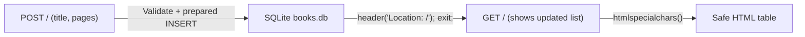

---
tags:
  - php
  - capstone
  - pdo
  - security
  - beginner
---

# Book Tracker CRUD & Validation

## TL;DR

Now that your database table is ready, your Book Tracker needs to add, list, update, and delete books safely. In this step, you add **CRUD** methods to `BookRepository` using prepared statements, validate form inputs, escape HTML output, and use **PRG** so refreshing the page never creates duplicate books.

> [!NOTE] Prerequisites: 39, 44, 46
> New terms: CRUD, PRG (Post-Redirect-Get)

> [!abstract] Core Idea
> Implement **CRUD** methods on `BookRepository` with **PDO** prepared statements, validate `$_POST` inputs in PHP, escape output with `htmlspecialchars()`, and redirect after every `POST` (**PRG**).
> Like a Flask or Django form view, redirecting with `302` after a successful `POST` keeps browser refreshes from re-submitting the form.

## Mental Model

Think of **PRG (Post-Redirect-Get)** like dropping a book request slip in a box (`POST`), getting a receipt that walks you back to the main shelf (`Location: /` redirect), and viewing the updated shelf (`GET`). If you hit Refresh on the shelf, you only repeat the harmless `GET`, never the `POST`.



- **CRUD** stands for the four core data operations: Create (`INSERT`), Read (`SELECT`), Update (`UPDATE`), and Delete (`DELETE`).
- **PRG (Post-Redirect-Get)** is a web pattern where a `POST` form handler redirects to a `GET` URL (`header('Location: ...'); exit;`) so refreshing the browser does not re-submit the form.

## Minimal Example

```php
<?php
// Inside BookRepository:
public function add(string $title, int $pages, ReadingStatus $status): void
{
    $stmt = $this->pdo->prepare(
        'INSERT INTO books (title, pages, status) VALUES (:title, :pages, :status)'
    );
    $stmt->execute([
        'title' => $title,
        'pages' => $pages,
        'status' => $status->value,
    ]);
}

public function all(): array
{
    return $this->pdo->query('SELECT id, title, pages, status FROM books ORDER BY id DESC')
        ->fetchAll();
}
```

- `add()` binds `:title`, `:pages`, and `$status->value` through a **prepared statement** so SQL injection is impossible.
- `all()` fetches every row as an associative array (using `PDO::FETCH_ASSOC` configured in Note 46).
- In `public/index.php`, after validating `trim($_POST['title'] ?? '') !== ''` and `(int) ($_POST['pages'] ?? 0) > 0`, you call `$repo->add(...)` and immediately run `header('Location: /'); exit;`.

> [!warning] Security angle
> Validate every `$_POST` field on the server (`$title !== ''`, `$pages > 0`, `ReadingStatus::tryFrom(...)`), use prepared statements for all SQL (`INSERT`, `UPDATE`, `DELETE`), and wrap every displayed title in `htmlspecialchars($book['title'], ENT_QUOTES, 'UTF-8')`.

## Compare

| **CRUD** Operation | SQL Statement                                      | Bound Parameters           |
| ------------------ | -------------------------------------------------- | -------------------------- |
| Create             | `INSERT INTO books (...) VALUES (...)`             | `title`, `pages`, `status` |
| Read               | `SELECT id, title, pages, status FROM books`       | None (or search filter)    |
| Update             | `UPDATE books SET status = :status WHERE id = :id` | `status`, `id`             |
| Delete             | `DELETE FROM books WHERE id = :id`                 | `id`                       |

## ◈ Edge Case Analysis

✗ **Mistake 1:** Rendering HTML directly at the end of a `POST` request without redirecting causes the browser's Refresh button to re-submit the `POST` and insert duplicate books.

```php
if ($_SERVER['REQUEST_METHOD'] === 'POST') {
    $repo->add($title, $pages, $status);
    // Forgot header('Location: /'); exit; !
}
```

✓ **Fix:** Always redirect with `header('Location: /'); exit;` right after a successful `POST` (**PRG**).

```php
$repo->add($title, $pages, $status);
header('Location: /');
exit;
```

✗ **Mistake 2:** Using `ReadingStatus::from($_POST['status'])` on form input throws an uncaught `ValueError` if a visitor tampers with the `<select>` value.

```php
$status = ReadingStatus::from($_POST['status'] ?? ''); // Throws ValueError on bad input!
```

✓ **Fix:** Use `ReadingStatus::tryFrom(...)` with `??` (or return a validation error if `null`).

```php
$status = ReadingStatus::tryFrom($_POST['status'] ?? '') ?? ReadingStatus::Unread;
```

✗ **Mistake 3:** Printing `$book['title']` in your HTML list without `htmlspecialchars()` exposes your app to stored **XSS** if someone saves `<script>` as a book title.

```php
<li><?= $book['title'] ?></li>  <!-- Stored XSS! -->
```

✓ **Fix:** Always escape every database string rendered in HTML.

```php
<li><?= htmlspecialchars($book['title'], ENT_QUOTES, 'UTF-8') ?></li>
```

## Try It

1. Write `updateStatus(int $id, ReadingStatus $status): void` and `delete(int $id): void` methods for `BookRepository` using prepared statements.
2. Write the server-side validation check for `$title = trim($_POST['title'] ?? '')` and `$pages = (int) ($_POST['pages'] ?? 0)` before calling `$repo->add(...)`.

<details>
<summary>◈ View Solution</summary>

1. `updateStatus()` and `delete()` methods:

```php
public function updateStatus(int $id, ReadingStatus $status): void
{
    $stmt = $this->pdo->prepare('UPDATE books SET status = :status WHERE id = :id');
    $stmt->execute(['status' => $status->value, 'id' => $id]);
}

public function delete(int $id): void
{
    $stmt = $this->pdo->prepare('DELETE FROM books WHERE id = :id');
    $stmt->execute(['id' => $id]);
}
```

2. Server-side validation before `add()` + **PRG** redirect:

```php
<?php
$title = trim($_POST['title'] ?? '');
$pages = (int) ($_POST['pages'] ?? 0);
$status = ReadingStatus::tryFrom($_POST['status'] ?? '') ?? ReadingStatus::Unread;

if ($title !== '' && $pages > 0) {
    $repo->add($title, $pages, $status);
    header('Location: /');
    exit;
}
```

</details>

## Topic Mastery Quiz

**Q1: What problem does PRG (Post-Redirect-Get) solve in a PHP web form?**

- [ ] A) SQL injection
- [ ] B) Duplicate form submissions when the user clicks Refresh after a `POST`
- [ ] C) Missing `vendor/autoload.php`
- [ ] D) Unescaped HTML tags

**Q2: Why should you use `ReadingStatus::tryFrom($_POST['status'] ?? '')` instead of `ReadingStatus::from(...)` on user input?**

- [ ] A) `tryFrom()` returns `null` instead of throwing a `ValueError` when the input is invalid
- [ ] B) `from()` does not exist on backed enums
- [ ] C) `tryFrom()` escapes HTML automatically
- [ ] D) `tryFrom()` saves directly to SQLite

**Q3: Which four operations does CRUD stand for?**

- [ ] A) Connect, Run, Undo, Disconnect
- [ ] B) Create, Read, Update, Delete
- [ ] C) Compile, Route, Upload, Debug
- [ ] D) Check, Redirect, Use, Dump

**Q4: What must you always call right after `header('Location: /');` in a `POST` handler?**

- [ ] A) `session_destroy();`
- [ ] B) `exit;`
- [ ] C) `var_dump($_POST);`
- [ ] D) `return false;`

**Q5: How do you safely render `$book['title']` inside an HTML `<li>` tag?**

- [ ] A) `<li><?= $book['title'] ?></li>`
- [ ] B) `<li><?= htmlspecialchars($book['title'], ENT_QUOTES, 'UTF-8') ?></li>`
- [ ] C) `<li><?= json_encode($book['title']) ?></li>`
- [ ] D) `<li><?= trim($book['title']) ?></li>`

**Q6: Why do `add()`, `updateStatus()`, and `delete()` use `$pdo->prepare(...)` + `$stmt->execute([...])`?**

- [ ] A) To prevent **SQL injection** by keeping SQL structure separate from user values
- [ ] B) Because SQLite does not support `INSERT` without `prepare()`
- [ ] C) To convert integers into strings
- [ ] D) To skip `header('Location: /')`

<details>
<summary>◈ View Answers & Explanations</summary>

1. **B** — Redirecting to a `GET` page after a `POST` ensures that pressing Refresh only reloads the `GET` view instead of re-sending the `POST` data. A, C, and D are solved by prepared statements, Composer, and `htmlspecialchars()`.
2. **A** — `tryFrom()` safely returns `null` on unknown values so you can handle invalid input cleanly, whereas `from()` throws a `ValueError`. B, C, and D are false.
3. **B** — **CRUD** stands for Create (`INSERT`), Read (`SELECT`), Update (`UPDATE`), and Delete (`DELETE`). A, C, and D are incorrect expansions.
4. **B** — `header('Location: /')` only queues the redirect header; `exit;` stops PHP from continuing to run the rest of the script. A, C, and D are wrong.
5. **B** — `htmlspecialchars(..., ENT_QUOTES, 'UTF-8')` prevents stored **XSS** when displaying database strings in HTML. A is vulnerable to XSS, and C/D do not escape HTML.
6. **A** — Prepared statements bind user values separately from the SQL command, blocking **SQL injection**. B, C, and D are false.

</details>

## One-Liner > [!tip] Safe CRUD Loop > **Validate `$_POST` in PHP, run CRUD with prepared statements, redirect with PRG, and escape HTML on output.**

> [!quote] Sources
>
> - [PDO::prepare - PHP Manual](https://www.php.net/manual/en/pdo.prepare.php)
> - [htmlspecialchars - PHP Manual](https://www.php.net/manual/en/function.htmlspecialchars.php)
> - [header - PHP Manual](https://www.php.net/manual/en/function.header.php)
