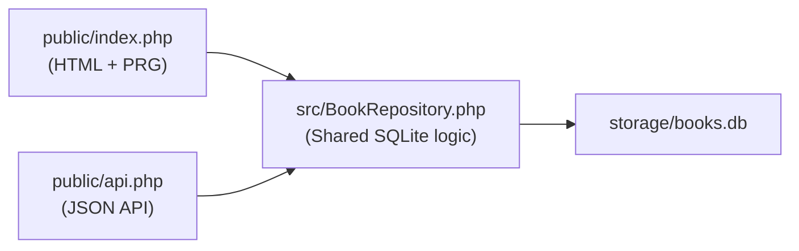

---
tags:
  - php
  - capstone
  - api
  - json
  - beginner
---

# Book Tracker JSON & Polish

## TL;DR

Your Book Tracker already has an HTML page backed by SQLite, but modern apps also expose a JSON **endpoint** so scripts, mobile apps, or a React frontend can read and add books. In this final step, you add `public/api.php` on top of the exact same `BookRepository` and verify the whole app with a quick **smoke test**.

> [!NOTE] Prerequisites: 45, 47
> New terms: smoke test

> [!abstract] Core Idea
> Reuse `BookRepository` inside `public/api.php` to serve `GET` and `POST` JSON requests, catch `Throwable` to return clean JSON errors, and verify both endpoints with a **smoke test**.
> Like adding a second blueprint or router in Flask over the same database layer, `public/index.php` and `public/api.php` share `BookRepository` without duplicating SQL.

## Mental Model

Think of `BookRepository` as the kitchen and `index.php` and `api.php` as two different serving windows. One window hands out HTML plates (`htmlspecialchars()` + **PRG**), while `api.php` hands out packed JSON boxes (`json_encode()`)—and both order from the same `BookRepository` kitchen.



- A **smoke test** is a quick end-to-end check (such as sending one `GET` and one `POST` request) to confirm the app starts and its main paths work without errors.

## Minimal Example

```php
<?php
declare(strict_types=1);
header('Content-Type: application/json; charset=utf-8');
require __DIR__ . '/../vendor/autoload.php';

try {
    $pdo = new PDO('sqlite:' . __DIR__ . '/../storage/books.db', options: [
        PDO::ATTR_DEFAULT_FETCH_MODE => PDO::FETCH_ASSOC,
    ]);
    $repo = new BookTracker\BookRepository($pdo);
    $method = $_SERVER['REQUEST_METHOD'] ?? 'GET';

    if ($method === 'GET') {
        echo json_encode(['books' => $repo->all()], JSON_THROW_ON_ERROR);
        exit;
    }
    if ($method === 'POST') {
        $data = json_decode(file_get_contents('php://input'), true, flags: JSON_THROW_ON_ERROR);
        $title = trim($data['title'] ?? '');
        $pages = (int) ($data['pages'] ?? 0);
        if ($title === '' || $pages <= 0) {
            http_response_code(400);
            echo json_encode(['error' => 'Valid title and pages required'], JSON_THROW_ON_ERROR);
            exit;
        }
        $repo->add($title, $pages, BookTracker\ReadingStatus::Unread);
        http_response_code(201);
        echo json_encode(['created' => $title], JSON_THROW_ON_ERROR);
        exit;
    }
    http_response_code(405);
    echo json_encode(['error' => 'Method not allowed'], JSON_THROW_ON_ERROR);
} catch (JsonException) {
    http_response_code(400);
    echo json_encode(['error' => 'Invalid JSON payload']);
} catch (Throwable $e) {
    error_log($e->getMessage());
    http_response_code(500);
    echo json_encode(['error' => 'Server error']);
}
```

- Both `public/index.php` and `public/api.php` share `BookTracker\BookRepository` via `vendor/autoload.php`.
- `catch (JsonException)` returns `400` (`Bad Request`) when the client sends broken JSON.
- `catch (Throwable $e)` logs any unexpected database or runtime failure privately with `error_log()` and returns a clean `500` JSON object instead of HTML.

> [!warning] Security angle
> Keep `display_errors` off in production and catch `Throwable` in `public/api.php` so raw SQLite paths or stack traces never appear in API output. Escape HTML only in `index.php`, never in `api.php`.

## Compare

| Entry File         | Purpose                           | Error Format                       | Output Escaping                              |
| ------------------ | --------------------------------- | ---------------------------------- | -------------------------------------------- |
| `public/index.php` | Browser HTML page + **PRG** forms | Escaped HTML message               | `htmlspecialchars(..., ENT_QUOTES, 'UTF-8')` |
| `public/api.php`   | JSON API **endpoint**             | `['error' => '...']` + `400`/`500` | `json_encode(..., JSON_THROW_ON_ERROR)`      |

## ◈ Edge Case Analysis

✗ **Mistake 1:** Calling `htmlspecialchars()` on book titles inside `public/api.php` turns `&` into `&amp;` in JSON responses.

```php
echo json_encode(['title' => htmlspecialchars($book['title'])]); // Corrupts JSON!
```

✓ **Fix:** Keep `htmlspecialchars()` in HTML templates (`index.php`) and pass raw strings to `json_encode()` in `api.php`.

```php
echo json_encode(['books' => $repo->all()], JSON_THROW_ON_ERROR);
```

✗ **Mistake 2:** Letting a `PDOException` go uncaught inside `api.php` prints an HTML fatal error instead of JSON, breaking `JSON.parse()` on the client.

```php
// No try...catch around new PDO(...) -> HTML crash output in a JSON endpoint!
```

✓ **Fix:** Wrap the endpoint in `try...catch (Throwable $e)`, log `$e->getMessage()`, and return `http_response_code(500)` with JSON.

```php
catch (Throwable $e) { error_log($e->getMessage()); http_response_code(500); echo json_encode(['error' => 'Server error']); }
```

✗ **Mistake 3:** Reading `$_POST` inside `api.php` when testing with JSON clients leaves `$title` empty.

```php
$title = $_POST['title'] ?? ''; // Empty for application/json requests!
```

✓ **Fix:** Always read JSON **payload**s from `file_get_contents('php://input')`.

```php
$data = json_decode(file_get_contents('php://input'), true, flags: JSON_THROW_ON_ERROR);
```

## Try It

1. Start your local server with `php -S localhost:8000 -t public` and run a **smoke test** `GET` request to `http://localhost:8000/api.php`.
2. Send a `POST` request with `{"title":"Dune","pages":412}` and verify you get HTTP `201` and `{"created":"Dune"}`.

<details>
<summary>◈ View Solution</summary>

1. Start the dev server in one PowerShell window:

```powershell
php -S localhost:8000 -t public
```

2. Run the `GET` and `POST` smoke tests in a second PowerShell window:

```powershell
Invoke-RestMethod http://localhost:8000/api.php
Invoke-RestMethod -Method Post -Uri http://localhost:8000/api.php -ContentType 'application/json' -Body '{"title":"Dune","pages":412}'
```

</details>

## Topic Mastery Quiz

**Q1: Why do `public/index.php` and `public/api.php` both use `BookRepository`?**

- [ ] A) PHP forbids writing SQL in `api.php`
- [ ] B) Sharing `BookRepository` keeps all SQLite queries and `ReadingStatus` rules in one place without duplicating SQL
- [ ] C) `index.php` cannot use `PDO` directly
- [ ] D) `api.php` cannot load `vendor/autoload.php`

**Q2: What HTTP status code should `api.php` return when `json_decode()` throws a `JsonException`?**

- [ ] A) `200`
- [ ] B) `201`
- [ ] C) `400`
- [ ] D) `302`

**Q3: Why does `api.php` catch `Throwable $e` at the outer level?**

- [ ] A) To hide all bugs without logging them
- [ ] B) To log the internal error privately and return a clean JSON `500` error instead of crashing with HTML
- [ ] C) To convert `Throwable` into `$_POST`
- [ ] D) Because `PDO` does not throw exceptions

**Q4: Should `api.php` pass book titles through `htmlspecialchars()` before `json_encode()`?**

- [ ] A) Yes, always
- [ ] B) No—`htmlspecialchars()` is for HTML output only and would corrupt characters like `&` inside JSON
- [ ] C) Only on `POST` requests
- [ ] D) Only for SQLite

**Q5: What status code should `api.php` return if a client sends a `DELETE` request when only `GET` and `POST` are supported?**

- [ ] A) `200`
- [ ] B) `201`
- [ ] C) `405`
- [ ] D) `302`

**Q6: What is the goal of running a quick `GET` and `POST` smoke test against `php -S localhost:8000 -t public`?**

- [ ] A) To deploy the app to production
- [ ] B) To verify end-to-end that the server starts, routes requests, and reads/writes `books.db` without errors
- [ ] C) To install Composer packages
- [ ] D) To delete `storage/books.db`

<details>
<summary>◈ View Answers & Explanations</summary>

1. **B** — Putting database logic in `BookRepository` lets both the HTML page and the JSON API share the same prepared statements and validation rules. A, C, and D are false.
2. **C** — `400` (`Bad Request`) signals that the client sent malformed JSON. `200` (A) and `201` (B) mean success, and `302` (D) is a redirect.
3. **B** — Catching `Throwable` logs the real error with `error_log()` while guaranteeing the client still receives valid JSON (`['error' => 'Server error']`) with status `500`. A, C, and D are false.
4. **B** — `htmlspecialchars()` turns `&` into `&amp;` for HTML browsers; JSON APIs must encode raw strings with `json_encode()`. A, C, and D are false.
5. **C** — `405` (`Method Not Allowed`) tells the client that the endpoint exists but does not support that HTTP method. A, B, and D are wrong.
6. **B** — A **smoke test** confirms that your autoloader, PDO connection, routes, and JSON encoding all work together end-to-end. A, C, and D are false.

</details>

## One-Liner

> [!tip] Share the Core, Format at the Edge
> **Keep SQL in `BookRepository`, escape HTML in `index.php`, return JSON in `api.php`, and smoke-test both.**

> [!quote] Sources
>
> - [json_encode - PHP Manual](https://www.php.net/manual/en/function.json-encode.php)
> - [Throwable errors - PHP Manual](https://www.php.net/manual/en/language.error-handling.throwable.php)
> - [Built-in web server - PHP Manual](https://www.php.net/manual/en/features.commandline.webserver.php)
