---
tags:
  - python
  - introduction
  - interpreter-and-basics
---

# Introduction to Python

## TL;DR (Quick Revision)

**Introduction to Python** = Interpreted language + UTF-8 parsing, indentation blocks, object references, immutable `str`, and mutable `list` sequences.

> [!abstract] Core Idea
> Python runs UTF-8 code interactively (`>>>` / `...`) or via CLI (`-c`, `-m`, `-i`), grouping statements by indentation. Names bind to objects (`int`, `float`, `str`, `list`) without copying data.

> [!question] Why Use It?
>
> - Skips compile/link steps via an interactive REPL.
> - Expresses complex logic concisely with built-in sequences and slicing.
> - Groups blocks by indentation — no variable type declarations needed.
> - Extends with C/C++ modules and embeds into C applications.

---

## Quick Reference Table

| Aspect / Feature         | Type / Syntax                      | Mutable? | Returns New Object? | Key Behavior                                                               |
| ------------------------ | ---------------------------------- | :------: | :-----------------: | -------------------------------------------------------------------------- |
| **Classic Division**     | `a / b`                            |    ✗     |          ✓          | Always returns **float** (`8 / 5` → `1.6`).                                |
| **Floor Division & Mod** | `a // b`, `a % b`                  |    ✗     |          ✓          | `//` discards fraction; `(a // b) * b + (a % b) == a`.                     |
| **Exponentiation**       | `a ** b`                           |    ✗     |          ✓          | Binds tighter than unary `-` (`-3**2` → `-9`; `(-3)**2` → `9`).            |
| **Text Sequence**        | `str` (`'...'`, `"..."`, `r'...'`) |    ✗     |          ✓          | **Immutable** 1-char strings; out-of-range index raises `IndexError`.      |
| **Compound Sequence**    | `list` (`[a, b, ...]`)             |    ✓     |    ✗ (in-place)     | **Mutable** sequence; supports item/slice assignment and `.append()`.      |
| **Variable Assignment**  | `rgba = rgb`                       |    ✓     |          ✗          | Never copies data; aliases the **same object** (`id(rgb) == id(rgba)`).    |
| **Shallow Slice Copy**   | `seq[start:end]` / `seq[:]`        |    ✓     |          ✓          | **Start included, end excluded**; `s[:i] + s[i:] == s`; clamps gracefully. |
| **CLI Invocation**       | `python -c` / `-m` / `-i`          |    ✗     |          ✗          | Populates `sys.argv` (`[0]` is `''`, `'-'`, `'-c'`, or module path).       |

---

## The Learning Concept

#### What Problem Does It Solve?

Consider a cart checkout — `=` aliases the same list, and `-3 ** 2` silently negates after exponentiation:

```python
# BAD - Aliasing a mutable list without copying and operator precedence bug
rgb_cart = ["Red", "Green", "Blue"]     # Original cart items
backup_cart = rgb_cart                  # BAD: binds to the exact same list object (no copy)
backup_cart.append("Alpha")             # Mutates rgb_cart too!
discount = -3 ** 2                      # BAD: evaluates as -(3 ** 2) = -9, not +9
print("Original mutated:", rgb_cart, "Discount:", discount)
# Output: Original mutated: ['Red', 'Green', 'Blue', 'Alpha'] Discount: -9
```

Assignment aliases `rgb_cart` (`id(rgb_cart) == id(backup_cart)`), and `**` binds tighter than unary `-`.

```python
# GOOD - Shallow slice copy [:] for independent lists and explicit grouping for **
rgb_cart = ["Red", "Green", "Blue"]     # Original cart items
backup_cart = rgb_cart[:]               # GOOD: [:] slice returns a new shallow copy list
backup_cart.append("Alpha")             # Modifies only backup_cart
discount = (-3) ** 2                    # GOOD: parentheses group unary minus before ** (+9)
print("Original safe:", rgb_cart, "Backup:", backup_cart, "Discount:", discount)
# Output: Original safe: ['Red', 'Green', 'Blue'] Backup: ['Red', 'Green', 'Blue', 'Alpha'] Discount: 9
```

#### How Python Implements It

> [!tip] Three Core Execution Mechanics
>
> 1. **UTF-8 & `sys.argv`**: Parses **UTF-8** by default (or `# -*- coding: encoding -*-` on line 1, or line 2 after shebang) and fills **`sys.argv`**.
> 2. **References & Slicing**: Names bind objects; slice indices sit **between elements** (`s[:i] + s[i:] == s`).
> 3. **Simultaneous Evaluation**: In `a, b = b, a + b`, **RHS expressions** evaluate left-to-right first, then bind.

#### Full Runnable Example

```python
# Complete runnable store checkout & reward sequence script
class StoreInvoice:
    # Demonstrates Python Tutorial: numbers, str, list, and while.

    def __init__(self, code: str, tax_rate: float) -> None:
        self.code = code                      # str: immutable text sequence
        self.tax_rate = tax_rate              # float: created via classic division /

    def process_order(self, base_prices: list) -> None:
        # 1. Shallow slice copy [:] avoids mutating caller's list reference
        cart = base_prices[:]
        cart[3] = 4 ** 3                      # Fix wrong cube (65 -> 64) via ** operator
        cart.append(7 ** 3)                   # Append 343 to end of mutable list

        # 2. Classic division (/), floor division (//), remainder (%), and round()
        price = cart[0] + cart[3] + 36.50     # Mixed int + float promotes to float (101.5)
        tax = price * self.tax_rate           # 101.5 * 0.125 = 12.6875
        total = round(price + tax, 2)         # Round to 2 decimal places -> 114.19
        boxes, rem = 17 // 3, 17 % 3          # Floor quotient (5) and remainder (2)

        # 3. String slicing invariant: s[:i] + s[i:] == s
        prefix = self.code[:2]                # 'Py' (start 0 included, 2 excluded)
        suffix = self.code[2:]                # 'thon' (index 2 to end)
        print(prefix + suffix, "Items:", len(cart), "Total:", total)
        print("Boxes:", boxes, "Remainder:", rem, "SameRef:", id(cart) == id(base_prices))

        # 4. Fibonacci reward tiers via simultaneous assignment & while loop
        print("FibRewards:", end=" ")
        a, b = 0, 1                           # Multiple assignment
        while a < 10:                         # Non-zero integer / non-empty sequence is True
            print(a, end=",")                 # Custom end avoids trailing newline
            a, b = b, a + b                   # RHS evaluated left-to-right before assignment
        print()


if __name__ == "__main__":
    raw_cubes = [1, 8, 27, 65, 125]
    invoice = StoreInvoice("Python", 12.5 / 100)
    invoice.process_order(raw_cubes)
    print("CallerUnchanged:", raw_cubes[3])
```

**Output:**

```Output
Python Items: 6 Total: 114.19
Boxes: 5 Remainder: 2 SameRef: False
FibRewards: 0,1,1,2,3,5,8,
CallerUnchanged: 65
```

#### Visual Diagram

```mermaid
flowchart LR
    subgraph CLI["1. Interpreter Invocation (sys.argv)"]
        A["python [-c cmd &#124; -m mod &#124; -i script.py]"] --> B["UTF-8 Source Parser &amp; Bytecode Execution"]
    end
    subgraph MEM["2. Names, References & Slicing"]
        B --> C["rgb = ['Red', 'Green', 'Blue']"]
        C -->|"rgba = rgb (Alias: same id)"| D["Same List Object in Memory"]
        C -->|"copy = rgb[:] (Shallow Copy)"| E["New List Object (start incl, end excl)"]
    end
    subgraph LOOP["3. Simultaneous Assignment"]
        B --> F["a, b = b, a + b"]
        F --> G["1. Evaluate RHS (b, a+b) Left-to-Right<br/>2. Bind New Values Simultaneously"]
    end
```



#### Key Terminology

1. **Interactive Mode (REPL)**: TTY mode (`>>>` / `...`) storing last result in `_`.
   Syntax: `>>> round(_, 2)`

2. **Raw String**: `r`-prefixed string keeping `\` literal.
   Syntax: `r'C:\this\name'`

3. **Slice Assignment**: In-place list slice replacement.
   Syntax: `letters[2:5] = ['C', 'D', 'E']`

4. **Multiple Assignment**: Left-to-right RHS evaluation before binding.
   Syntax: `a, b = b, a + b`

> [!important] Key Rules to Remember
>
> - **Division**: `/` always returns `float`; `//` floors toward negative infinity.
> - **Slicing**: Start **included**, end **excluded** (`len(s[i:j]) == j - i`).
> - **Truthiness**: Non-zero/non-empty is `True`; `0`, `''`, `[]` are `False`.
> - **Assignment** never copies — use `[:]` to make a shallow copy of a list.
> - **`**`precedence**: Binds tighter than unary`-`; use `(-3) \*\* 2` for positive result.

---

## ◈ Edge Case Analysis

#### 1. Raw Strings Ending in Odd Backslashes

**Problem:** `r"..."` cannot end with an odd number of `\`.
**Fix:** Append a regular string with `"\\"` via adjacent literal concatenation.

```python
# Fix: combine raw string with adjacent regular string literal for trailing backslash
path = r"C:\Users\Admin" "\\"   # Adjacent string literals auto-concatenate
print(path)
```

**Output:**

```Output
C:\Users\Admin\
```

#### 2. Adjacent Concatenation on Variables

**Problem:** `prefix 'thon'` raises `SyntaxError` — adjacent literal concat works for literals only.
**Fix:** Use `+` for runtime concatenation.

```python
# Fix: use + when joining a variable or expression with a string literal
prefix = "Py"
word = prefix + "thon"          # Valid runtime concatenation
print(word, ("un" * 3) + "ium")
```

**Output:**

```Output
Python unununium
```

#### 3. Out-of-Range Indexing vs. Slicing

**Problem:** `word[42]` raises `IndexError`; slicing `word[4:42]` clamps gracefully.
**Fix:** Prefer slicing when bounds may exceed length.

```python
# Fix: slicing clamps gracefully at boundaries without raising IndexError
word = "Python"
print("Clamped tail:", repr(word[4:42]), "Empty slice:", repr(word[42:]))
```

**Output:**

```Output
Clamped tail: 'on' Empty slice: ''
```

#### 4. Masking the Interactive `_`

**Problem:** `_ = ...` shadows the built-in REPL `_` (last result).
**Fix:** Use a named variable in scripts instead.

```python
# Fix: use named variables in scripts instead of assigning to _
price, tax = 100.50, 12.5 / 100
last_calc = price * tax
print(round(price + last_calc, 2))
```

**Output:**

```Output
113.06
```

---

## Going Deeper (Intermediate → Advanced)

### String Formatting: f-strings vs `.format()` vs `%`

Modern Python strongly prefers **f-strings** (PEP 498, Python 3.6+). They are faster, more readable, and support expressions inline.

```python
name = "Alice"
score = 98.567

# Old way (avoid)
print("Name: %s, Score: %.2f" % (name, score))

# Better
print("Name: {}, Score: {:.2f}".format(name, score))

# Best - f-string (Python 3.6+)
print(f"Name: {name}, Score: {score:.2f}")
```

> [!tip] f-string Expressions
> You can embed any expression: `f"{2 ** 10}"`, `f"{name.upper()}"`, `f"{price * 1.2:.2f}"`.

### List Comprehensions vs. `while` Loops

Comprehensions are more Pythonic and faster for building lists from sequences.

```python
# While loop (verbose)
squares = []
i = 0
while i < 5:
    squares.append(i ** 2)
    i += 1

# List comprehension (concise & preferred)
squares = [i ** 2 for i in range(5)]
print(squares)  # [0, 1, 4, 9, 16]
```

### Deep Copy vs. Shallow Copy

`[:]` only copies the outer list — nested mutable objects are still shared.

```python
import copy

original = [[1, 2], [3, 4]]
shallow  = original[:]          # Outer list is new, inner lists are aliased
deep     = copy.deepcopy(original)  # Fully independent at every level

shallow[0].append(99)           # Mutates original[0] too!
deep[1].append(99)              # Safe — independent copy

print(original)  # [[1, 2, 99], [3, 4]]
```

> [!warning] Watch out with nested structures
> Always use `copy.deepcopy()` when your list contains other mutable objects (lists, dicts).

### Comparison Table

| Method            | Speed | Readable | Copies Nested? | Use When                        |
| ----------------- | :---: | :------: | :------------: | ------------------------------- |
| `=`               | Fast  |    ✓     |   ✗ (alias)    | You want the same object        |
| `[:]`             | Fast  |    ✓     |  ✗ (shallow)   | Flat lists only                 |
| `list(seq)`       | Fast  |    ✓     |  ✗ (shallow)   | Converting any iterable to list |
| `copy.deepcopy()` | Slow  |    ✓     |       ✓        | Nested mutable structures       |

---


## Topic Mastery Quiz

Test yourself before moving to the next chapter. Pick the best answer for each question.

**Q1: What does `a, b = b, a + b` actually do under the hood?**

- [ ] A) It swaps `a` and `b` using a hidden temp variable
- [ ] B) The RHS is fully evaluated left-to-right into a tuple first, then bound to `a` and `b`
- [ ] C) It raises a `SyntaxError` because two assignments can't share one line
- [ ] D) `b` is evaluated twice — once for the new `a`, once for the new `b`

**Q2: What is the result of `-3 ** 2` in Python?**

- [ ] A) `9` — unary minus applies first
- [ ] B) `-9` — `**` binds tighter than unary `-`
- [ ] C) `SyntaxError` — negative bases need parentheses
- [ ] D) `-6` — Python treats it as `-(3 * 2)`

**Q3: You run `backup = cart` then `backup.append("x")`. What happens to `cart`?**

- [ ] A) Nothing — `backup` is a copy
- [ ] B) `cart` also gets `"x"` appended — both names alias the same list
- [ ] C) Python raises `AttributeError` since list copies don't support `.append()`
- [ ] D) `cart` is unaffected because assignment creates a shallow copy

**Q4: What does `sys.argv[0]` contain when you run `python -c "print(1)"`?**

- [ ] A) `''` (empty string)
- [ ] B) The script filename
- [ ] C) `'-c'`
- [ ] D) `None`

**Q5: Which of these raw strings causes a `SyntaxError`?**

- [ ] A) `r"C:\Users\Admin"`
- [ ] B) `r"path\\"`
- [ ] C) `r"C:\Users\Admin\"`
- [ ] D) `r"\n\t"`

**Q6: What does `word[42:]` return if `word = "Python"` (length 6)?**

- [ ] A) Raises `IndexError`
- [ ] B) Returns `'Python'` (full string)
- [ ] C) Returns `''` (empty string)
- [ ] D) Returns `None`

<details>
<summary>◈ View Answers & Explanations</summary>

1. **B** — Python evaluates the entire RHS `(b, a + b)` as a tuple before any binding happens. No temp variable needed; it's one atomic operation.
2. **B** — `**` has higher precedence than unary `-`, so `-3 ** 2` = `-(3 ** 2)` = `-9`. Use `(-3) ** 2` for `9`.
3. **B** — `backup = cart` never copies; both names point to the same list object in memory. Use `backup = cart[:]` for an independent copy.
4. **C** — `sys.argv[0]` is `'-c'` for `python -c`, `'-'` for stdin, `''` with no args, and the module path for `python -m`.
5. **C** — A raw string cannot end with an odd number of `\` because the `\` escapes the closing quote. Fix: `r"C:\Users\Admin" "\\"`.
6. **C** — Slicing clamps to valid bounds gracefully. Out-of-range slices return `''`, never raise `IndexError`.

</details>

### Classic Mistakes / Traps

✗ **Mistake 1:** Aliasing a list instead of copying it

```python
# BAD
backup = original       # Both names point to the same list
backup.append("x")      # Mutates original too!
```

✓ **Fix:** Use slice copy `[:]` or `list()`.

```python
# GOOD
backup = original[:]    # Independent shallow copy
```

✗ **Mistake 2:** Expecting `-3 ** 2` to be `9`

```python
# BAD
result = -3 ** 2        # Actually -(3**2) = -9
```

✓ **Fix:** Parenthesize the base.

```python
# GOOD
result = (-3) ** 2      # 9
```

✗ **Mistake 3:** Trying adjacent concatenation with a variable

```python
# BAD - SyntaxError
prefix = "Py"
word = prefix "thon"
```

✓ **Fix:** Use `+` for runtime concatenation.

```python
# GOOD
word = prefix + "thon"
```

✗ **Mistake 4:** Assigning to `_` in the REPL

```python
# BAD - shadows the built-in last-result variable
_ = expensive_function()   # Now _ no longer holds the last REPL result
```

✓ **Fix:** Use a real variable name in scripts.

```python
# GOOD
result = expensive_function()
```

---

## Practice Exercises

**Exercise 1: Safe List Backup**
Create a function `safe_backup(items)` that:

- Takes a list of strings
- Returns a shallow copy using `[:]`
- Appends `"backup_item"` to the copy without affecting the original
- Prints both lists to confirm independence

**Exercise 2: Operator Precedence Checker**
Write a script that:

- Computes `-3 ** 2`, `(-3) ** 2`, `17 // 3`, `17 % 3`, and `4 * 3.75 - 1`
- Prints each result with a label
- Verifies `(17 // 3) * 3 + (17 % 3) == 17` and prints the boolean

**Exercise 3: Fibonacci Sequence Builder**
Create a function `fib_up_to(limit)` that:

- Uses simultaneous assignment `a, b = b, a + b`
- Collects Fibonacci numbers below `limit` into a list
- Returns the list
- Write a `main` block to test with `limit=100`

---

## Memory Trick / One-Liner

> [!tip] The Capsule Analogy
> Think of a **photocopy machine** → `=` hands you the original document (same paper), `[:]` makes a fresh copy (new paper, same content).
> **Assignment = same object | Slice copy = new object, same values | Deep copy = fully independent**

---

## Warning Block (Best Practice)

> [!warning] Common Mistake (Avoid This!)
>
> ```python
> # BAD - aliasing instead of copying; both names mutate together
> cart = ["apple", "banana"]
> backup = cart             # Same object!
> backup.append("cherry")   # cart is also modified
> ```
>
> ```python
> # GOOD - slice copy creates an independent list
> backup = cart[:]          # New object, safe to mutate independently
> ```
