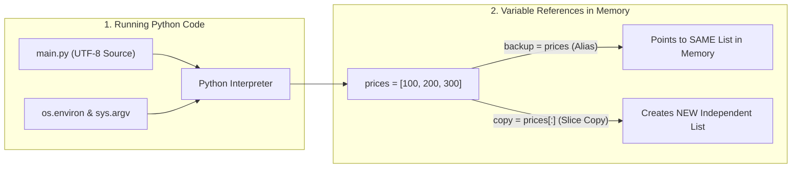

---
tags:
  - python
  - introduction
  - basics
  - interpreter
---

# Introduction to Python

#### TL;DR (Quick Revision)

**Python** = Read & write plain English-like code (grouped by indentation) + Run it immediately through an interpreter without a separate compile step ([The Python Tutorial](https://docs.python.org/3/tutorial/index.html)).

> [!abstract] Core Idea
> Created by **Guido van Rossum** in the late 1980s (first released in **1991**) as a successor to the ABC language and named after _Monty Python's Flying Circus_, Python is a high-level, interpreted, dynamically typed, object-oriented, and platform-independent language ([General Python FAQ](https://docs.python.org/3/faq/general.html)). You can test expressions live in the interactive shell (`>>>`) or save code in a `.py` file and run it from the command line ([Using the Python Interpreter](https://docs.python.org/3.14/tutorial/interpreter.html)).

> [!question] Why Use It?
>
> - Write clean, readable code using indentation instead of curly braces `{}` and semicolons `;`
> - Skip the compile-and-link step—run `.py` scripts directly via the interpreter
> - Use dynamic typing (`age = 22`, `name = "Valay"`) without declaring variable types upfront
> - Build web apps, AI/ML models, automation scripts, and cybersecurity tools across Windows, macOS, and Linux

#### Quick Comparison Table

| Feature / Aspect        | Compiled Languages (C / C++ / Java)               | Python (3.14+)                                                                      |
| :---------------------- | :------------------------------------------------ | :---------------------------------------------------------------------------------- |
| **Execution Model**     | Must compile source code before running           | **Interpreted** — runs `.py` files directly (compiles to bytecode automatically)    |
| **Type System**         | **Static** — must declare types (`int age = 22;`) | **Dynamic** — types are inferred from values (`age = 22`)                           |
| **Code Blocks**         | Curly braces `{ ... }`                            | **Indentation** (4 spaces per level after `:`)                                      |
| **Division (`8 / 5`)**  | Integer division truncates (`8 / 5` is `1`)       | `/` **always returns a `float`** (`1.6`); use `//` for integer floor division (`1`) |
| **Variable Assignment** | Copies primitive values into memory slots         | Attaches a **name (label)** to an object reference in memory                        |

---

## The Learning Concept

### What Problem Does It Solve?

Imagine writing a simple billing calculation in a language with verbose boilerplate, integer-division traps, and manual array copying vs. writing it in Python:

```python
# BAD - Common beginner mistakes in Python
prices = [100, 200, 300]
backup_prices = prices          # BAD: Does NOT copy the list! Both names point to the SAME list!
backup_prices.append(999)       # Oops! This modifies 'prices' too!

discount = -3 ** 2              # BAD: Evaluates as -(3 ** 2) = -9, NOT +9!
half = 10 / 2                   # Note: '/' always returns a float (5.0), even when evenly divisible

print("Original prices got corrupted:", prices)
print("Wrong discount:", discount, "| Half:", half)
```

This causes bugs because `=` in Python **never copies a list** (it just attaches a second label to the same list in memory), and `**` has higher priority than `-` ([An Informal Introduction to Python](https://docs.python.org/3/tutorial/introduction.html)). Here is the clean Python way:

```python
# GOOD - Safe list copying with [:] and explicit parentheses
prices = [100, 200, 300]
backup_prices = prices[:]       # GOOD: [:] slices the whole list to create a separate copy!
backup_prices.append(999)       # Only modifies backup_prices; original prices stays safe!

discount = (-3) ** 2            # GOOD: Parentheses square -3 properly -> 9
half = 10 // 2                  # GOOD: '//' floor division returns a whole int -> 5

print("Original prices safe:", prices)
print("Backup prices:", backup_prices)
print("Correct discount:", discount, "| Whole half:", half)
```

### How Python Implements It

> [!tip] Three Simple Steps
>
> 1. **Write UTF-8 Code in a `.py` File**: Save statements in a file like `main.py` and run `python main.py` (or test single lines in the `>>>` interactive shell) ([Using the Python Interpreter](https://docs.python.org/3.14/tutorial/interpreter.html)).
> 2. **Indent After Every Colon `:`**: Whenever a statement ends with `:` (`while`, `if`, `for`, `def`, `class`), indent the block underneath by 4 spaces ([An Informal Introduction to Python](https://docs.python.org/3/tutorial/introduction.html)).
> 3. **Use Built-in Numbers, Strings, and Lists**: Combine math operators (`/`, `//`, `%`, `**`), immutable strings (`'...'`), and mutable lists (`[...]`) without type declarations ([An Informal Introduction to Python](https://docs.python.org/3/tutorial/introduction.html)).

#### Full Runnable Example

```python
import os
import sys

# Step 1: Read Environment Variables & Command-Line Arguments
os.environ["APP_CITY"] = "Nagpur"
city = os.environ.get("APP_CITY", "Pune")       # Safely reads env variable with fallback
script_name = os.path.basename(sys.argv[0] or "main.py")

# Step 2: Numbers & Arithmetic Operators (+, -, *, /, //, %, **)
item_price = 100.50
tax_rate = 12.5 / 100                           # '/' always returns float (0.125)
total_bill = round(item_price * (1 + tax_rate), 2)
boxes_needed = 17 // 3                          # '//' floor division -> 5 whole boxes
leftover_items = 17 % 3                         # '%' modulus -> 2 remainder items

# Step 3: Strings (Immutable text, 0-based & negative indexing, slicing)
course = "Python"
first_char = course[0]                          # 'P' (index 0 from left)
last_char = course[-1]                          # 'n' (index -1 from right)
prefix = course[:2]                             # 'Py' (index 0 included, 2 excluded)
suffix = course[2:]                             # 'thon' (from index 2 to end)

# Step 4: Lists (Mutable sequences) & Simultaneous Assignment in a Loop
cubes = [1, 8, 27, 65, 125]
cubes[3] = 4 ** 3                               # Fix wrong cube (65 -> 64) in-place!
cubes.append(6 ** 3)                            # Append 216 to the end of the list

print(f"Script: {script_name} | City: {city} | Total Bill: {total_bill}")
print(f"17 items -> {boxes_needed} boxes with {leftover_items} left over")
print(f"String '{course}' -> first='{first_char}', last='{last_char}', slice='{prefix}-{suffix}'")
print(f"Fixed Cubes List: {cubes} (Length: {len(cubes)})")

# Step 5: First Steps Towards Programming — Fibonacci series using while
print("Fibonacci Series:", end=" ")
a, b = 0, 1                                     # Simultaneous assignment
while a < 20:
    print(a, end=" ")
    a, b = b, a + b                             # Right side evaluated before assignment!
print()
```

**Output:**

```
Script: main.py | City: Nagpur | Total Bill: 113.06
17 items -> 5 boxes with 2 left over
String 'Python' -> first='P', last='n', slice='Py-thon'
Fixed Cubes List: [1, 8, 27, 64, 125, 216] (Length: 6)
Fibonacci Series: 0 1 1 2 3 5 8 13
```

### Visual Diagram: How Python Executes & Manages References



### Key Terminology

1. **Interactive Mode (REPL)**: Running `python` in the terminal with no file opens the `>>>` primary prompt (and `...` continuation prompt), where `_` stores the last printed result ([Using the Python Interpreter](https://docs.python.org/3.14/tutorial/interpreter.html)).
   Syntax: `>>> round(_, 2)`

2. **Environment Variables (`os.environ`)**: System-level key-value pairs used to store configuration outside code, read via `os.environ.get("KEY")` ([os Module](https://docs.python.org/3/library/os.html)).
   Syntax: `os.environ.get("APP_CITY", "Pune")`

3. **Floor Division (`//`) vs. Classic Division (`/`)**: `/` always returns a decimal `float`; `//` discards the fractional part and returns the floored quotient ([An Informal Introduction to Python](https://docs.python.org/3/tutorial/introduction.html)).
   Syntax: `17 / 3  # 5.6666... vs 17 // 3  # 5`

4. **Simultaneous (Multiple) Assignment**: Assigning multiple variables on one line (`a, b = b, a + b`), where Python evaluates all right-hand expressions left-to-right before updating any variable ([An Informal Introduction to Python](https://docs.python.org/3/tutorial/introduction.html)).
   Syntax: `a, b = 0, 1`

> [!important] Key Rules to Remember
>
> - **Division `/` always returns `float`** → use `//` when you need an integer quotient
> - **Slice `s[start:end]`** → `start` is **always included**, `end` is **always excluded** (`s[:i] + s[i:] == s`)
> - **Strings are immutable** → `word[0] = 'J'` raises `TypeError`; **Lists are mutable** → `cubes[3] = 64` works
> - **Simple assignment `=` never copies data** → use `nums[:]` or `nums.copy()` to copy a list

---

## ◈ Edge Case Analysis

When starting out with Python, watch out for these 4 classic traps from the official tutorial:

### 1. Raw Strings Cannot End with an Odd Number of Backslashes

✗ **Problem:** We use raw strings (`r"C:\some\name"`) so `\n` isn't treated as a newline. However, `r"C:\Users\"` fails with a `SyntaxError` because the final `\` escapes the closing quote! ([An Informal Introduction to Python](https://docs.python.org/3/tutorial/introduction.html)).
✓ **Fix:** Concatenate a regular escaped backslash string `"\\"` at the end.

```python
# Fix: join a raw string with a regular escaped backslash literal
folder = r"C:\Users\Valay" "\\"
print("Valid trailing backslash:", folder)
```

### 2. Automatic String Joining Only Works on Literals, Not Variables

✗ **Problem:** Placing two string literals next to each other (`'Py' 'thon'`) joins them automatically into `'Python'`, but doing that with a variable (`prefix 'thon'`) raises a `SyntaxError` ([An Informal Introduction to Python](https://docs.python.org/3/tutorial/introduction.html)).
✓ **Fix:** Always use `+` when joining variables or expressions.

```python
prefix = "Py"
# word = prefix 'thon'          # ERROR: SyntaxError!
word = prefix + "thon"          # GOOD: '+' works on variables and expressions
print(word)
```

### 3. Indexing Out of Range Crashes, Slicing Out of Range Does Not

✗ **Problem:** Accessing `word[42]` on `"Python"` raises `IndexError: string index out of range`, whereas slicing `word[2:42]` or `word[42:]` never crashes—it clamps cleanly ([An Informal Introduction to Python](https://docs.python.org/3/tutorial/introduction.html)).
✓ **Fix:** Use slicing when you want safe boundary clamping without `IndexError`.

```python
word = "Python"
print("Clamped slice [2:42]:", word[2:42])      # 'thon'
print("Out-of-bounds slice [42:]:", repr(word[42:]))  # ''
```

### 4. Shadowing the Interactive `_` Variable

✗ **Problem:** In the interactive `>>>` shell, `_` automatically holds the last printed result. If you assign `_ = 10` yourself, your local variable `_` blocks the built-in `_` ([An Informal Introduction to Python](https://docs.python.org/3/tutorial/introduction.html)).
✓ **Fix:** Treat `_` as read-only in the interactive shell and use descriptive variable names in scripts.

---

## Going Deeper (Intermediate → Advanced)

### 1. How `sys.argv` Changes Across CLI Invocation Modes

When you launch Python from the terminal, the interpreter populates `sys.argv` (a list of strings) differently depending on how you invoke it ([Using the Python Interpreter](https://docs.python.org/3.14/tutorial/interpreter.html)):

| Command Run in Terminal                       | Value of `sys.argv[0]`        | What `sys.argv[1:]` Contains |
| :-------------------------------------------- | :---------------------------- | :--------------------------- |
| `python` (Interactive REPL)                   | `''` (Empty string)           | `[]`                         |
| `python main.py arg1 arg2`                    | `'main.py'`                   | `['arg1', 'arg2']`           |
| `python -c "import sys; print(sys.argv)" one` | `'-c'`                        | `['one']`                    |
| `python -m http.server 8000`                  | Full path to `http/server.py` | `['8000']`                   |

### 2. Source File Encoding & UNIX Shebang Rules

By default, Python 3 treats all `.py` source files as **UTF-8**. If you ever must use another encoding (such as `cp1252`), place a special comment on the **first line**—or on the **second line** if line 1 is a UNIX shebang (`#!/usr/bin/env python3`) ([Using the Python Interpreter](https://docs.python.org/3.14/tutorial/interpreter.html)):

```python
#!/usr/bin/env python3
# -*- coding: utf-8 -*-
print("Shebang on line 1, encoding declaration on line 2!")
```

### 3. Decoder: Optional Type Hints (`: str`, `-> None`) You Might See in Advanced Code

In modern Python 3.14+ codebases, you will sometimes see optional **type hints** (annotations) attached to variables or functions ([More Control Flow Tools — Function Annotations](https://docs.python.org/3/tutorial/controlflow.html)):

```python
# Without type hints (standard, clean Python)
def greet(name):
    print("Hello", name)

# With optional type hints (exact same runtime behavior!)
def greet_typed(name: str) -> None:
    print("Hello", name)
```

> [!note] Type Hints Are Optional Notes for Humans & IDEs
> `: str` just means _"expected to be a string"_ and `-> None` means _"this function doesn't return a value."_ Python does **not** enforce them at runtime! In Python 3.14 (PEP 649), annotations are evaluated lazily only when inspected ([What's New in Python 3.14](https://docs.python.org/3/whatsnew/3.14.html)).

---

## Topic Mastery Quiz

Test yourself before moving to the next chapter. Pick the best answer for each question.

**Q1: What is the output of `print(8 / 4, 8 // 4)` in Python 3?**

- [ ] A) `2 2`
- [ ] B) `2.0 2`
- [ ] C) `2 2.0`
- [ ] D) `2.0 2.0`

**Q2: Given `word = "Python"`, what does `word[-2:]` evaluate to?**

- [ ] A) `'Py'`
- [ ] B) `'ho'`
- [ ] C) `'on'`
- [ ] D) `IndexError`

**Q3: What is the result of `-2 ** 4` in Python?\*\*

- [ ] A) `16`
- [ ] B) `-16`
- [ ] C) `-8`
- [ ] D) `SyntaxError`

**Q4: If `a = [1, 2]` and `b = a`, what is `a` after running `b.append(3)`?**

- [ ] A) `[1, 2]`
- [ ] B) `[1, 2, 3]`
- [ ] C) `[3]`
- [ ] D) `TypeError`

**Q5: Which module and method safely reads an OS environment variable without raising `KeyError` if missing?**

- [ ] A) `sys.argv.get("KEY")`
- [ ] B) `os.environ["KEY"]`
- [ ] C) `os.environ.get("KEY")`
- [ ] D) `sys.path.get("KEY")`

<details>
<summary>◈ View Answers & Explanations</summary>

1. **B** — Classic division `/` always returns a `float` (`2.0`), whereas floor division `//` returns an `int` (`2`).
2. **C** — Index `-2` is the second-to-last character (`'o'`), so `word[-2:]` slices from `'o'` to the end (`'on'`).
3. **B** — `**` binds tighter than unary `-`, so `-2 ** 4` is `-(2 ** 4) = -16`.
4. **B** — `b = a` aliases the exact same list object in memory, so `b.append(3)` mutates `a` as well (`[1, 2, 3]`).
5. **C** — `os.environ.get("KEY")` returns `None` (or a default value) if `"KEY"` is not set, whereas `os.environ["KEY"]` raises `KeyError`.

</details>

---

## Practice Exercises

**Exercise 1: Bill & Box Calculator**
Write a script that:

- Takes `items = 29` and `box_size = 6`
- Calculates full boxes (`//`) and leftover items (`%`)
- Verifies that `full_boxes * box_size + leftover == items`

**Exercise 2: String Slicing & Reversal**
Given `title = "PythonProgramming"`:

- Extract `"Python"` and `"Programming"` using slices
- Print the last 4 characters using a negative slice (`title[-4:]`)
- Verify that `title[:6] + title[6:] == title`

**Exercise 3: Safe List Copying**
Create `cart = ["Laptop", "Mouse"]`:

- Create an independent copy `saved_cart` using `[:]`
- Append `"Keyboard"` to `saved_cart` and replace `"Mouse"` with `"Trackpad"` in `cart`
- Print both lists and their `id()` values to verify they are separate objects

---

## Memory Trick / One-Liner

> [!tip] Fencepost Analogy for Slicing
> Think of slice numbers as **fenceposts between characters**, not the characters themselves:
> `+---+---+---+---+---+---+`
> `| P | y | t | h | o | n |`
> `0   1   2   3   4   5   6`
> `word[0:2]` grabs everything between post `0` and post `2` → **`'Py'`** (and `2 - 0 = 2` characters!).

---

## Warning Block (Best Practice)

> [!warning] Common Mistake (Avoid This!)
>
> ```python
> # BAD - Using '=' thinking it copies a list
> original = [10, 20, 30]
> copy_list = original          # Both point to the SAME list!
> copy_list.append(40)          # Accidentally mutates 'original'!
> ```
>
> ```python
> # GOOD - Slice with [:] or call .copy() for an independent list
> original = [10, 20, 30]
> copy_list = original[:]       # Separate shallow copy!
> copy_list.append(40)          # 'original' stays [10, 20, 30]
> ```
