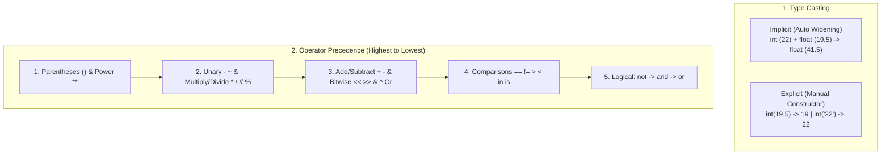

---
tags:
  - python
  - variables
  - casting
  - operators
---

# Variables, Data Types, Casting, and Operators in Python

#### TL;DR (Quick Revision)

**Variables, Casting & Operators** = Attach names to typed objects (`age = 22`) + Convert between types (`int()`, `float()`, `str()`) + Combine values using 7 operator families ([An Informal Introduction to Python](https://docs.python.org/3/tutorial/introduction.html), [Expressions Reference](https://docs.python.org/3/reference/expressions.html)).

> [!abstract] Core Idea
> A variable in Python is a label attached to a value in memory (`age = 22`) → Its data type (`int`, `float`, `bool`, `str`, `list`, `tuple`, `set`, `dict`) is detected automatically → You convert types implicitly or explicitly (`int("8080")`) and process values through 7 operator families governed by operator precedence ([Expressions Reference](https://docs.python.org/3/reference/expressions.html)).

> [!question] Why Use It?
>
> - Store and reuse data under meaningful variable names without verbose type declarations
> - Safely convert user input (`str` from `input()` or `os.environ`) into numbers (`int`, `float`) for math
> - Combine arithmetic, comparison, logical (`and`, `or`, `not`), membership (`in`), and identity (`is`) checks
> - Control exact calculation order using operator precedence and parentheses `()`

#### Quick Comparison Table

| Category / Operator Family | Examples / Syntax | Mutates In-Place? | What It Does ([Expressions Reference](https://docs.python.org/3/reference/expressions.html)) |
| :--- | :--- | :---: | :--- |
| **Primitive (Scalar) Types** | `int` (`22`), `float` (`19.5`), `complex` (`3+5j`), `bool` (`True`), `str` (`"Hi"`) | No (Immutable) | Represent single values; inspect any variable's type with `type(x)`. |
| **Non-Primitive (Collections)** | `list` (`[...]`), `tuple` (`(...)`), `set` (`{...}`), `dict` (`{k: v}`) | `list`/`set`/`dict`: Yes | Hold multiple values in a single variable. |
| **Implicit Casting (Widening)** | `10 + 2.5` → `12.5` | No | Python automatically widens `int` to `float` so decimals aren't lost. |
| **Explicit Casting (Narrowing)** | `int(19.9)` → `19`, `str(22)` → `'22'` | No | Programmer manually converts types; `int(float)` truncates toward zero. |
| **1. Mathematical Operators** | `+`, `-`, `*`, `/`, `//`, `%`, `**` | No | Addition, subtraction, multiplication, float div, floor div, modulus, power. |
| **2. Assignment Operators** | `=`, `+=`, `-=`, `*=`, `/=`, `//=`, `%=`, `**=` | Yes (on `list`) | Assigns or updates a variable (`a += 10` means `a = a + 10`). |
| **3. Comparison Operators** | `==`, `!=`, `>`, `<`, `>=`, `<=` | No | Compares two values and returns `True` or `False` (`==` compares values; `=` assigns). |
| **4. Logical Operators** | `and`, `or`, `not` | No | Combines conditions: `and` (both true), `or` (at least one true), `not` (reverses). |
| **5. Membership Operators** | `in`, `not in` | No | Checks if an item exists inside a `str`, `list`, `tuple`, `set`, or `dict`. |
| **6. Identity Operators** | `is`, `is not` | No | Checks if two variables point to the **exact same object in memory** (`id(a) == id(b)`). |
| **7. Bitwise Operators** | `&`, `\|`, `^`, `~`, `<<`, `>>` | No | Performs binary bit-level AND, OR, XOR, NOT (`~x == -(x+1)`), and bit shifts. |

---

## The Learning Concept

### What Problem Does It Solve?

Imagine reading a user's age from a form or environment variable (`"22"`) and trying to add `5` years to it, or using `is` instead of `==` to compare two lists:

```python
# BAD - Adding a number to a string without casting, and using 'is' to compare values
raw_age = "22"
# future_age = raw_age + 5      # ERROR! TypeError: can only concatenate str (not "int") to str

result = 10 + 5 * 2             # Evaluates 5 * 2 first -> 20 (NOT 30!)
cart_a = ["apple", "banana"]
cart_b = ["apple", "banana"]
print("Result:", result, "| Same list with 'is'?:", cart_a is cart_b)
```

This fails because `"22"` is text (`str`), not a number (`int`), and `cart_a is cart_b` checks if both variables share the exact same memory address (`False`), not whether their contents are equal ([Expressions Reference](https://docs.python.org/3/reference/expressions.html)). Explicit casting and `==` fix this:

```python
# GOOD - Explicit casting with int(), parentheses for precedence, and '==' for value equality
raw_age = "22"
future_age = int(raw_age) + 5   # GOOD: int("22") converts string to integer 22 -> 27

result = (10 + 5) * 2           # GOOD: Parentheses run addition first -> 30
cart_a = ["apple", "banana"]
cart_b = ["apple", "banana"]
print("Future Age:", future_age, "| Grouped:", result, "| Equal with '=='?:", cart_a == cart_b)
```

### How Python Implements It

> [!tip] Three Simple Steps
>
> 1. **Check Types with `type(x)`**: Every value has a class (`int`, `float`, `complex`, `bool`, `str`) that you can inspect anytime with `print(type(age))` ([Built-in Functions](https://docs.python.org/3/library/functions.html)).
> 2. **Cast Before Mixing Text and Numbers**: Python widens `int` + `float` automatically (`10 + 2.5 = 12.5`), but never guesses when mixing `str` and `int`—use `int(x)`, `float(x)`, or `str(x)` explicitly.
> 3. **Follow Operator Precedence**: Python evaluates `()` first, then `**`, unary `- ~`, `* / // %`, `+ -`, shifts `<< >>`, bitwise `& ^ |`, comparisons/membership/identity (`== != in is`), and finally `not` → `and` → `or` ([Expressions Reference](https://docs.python.org/3/reference/expressions.html)).

#### Full Runnable Example

```python
# Step 1: Variables & Data Types (Primitive/Scalar vs Non-Primitive/Collections)
age = 22                                        # int (whole number)
price = 19.50                                   # float (decimal number)
comp = 3 + 5j                                   # complex (real + imaginary part)
is_active = True                                # bool (True or False)
name = "Valay"                                  # str (text)
fruits = ["apple", "banana", "mango"]           # list (mutable collection)

# Step 2: Implicit Casting (Widening) vs Explicit Casting (Narrowing)
widened = age + price                           # Implicit: 22 + 19.50 -> 41.5 (float)
narrowed = int(price)                           # Explicit: int(19.50) -> 19 (truncates decimal)

# Step 3: Mathematical, Assignment & Precedence
a = 10
b = 3
a += 10                                         # Assignment operator: a becomes 20
precedence_check = 10 + 5 * 2                   # 5 * 2 runs first -> 20

# Step 4: Comparison, Logical, Membership, Identity & Bitwise
has_fruit = ("apple" in fruits) and ("grape" not in fruits)
alias_fruits = fruits
same_object = (fruits is alias_fruits)          # True: both point to the exact same list

print(f"Types -> age:{type(age).__name__}, price:{type(price).__name__}, comp:{type(comp).__name__}")
print(f"Casting -> Implicit (22 + 19.50): {widened} | Explicit int(19.50): {narrowed}")
print(f"Math (10, 3) -> div:{10/b:.2f}, floor:{10//b}, mod:{10%b}, pow:{2**b}, a+=10:{a}, 10+5*2:{precedence_check}")
print(f"Membership & Logic: {has_fruit} | Identity (is): {same_object}")
print(f"Bitwise (5, 3) -> AND:{5&3}, OR:{5|3}, XOR:{5^3}, NOT(~5):{~5}, LShift:{5<<1}, RShift:{5>>1}")
```

**Output:**

```
Types -> age:int, price:float, comp:complex
Casting -> Implicit (22 + 19.50): 41.5 | Explicit int(19.50): 19
Math (10, 3) -> div:3.33, floor:3, mod:1, pow:8, a+=10:20, 10+5*2:20
Membership & Logic: True | Identity (is): True
Bitwise (5, 3) -> AND:1, OR:7, XOR:6, NOT(~5):-6, LShift:10, RShift:2
```

### Visual Diagram: Operator Precedence & Casting Flow



### Key Terminology

1. **Implicit Casting (Widening)**: Automatic conversion performed by Python when mixing compatible types (such as converting `int` to `float` in `10 + 2.5`) ([An Informal Introduction to Python](https://docs.python.org/3/tutorial/introduction.html)).
   Syntax: `total = 10 + 2.5  # 12.5`

2. **Explicit Casting (Narrowing)**: Manual type conversion using built-in constructors `int()`, `float()`, `str()`, or `bool()` ([Built-in Functions](https://docs.python.org/3/library/functions.html)).
   Syntax: `whole = int(19.99)  # 19`

3. **Membership Operators (`in`, `not in`)**: Test whether a value exists inside a sequence or collection (`str`, `list`, `tuple`, `set`, `dict`) ([Expressions Reference](https://docs.python.org/3/reference/expressions.html)).
   Syntax: `"apple" in fruits`

4. **Identity Operators (`is`, `is not`)**: Test whether two variables point to the exact same object in memory (`id(x) == id(y)`), rather than just having equal values (`==`) ([Expressions Reference](https://docs.python.org/3/reference/expressions.html)).
   Syntax: `if result is None:`

> [!important] Key Rules to Remember
>
> - **`=` vs `==` vs `is`** → `=` assigns a value, `==` compares **values**, and `is` compares **memory addresses**
> - **Logical Priority** → `not` runs first, then `and`, and finally `or`
> - **Bitwise NOT Formula** → `~x` always equals **`-(x + 1)`** in two's complement (so `~5` is `-6`)
> - **Right-to-Left Power** → `2 ** 3 ** 2` evaluates right-to-left as `2 ** (3 ** 2) = 512`, not `64`

---

## ◈ Edge Case Analysis

### 1. `int("19.99")` Crashes on Decimal Strings

✗ **Problem:** While `int(19.99)` works on a `float` and `int("19")` works on an integer string, passing a decimal string directly to `int("19.99")` raises `ValueError: invalid literal for int() with base 10: '19.99'` ([Built-in Functions](https://docs.python.org/3/library/functions.html)).
✓ **Fix:** Convert the string to `float` first, then to `int`: `int(float("19.99"))`.

```python
raw_price = "19.99"
whole_dollars = int(float(raw_price))   # Step 1: float("19.99") -> Step 2: int(19.99) -> 19
print("Converted decimal string to int:", whole_dollars)
```

### 2. Why `is` Seems to Work on Small Numbers (`7`) But Fails on Large Numbers or Lists

✗ **Problem:** CPython caches small integers (`-5` to `256`) in memory, so `a = 7; b = 7; a is b` happens to be `True`. For larger dynamically created integers or lists, `a is b` is `False` even when `a == b` is `True`! ([Expressions Reference](https://docs.python.org/3/reference/expressions.html)).
✓ **Fix:** Always use `==` to compare numbers, strings, or lists; reserve `is` for `x is None`.

```python
x = int("123456789")
y = int("123456789")
print("Using 'is' (memory check):", x is y, "| Using '==' (value check):", x == y)
```

### 3. `bool("False")` Is `True`!

✗ **Problem:** Beginners often try `bool("False")` expecting `False`. However, **any non-empty string** in Python is truthy—only the empty string `""` is `False`! ([Built-in Functions](https://docs.python.org/3/library/functions.html)).
✓ **Fix:** Compare the string explicitly: `user_input.lower() == "true"`.

```python
print("bool('False'):", bool("False"), "| bool(''):", bool(""))
```

---

## Going Deeper (Intermediate → Advanced)

### 1. Short-Circuit Evaluation & Operand Return in `and` / `or`

In Python, `and` and `or` don't just return `True` or `False`—they return the **actual value of the last evaluated operand** ([Data Structures — More on Conditions](https://docs.python.org/3/tutorial/datastructures.html)):

```python
# 'or' returns the first truthy value (or the last value if all are falsy)
nickname = "" or "Guest"                # '' is falsy -> returns 'Guest'

# 'and' returns the first falsy value (or the last value if all are truthy)
status = "Active" and "Verified"        # Both truthy -> returns 'Verified'
print("Nickname:", nickname, "| Status:", status)
```

### 2. Augmented Assignment `+=` on Immutable (`int`) vs. Mutable (`list`)

For immutable numbers and strings, `a += 10` creates a **brand-new object** (`a = a + 10`). For a mutable `list`, `items += [4]` modifies the existing list **in-place** (just like `items.extend([4])`), so any other variable pointing to that list sees the change!

```python
nums = [1, 2]
alias = nums
nums += [3]                             # Mutates the list in-place!
print("Alias also sees += change:", alias)
```

---

## Topic Mastery Quiz

Test yourself before moving to the next chapter. Pick the best answer for each question.

**Q1: What is the output of `print(10 + 5 * 2 ** 2)`?**
- [ ] A) `60`
- [ ] B) `30`
- [ ] C) `110`
- [ ] D) `50`

**Q2: What does `int(float("15.8"))` return?**
- [ ] A) `16`
- [ ] B) `15.8`
- [ ] C) `15`
- [ ] D) `ValueError`

**Q3: What is the value of `"" or "Default" and "Admin"`?**
- [ ] A) `""`
- [ ] B) `"Default"`
- [ ] C) `"Admin"`
- [ ] D) `True`

**Q4: Given `fruits = ["apple", "mango"]`, what does `"banana" not in fruits` return?**
- [ ] A) `True`
- [ ] B) `False`
- [ ] C) `-1`
- [ ] D) `ValueError`

**Q5: What is the result of `5 & 3` and `5 | 3` in binary bitwise math (`5 = 0101`, `3 = 0011`)?**
- [ ] A) `1` and `7`
- [ ] B) `7` and `1`
- [ ] C) `6` and `8`
- [ ] D) `True` and `True`

<details>
<summary>◈ View Answers & Explanations</summary>

1. **B** — `**` runs first (`2 ** 2 = 4`), then `*` (`5 * 4 = 20`), then `+` (`10 + 20 = 30`).
2. **C** — `float("15.8")` parses to `15.8`, and `int(15.8)` truncates the decimal toward zero to `15`.
3. **C** — `and` has higher precedence than `or`, so `"Default" and "Admin"` evaluates to `"Admin"`, and `"" or "Admin"` returns `"Admin"`.
4. **A** — `"banana"` is not present in `fruits`, so `not in` returns `True`.
5. **A** — `0101 & 0011` is `0001` (`1`), and `0101 | 0011` is `0111` (`7`).

</details>

---

## Practice Exercises

**Exercise 1: Safe String-to-Number Converter**
- Given `raw_qty = "4"` and `raw_price = "49.75"`
- Cast `raw_qty` to `int` and `raw_price` to `float`
- Compute the total bill and cast the truncated integer dollar amount using `int()`

**Exercise 2: Operator Precedence Challenge**
- Predict the output of `result = 4 + 3 * 2 ** 3 // 4 - 1` by hand
- Write a script to verify each step by adding parentheses matching Python's precedence rules

**Exercise 3: Identity vs. Equality Audit**
- Create `list1 = [10, 20]`, `list2 = [10, 20]`, and `list3 = list1`
- Print `==`, `is`, and `id()` comparisons across all three variables

---

## Memory Trick / One-Liner

> [!tip] Name-Tag Analogy (`==` vs `is`)
> Think of two identical twin brothers wearing different shirts:
> - **`a == b`** asks: *"Do they look the same (same value)?"* → **`True`**
> - **`a is b`** asks: *"Are they literally the exact same person (same memory ID)?"* → **`False`**

---

## Warning Block (Best Practice)

> [!warning] Common Mistake (Avoid This!)
>
> ```python
> # BAD - Using 'is' to compare two separate lists with equal values
> a, b = [1, 2], [1, 2]
> print(a is b)                 # Prints False! Checks memory address, not value!
> ```
>
> ```python
> # GOOD - Always use '==' for values, and reserve 'is' for None
> a, b = [1, 2], [1, 2]
> print(a == b and a is not None)  # Prints True!
> ```
