---
tags:
  - python
  - variables
  - operators
  - casting
---

# Variables, Types, Casting & Operators in Python

## TL;DR (Quick Revision)

**Variables, Casting & Operators** = Dynamic name-to-object bindings (`int`, `float`, `complex`, `bool`, `str`) + implicit/explicit type conversions + 7 operator families governed by strict precedence.

> [!abstract] Core Idea
> Python is a high-level, interpreted, dynamically typed language. It stores config via `os.environ`, passes CLI arguments via `sys.argv`, classifies values into scalar types (`int`, `float`, `complex`, `bool`, `str`) and collection types (`list`, `tuple`, `set`, `dict`), converts types via implicit widening or explicit constructors (`int()`, `float()`, `str()`), and evaluates expressions across 7 operator families.

> [!question] Why Use It?
>
> - **Dynamic Typing**: Binds names (`age = 22`) to objects at runtime — no explicit type declarations needed.
> - **Decoupled Config & CLI**: Reads settings via `os.environ.get()` and CLI arguments via `sys.argv` for headless automation.
> - **Safe Type Conversion**: Widens `int` → `float` automatically in mixed arithmetic; provides explicit constructors for narrowing.
> - **Rich Operator Set**: Combines mathematical, assignment, comparison, logical, membership (`in`), identity (`is`), and bitwise operators.

---

## Quick Reference Table

| Category / Operator Family       | Syntax / Examples                        | Mutates? | Returns Bool?  | Key Behaviour                                                                     |
| :------------------------------- | :--------------------------------------- | :------: | :------------: | :-------------------------------------------------------------------------------- |
| **Scalar Types**                 | `int`, `float`, `complex`, `bool`, `str` |    ✗     |       ✗        | Immutable single values (`22`, `19.5`, `3+5j`, `True`, `'text'`).                 |
| **Collection Types**             | `list`, `tuple`, `set`, `dict`           | ✓ (most) |       ✗        | Hold multiple items; `list` mutable, `tuple` immutable, `set` unique, `dict` k-v. |
| **Implicit Casting (Widening)**  | `10 + 3.5` → `13.5`                      |    ✗     |       ✗        | Python auto-converts `int` → `float` in mixed arithmetic to prevent data loss.    |
| **Explicit Casting (Narrowing)** | `int(19.99)` → `19`                      |    ✗     |       ✗        | Programmer calls `int()`, `float()`, or `str()`; truncates toward zero.           |
| **1. Mathematical**              | `+  -  *  /  //  %  **`                  |    ✗     |       ✗        | `/` returns `float`; `//` floors; `%` remainder; `**` power (`2**3 = 8`).         |
| **2. Assignment**                | `=  +=  -=  *=  /=  //=  %=  **=`        |    ✓     |       ✗        | `a += 10` shorthand for `a = a + 10`.                                             |
| **3. Comparison**                | `==  !=  >  <  >=  <=`                   |    ✗     |       ✓        | `==` checks value equality; never confuse with `=` (assignment).                  |
| **4. Logical**                   | `and  or  not`                           |    ✗     | ✓ (or operand) | `and` (both true), `or` (at least one true), `not` (inverts truth).               |
| **5. Membership**                | `in  not in`                             |    ✗     |       ✓        | Checks if element exists in a sequence/collection (`'apple' in fruits`).          |
| **6. Identity**                  | `is  is not`                             |    ✗     |       ✓        | Checks same object in memory (`id(a) == id(b)`), not value equality.              |
| **7. Bitwise**                   | `&  \|  ^  ~  <<  >>`                    |    ✗     |       ✗        | Operates on binary representation: AND, OR, XOR, NOT, left/right shifts.          |

---

## The Learning Concept

#### What Problem Does It Solve?

Reading a missing environment variable with `os.environ["KEY"]` crashes with `KeyError`, and confusing `==` (value equality) with `is` (object identity) causes silent logic bugs:

```python
# BAD - Unsafe env lookup, type mismatch, and 'is' used for value comparison
import os

raw_port = os.environ.get("PORT", "8080")   # Returns str '8080', not int!
# next_port = raw_port + 1                  # TypeError: can only concatenate str to str
calc = 10 + 5 * 2                           # * evaluated first → 20, not 30
a = [1, 2]
b = [1, 2]
print("Calc:", calc, "Same object (is):", a is b)
# Output: Calc: 20 Same object (is): False
```

`os.environ.get()` always returns a `str`, so arithmetic requires explicit `int()` casting. `is` compares memory addresses, not values.

```python
# GOOD - Safe env lookup, explicit int() cast, parentheses for precedence, == for values
import os

raw_port = os.environ.get("PORT", "8080")   # Safe lookup with default fallback
next_port = int(raw_port) + 1               # Explicit cast: str → int before addition
grouped_calc = (10 + 5) * 2                 # Parentheses override * precedence → 30
a = [1, 2]
b = [1, 2]
print("NextPort:", next_port, "Grouped:", grouped_calc, "Equal (==):", a == b)
# Output: NextPort: 8081 Grouped: 30 Equal (==): True
```

#### How Python Implements It

> [!tip] Four Pillars of Variables, Casting & Operators
>
> 1. **Environment & CLI Lifecycle**: `os.environ` caches OS variables at startup; `sys.argv` stores CLI args.
> 2. **Everything is an Object**: All values — even `int` and `bool` — are object instances inspectable via `type(x)`.
> 3. **Implicit vs. Explicit Casting**: Mixed `int + float` widens automatically; `str → int` requires explicit `int()`.
> 4. **Operator Precedence**: `()` binds tightest → `**` → unary `+ - ~` → `* / // %` → `+ -` → `<< >>` → `& ^ |` → comparisons → `not` → `and` → `or`.

#### Full Runnable Example

```python
# Demonstrates env vars, data types, casting & all 7 operator families
import os
import sys

if __name__ == "__main__":
    # 1. Environment variables & CLI args
    os.environ["APP_ENV"] = "production"
    env_mode = os.environ.get("APP_ENV", "dev")     # Safe read with fallback

    # 2. Scalar & collection types
    age   = 22                                       # int
    price = 19.50                                    # float
    comp  = 3 + 5j                                   # complex
    fruits = ["apple", "banana", "mango"]            # list (mutable collection)

    # 3. Implicit (widening) vs explicit (narrowing) casting
    widened  = age + price                           # int(22) → float → 41.5
    narrowed = int(price)                            # float(19.50) → int(19), truncates

    # 4. Mathematical, assignment & precedence
    a, b = 10, 3
    a += 10                                          # Assignment operator: a = 10 + 10 = 20
    prec = 10 + 5 * 2                               # * before + → 20

    # 5. Comparison, logical, membership, identity & bitwise
    has_apple  = ("apple" in fruits) and ("grape" not in fruits)
    alias      = fruits
    same_ref   = (fruits is alias)                  # True: same object in memory

    print(f"Env:{env_mode}  ArgvLen:{len(sys.argv)}  Types:{type(age).__name__}, {type(comp).__name__}")
    print(f"Widened:{widened}  Narrowed:{narrowed}  UpdatedA:{a}  Precedence:{prec}")
    print(f"Math: div={10/b:.2f}  floor={10//b}  mod={10%b}  pow={2**b}")
    print(f"Logic&Member:{has_apple}  Identity(is):{same_ref}")
    print(f"Bitwise(5,3): AND={5&3}  OR={5|3}  XOR={5^3}  NOT(~5)={~5}  LShift={5<<1}  RShift={5>>1}")
```

**Output:**

```Output
Env:production  ArgvLen:1  Types:int, complex
Widened:41.5  Narrowed:19  UpdatedA:20  Precedence:20
Math: div=3.33  floor=3  mod=1  pow=8
Logic&Member:True  Identity(is):True
Bitwise(5,3): AND=1  OR=7  XOR=6  NOT(~5)=-6  LShift=10  RShift=2
```

#### Visual Diagram

```mermaid
flowchart TD
    subgraph ENV["1. External Input"]
        E1["os.environ.get('KEY')"] --> CAST["Explicit Casting: int() / float() / str()"]
        E2["sys.argv (CLI Args)"] --> CAST
    end
    subgraph TYPES["2. Data Types"]
        CAST --> SCALAR["Scalar: int, float, complex, bool, str"]
        CAST --> COLL["Collections: list, tuple, set, dict"]
    end
    subgraph OPS["3. Operator Precedence (High to Low)"]
        SCALAR --> P1["1. () Grouping &amp; ** Power"]
        COLL --> P1
        P1 --> P2["2. ~ Unary &amp; * / // % Multiplicative"]
        P2 --> P3["3. + - Additive &amp; &lt;&lt; &gt;&gt; &amp; ^ &#124; Bitwise"]
        P3 --> P4["4. == != &gt; &lt; in is Comparisons &amp; not → and → or"]
    end
```



#### Key Terminology

1. **Environment Variables (`os.environ`)**: OS-level key-value mapping for external config; use `os.environ.get("KEY", default)` to avoid `KeyError`.
   Syntax: `os.environ.get("PORT", "8080")`

2. **Implicit vs. Explicit Casting**: Auto-widening (`int` → `float`) done by Python; manual narrowing (`int(3.9)` → `3`) done by the programmer.
   Syntax: `total = 10 + 2.5  # implicit` / `n = int(2.5)  # explicit`

3. **Membership Operators (`in` / `not in`)**: Test whether a value exists inside a sequence or collection.
   Syntax: `"apple" in ["apple", "banana", "mango"]`

4. **Identity Operators (`is` / `is not`)**: Test whether two variables reference the exact same object in memory (`id(x) == id(y)`).
   Syntax: `x is None`

5. **Bitwise NOT (`~`)**: Inverts all bits in two's complement — always equals `-(x + 1)`.
   Syntax: `~5  # → -6`

> [!important] Key Rules to Remember
>
> - **Equality vs. Identity**: Use **`==`** to compare values; use **`is`** only for singletons like `None`.
> - **`~x` formula**: Bitwise NOT always equals `-(x + 1)` (e.g., `~5 == -6`).
> - **Right-associative `**`**: `2 ** 3 ** 2`evaluates as`2 ** (3 ** 2) = 512`, not `(2**3)**2 = 64`.
> - **`os.environ` returns `str`**: Always cast with `int()` or `float()` before arithmetic.
> - **`+=` on mutable types**: Mutates the list in-place — all aliases see the change.

---

## ◈ Edge Case Analysis

#### 1. `is` vs `==` with CPython Integer Caching

**Problem:** CPython caches small integers (`-5` to `256`) — `x is y` can be `True` for them. For larger integers constructed separately, `x is y` is `False` even when `x == y` is `True`.
**Fix:** Never use `is` for numeric or string equality — always use `==`.

```python
# Fix: use == for value comparison; 'is' checks memory identity only
small_a, small_b = 7, 7
large_a = int("123456789")
large_b = int("123456789")
print("Small is:", small_a is small_b, "| Large is:", large_a is large_b, "| Large ==:", large_a == large_b)
```

```Output
Small is: True | Large is: False | Large ==: True
```

#### 2. `int()` on a Decimal String

**Problem:** `int("19.99")` raises `ValueError` — `int()` does not parse floats from strings.
**Fix:** Convert to `float` first, then to `int`: `int(float("19.99"))`.

```python
# Fix: parse decimal strings via float() before truncating with int()
raw_price = "19.99"
whole_dollars = int(float(raw_price))
print("Truncated int:", whole_dollars)
```

```Output
Truncated int: 19
```

#### 3. `+=` on Mutable vs. Immutable Types

**Problem:** For `int`/`str`/`tuple`, `a += b` creates a new object. For `list`, `a += b` mutates in-place — all aliases see the change.
**Fix:** Use `a = a + [...]` if you need a new list without touching aliases.

```python
# Fix: += mutates lists in-place; a = a + [...] creates a new list
L1 = [1, 2]
alias = L1
L1 += [3]                       # In-place mutation — alias also sees [1, 2, 3]
print("After += :", alias)
```

```Output
After += : [1, 2, 3]
```

#### 4. Logical Short-Circuit Return Values

**Problem:** `and` / `or` return the last evaluated operand — not necessarily `True`/`False`. `"" or "fallback"` returns `"fallback"`, not `True`.
**Fix:** Wrap in `bool(...)` when a strict boolean is required.

```python
# Fix: understand short-circuit operand return and chained comparisons
val   = "" or "default_user"    # Returns 'default_user' (first truthy operand)
chain = 1 < 5 < 10              # Equivalent to (1 < 5) and (5 < 10)
print("Short-circuit:", val, "| Chained:", chain)
```

```Output
Short-circuit: default_user | Chained: True
```

---

## Going Deeper (Intermediate → Advanced)

### Operator Precedence — Full Hierarchy

Understanding precedence prevents subtle bugs. From highest to lowest:

```text
1. ()          → Parentheses (grouping)
2. **          → Exponentiation (right-associative)
3. +x  -x  ~x → Unary operators
4. *  /  //  % → Multiplicative
5. +  -        → Additive
6. <<  >>      → Bit shifts
7. &           → Bitwise AND
8. ^           → Bitwise XOR
9. |           → Bitwise OR
10. ==  !=  >  <  >=  <=  in  not in  is  is not → Comparisons
11. not        → Logical NOT
12. and        → Logical AND
13. or         → Logical OR
```

> [!tip] Quick Rule
> When in doubt, add `()`. It costs nothing and prevents every precedence bug.

### Type Checking at Runtime

Python provides multiple tools to inspect types. `isinstance()` is preferred over `type()` because it handles inheritance.

```python
value = 42

# Less flexible — doesn't account for subclasses
if type(value) == int:
    print("type() check: int")

# Better — works with subclasses too
if isinstance(value, (int, float)):
    print("isinstance() check: numeric")

# Inspect any value
print(type(value).__name__)   # 'int'
```

### Walrus Operator (`:=`) — Python 3.8+

Assigns and returns a value in a single expression — useful inside `while` and `if`.

```python
# Without walrus: two lines
data = input("Enter value: ")
if data:
    print("Got:", data)

# With walrus: assign and check in one line
if chunk := input("Enter value: "):
    print("Got:", chunk)
```

> [!warning] Readability over cleverness
> Only use `:=` when it genuinely reduces repetition. Overuse makes code hard to read.

### Comparison Table

| Feature            |  `type(x) == T`  | `isinstance(x, T)` |    Walrus `:=`    |
| ------------------ | :--------------: | :----------------: | :---------------: |
| Handles subclasses |        ✗         |         ✓          |        n/a        |
| Preferred in prod  |        ✗         |         ✓          |    situational    |
| Python version     |       all        |        all         |       3.8+        |
| Use for            | exact type match |  type-safe checks  | inline assignment |

---

## Topic Mastery Quiz

Test yourself before moving to the next chapter. Pick the best answer for each question.

**Q1: What does `a is b` check, and when can it return `False` even if `a == b`?**

- [ ] A) It checks value equality — same as `==`
- [ ] B) It checks memory identity; two separate objects with equal values will return `False`
- [ ] C) It checks type equality — `True` only when both are the same type
- [ ] D) It is equivalent to `id(a) != id(b)`

**Q2: What does `~5` evaluate to in Python?**

- [ ] A) `5` — NOT on a positive flips to itself
- [ ] B) `-5` — simple sign flip
- [ ] C) `-6` — bitwise NOT equals `-(x + 1)` via two's complement
- [ ] D) `4` — clears the lowest bit

**Q3: `os.environ.get("PORT", "8080")` returns `"8080"`. What happens next?**

```python
next_port = os.environ.get("PORT", "8080") + 1
```

- [ ] A) `next_port` becomes `8081`
- [ ] B) `TypeError` — cannot add `str` and `int`
- [ ] C) `next_port` becomes `"80801"`
- [ ] D) `KeyError` — key `PORT` is not set

**Q4: What is the result of `2 ** 3 ** 2`?**

- [ ] A) `64` — left-to-right: `(2**3)**2`
- [ ] B) `512` — right-to-left: `2**(3**2)` because `**` is right-associative
- [ ] C) `SyntaxError` — chained `**` is not allowed
- [ ] D) `18` — Python evaluates it as `2 * 3 * 2 + 2`

**Q5: `L = [1, 2]; alias = L; L += [3]` — what does `alias` contain?**

- [ ] A) `[1, 2]` — `+=` creates a new list and rebinds `L`
- [ ] B) `[1, 2, 3]` — `+=` on a list mutates in-place, so `alias` sees the change
- [ ] C) `[1, 2, [3]]` — `+=` appends as a nested list
- [ ] D) `None` — `alias` is unbound after reassignment

**Q6: Which expression correctly parses a decimal string `"19.99"` into an integer?**

- [ ] A) `int("19.99")`
- [ ] B) `str(int("19.99"))`
- [ ] C) `int(float("19.99"))`
- [ ] D) `float(int("19.99"))`

<details>
<summary>◈ View Answers & Explanations</summary>

1. **B** — `is` compares object identity (`id(a) == id(b)`), not value. Two separately constructed lists `[1,2]` and `[1,2]` are equal (`==`) but different objects in memory (`is` → `False`).
2. **C** — Bitwise NOT in Python uses two's complement: `~x` = `-(x + 1)`. So `~5` = `-6`. Never confuse with negation.
3. **B** — `os.environ.get()` always returns a `str`. Adding `str + int` raises `TypeError`. Fix: `int(os.environ.get("PORT", "8080")) + 1`.
4. **B** — `**` is right-associative: `2 ** 3 ** 2` = `2 ** (3 ** 2)` = `2 ** 9` = `512`. Left-to-right would give `64`.
5. **B** — `+=` on a `list` calls `list.__iadd__()` which mutates in-place. Both `L` and `alias` point to the same object, so `alias` sees `[1, 2, 3]`.
6. **C** — `int("19.99")` raises `ValueError`. You must chain: `int(float("19.99"))` → `19`. Option D gives `19.0` (a float), not an int.

</details>

### Classic Mistakes / Traps

✗ **Mistake 1:** Using `is` to compare integer or string values

```python
# BAD — relies on CPython integer caching; breaks for large numbers
x = 1000
y = 1000
print(x is y)   # May be False even though x == y is True
```

✓ **Fix:** Always use `==` for value comparison.

```python
# GOOD
print(x == y)   # True, reliably
```

✗ **Mistake 2:** Direct `int()` cast on a decimal string

```python
# BAD — raises ValueError
price = int("19.99")
```

✓ **Fix:** Chain through `float()` first.

```python
# GOOD
price = int(float("19.99"))   # 19
```

✗ **Mistake 3:** Assuming `and`/`or` always returns `True`/`False`

```python
# BAD — returns the operand, not a bool
result = "" or 0    # Returns 0, not False
```

✓ **Fix:** Wrap in `bool()` when a strict boolean is needed.

```python
# GOOD
result = bool("" or 0)   # False
```

✗ **Mistake 4:** Forgetting that `os.environ.get()` returns a `str`

```python
# BAD — TypeError: can only concatenate str to str
port = os.environ.get("PORT", "8080")
next_port = port + 1
```

✓ **Fix:** Explicitly cast the result.

```python
# GOOD
next_port = int(os.environ.get("PORT", "8080")) + 1
```

---

## Practice Exercises

**Exercise 1: Safe Config Loader**
Create a function `load_config()` that:

- Reads `PORT`, `APP_ENV`, and `DEBUG` from `os.environ` using `.get()` with sensible defaults
- Casts `PORT` to `int` and `DEBUG` to `bool`
- Returns a dict with the typed values
- Write a `main` block to print the config

**Exercise 2: Operator Explorer**
Write a script that for two integers `a = 15` and `b = 4`:

- Prints results of all 7 mathematical operators
- Prints `a is b`, `a == b`, `a != b`
- Verifies that `(a // b) * b + (a % b) == a` and prints the boolean

**Exercise 3: Type-Safe Calculator**
Create a function `safe_add(x, y)` that:

- Accepts any two inputs (could be `str`, `int`, or `float`)
- Uses `isinstance()` to detect types
- Casts string inputs to `float` before adding
- Raises a clear `TypeError` message for unsupported types
- Test with `("3.5", 2)`, `(10, 20)`, and `("abc", 1)`

---

## Memory Trick / One-Liner

> [!tip] The ID Card Analogy
> Think of `==` as comparing two people's **names** (same name = equal), and `is` as checking their **ID number** (same ID = literally the same person).
> **`==` → same value | `is` → same object in memory | use `is` only for `None`**

---

## Warning Block (Best Practice)

> [!warning] Common Mistake (Avoid This!)
>
> ```python
> # BAD - 'is' used for value comparison; breaks outside CPython cache range
> port = os.environ.get("PORT", "8080")
> if port is "8080":        # May be False even when the value matches!
>     start_server()
> ```
>
> ```python
> # GOOD - == for values, explicit cast for arithmetic
> if port == "8080":        # Reliable value comparison
>     start_server()
> next_port = int(port) + 1  # Cast before arithmetic
> ```
