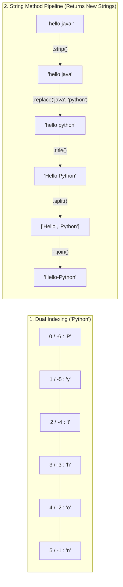

---
tags:
  - python
  - strings
  - string-methods
  - slicing
---

# Strings, Slicing, and String Methods in Python

#### TL;DR (Quick Revision)

**Python Strings (`str`)** = Immutable sequences of characters (`'...'`, `"..."`, `"""..."""`) + Dual indexing (`0` and `-1`), `[start:stop:step]` slicing, and dot-methods (`.upper()`, `.strip()`, `.replace()`, `.find()`, `.split()`, `.join()`) that always return a brand-new string ([An Informal Introduction to Python](https://docs.python.org/3/tutorial/introduction.html)).

> [!abstract] Core Idea
> A string is an ordered, **immutable** sequence of characters → You extract characters by index (`word[0]`, `word[-1]`) or slices (`word[0:3]`, `word[::2]`, `word[::-1]`) → Because strings cannot be modified in-place, every string method returns a **new string** that you store in a variable ([An Informal Introduction to Python](https://docs.python.org/3/tutorial/introduction.html)).

> [!question] Why Use It?
>
> - Extract substrings or reverse text cleanly in one step using `[start:stop:step]` slicing
> - Clean and normalize messy user input with `.strip()`, `.lower()`, `.upper()`, and `.title()`
> - Search and replace words safely with `.find()`, `.count()`, and `.replace()`
> - Break sentences into word lists with `.split()` and glue lists back into text with `.join()`

#### Quick Comparison Table

| Method / Operation | Example (`word = "Python"`) | Raises Error if Missing? | What It Returns & Does ([String Methods](https://docs.python.org/3/library/stdtypes.html)) |
| :--- | :--- | :---: | :--- |
| **Indexing** | `word[0]` (`'P'`), `word[-1]` (`'n'`) | Yes (`IndexError`) | Positive starts at `0` (left); negative starts at `-1` (right end). |
| **Slicing & Step** | `word[0:3]` (`'Pyt'`), `word[::2]` (`'Pto'`), `word[::-1]` (`'nohtyP'`) | No (Clamps safely) | Extracts from `start` (included) to `stop` (excluded) by `step`. |
| **Concat & Repeat** | `"Hello" + " " + "World"`, `"Hi " * 3` | No | `+` joins strings together; `*` repeats a string `n` times. |
| **Length (`len`)** | `len("Hello ")` → `6` | No | Counts all characters, **including spaces** and punctuation. |
| **Case Methods** | `.upper()`, `.lower()`, `.capitalize()`, `.title()`, `.swapcase()` | No | All upper, all lower, 1st char upper, each word's 1st char upper, or flipped case. |
| **Strip Spaces** | `.strip()`, `.lstrip()`, `.rstrip()` | No | Removes spaces from both ends (`strip`), left side (`lstrip`), or right side (`rstrip`). |
| **Replace Text** | `"I like Java".replace("Java", "Python")` | No | Returns a new string with occurrences of old substring replaced by new. |
| **`find()` vs `index()`** | `text.find("py")` vs `text.index("py")` | `find`: **No (`-1`)** / `index`: **Yes (`ValueError`)** | Both return the first index of substring; **`find()` returns `-1` if not found**, **`index()` crashes with `ValueError`**. |
| **Count Matches** | `"banana".count("a")` → `3` | No | Counts how many times a substring appears. |
| **`split()` & `join()`** | `"a b c".split()` / `"-".join(words)` | No | `split()` breaks a string into a `list`; `sep.join(list)` combines a list into a `str`. |

---

## The Learning Concept

### What Problem Does It Solve?

Imagine cleaning up a user's name and email input (`"  valay@java.com  "`). Because strings are **immutable**, calling `text.strip()` without saving the result leaves the original string untouched, and using `.index()` on missing text crashes your program:

```python
# BAD - Forgetting that strings are immutable and using .index() on missing text
text = "  I like Java  "
text.strip()                            # BAD: Result is thrown away! 'text' still has spaces!
text.replace("Java", "Python")          # BAD: Does NOT change 'text' in-place!
# text[0] = "i"                         # ERROR! TypeError: 'str' object does not support item assignment
# pos = text.index("Rust")              # ERROR! ValueError: substring not found

print("Original text is still dirty:", repr(text))
```

Since strings cannot be changed in-place, you must assign the returned string to a variable (`text = text.strip()`), and use `.find()` when a word might not exist:

```python
# GOOD - Save returned strings (or chain methods) and use .find() for safe searching
text = "  I like Java  "
clean_text = text.strip().replace("Java", "Python")     # GOOD: Chain and save the new string!

pos_python = clean_text.find("Python")                  # GOOD: Returns 7
pos_rust = clean_text.find("Rust")                      # GOOD: Returns -1 instead of crashing!

print("Cleaned text:", repr(clean_text))
print("Python at index:", pos_python, "| Rust at index:", pos_rust)
```

### How Python Implements It

> [!tip] Three Core String Patterns
>
> 1. **Single, Double, and Triple Quotes**: `'Hello'`, `"Hello"`, and `"""Hello"""` all create `str` objects; triple quotes allow multi-line strings ([An Informal Introduction to Python](https://docs.python.org/3/tutorial/introduction.html)).
> 2. **Two Ways to Reverse a String (From Your `main.py`)**: Either use slice step `name[::-1]` or loop through characters prepending each character (`rev = char + rev`).
> 3. **Split Apart, Join Together**: `text.split()` turns `"apple banana mango"` into `['apple', 'banana', 'mango']`, and `"-".join(words)` turns the list back into `"apple-banana-mango"`.

#### Full Runnable Example

```python
# Step 1: Creating Strings, Indexing (Positive & Negative) & Slicing
word = "Python"
print("Indexes -> [0]:", word[0], "| [2]:", word[2], "| [-1]:", word[-1])
print("Slices  -> [0:3]:", word[0:3], "| [2:5]:", word[2:5], "| [:4]:", word[:4], "| [::2]:", word[::2])

# Step 2: Reversing a String — Slice [::-1] vs For-Loop (from your main.py)
name = "harish"
rev_loop = ""
for char in name:
    rev_loop = char + rev_loop                  # Prepends each character to reverse
print("Reverse 'harish' -> Loop:", rev_loop, "| Slice [::-1]:", name[::-1])

# Step 3: Case Conversion & Removing Spaces
raw = "   hello python world   "
trimmed = raw.strip()                           # Removes spaces from both ends
print("Upper:", trimmed.upper())
print("Lower:", trimmed.lower())
print("Capitalize:", trimmed.capitalize())      # Only very first letter capitalized
print("Title:", trimmed.title())                # First letter of every word capitalized
print("Swapcase 'PyThon':", "PyThon".swapcase())

# Step 4: Replace, Search (find vs index), Count, Split & Join
replaced = "I like Java".replace("Java", "Python")
print("Replace:", replaced, "| Count 'a' in banana:", "banana".count("a"))
print("find('Python'):", trimmed.find("python"), "| find('missing'):", trimmed.find("missing"))
print("index('python'):", trimmed.index("python"))

words = "apple banana mango".split()            # Splits string into a list of words
joined = "-".join(words)                        # Joins list into a hyphenated string
print("Split list:", words, "| Joined string:", joined)
```

**Output:**

```
Indexes -> [0]: P | [2]: t | [-1]: n
Slices  -> [0:3]: Pyt | [2:5]: tho | [:4]: Pyth | [::2]: Pto
Reverse 'harish' -> Loop: hsirah | Slice [::-1]: hsirah
Upper: HELLO PYTHON WORLD
Lower: hello python world
Capitalize: Hello python world
Title: Hello Python World
Swapcase 'PyThon': pYtHON
Replace: I like Python | Count 'a' in banana: 3
find('Python'): 6 | find('missing'): -1
index('python'): 6
Split list: ['apple', 'banana', 'mango'] | Joined string: apple-banana-mango
```

### Visual Diagram: String Indexing & Method Pipeline



### Key Terminology

1. **Immutability**: Once a string is created in memory, its characters cannot be changed in-place (`word[0] = 'J'` raises `TypeError`) ([An Informal Introduction to Python](https://docs.python.org/3/tutorial/introduction.html)).
   Syntax: `new_word = "J" + word[1:]`

2. **Step Slicing (`word[::2]` and `word[::-1]`)**: The third number in `word[start:stop:step]` controls the stride—`2` takes every second character (`'Pto'`), and `-1` steps backward to reverse the string (`'nohtyP'`).
   Syntax: `"Python"[::-1]  # 'nohtyP'`

3. **`find()` vs. `index()`**: Both search for the first position of a substring, but `find()` returns `-1` when not found, whereas `index()` raises a `ValueError`.
   Syntax: `"Hello Python".find("Python")  # 6`

4. **`split()` and `join()`**: `split()` separates a string into a `list` of substrings; `sep.join(list)` combines a list of strings using `sep` between each item.
   Syntax: `"-".join(["apple", "banana", "mango"])`

> [!important] Key Rules to Remember
>
> - **Strings are immutable** → always capture the return value (`s = s.strip()`)
> - **`len()` counts spaces** → `len("Hi ")` is `3`, not `2`
> - **Call `.join()` on the separator** → write `"-".join(words)`, **not** `words.join("-")`
> - **Use `.find()` for safe checks** → returns `-1` on missing text instead of crashing with `ValueError`

---

## ◈ Edge Case Analysis

### 1. Quotes Inside F-Strings (`emp["name"]` in Python 3.12+ vs. Older Python)

✗ **Problem:** In your `main.py`, you wrote `print(f"Name: {emp["name"]}")` with double quotes inside a double-quoted f-string. In Python 3.12 and 3.14+, reusing quotes inside `{...}` is valid! However, in Python 3.11 and earlier, reusing the same quote inside an f-string raises a `SyntaxError` ([What's New in Python 3.12](https://docs.python.org/3/whatsnew/3.12.html)).
✓ **Fix:** Use single quotes inside double-quoted f-strings (`f"Name: {emp['name']}"`) so your code runs on every Python version.

```python
emp = {"name": "Valay", "age": 22}
print(f"Name: {emp['name']} | Age: {emp['age']}")
```

### 2. Default `.split()` vs. Explicit `.split(" ")` on Multiple Spaces

✗ **Problem:** Calling `"apple   banana".split()` (with no arguments) neatly groups multiple spaces together into `['apple', 'banana']`. Calling `.split(" ")` (with a single space) splits on every space individually, leaving empty `''` strings in the list!
✓ **Fix:** Use `.split()` with no arguments whenever splitting words separated by spaces.

```python
messy = "  apple   banana  "
print("Default .split():", messy.split())
print("Explicit .split(' '):", messy.split(" "))
```

### 3. `.join()` Crashes If the List Contains Numbers

✗ **Problem:** Calling `"-".join([1, 2, 3])` raises `TypeError: sequence item 0: expected str instance, int found`.
✓ **Fix:** Convert numbers to strings first (`"-".join(str(x) for x in [1, 2, 3])`).

```python
nums = [1, 2, 3]
print("Joined numbers:", "-".join(str(x) for x in nums))
```

---

## Going Deeper (Intermediate → Advanced)

### 1. Why `"".join(list)` Is Much Faster Than `rev = char + rev` on Huge Text

In a loop like `for char in name: rev = char + rev`, because strings are **immutable**, Python has to allocate a brand-new string and copy all characters on **every single iteration** (O(n²) time for large strings). Collecting pieces in a list and calling `"".join(pieces)` at the end allocates the final string only **once** in O(n) time!

### 2. Python 3.14 Template Strings (`t"..."`, PEP 750) vs. F-Strings (`f"..."`)

While an `f-string` (`f"Hello {name}"`) immediately returns a plain `str`, Python 3.14 introduces **Template Strings (`t-strings`)** prefixed with `t` (`t"SELECT * FROM users WHERE name = {name}"`), which return a `Template` object separating static text from interpolated values so libraries can automatically sanitize SQL or HTML inputs ([What's New in Python 3.14](https://docs.python.org/3/whatsnew/3.14.html)).

---

## Topic Mastery Quiz

Test yourself before moving to the next chapter. Pick the best answer for each question.

**Q1: Given `word = "Python"`, what is the output of `print(word[1:4], word[::2])`?**
- [ ] A) `yth Pto`
- [ ] B) `Pyt Phn`
- [ ] C) `ytho Pto`
- [ ] D) `yth yhn`

**Q2: What does `"Hello Python".find("Java")` return?**
- [ ] A) `False`
- [ ] B) `None`
- [ ] C) `-1`
- [ ] D) `ValueError`

**Q3: What is the output of `"PyThon".swapcase()`?**
- [ ] A) `Python`
- [ ] B) `PYTHON`
- [ ] C) `pYtHON`
- [ ] D) `python`

**Q4: Which code correctly joins `words = ["apple", "banana", "mango"]` with hyphens?**
- [ ] A) `words.join("-")`
- [ ] B) `"-".join(words)`
- [ ] C) `words.split("-")`
- [ ] D) `join(words, "-")`

**Q5: What does `"banana".count("a")` return?**
- [ ] A) `1`
- [ ] B) `2`
- [ ] C) `3`
- [ ] D) `6`

<details>
<summary>◈ View Answers & Explanations</summary>

1. **A** — `word[1:4]` extracts indices 1, 2, 3 (`'yth'`), and `word[::2]` takes every 2nd character at indices 0, 2, 4 (`'Pto'`).
2. **C** — `.find()` returns `-1` when the substring is not found (unlike `.index()`, which raises `ValueError`).
3. **C** — `.swapcase()` converts uppercase characters to lowercase and lowercase characters to uppercase (`'pYtHON'`).
4. **B** — `.join()` is a string method called on the separator string `"-"` with the list passed as its argument: `"-".join(words)`.
5. **C** — The letter `'a'` appears 3 times in `"banana"`.

</details>

---

## Practice Exercises

**Exercise 1: Username & Email Sanitizer**
- Given `raw_email = "   Valay.User@GMAIL.com   "`
- Strip spaces from both ends and convert the entire email to lowercase
- Use `.find("@")` and slicing to extract the username (`"valay.user"`) and domain (`"gmail.com"`)

**Exercise 2: URL Slug Generator**
- Given `heading = "  Introduction to Python Programming  "`
- Strip outer spaces, convert to lowercase, `.split()` into words, and `"-".join()` into `"introduction-to-python-programming"`

**Exercise 3: Palindrome Checker**
- Write a check that tests if a word (like `"madam"` or `"radar"`) reads the same forward and backward using `word == word[::-1]`

---

## Memory Trick / One-Liner

> [!tip] `find()` vs `index()` Memory Trick
> - **`find()` is Friendly** → returns **`-1`** if missing (never crashes)
> - **`index()` is Intolerant** → throws a **`ValueError`** if missing!

---

## Warning Block (Best Practice)

> [!warning] Common Mistake (Avoid This!)
>
> ```python
> # BAD - Calling string methods without reassigning the variable
> name = "  valay  "
> name.strip()
> name.capitalize()
> print(name)                   # Still prints '  valay  ' with spaces!
> ```
>
> ```python
> # GOOD - Reassign the variable (and chain the methods!)
> name = "  valay  "
> name = name.strip().capitalize()
> print(name)                   # Prints 'Valay'
> ```
