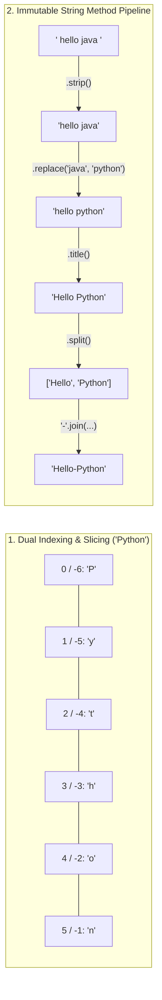

---
tags:
  - python
  - strings
  - string-methods
---

# Strings & Methods in Python

## TL;DR (Quick Revision)

**Python Strings (`str`)** = Immutable sequences of Unicode characters (`'...'`, `"..."`, `"""..."""`) + 0-based/negative indexing, `[start:stop:step]` slicing, and non-mutating `.method()` transformations that always return a new string ([An Informal Introduction to Python](https://docs.python.org/3.14/tutorial/introduction.html), [String Operations](https://docs.python.org/3/library/string.html)).

> [!abstract] Core Idea
> A `str` is an immutable sequence of characters supporting positive indices (`0` to `len(s)-1`), negative indices (`-1` to `-len(s)`), step-based slicing (`s[start:stop:step]`), concatenation (`+`), and repetition (`*`) ([An Informal Introduction to Python](https://docs.python.org/3.14/tutorial/introduction.html)). Because strings cannot be modified in place after creation, every string method—case conversion, whitespace stripping, searching, replacing, splitting, and joining—returns a brand-new object ([An Informal Introduction to Python](https://docs.python.org/3.14/tutorial/introduction.html)).

> [!question] Why Use It?
>
> - **O(1) Character Access & Flexible Slicing**: Extracts substrings with `[start:stop:step]` and reverses strings concisely via `text[::-1]` ([An Informal Introduction to Python](https://docs.python.org/3.14/tutorial/introduction.html)).
> - **Immutability Safety**: Guarantees that passing a string to a function or using it as a `dict` key / `set` element is safe from in-place mutation ([An Informal Introduction to Python](https://docs.python.org/3.14/tutorial/introduction.html)).
> - **Built-in Text Pipeline Methods**: Normalizes case (`upper`, `lower`, `capitalize`, `title`, `swapcase`), trims whitespace (`strip`, `lstrip`, `rstrip`), searches (`find`, `index`, `count`), and tokenizes (`split`, `join`).
> - **Modern Formatting (f-strings & 3.14 t-strings)**: Supports inline expression interpolation (`f"{val}"`) and Python 3.14 `string.templatelib.Template` (`t"{val}"`) for custom sanitization ([What's New in Python 3.14](https://docs.python.org/3/whatsnew/3.14.html)).

## Quick Reference Table

| Method / Operation | Syntax Example | Raises on Miss? | Returns Type | Exact Behavior ([Official Docs](https://docs.python.org/3.14/tutorial/introduction.html)) |
| :--- | :--- | :---: | :---: | :--- |
| **Indexing** | `word[0]`, `word[-1]` | `✓` (`IndexError`) | `str` (len 1) | Positive starts at `0` (left); negative starts at `-1` (rightmost character). |
| **Slicing & Step** | `word[0:3]`, `word[::2]`, `word[::-1]` | `✗` (Clamps) | `str` | Extracts from `start` (included) to `stop` (excluded) by `step`; `[::-1]` reverses. |
| **Concat & Repeat** | `a + " " + b`, `"Hi " * 3` | `✗` | `str` | `+` joins strings together; `*` repeats a string `n` times. |
| **Length** | `len(text)` | `✗` | `int` | Returns total character count, **including spaces** and escape characters. |
| **Case Conversion** | `.upper()`, `.lower()`, `.capitalize()`, `.title()`, `.swapcase()` | `✗` | `str` | All uppercase, all lowercase, first char upper, each word's first char upper, or inverted case. |
| **Whitespace Strip** | `.strip()`, `.lstrip()`, `.rstrip()` | `✗` | `str` | Removes leading & trailing spaces (`strip`), left-only (`lstrip`), or right-only (`rstrip`). |
| **Replace** | `text.replace("Java", "Python")` | `✗` | `str` | Replaces all occurrences (or `count` occurrences) of old substring with new. |
| **`find()` vs `index()`** | `text.find("py")` vs `text.index("py")` | `find`: `✗` / `index`: `✓` | `int` | Both return first index of substring; **`find()` returns `-1`** if missing, **`index()` raises `ValueError`**. |
| **Occurrence Count** | `"banana".count("a")` | `✗` | `int` | Counts non-overlapping occurrences of substring (`3` for `"a"` in `"banana"`). |
| **Split & Join** | `text.split()` / `"-".join(words)` | `✗` | `list` / `str` | `split()` separates a string into a `list`; `sep.join(iterable)` combines strings using `sep`. |

## The Learning Concept

#### What Problem Does It Solve?

When normalizing user profile input, attempting to mutate a character by index (`text[0] = "H"`), ignoring `text.strip()` return values, or using `.index()` on untrusted input without handling missing substrings crashes the program ([An Informal Introduction to Python](https://docs.python.org/3.14/tutorial/introduction.html)):

```python
# BAD - Expecting in-place string mutation and using .index() on missing text
text = "  hello java  "
text.strip()                            # BAD: return value ignored! 'text' still has spaces
text.replace("java", "python")          # BAD: strings are immutable; original 'text' is unchanged
# text[0] = "H"                         # BAD: raises TypeError: 'str' object does not support item assignment
# pos = text.index("rust")              # BAD: raises ValueError: substring not found
print("Unchanged:", repr(text))
# Output: Unchanged: '  hello java  '
```

Strings are **immutable**—calling `text.strip()` or `text.replace()` does not alter `text` in place. Furthermore, `.index()` raises `ValueError` when the target is absent, whereas `.find()` safely returns `-1`.

```python
# GOOD - Reassigning method return values and using .find() for safe substring lookup
text = "  hello java  "
cleaned = text.strip().replace("java", "python").title()  # GOOD: chain & capture new str
pos_python = cleaned.find("Python")                       # GOOD: returns 6
pos_rust = cleaned.find("Rust")                           # GOOD: returns -1 (no crash)
print("Cleaned:", repr(cleaned), "| Python idx:", pos_python, "| Rust idx:", pos_rust)
# Output: Cleaned: 'Hello Python' | Python idx: 6 | Rust idx: -1
```

#### How Python Implements It

> [!tip] Four Core String Mechanics
>
> 1. **Single, Double & Triple Quotes**: `'Hello'`, `"Hello"`, and `"""Hello"""` all create `str` objects; triple quotes allow multi-line text with embedded newlines ([An Informal Introduction to Python](https://docs.python.org/3.14/tutorial/introduction.html)).
> 2. **Dual Indexing & Step Slicing**: For `word = "Python"`, positive indices run `0..5` and negative indices run `-6..-1`; `word[::2]` steps by 2 (`'Pto'`) and `word[::-1]` steps backward (`'nohtyP'`).
> 3. **Dot-Method Chaining**: String methods are called with a dot (`variable.method()`) and return a new `str`, enabling fluent pipelines like `raw.strip().lower().split()`.
> 4. **Inverse `split()` and `join()`**: `text.split()` breaks a string into a `list` of words (`['apple', 'banana', 'mango']`), while `"-".join(words)` glues a sequence of strings back into a single `str` (`'apple-banana-mango'`).

#### Full Runnable Example

```python
# Complete runnable demonstration of Indexing, Slicing, Reversal & All 13 String Methods
if __name__ == "__main__":
    # 1. String creation (single, double, triple quotes) & length (including spaces)
    a, b, c = 'Hello', "World", """Python 3.14"""
    greeting = a + " " + b                      # Concatenation (+)
    echo = ("Hi " * 3).rstrip()                 # Repetition (*) + right-strip

    # 2. Positive/Negative Indexing & Slicing with Step
    word = "Python"
    first_ch, third_ch, last_ch = word[0], word[2], word[-1]
    s1, s2, s3 = word[0:3], word[2:5], word[:4]
    every_second = word[::2]                    # Indices 0, 2, 4 -> 'Pto'
    reversed_word = word[::-1]                  # Step -1 reverses string -> 'nohtyP'

    # 3. Case Methods & Whitespace Removal
    dirty = "   hello python world   "
    trimmed = dirty.strip()                     # Removes spaces from both ends
    swapped = "PyThon".swapcase()               # Upper -> lower and lower -> upper

    # 4. Replace, Search (find vs index), Count, Split & Join
    replaced = "I like Java".replace("Java", "Python")
    found_idx = trimmed.find("python")          # 6
    missing_idx = trimmed.find("ruby")          # -1 (safe miss)
    exact_idx = trimmed.index("python")         # 6 (raises ValueError if missing)
    a_count = "banana".count("a")               # 3
    tokens = "apple banana mango".split()       # ['apple', 'banana', 'mango']
    joined = "-".join(tokens)                   # 'apple-banana-mango'

    print(f"Greeting:{greeting} (len={len(greeting)}) | Echo:{echo}")
    print(f"Index: [0]={first_ch} [2]={third_ch} [-1]={last_ch}")
    print(f"Slices: [0:3]={s1} [2:5]={s2} [:4]={s3} [::2]={every_second} [::-1]={reversed_word}")
    print(f"Cases: upper='{trimmed.upper()}' cap='{trimmed.capitalize()}' title='{trimmed.title()}' swap='{swapped}'")
    print(f"Search: find={found_idx} miss={missing_idx} index={exact_idx} count('a')={a_count}")
    print(f"Replace:'{replaced}' | Split:{tokens} | Join:'{joined}'")
```

**Output:**

```Output
Greeting:Hello World (len=11) | Echo:Hi Hi Hi
Index: [0]=P [2]=t [-1]=n
Slices: [0:3]=Pyt [2:5]=tho [:4]=Pyth [::2]=Pto [::-1]=nohtyP
Cases: upper='HELLO PYTHON WORLD' cap='Hello python world' title='Hello Python World' swap='pYtHON'
Search: find=6 miss=-1 index=6 count('a')=3
Replace:'I like Python' | Split:['apple', 'banana', 'mango'] | Join:'apple-banana-mango'
```

#### Visual Diagram



#### Key Terminology

1. **String Immutability**: Once created, a `str` object's characters cannot be reassigned in place (`word[0] = 'J'` raises `TypeError`) ([An Informal Introduction to Python](https://docs.python.org/3.14/tutorial/introduction.html)).
   Syntax: `new_word = "J" + word[1:]`
2. **Stride / Step Slicing (`s[start:stop:step]`)**: Extracts every `step`-th character between `start` and `stop`; a negative step (`-1`) traverses right-to-left.
   Syntax: `"Python"[::2]  # 'Pto'; "Python"[::-1]  # 'nohtyP'`
3. **`find()` vs. `index()`**: Both locate the first index of a substring, but `find()` returns `-1` when not found whereas `index()` raises `ValueError`.
   Syntax: `"Hello Python".find("Python")  # 6`
4. **`split()` and `join()`**: `s.split(sep)` splits a string into a `list` of substrings; `sep.join(iterable)` concatenates a sequence of strings using `sep` as the delimiter.
   Syntax: `"-".join(["apple", "banana", "mango"])`

> [!important] Key Rules to Remember
>
> - **Spaces Count in `len()`**: `len("Hello ")` is `6` because spaces and punctuation are characters.
> - **`join()` Is Called on the Separator**: Write `"-".join(words)`, **not** `words.join("-")` (`list` has no `.join()` method).
> - **`join()` Requires `str` Elements**: Passing integers inside `"-".join([1, 2])` raises `TypeError`; convert elements to `str` first.

## ◈ Edge Case Analysis

#### 1. `split()` (Default) vs. `split(" ")` (Explicit Single Space)
**Problem:** Calling `text.split()` with no arguments splits on **any run of consecutive whitespace** and strips leading/trailing whitespace, whereas `text.split(" ")` splits strictly on single spaces, producing empty strings `''` for multiple spaces.
**Fix:** Use `text.split()` (without arguments) when tokenizing human-typed text with irregular spacing.

```python
# Fix: default .split() collapses consecutive spaces; .split(" ") keeps empty tokens
messy = "  apple   banana  "
print("Default split():", messy.split())
print("Explicit split(' '):", messy.split(" "))
```

**Output:**

```Output
Default split(): ['apple', 'banana']
Explicit split(' '): ['', '', 'apple', '', '', 'banana', '', '']
```

#### 2. `strip(chars)` Strips a Character Set, Not a Prefix/Suffix Word
**Problem:** Passing a string to `.strip("cmowz.")` removes **any combination** of those characters from both ends, not the literal word `"cmowz."` (`removeprefix()` / `removesuffix()` remove exact substrings).
**Fix:** Use `.removeprefix(prefix)` or `.removesuffix(suffix)` when stripping an exact prefix or file extension.

```python
# Fix: use removesuffix() for exact extension removal instead of rstrip()
filename = "notes_md.md"
print("rstrip('.md'):", filename.rstrip(".md"), "| removesuffix('.md'):", filename.removesuffix(".md"))
```

**Output:**

```Output
rstrip('.md'): notes_ | removesuffix('.md'): notes_md
```

#### 3. `.title()` vs. `.capitalize()` with Apostrophes
**Problem:** `.title()` capitalizes the first letter after **any non-letter character** (so `"they're".title()` becomes `"They'Re"`), whereas `.capitalize()` uppercases only the very first character of the string and lowercases the rest.
**Fix:** Be aware of apostrophe behavior in `.title()` or use `string.capwords(s)` from the standard library ([string Module](https://docs.python.org/3/library/string.html)).

```python
# Fix: compare .title() and .capitalize() on contractions
phrase = "they're learning PYTHON"
print("capitalize():", phrase.capitalize(), "| title():", phrase.title())
```

**Output:**

```Output
capitalize(): They're learning python | title(): They'Re Learning Python
```

#### 4. Python 3.14 Template Strings (`t'...'`) vs. `f'...'` Strings
**Problem:** An `f-string` (`f"Hello {user}"`) immediately evaluates to a flat `str`, making it impossible to sanitize interpolated user input afterward; Python 3.14 introduces `t-strings` (`t"Hello {user}"`, PEP 750) which evaluate to a `string.templatelib.Template` object instead of `str` ([What's New in Python 3.14](https://docs.python.org/3/whatsnew/3.14.html)).
**Fix:** Use `f"..."` when you want an immediate `str`, and `t"..."` in Python 3.14+ when building SQL/HTML sanitizers that inspect `Interpolation` parts.

```python
# Fix: f-strings return str immediately (standard across Python 3.6 - 3.14+)
user = "Rahul"
formatted = f"Welcome, {user.upper()}!"
print(type(formatted).__name__, "->", formatted)
```

**Output:**

```Output
str -> Welcome, RAHUL!
```

## Topic Mastery Quiz

Test yourself on Python string immutability, slicing mechanics, searching, and case manipulation.

**Q1: What is the exact difference between `text.find("python")` and `text.index("python")` when the substring is missing?**
- [ ] A) `find()` returns `-1`, whereas `index()` raises `ValueError`
- [ ] B) `find()` raises `ValueError`, whereas `index()` returns `None`
- [ ] C) Both return `None`
- [ ] D) `find()` returns `False`, whereas `index()` returns `-1`

**Q2: Given `word = "Python"`, what is the result of evaluating `word[::2]` and `word[::-1]`?**
- [ ] A) `'Pto'` and `'nohtyP'`
- [ ] B) `'yhn'` and `'Python'`
- [ ] C) `'Pto'` and `'Pto'`
- [ ] D) `'Python'` and `'nohtyP'`

**Q3: Given `text = "hello"`, what happens when running `text.upper()` followed by `print(text)`?**
- [ ] A) It prints `'hello'` because strings are immutable and `upper()` returns a new string
- [ ] B) It prints `'HELLO'` because `upper()` mutates the string in place
- [ ] C) It raises `AttributeError`
- [ ] D) It prints `None`

**Q4: How does `capitalize()` behave differently from `title()` on `"hELLO pYTHON"`?**
- [ ] A) `capitalize()` makes only the first character uppercase and all others lowercase (`'Hello python'`), while `title()` capitalizes each word (`'Hello Python'`)
- [ ] B) Both produce identical output `'Hello Python'`
- [ ] C) `title()` converts to all uppercase, while `capitalize()` lowercases all
- [ ] D) `capitalize()` affects only vowels

**Q5: What is the key difference between calling `text.split()` with no arguments versus `text.split(" ")`?**
- [ ] A) `split()` discards all whitespace; `split(" ")` raises `ValueError` on empty text
- [ ] B) `split()` collapses consecutive whitespace runs and strips edges; `split(" ")` splits strictly on single space, preserving empty tokens
- [ ] C) There is no difference; they are aliases
- [ ] D) `split()` splits on tabs only

**Q6: Why does `"-".join([1, 2, 3])` fail with a `TypeError`?**
- [ ] A) `join` is a list method, so it must be called as `[1, 2, 3].join("-")`
- [ ] B) `join` requires an iterable where all elements are strings
- [ ] C) Delimiter `"-"` cannot be used with numeric data
- [ ] D) Python lists cannot be joined

<details>
<summary>◈ View Answers & Explanations</summary>

1. **Answer: A** — Both search for the lowest index of the substring, but when absent, `find()` returns `-1` while `index()` raises `ValueError`.
2. **Answer: A** — Slicing takes `[start:stop:step]`. `word[::2]` extracts characters at indices 0, 2, 4 (`'Pto'`), while `word[::-1]` steps backwards by `-1`, reversing the string (`'nohtyP'`).
3. **Answer: A** — Strings in Python are immutable. All string methods return a new string object and leave the original instance unmodified.
4. **Answer: A** — `capitalize()` uppercases the very first character and forces all subsequent characters to lowercase. `title()` capitalizes the first character of every word.
5. **Answer: B** — Default `split()` treats runs of arbitrary whitespace as a single delimiter and strips leading/trailing space. Passing `" "` splits strictly on single spaces, preserving empty strings for adjacent spaces.
6. **Answer: B** — `str.join()` requires all sequence items to be string instances; passing integers raises `TypeError: sequence item 0: expected str instance, int found`.

</details>
