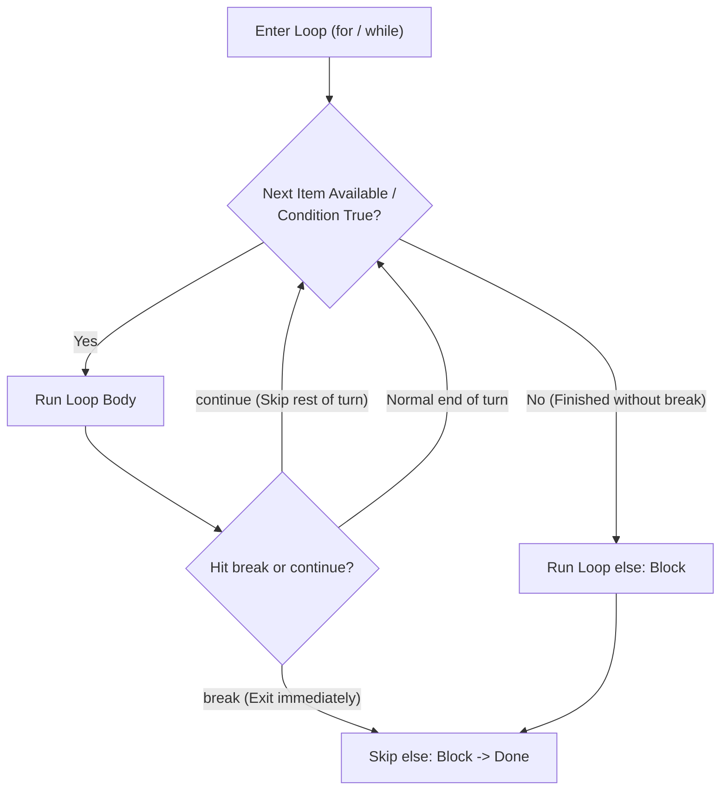

---
tags:
  - python
  - control-flow
  - loops
  - range
---

# Program Flow: Conditionals and Loops in Python

#### TL;DR (Quick Revision)

**Program Flow** = Make decisions with `if` / `elif` / `else` (and `match` / `case`) + Repeat actions with `while` and `for` loops using `range(start, stop, step)`, `break`, `continue`, and loop `else` ([More Control Flow Tools](https://docs.python.org/3/tutorial/controlflow.html)).

> [!abstract] Core Idea
> Normally Python runs code line-by-line from top to bottom → **Conditionals** (`if` / `elif` / `else`) choose which block to run based on `True`/`False` conditions → **Loops** (`while` and `for`) repeat blocks over sequences or `range()` progressions until stopped by exhaustion or `break` ([More Control Flow Tools](https://docs.python.org/3/tutorial/controlflow.html)).

> [!question] Why Use It?
>
> - Branch program logic cleanly with `if`, `elif`, and `else` combined with `and` / `or` conditions
> - Loop directly through every character in a string or item in a list using `for x in seq:`
> - Generate number sequences in O(1) memory using `range(stop)`, `range(start, stop)`, and `range(start, stop, step)`
> - Exit loops early with `break`, skip iterations with `continue`, and detect unbroken completion with `for ... else:`

#### Quick Comparison Table

| Statement / Function | Syntax Example | Stops Loop Early? | Key Behavior ([Official Tutorial Ch. 4.1–4.7](https://docs.python.org/3/tutorial/controlflow.html)) |
| :--- | :--- | :---: | :--- |
| **`if` / `elif` / `else`** | `if x > 0: ... elif x == 0: ... else: ...` | No | Runs **only the first** branch whose condition is `True`. |
| **`while` Loop** | `while count < 5:` | No | **Pre-test loop**: checks condition *before* each run (may run 0 times). |
| **`for` Loop** | `for char in "PYTHON":` | No | Iterates directly over items of any `str`, `list`, `tuple`, or `range` in order. |
| **`range(stop)`** | `range(5)` → `0, 1, 2, 3, 4` | No | Starts at `0`, steps by `1`, and stops **before** `stop` (`5` is excluded!). |
| **`range(start, stop, step)`** | `range(2, 11, 2)` → `2, 4, 6, 8, 10` | No | Starts at `start`, increments by `step`, and excludes `stop`. |
| **`break` Keyword** | `break` | **Yes** | Immediately exits the innermost `for` or `while` loop (and skips loop `else`). |
| **`continue` Keyword** | `continue` | No | Skips the rest of the current iteration and jumps to the next iteration. |
| **Loop `else` Clause** | `for x in seq: ... else: ...` | No | Runs after the loop finishes—**only if the loop did NOT exit via `break`**. |
| **`pass` Keyword** | `pass` | No | Do-nothing placeholder when syntax requires a block (`if`, `def`, `class`). |
| **`match` / `case`** | `match status: case 404: ... case _:` | No | Structural pattern matching (Python 3.10+); `_` is the default wildcard. |

---

## The Learning Concept

### What Problem Does It Solve?

Imagine searching for a factor of a number or modifying a collection while looping over it. If you forget how `break` interacts with a loop, or if you delete items directly from a dictionary/list while iterating over it, you get bugs or crashes:

```python
# BAD - Modifying a dictionary directly while iterating over it crashes!
users = {"Rahul": "active", "Priya": "inactive", "Aman": "active"}

# for user, status in users.items():
#     if status == "inactive":
#         del users[user]       # ERROR! RuntimeError: dictionary changed size during iteration
print("Never delete keys directly from a dict while looping over it!")
```

To safely remove items during a loop, iterate over a copy (`users.copy().items()`) or build a new filtered collection ([More Control Flow Tools](https://docs.python.org/3/tutorial/controlflow.html)):

```python
# GOOD - Iterate over a shallow copy (.copy()) when deleting items in a loop
users = {"Rahul": "active", "Priya": "inactive", "Aman": "active"}

for user, status in users.copy().items():
    if status == "inactive":
        del users[user]         # GOOD: Safely removes 'Priya'

print("Active users remaining:", users)
```

### How Python Implements It

> [!tip] Four Essential Control Flow Mechanics
>
> 1. **Combining `and` / `or` in `if` Statements**: Use `if age >= 18 and has_id:` (both must be true) or `if role == "admin" or role == "owner":` (at least one true).
> 2. **Three Forms of `range()`**:
>    - `range(5)` → `0, 1, 2, 3, 4` (starts at `0`, excludes `5`)
>    - `range(1, 6)` → `1, 2, 3, 4, 5` (starts at `1`, excludes `6`)
>    - `range(2, 11, 2)` → `2, 4, 6, 8, 10` (starts at `2`, steps by `2`, excludes `11`)
> 3. **Reversing a String with a `for` Loop (From Your `main.py` & PDF Page 16)**: Loop through each character `for char in name:` and prepend `rev = char + rev`.
> 4. **How `for ... else` Works**: Attach `else:` at the **same indentation level as `for`** (not `if`!). The `else:` block runs only when the loop completes all iterations **without hitting `break`** ([More Control Flow Tools](https://docs.python.org/3/tutorial/controlflow.html)).

#### Full Runnable Example

```python
# Step 1: if / elif / else with 'and' / 'or' conditions
marks = 82
attendance = 90
if marks >= 80 and attendance >= 75:
    grade = "A (Distinction)"
elif marks >= 60 or attendance >= 95:
    grade = "B (Pass)"
else:
    grade = "C (Needs Improvement)"

# Step 2: All 3 forms of range() in for loops
r1 = [i for i in range(5)]                      # range(stop) -> [0, 1, 2, 3, 4]
r2 = [i for i in range(1, 6)]                   # range(start, stop) -> [1, 2, 3, 4, 5]
r3 = [i for i in range(2, 11, 2)]               # range(start, stop, step) -> [2, 4, 6, 8, 10]

# Step 3: Looping through string values & reversing a string (from your main.py)
name = "harish"
rev = ""
for char in name:
    rev = char + rev                            # Prepends each character

# Step 4: break, continue, and for-loop else (Prime Number Finder from Official Tutorial)
primes = []
for n in range(2, 10):
    for x in range(2, n):
        if n % x == 0:
            break                               # Found a factor -> not prime, exit inner loop
    else:
        # Belongs to the inner 'for x' loop! Runs ONLY if 'break' did NOT happen
        primes.append(n)

# Step 5: while loop with continue and break
visited = []
k = 0
while k < 6:
    k += 1
    if k == 2:
        continue                                # Skip number 2
    if k == 5:
        break                                   # Stop completely at 5
    visited.append(k)

print("Grade:", grade)
print("range(5):", r1, "| range(1,6):", r2, "| range(2,11,2):", r3)
print("Reversed 'harish':", rev)
print("Primes (2..9) via for-else:", primes)
print("While loop (skip 2, stop at 5):", visited)
```

**Output:**

```
Grade: A (Distinction)
range(5): [0, 1, 2, 3, 4] | range(1,6): [1, 2, 3, 4, 5] | range(2,11,2): [2, 4, 6, 8, 10]
Reversed 'harish': hsirah
Primes (2..9) via for-else: [2, 3, 5, 7]
While loop (skip 2, stop at 5): [1, 3, 4]
```

### Visual Diagram: How `for` / `while` + `break` + `else` Works



### Key Terminology

1. **`elif` Keyword**: Short for `"else if"`; checks another condition only if all previous `if`/`elif` conditions were `False` ([More Control Flow Tools](https://docs.python.org/3/tutorial/controlflow.html)).
   Syntax: `elif score >= 75:`

2. **`range(start, stop, step)`**: Lazy sequence generator that yields numbers from `start` up to (but **excluding**) `stop`, stepping by `step` ([More Control Flow Tools](https://docs.python.org/3/tutorial/controlflow.html)).
   Syntax: `for i in range(2, 11, 2):`

3. **`break` vs. `continue`**: `break` terminates the innermost loop completely; `continue` skips the rest of the current iteration and moves to the next iteration ([More Control Flow Tools](https://docs.python.org/3/tutorial/controlflow.html)).
   Syntax: `if x == 5: break`

4. **Loop `else` Statement**: An `else:` clause aligned with `for` or `while` that executes when the loop finishes normally **without hitting `break`** ([More Control Flow Tools](https://docs.python.org/3/tutorial/controlflow.html)).
   Syntax: `for x in nums: ... else: print("No break occurred")`

> [!important] Key Rules to Remember
>
> - **`range()` never includes `stop`** → `range(1, 6)` stops at `5`
> - **`while` vs `do-while`** → `while` checks the condition *first*; Python has no `do-while` keyword (emulate it with `while True: ... if not cond: break`)
> - **`break` skips loop `else`** → if a loop exits via `break`, its `else:` block does **not** run
> - **`pass` does nothing** → use `pass` as an empty placeholder in `class Emp: pass` or `if cond: pass`

---

## ◈ Edge Case Analysis

### 1. Loop `else:` Runs Even When the List Is Empty!

✗ **Problem:** Many people think `for x in items: ... else:` means *"run `else` if `items` was empty."* That's wrong! `else:` means **"no `break` occurred"**—so on an empty list `[]`, the loop finishes 0 iterations without breaking and **runs `else:`**! ([More Control Flow Tools](https://docs.python.org/3/tutorial/controlflow.html)).
✓ **Fix:** Think of loop `else:` as **`nobreak:`**.

```python
for x in []:
    if x == 99:
        break
else:
    print("Ran else because 'break' never happened (even on an empty list!)")
```

### 2. Counting Backwards with `range()` Requires a Negative `step`

✗ **Problem:** Writing `list(range(5, 0))` returns an empty list `[]` because the default step is `+1`!
✓ **Fix:** Pass `-1` as the third argument: `range(5, 0, -1)`.

```python
print("Missing -1 step:", list(range(5, 0)))
print("With -1 step:", list(range(5, 0, -1)))
```

### 3. Modifying the Loop Variable `i` Inside `for i in range(5):` Does Not Skip Steps

✗ **Problem:** In C/Java, changing `i = 10` inside a `for` loop changes the loop counter. In Python, `for i in range(5):` overwrites `i` with the next value from `range(5)` at the start of every iteration!
✓ **Fix:** Use a `while` loop if you need to jump the counter dynamically inside the body.

```python
visited = []
for i in range(4):
    visited.append(i)
    i = 99                              # Ignored on next turn! range(4) still assigns 1, 2, 3
print("For loop ignored i = 99:", visited)
```

---

## Going Deeper (Intermediate → Advanced)

### 1. Why `range(10_000_000)` Uses Almost Zero Memory

If you print `range(10)`, Python prints `range(0, 10)` instead of `[0, 1, 2, ..., 9]`. Why? Because `range()` is a **lazy sequence object**: it only stores three integers (`start`, `stop`, `step`) in memory and calculates each number on the fly as you iterate over it ([More Control Flow Tools](https://docs.python.org/3/tutorial/controlflow.html)).

### 2. Structural Pattern Matching (`match` / `case`, Python 3.10+)

When comparing a value against multiple patterns or unpacking tuples/dicts, `match` / `case` is cleaner than a long `if`/`elif` ladder ([More Control Flow Tools](https://docs.python.org/3/tutorial/controlflow.html)):

```python
def handle_command(cmd):
    match cmd.split():
        case ["quit"]:
            return "Exiting program"
        case ["load", filename]:
            return f"Loading {filename}"
        case ["move", x, y] if int(x) >= 0 and int(y) >= 0:
            return f"Moving to ({x}, {y})"
        case _:
            return "Unknown command"

print(handle_command("load notes.md"))
print(handle_command("move 10 20"))
```

---

## Topic Mastery Quiz

Test yourself before moving to the next chapter. Pick the best answer for each question.

**Q1: What numbers does `list(range(2, 11, 2))` produce?**
- [ ] A) `[2, 4, 6, 8, 10, 11]`
- [ ] B) `[2, 4, 6, 8, 10]`
- [ ] C) `[2, 3, 4, 5, 6, 7, 8, 9, 10]`
- [ ] D) `[0, 2, 4, 6, 8, 10]`

**Q2: What is the output of this code?**
```python
for n in [1, 2, 3]:
    if n == 2:
        break
else:
    print("Done")
```
- [ ] A) Prints `Done`
- [ ] B) Prints nothing (because `break` skipped the `else` block)
- [ ] C) `SyntaxError` (`else` cannot be used with `for`)
- [ ] D) Prints `1 2 Done`

**Q3: In `for char in "cat": rev = char + rev` (starting with `rev = ""`), what is `rev` after the loop?**
- [ ] A) `"cat"`
- [ ] B) `"tac"`
- [ ] C) `"c"`
- [ ] D) `"t"`

**Q4: What does `list(range(5, 1))` return?**
- [ ] A) `[5, 4, 3, 2]`
- [ ] B) `[5, 4, 3, 2, 1]`
- [ ] C) `[]` (Empty list)
- [ ] D) `ValueError`

**Q5: Which keyword is used as an empty placeholder body inside `class Emp:` when you haven't written code yet?**
- [ ] A) `continue`
- [ ] B) `null`
- [ ] C) `pass`
- [ ] D) `break`

<details>
<summary>◈ View Answers & Explanations</summary>

1. **B** — `range(2, 11, 2)` starts at `2`, increments by `2` (`2, 4, 6, 8, 10`), and stops before `11`.
2. **B** — Because the loop exited early via `break` when `n == 2`, the loop's `else` clause is skipped.
3. **B** — Iteration 1: `"c" + ""` = `"c"`; Iteration 2: `"a" + "c"` = `"ac"`; Iteration 3: `"t" + "ac"` = `"tac"`.
4. **C** — With default step `+1`, starting at `5` and stopping before `1` yields no numbers (`[]`). You need `range(5, 1, -1)` to count down.
5. **C** — `pass` is Python's no-op placeholder statement when syntax requires an indented block.

</details>

---

## Practice Exercises

**Exercise 1: Multiplication Table with `range()`**
- Given `num = 7`
- Use `for i in range(1, 11):` to print `7 x 1 = 7` through `7 x 10 = 70`

**Exercise 2: Search with `for ... else`**
- Given `nums = [12, 28, 21, 39, 13, 18]` and `target = 25`
- Loop through `nums`; if `target` is found, print its value and `break`
- Attach an `else:` block to the `for` loop that prints `"Target not found"` if the loop completes without breaking

**Exercise 3: Odd Number Filter with `continue`**
- Loop over `range(1, 10)`
- Use `if n % 2 == 0: continue` to skip all even numbers and collect only the odd numbers

---

## Memory Trick / One-Liner

> [!tip] Think of Loop `else:` as `nobreak:`
> Whenever you see `else:` lined up under a `for` or `while` loop, mentally read the word `else:` as **`if_no_break_happened:`**!

---

## Warning Block (Best Practice)

> [!warning] Common Mistake (Avoid This!)
>
> ```python
> # BAD - Indenting 'else' under 'if' inside a search loop!
> for x in [10, 20, 30]:
>     if x == 20:
>         print("Found 20!")
>         break
>     else:
>         print("Not found!")   # BUG! Prints 'Not found!' on 10 before checking 20!
> ```
>
> ```python
> # GOOD - Align 'else' with 'for' so it only runs if the WHOLE loop fails to find 20
> for x in [10, 20, 30]:
>     if x == 20:
>         print("Found 20!")
>         break
> else:
>     print("Not found!")       # Only runs if 20 is missing from the entire list!
> ```
