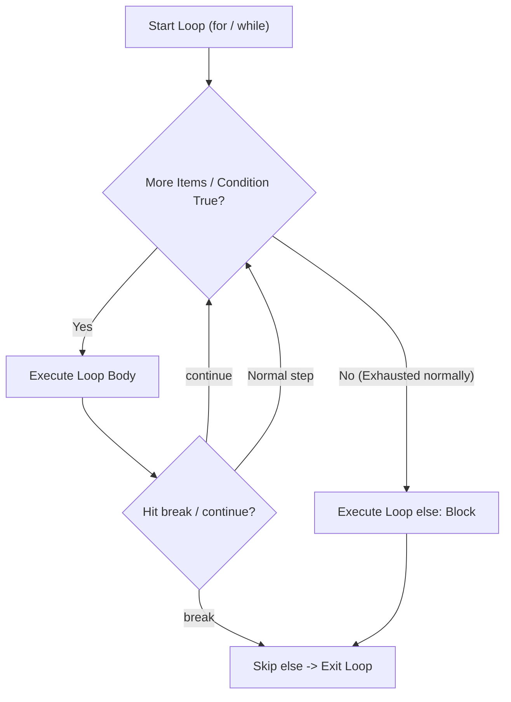

---
tags:
  - python
  - control-flow
  - loops-and-match
---

# Control Flow & Loops in Python

## TL;DR (Quick Revision)

**Program Flow** = Conditional branching (`if` / `elif` / `else`, `match` / `case`) + iterative loops (`while`, `for ... in`, `range(start, stop, step)`) controlled by `break`, `continue`, loop-`else`, and `pass` ([More Control Flow Tools](https://docs.python.org/3/tutorial/controlflow.html)).

> [!abstract] Core Idea
> Normally Python executes statements top-to-bottom; control flow statements direct execution conditionally (`if` / `elif` / `else` and structural `match` / `case`) or repeatedly (`while` pre-test loops and sequence-driven `for` loops) ([More Control Flow Tools](https://docs.python.org/3/tutorial/controlflow.html)). The built-in `range()` function generates lazy arithmetic progressions without allocating a full list in memory, while `break`, `continue`, and loop `else` clauses manage early termination and completion logic ([More Control Flow Tools](https://docs.python.org/3/tutorial/controlflow.html)).

> [!question] Why Use It?
>
> - **Clean Multi-Way Branching**: Replaces deeply nested `if`/`else` chains with flat `elif` ladders or structural `match` / `case` pattern matching ([More Control Flow Tools](https://docs.python.org/3/tutorial/controlflow.html)).
> - **Direct Sequence Iteration**: `for variable in sequence:` iterates directly over items of any `str`, `list`, or `tuple` in order without manual index counters ([More Control Flow Tools](https://docs.python.org/3/tutorial/controlflow.html)).
> - **Memory-Efficient `range()`**: `range(start, stop, step)` computes values on demand in O(1) memory regardless of range size ([More Control Flow Tools](https://docs.python.org/3/tutorial/controlflow.html)).
> - **Built-in Search Completion (`for...else`)**: Executes a loop's `else` block only when the loop finishes normally without hitting `break` ([More Control Flow Tools](https://docs.python.org/3/tutorial/controlflow.html)).

## Quick Reference Table

| Construct | Syntax | Terminates Loop? | Lazy / Iterable? | Key Behavior ([Official Tutorial Ch. 4](https://docs.python.org/3/tutorial/controlflow.html)) |
| :--- | :--- | :---: | :---: | :--- |
| **`if` / `elif` / `else`** | `if cond: ... elif cond2: ... else: ...` | `✗` | `✗` | Evaluates conditions top-down; executes only the **first** true branch. |
| **`while` Loop** | `while condition: statements` | `✗` | `✗` | **Pre-test loop**: checks `condition` first, then executes body while truthy. |
| **`for` Loop** | `for item in sequence:` | `✗` | `✓` | Iterates directly over each element of a `str`, `list`, `tuple`, or iterable. |
| **`range(stop)`** | `range(5)` -> `0, 1, 2, 3, 4` | `✗` | `✓` | Starts at `0`, increments by `1`, and stops **before** `stop` (`stop` is excluded). |
| **`range(start, stop, step)`** | `range(2, 11, 2)` -> `2, 4, 6, 8, 10` | `✗` | `✓` | Starts at `start`, steps by `step` (positive or negative), excludes `stop`. |
| **`break` Statement** | `break` | `✓` | `✗` | Immediately terminates the **innermost** enclosing `for` or `while` loop. |
| **`continue` Statement** | `continue` | `✗` | `✗` | Skips the rest of the current iteration and jumps to the next iteration. |
| **Loop `else` Clause** | `for x in seq: ... else: ...` | `✗` | `✗` | Runs after loop finishes normally—**skipped if loop exited via `break`**. |
| **`pass` Statement** | `pass` (or `...`) | `✗` | `✗` | Null operation placeholder where syntax requires a body (`class`, `def`, `if`). |
| **`match` / `case`** | `match val: case pat: ... case _:` | `✗` | `✗` | Structural pattern matching (3.10+); `_` is wildcard; supports `\|` and `if` guards. |

## The Learning Concept

#### What Problem Does It Solve?

When filtering inactive users or reversing strings, mutating a collection while iterating over it directly skips elements or raises `RuntimeError`, and forgetting to update a `while` counter causes an infinite loop ([More Control Flow Tools](https://docs.python.org/3/tutorial/controlflow.html)):

```python
# BAD - Modifying a dictionary directly while iterating over it raises RuntimeError
users = {"Rahul": "active", "Priya": "inactive", "Aman": "active"}
# for user, status in users.items():
#     if status == "inactive":
#         del users[user]               # BAD: RuntimeError: dictionary changed size during iteration
print("Unsafe direct mutation avoided")
# Output: Unsafe direct mutation avoided
```

Modifying a collection in-place while iterating over it invalidates the iterator state; the official tutorial recommends iterating over a shallow copy (`users.copy().items()`) or building a new filtered collection ([More Control Flow Tools](https://docs.python.org/3/tutorial/controlflow.html)).

```python
# GOOD - Iterate over a copy (.copy()) when deleting, or build a new filtered collection
users = {"Rahul": "active", "Priya": "inactive", "Aman": "active"}
for user, status in users.copy().items():   # GOOD: iterate over shallow copy
    if status == "inactive":
        del users[user]                     # Safely removes 'Priya'
print("Active users:", users)
# Output: Active users: {'Rahul': 'active', 'Aman': 'active'}
```

#### How Python Implements It

> [!tip] Four Essential Control Flow Patterns
>
> 1. **Pre-Test `while` vs. Sequence `for`**: `while` checks the condition **before** each iteration (unlike C/Java `do-while` which runs the body first); `for` pulls successive items from any iterable (`for letter in "PYTHON":`) ([More Control Flow Tools](https://docs.python.org/3/tutorial/controlflow.html)).
> 2. **Lazy `range()` Progression**: `range(stop)`, `range(start, stop)`, and `range(start, stop, step)` return a compact `range` object that computes values on the fly (`list(range(2, 11, 2))` -> `[2, 4, 6, 8, 10]`) ([More Control Flow Tools](https://docs.python.org/3/tutorial/controlflow.html)).
> 3. **Two Ways to Reverse a String**: Use slice step `text[::-1]` or prepend each character in a `for` loop (`for ch in s: rev = ch + rev`).
> 4. **Loop `else` & Structural `match`**: A loop's `else:` block pairs with `break` inside the loop (running only if no `break` occurred); `match` unpacks sequences/mappings/classes and matches literals or `case _:` wildcard ([More Control Flow Tools](https://docs.python.org/3/tutorial/controlflow.html)).

#### Full Runnable Example

```python
# Complete runnable script covering if/elif/else, while, break/continue, for, range, reversal & match
def classify_http(status: int, point: tuple[int, int]) -> str:
    # Structural pattern matching (match/case) with OR pattern (|) and guard (if)
    match (status, point):
        case (200, (0, 0)):
            return "OK at Origin"
        case (401 | 403 | 404, (x, y)) if x == y:
            return f"Error {status} on diagonal Y=X={x}"
        case _:
            return "Unhandled state"


if __name__ == "__main__":
    # 1. if / elif / else branching
    score = 85
    if score >= 90:
        grade = "A"
    elif score >= 75:
        grade = "B"
    else:
        grade = "C"

    # 2. range(stop), range(start, stop), and range(start, stop, step)
    r_stop = list(range(5))                     # [0, 1, 2, 3, 4]
    r_bounds = list(range(1, 6))                # [1, 2, 3, 4, 5]
    r_step = list(range(2, 11, 2))              # [2, 4, 6, 8, 10]

    # 3. Reverse a string via slice [::-1] AND via for-loop prepending (PDF Page 16)
    text = "python"
    rev_slice = text[::-1]
    rev_loop = ""
    for ch in text:
        rev_loop = ch + rev_loop                # Prepends current character

    # 4. Nested for loop with break, continue & loop-else (Prime number finder)
    primes: list[int] = []
    for n in range(2, 10):
        for x in range(2, n):
            if n % x == 0:
                break                           # Composite factor found -> exit inner loop
        else:
            primes.append(n)                    # Executed ONLY when inner loop did not break

    # 5. while loop with continue and break
    countdown: list[int] = []
    k = 5
    while k > 0:
        k -= 1
        if k == 3:
            continue                            # Skip 3
        if k == 0:
            break                               # Stop at 0
        countdown.append(k)

    print(f"Grade:{grade} | range(5):{r_stop} | range(1,6):{r_bounds} | range(2,11,2):{r_step}")
    print(f"Reverse Slice:'{rev_slice}' | Reverse Loop:'{rev_loop}'")
    print(f"Primes(2..9):{primes} | WhileCountdown:{countdown}")
    print("Match:", classify_http(404, (5, 5)))
```

**Output:**

```Output
Grade:B | range(5):[0, 1, 2, 3, 4] | range(1,6):[1, 2, 3, 4, 5] | range(2,11,2):[2, 4, 6, 8, 10]
Reverse Slice:'nohtyp' | Reverse Loop:'nohtyp'
Primes(2..9):[2, 3, 5, 7] | WhileCountdown:[4, 2, 1]
Match: Error 404 on diagonal Y=X=5
```

#### Visual Diagram



#### Key Terminology

1. **Pre-Test Loop (`while`)**: Evaluates its condition before every iteration; if initially `False`, the body executes zero times.
   Syntax: `while a < 10: ...`
2. **Lazy Sequence (`range`)**: An immutable sequence type holding only `start`, `stop`, and `step` in memory and computing elements on demand ([More Control Flow Tools](https://docs.python.org/3/tutorial/controlflow.html)).
   Syntax: `for i in range(2, 11, 2):`
3. **Loop `else` Clause**: Optional `else:` block attached to a `for` or `while` loop that runs only if the loop terminates without hitting `break` ([More Control Flow Tools](https://docs.python.org/3/tutorial/controlflow.html)).
   Syntax: `for x in seq: ... else: print("Not found")`
4. **Structural Pattern Matching (`match` / `case`)**: Compares a subject value against structural patterns (literals, sequences, mappings, class instances) and binds captured variables ([More Control Flow Tools](https://docs.python.org/3/tutorial/controlflow.html)).
   Syntax: `match status: case 401 | 403: ... case _:`

> [!important] Key Rules to Remember
>
> - **`range` Excludes `stop`**: `range(1, 6)` produces `1, 2, 3, 4, 5` (never `6`); for negative steps, `start` must be greater than `stop` (`range(10, 0, -2)`).
> - **No Built-in `do-while`**: Python does not have a `do-while` keyword; emulate it with `while True:` and a conditional `if not cond: break` at the end of the body.
> - **`match` Sequence Patterns Exclude `str`**: Sequence patterns like `case [x, y]:` match `list` and `tuple`, but never match `str` or iterators ([More Control Flow Tools](https://docs.python.org/3/tutorial/controlflow.html)).

## ◈ Edge Case Analysis

#### 1. Misunderstanding `for ... else` Indentation
**Problem:** Beginners often think `else:` after a `for` loop runs when the iterable is empty, or indent `else:` inside the `if`. In fact, `for ... else` runs **even on an empty iterable**—it is skipped **only** if `break` (or `return`/exception) exits the loop ([More Control Flow Tools](https://docs.python.org/3/tutorial/controlflow.html)).
**Fix:** Pair `else:` at the exact same indentation level as `for` when using `break` for search loops.

```python
# Fix: loop 'else' executes on an empty list because 'break' never ran
for item in []:
    if item == 99:
        break
else:
    print("Loop finished without break (even on empty list!)")
```

**Output:**

```Output
Loop finished without break (even on empty list!)
```

#### 2. Python 3.14 `elif` After `else` Specific `SyntaxError`
**Problem:** Placing an `elif` block after an `else` block is invalid syntax; in Python 3.14+, the parser emits a dedicated diagnostic: `SyntaxError: 'elif' block follows an 'else' block` ([What's New in Python 3.14](https://docs.python.org/3/whatsnew/3.14.html)).
**Fix:** Always place all `elif` branches **before** the final fallback `else:` block.

```python
# Fix: place elif before else
who = "admin"
if who == "guest":
    role = "read-only"
elif who == "admin":            # Must precede else
    role = "full-access"
else:
    role = "none"
print("Role:", role)
```

**Output:**

```Output
Role: full-access
```

#### 3. Variable Capture vs. Named Constants in `match` / `case`
**Problem:** Using a bare variable name like `case RED:` inside a `match` statement does **not** compare against the constant `RED`—it treats `RED` as a capture variable that matches **anything** and overwrites `RED`! ([More Control Flow Tools](https://docs.python.org/3/tutorial/controlflow.html)).
**Fix:** Named constants in `case` patterns must be **dotted names** (such as `Color.RED` from an `Enum`) so Python treats them as value lookups rather than capture targets.

```python
# Fix: use dotted Enum names in match/case to avoid accidental variable capture
from enum import Enum

class Color(Enum):
    RED = "red"
    BLUE = "blue"

choice = Color.BLUE
match choice:
    case Color.RED:             # Dotted name compares value instead of capturing
        out = "Matched Red"
    case Color.BLUE:
        out = "Matched Blue"
print(out)
```

**Output:**

```Output
Matched Blue
```

#### 4. `range()` with Wrong Step Direction Returns an Empty Range
**Problem:** Writing `range(1, 10, -1)` or `range(10, 1)` (with default step `+1`) does not raise an error—it silently yields an empty `range` `[]`.
**Fix:** Ensure `step < 0` when `start > stop` (`range(10, 1, -1)`).

```python
# Fix: match step sign to (stop - start) direction
print("Wrong step sign:", list(range(5, 0, 1)), "| Correct:", list(range(5, 0, -1)))
```

**Output:**

```Output
Wrong step sign: [] | Correct: [5, 4, 3, 2, 1]
```

## Topic Mastery Quiz

Test yourself on Python conditionals, loop semantics, range behavior, and structural pattern matching.

**Q1: Why is `range(10_000_000)` fast and memory-efficient in Python 3?**
- [ ] A) It pre-allocates an optimized contiguous C array in RAM
- [ ] B) It produces an immutable sequence object that computes elements on demand in O(1) space
- [ ] C) It runs asynchronously in a background thread
- [ ] D) It compiles directly to GPU machine code

**Q2: When does the `else` block of a `for` or `while` loop execute in Python?**
- [ ] A) It runs whenever the loop condition was initially false
- [ ] B) It runs when the loop terminates normally without encountering a `break` statement
- [ ] C) It runs on every iteration right after the loop body
- [ ] D) It only runs if an exception was raised inside the loop

**Q3: How do you emulate a `do-while` loop in Python?**
- [ ] A) Using `do: ... while condition`
- [ ] B) Using `while True:` with an `if not condition: break` at the end of the body
- [ ] C) Using a `repeat ... until` statement
- [ ] D) Python does not permit loops that execute at least once

**Q4: In Python structural pattern matching (`match...case`), why must constant values be qualified with a dotted name (e.g., `Color.RED`)?**
- [ ] A) Bare names like `case RED:` are interpreted as capture variables that bind any value, whereas dotted names compare against the attribute value
- [ ] B) Bare names raise a `SyntaxError` inside `match` statements
- [ ] C) Dotted names enforce thread safety during pattern matching
- [ ] D) Only class types can be matched

**Q5: What is the result of evaluating `list(range(5, 0))` with default step in Python?**
- [ ] A) `[5, 4, 3, 2, 1]`
- [ ] B) `[]` (empty list because default step is `+1` and start > stop)
- [ ] C) `ValueError: step must be negative`
- [ ] D) `[5, 0]`

**Q6: How do `True`, `False`, and `None` get compared in structural pattern matching `case` clauses?**
- [ ] A) By equality (`==`)
- [ ] B) By identity (`is`)
- [ ] C) By string representation
- [ ] D) By hash code

<details>
<summary>◈ View Answers & Explanations</summary>

1. **Answer: B** — `range` is an immutable sequence object that stores only start, stop, and step. It calculates values algorithmically on demand rather than storing items in memory.
2. **Answer: B** — A loop's `else` suite executes when the loop finishes its iterations cleanly. If a `break` statement terminates the loop early, the `else` block is bypassed.
3. **Answer: B** — Python has no `do-while` statement. The standard pattern is an infinite `while True:` loop containing an exit check `if not condition: break` at the end of the block.
4. **Answer: A** — In `case` patterns, standalone identifiers act as capture patterns, binding the subject to that variable name. Dotted attributes (like `Enum.MEMBER`) indicate value equality lookups.
5. **Answer: B** — Because default step is `+1`, a range where `start > stop` cannot increment towards `stop`, producing an empty sequence without error.
6. **Answer: B** — Python singletons `True`, `False`, and `None` are matched by identity (`is`) in `case` clauses, preventing type coercion (e.g., matching integer `1` when checking for boolean `True`).

</details>
