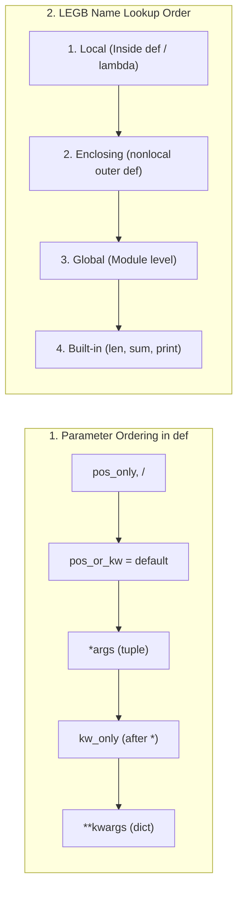

---
tags:
  - python
  - functions
  - lambda-recursion-scope
---

# Functions, Lambda & Scope in Python

## TL;DR (Quick Revision)

**Python Functions** = Reusable first-class code blocks (`def` / `lambda`) + flexible parameter binding (`pos_only, /, standard, *, kw_only`, `*args`, `**kwargs`), recursive call stacks, and LEGB namespace resolution ([More Control Flow Tools](https://docs.python.org/3/tutorial/controlflow.html), [Classes — Scopes and Namespaces](https://docs.python.org/3/tutorial/classes.html)).

> [!abstract] Core Idea
> A function is defined with `def name(params):`, creates a fresh local symbol table on every call (including recursive calls), passes arguments via **call by object reference**, and returns `None` by default if no `return expr` is executed ([More Control Flow Tools](https://docs.python.org/3/tutorial/controlflow.html)). Python supports positional, keyword, default, variable-length positional (`*args` -> `tuple`), and variable-length keyword (`**kwargs` -> `dict`) arguments, anonymous single-expression `lambda` functions, and lexical **LEGB** scope (`local` -> `enclosing` -> `global` -> `builtins`) ([More Control Flow Tools](https://docs.python.org/3/tutorial/controlflow.html), [Classes — Scopes and Namespaces](https://docs.python.org/3/tutorial/classes.html)).

> [!question] Why Use It?
>
> - **Eliminates Code Duplication**: Encapsulates reusable logic that returns computed values via `return` rather than merely displaying text with `print()` ([More Control Flow Tools](https://docs.python.org/3/tutorial/controlflow.html)).
> - **Expressive Parameter Contracts**: Combines default values, `*args`, `**kwargs`, positional-only (`/`), and keyword-only (`*`) markers for clean APIs ([More Control Flow Tools](https://docs.python.org/3/tutorial/controlflow.html)).
> - **Concise Inline Callbacks (`lambda`)**: Defines small anonymous single-expression functions (`lambda a, b: a + b`) wherever function objects are expected ([More Control Flow Tools](https://docs.python.org/3/tutorial/controlflow.html)).
> - **Deferred Annotations in Python 3.14**: Evaluates function annotations lazily via PEP 649 / `annotationlib` so forward references work without string quotes ([What's New in Python 3.14](https://docs.python.org/3/whatsnew/3.14.html)).

## Quick Reference Table

| Concept / Parameter Kind | Syntax Example | Container Type Inside Function | Can Pass by Keyword? | Key Behavior (PDF Pages 16–21 + [Official Tutorial Ch. 4.8–4.9](https://docs.python.org/3/tutorial/controlflow.html)) |
| :--- | :--- | :---: | :---: | :--- |
| **`print()` vs `return`** | `print(x)` vs `return x` | `None` vs Value | `✗` | `print()` writes to screen and returns `None`; `return` sends value back to caller. |
| **1. Positional Arguments** | `student("Rahul", 22)` | Bound to params | `✓` (unless `/`) | Matched left-to-right according to parameter positions. |
| **2. Keyword Arguments** | `student(age=22, name="Rahul")` | Bound to params | `✓` | Matched by parameter name; order of keyword arguments does not matter. |
| **3. Default Arguments** | `def emp(name, dept="IT"):` | Bound to param | `✓` | Uses default value if omitted; **evaluated only once** at `def` time. |
| **4. Variable Positional (`*args`)** | `def add(*numbers):` | `tuple` | `✗` | Scoops up arbitrary extra positional arguments into a `tuple` (`sum(numbers)`). |
| **5. Variable Keyword (`**kwargs`)** | `def emp(**details):` | `dict` | `✓` | Scoops up arbitrary extra keyword arguments into a `dict` (`details.items()`). |
| **Special `/` and `*` Markers** | `def f(pos, /, std, *, kw):` | Bound to params | `/`: `✗` / `*`: `✓` | Params before `/` are **positional-only**; params after `*` are **keyword-only**. |
| **Lambda Function** | `sq = lambda x: x * x` | `function` | `✓` | Anonymous function restricted to a **single expression** (implicit return). |
| **Recursive Function** | `return n * factorial(n - 1)` | New stack frame | `✓` | Function calls itself with a smaller input until reaching a **base case** (`n <= 1`). |
| **Local vs. Global Scope** | `local` vs `global x` / `nonlocal x` | Symbol table | `✗` | Assignments bind in local scope unless declared `global` or `nonlocal`. |

## The Learning Concept

#### What Problem Does It Solve?

In a student roster helper, using `print()` instead of `return` prevents downstream calculations (because the function returns `None`), and using a mutable default argument (`items=[]`) shares the exact same list across every call ([More Control Flow Tools](https://docs.python.org/3/tutorial/controlflow.html)):

```python
# BAD - Using print() instead of return and mutable default list []
def bad_add(a, b, history=[]):          # BAD: default list [] is created ONCE at def time!
    history.append(a + b)
    print("Printed sum:", a + b)        # BAD: prints to screen but returns None

res1 = bad_add(10, 20)                  # res1 is None! Cannot do res1 + 5
bad_add(5, 4)                           # Mutates the same shared default list!
print("Return value:", res1, "| Shared default:", bad_add.__defaults__)
# Output:
# Printed sum: 30
# Printed sum: 9
# Return value: None | Shared default: ([30, 9],)
```

Functions without an explicit `return expr` return `None`, and default parameter values are evaluated **only once** when the `def` statement executes—so a mutable default list accumulates state across calls ([More Control Flow Tools](https://docs.python.org/3/tutorial/controlflow.html)).

```python
# GOOD - Use return to send values back and None as sentinel for mutable defaults
def good_add(a: int, b: int, history: list[int] | None = None) -> tuple[int, list[int]]:
    if history is None:
        history = []                    # GOOD: creates a fresh list on each call
    total = a + b
    history.append(total)
    return total, history               # GOOD: returns values for reuse elsewhere

val1, hist1 = good_add(10, 20)
val2, hist2 = good_add(5, 4)
print("Returned:", val1, val2, "| Independent histories:", hist1, hist2)
# Output: Returned: 30 9 | Independent histories: [30] [9]
```

#### How Python Implements It

> [!tip] Four Core Mechanics of Functions & Scope
>
> 1. **Call by Object Reference & Symbol Tables**: Invoking a function creates a new local symbol table; arguments pass object references by value, and `return` (or falling off the end) exits the frame ([More Control Flow Tools](https://docs.python.org/3/tutorial/controlflow.html)).
> 2. **Complete Parameter Ordering Rule**: In a function signature, parameters must appear in this order: `def f(pos_only, /, pos_or_kw, default="IT", *args, kw_only, **kwargs):` ([More Control Flow Tools](https://docs.python.org/3/tutorial/controlflow.html)).
> 3. **Lambda & Recursion**: `lambda a, b: a + b` creates a function object syntactically restricted to one expression; a recursive function (`factorial(n)`) allocates a separate local namespace per call until its base case returns ([More Control Flow Tools](https://docs.python.org/3/tutorial/controlflow.html), [Classes — Scopes and Namespaces](https://docs.python.org/3/tutorial/classes.html)).
> 4. **LEGB Scope Resolution**: Unqualified name lookups search **L**ocal -> **E**nclosing (`nonlocal`) -> **G**lobal (`global`) -> **B**uilt-ins (`builtins`); assignment inside a function always binds locally unless `global` or `nonlocal` is declared ([Classes — Scopes and Namespaces](https://docs.python.org/3/tutorial/classes.html)).

#### Full Runnable Example

```python
# Complete runnable script: All 5 Argument Types, / & *, Lambda, Factorial Recursion & Scope
company_bonus = 100                             # Global variable (module scope)


def student(name: str, age: int) -> str:
    return f"{name}:{age}"


def employee(emp_id: int, /, name: str, department: str = "IT", *scores: int, **details: int) -> dict:
    # Demonstrates positional-only (/), standard, default, *args (tuple), and **kwargs (dict)
    local_sum = sum(scores)                     # Local variable inside employee()
    return {
        "id": emp_id,
        "profile": f"{name}-{department}",
        "total_pts": local_sum + company_bonus, # Reads global variable company_bonus
        "details": details,
    }


def factorial(n: int) -> int:
    # Recursive function with base case (n == 0 or n == 1)
    if n == 0 or n == 1:
        return 1
    return n * factorial(n - 1)


if __name__ == "__main__":
    # 1. Positional vs Keyword arguments (PDF Pages 17-18)
    s_pos = student("Rahul", 22)
    s_kw = student(age=22, name="Rahul")

    # 2. Default, *args, and **kwargs combined (PDF Pages 18-19)
    e1 = employee(1, "Rahul")                   # Uses default department="IT"
    e2 = employee(2, "Priya", "HR", 10, 20, 30, age=25, salary=30000)

    # 3. Lambda functions (single-expression anonymous functions, PDF Page 19)
    square = lambda x: x * x
    addition = lambda a, b: a + b

    # 4. Recursive factorial (PDF Page 20)
    fact_5 = factorial(5)

    print("Positional vs Keyword:", s_pos, "|", s_kw)
    print("Emp1 (Defaults):", e1)
    print("Emp2 (*args & **kwargs):", e2)
    print("Lambda square(5):", square(5), "| addition(10,20):", addition(10, 20))
    print("Recursive factorial(5):", fact_5)
```

**Output:**

```Output
Positional vs Keyword: Rahul:22 | Rahul:22
Emp1 (Defaults): {'id': 1, 'profile': 'Rahul-IT', 'total_pts': 100, 'details': {}}
Emp2 (*args & **kwargs): {'id': 2, 'profile': 'Priya-HR', 'total_pts': 160, 'details': {'age': 25, 'salary': 30000}}
Lambda square(5): 25 | addition(10,20): 30
Recursive factorial(5): 120
```

#### Visual Diagram



#### Key Terminology

1. **Positional-Only (`/`) & Keyword-Only (`*`) Parameters**: Parameters before `/` can only be passed by position; parameters after `*` (or after `*args`) can only be passed by keyword ([More Control Flow Tools](https://docs.python.org/3/tutorial/controlflow.html)).
   Syntax: `def f(pos1, /, std, *, kw1):`
2. **Arbitrary Argument Lists (`*args` and `**kwargs`)**: `*args` packs excess positional arguments into a `tuple`; `**kwargs` packs excess keyword arguments into a `dict` ([More Control Flow Tools](https://docs.python.org/3/tutorial/controlflow.html)).
   Syntax: `def addition(*numbers): return sum(numbers)`
3. **Lambda Expression**: An anonymous function created with the `lambda` keyword that evaluates and returns a single expression ([More Control Flow Tools](https://docs.python.org/3/tutorial/controlflow.html)).
   Syntax: `addition = lambda a, b: a + b`
4. **Recursive Function**: A function that calls itself with a reduced subproblem until hitting a termination base case (`if n == 0 or n == 1: return 1`).
   Syntax: `return n * factorial(n - 1)`
5. **LEGB Scope (`local`, `nonlocal`, `global`)**: Python's static scope hierarchy where assignments inside a function bind locally unless overridden by `global var` or `nonlocal var` ([Classes — Scopes and Namespaces](https://docs.python.org/3/tutorial/classes.html)).
   Syntax: `global x`

> [!important] Key Rules to Remember
>
> - **Positional Before Keyword at Call Site**: In a function call, positional arguments **must** precede keyword arguments (`student(name="Rahul", 22)` raises `SyntaxError`) ([More Control Flow Tools](https://docs.python.org/3/tutorial/controlflow.html)).
> - **No Duplicate Argument Binding**: Passing a positional argument and a keyword argument for the same parameter (`student("Rahul", name="Priya")`) raises `TypeError: got multiple values for argument` ([More Control Flow Tools](https://docs.python.org/3/tutorial/controlflow.html)).
> - **Call Unpacking (`*` and `**`)**: Use `*seq` to unpack a list/tuple into positional arguments and `**mapping` to unpack a dictionary into keyword arguments at the call site ([More Control Flow Tools](https://docs.python.org/3/tutorial/controlflow.html)).

## ◈ Edge Case Analysis

#### 1. `UnboundLocalError` When Modifying a Global Variable Without `global`
**Problem:** Reading a global variable inside a function works, but assigning to that same variable name anywhere in the function body makes Python treat it as **local** throughout the entire function—raising `UnboundLocalError` if read before assignment ([Classes — Scopes and Namespaces](https://docs.python.org/3/tutorial/classes.html)).
**Fix:** Declare `global x` (or pass `x` as a parameter and `return` the updated value).

```python
# Fix: use 'global' when rebinding a module-level variable inside a function
counter = 100

def increment() -> int:
    global counter              # Declares counter refers to module-level variable
    counter += 10
    return counter

print("Updated global counter:", increment())
```

**Output:**

```Output
Updated global counter: 110
```

#### 2. Name Collision Between Positional Parameter and `**kwargs` Key
**Problem:** In `def f(name, **kwds):`, passing `f(1, **{'name': 2})` raises `TypeError: f() got multiple values for argument 'name'` because `'name'` collides with the first parameter ([More Control Flow Tools](https://docs.python.org/3/tutorial/controlflow.html)).
**Fix:** Mark the first parameter as positional-only using `/`: `def f(name, /, **kwds):`.

```python
# Fix: '/' allows 'name' to be used both as positional arg and inside **kwds
def check_collision(name: int, /, **kwds: int) -> tuple[int, int]:
    return name, kwds["name"]

print("No collision:", check_collision(1, **{"name": 2}))
```

**Output:**

```Output
No collision: (1, 2)
```

#### 3. Late-Binding Closures in a Loop of Lambdas
**Problem:** Creating `[lambda: i for i in range(3)]` captures the variable `i` by reference, not its value at each iteration—so all lambdas return `2` (the final value of `i`).
**Fix:** Bind the loop variable as a default argument (`lambda i=i: i`) so each lambda captures the current iteration's value at definition time.

```python
# Fix: bind i=i as a default parameter to capture current loop value
funcs = [lambda x=i: x * 10 for i in range(3)]
print("Captured values:", [f() for f in funcs])
```

**Output:**

```Output
Captured values: [0, 10, 20]
```

#### 4. Python 3.14 Deferred Annotations (PEP 649 / PEP 749)
**Problem:** Prior to Python 3.14, function annotations were evaluated eagerly at definition time, raising `NameError` on forward-referenced types unless quoted or using `from __future__ import annotations` ([What's New in Python 3.14](https://docs.python.org/3/whatsnew/3.14.html)).
**Fix:** In Python 3.14+, annotations are deferred by default in a special `__annotate__` function and inspected via `annotationlib.get_annotations(func, format=Format.FORWARDREF)`.

```python
# Python 3.11-3.14+ compatible annotation inspection
def greet_user(user: str) -> str:
    return f"Hello, {user}"

print("Annotations dict:", greet_user.__annotations__)
```

**Output:**

```Output
Annotations dict: {'user': <class 'str'>, 'return': <class 'str'>}
```

## Topic Mastery Quiz

Test yourself on Python function argument binding, closures, recursion limits, and LEGB variable scoping.

**Q1: What does a Python function return if it executes to completion without hitting an explicit `return` statement?**
- [ ] A) `0`
- [ ] B) `None`
- [ ] C) `False`
- [ ] D) `void`

**Q2: What data types do `*args` and `**kwargs` have inside the function body?**
- [ ] A) `list` and `dict`
- [ ] B) `tuple` and `dict`
- [ ] C) `set` and `list`
- [ ] D) `tuple` and `set`

**Q3: In the function signature `def fn(a, /, b, *, c):`, what are the calling constraints on parameters `a` and `c`?**
- [ ] A) `a` is positional-only; `c` is keyword-only
- [ ] B) `a` is keyword-only; `c` is positional-only
- [ ] C) Both `a` and `c` must be passed as keyword arguments
- [ ] D) Both `a` and `c` must be passed as positional arguments

**Q4: Why is `def append_item(val, target=[]):` problematic in Python?**
- [ ] A) Default parameter values are evaluated once at definition time, so all calls share the same mutable list
- [ ] B) It raises a `SyntaxError` because empty lists cannot be used as defaults
- [ ] C) Python converts empty lists to tuples at runtime
- [ ] D) The parameter cannot be overridden by callers

**Q5: In Python's LEGB scope lookup order, what does the "E" stand for?**
- [ ] A) External (imported libraries)
- [ ] B) Enclosing (outer nested functions)
- [ ] C) Environment (`os.environ`)
- [ ] D) Execution frame

**Q6: What is the key difference between the `global` and `nonlocal` keywords inside a nested function?**
- [ ] A) `global` rebinds in the top-level module scope; `nonlocal` rebinds in the nearest enclosing function scope
- [ ] B) `global` creates a variable accessible across different processes; `nonlocal` is thread-local
- [ ] C) `nonlocal` allows modifying built-in functions; `global` modifies local variables
- [ ] D) There is no difference; they are aliases

<details>
<summary>◈ View Answers & Explanations</summary>

1. **Answer: B** — A function without a `return` statement (or with a bare `return`) implicitly returns `None`.
2. **Answer: B** — `*args` gathers extra positional arguments into an immutable `tuple`, while `**kwargs` gathers extra keyword arguments into a standard `dict`.
3. **Answer: A** — Parameters preceding `/` are strictly positional-only (cannot be passed by name); parameters following `*` are strictly keyword-only (cannot be passed positionally).
4. **Answer: A** — Python evaluates default arguments only once when the function is defined. Subsequent invocations that omit `target` mutate and reuse that exact same list object.
5. **Answer: B** — LEGB stands for **L**ocal, **E**nclosing (surrounding functions), **G**lobal (module), and **B**uilt-in.
6. **Answer: A** — `global var` instructs Python to resolve assignments to the module's global namespace, whereas `nonlocal var` targets the nearest outer non-global enclosing function scope.

</details>
