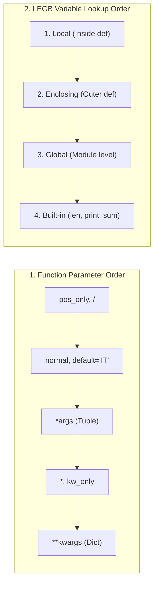

---
tags:
  - python
  - functions
  - lambda
  - recursion
  - scope
---

# Functions, Arguments, Lambda, Recursion, and Scope in Python

#### TL;DR (Quick Revision)

**Python Functions** = Reusable blocks of code (`def` or `lambda`) + Flexible argument passing (Positional, Keyword, Default, `*args`, `**kwargs`, `/`, `*`) + Returning values (`return` vs `print()`) and LEGB variable scope ([More Control Flow Tools — Defining Functions](https://docs.python.org/3/tutorial/controlflow.html)).

> [!abstract] Core Idea
> A function is a reusable block of code defined with `def name(parameters):` that executes only when you call it → It accepts inputs in 5 ways (positional, keyword, default, `*args` tuple, `**kwargs` dict) → It sends computed results back to the caller using `return` (or returns `None` if `return` is omitted) ([More Control Flow Tools](https://docs.python.org/3/tutorial/controlflow.html)).

> [!question] Why Use It?
>
> - Avoid writing the same code repeatedly and reduce code duplication
> - Send calculated results back (`return total, avg`) so they can be unpacked and reused elsewhere
> - Accept any number of positional (`*args`) or keyword (`**kwargs`) inputs when argument counts vary
> - Write compact one-line helper functions using `lambda` (`sqr = lambda x: x * x`)

#### Quick Comparison Table

| Concept / Argument Type | Example (`main.py` & Official Docs) | Type Inside Function | Key Behavior ([Official Tutorial Ch. 4.8–4.9](https://docs.python.org/3/tutorial/controlflow.html)) |
| :--- | :--- | :--- | :--- |
| **`print()` vs `return`** | `print(tot)` vs `return tot, avg` | `None` vs Value (`tuple`) | `print()` only displays on screen (returns `None`); `return` sends data back to caller. |
| **1. Required (Positional) Args** | `show_user("Ramesh", 23)` | Bound by position | Order matters! Passing `(23, "Ramesh")` swaps `name` and `age`! |
| **2. Keyword Arguments** | `show_user(age=23, name="Ashok")` | Bound by name | Matched by parameter name; order does not matter. |
| **3. Default Arguments** | `def employee(name, dept="IT"):` | Default if omitted | Uses `"IT"` if `dept` is not passed; evaluated **once** when `def` runs. |
| **4. Variable Positional (`*args`)** | `def find_sum(*args):` | **`tuple`** | Collects any number of positional arguments into a tuple (`(1, 2, 3, ...)`). |
| **5. Variable Keyword (`**kwargs`)** | `def show_emp(**kwargs):` | **`dict`** | Collects any number of `key=value` arguments into a dictionary (`{'name': 'Hari'}`). |
| **Keyword-Only (`*`) & Pos-Only (`/`)** | `def show_user(name, *, loc, age):` | Enforced mode | Params after `*` **must** be passed by keyword (`loc="Chennai"`); params before `/` are positional-only. |
| **Anonymous Function (`lambda`)** | `sqr = lambda x: x * x` | `function` | Single-expression inline function that implicitly returns its result. |
| **Recursive Function** | `return n * factorial(n - 1)` | New stack frame | Function calls itself with a smaller input until hitting its base case (`n == 1`). |
| **Local vs. Global Variables** | `x = 100` vs `global x` | Symbol table | Variables created inside `def` are **local**; use `global x` to rebind a module global. |

---

## The Learning Concept

### What Problem Does It Solve? (Fixing the `find_sum` Indentation Bug from `main.py`)

In your `main.py`, look at what happened when `for x in args:` was accidentally unindented outside `def find_sum(*args):` or when positional arguments were passed in the wrong order (`show_user(22, "Ramesh")`):

```python
# BAD - Swapped positional arguments and using print() when the caller needs the return value
def show_user(name, age):
    print(f"User name: {name} | Age: {age}")

show_user(22, "Ramesh")         # BAD: Prints 'User name: 22 | Age: Ramesh' because position was swapped!

def bad_sum(*args):
    tot = 0
    for x in args:
        tot += x
    print(tot)                  # BAD: Only prints to screen; returns None!

result = bad_sum(10, 20, 30)    # result is None! You cannot do result * 2!
print("Returned value from bad_sum:", result)
```

Using keyword-only arguments (`*`) prevents callers from mixing up parameter positions, and using `return total, avg` sends the values back as a tuple that you can unpack:

```python
# GOOD - Enforce keyword arguments with '*' and return multiple values as a tuple (from your main.py)
def show_user(name, *, location, age):          # '*' forces location and age to be keyword arguments!
    print(f"User: {name} | Location: {location} | Age: {age}")

def find_sum(*nums):                            # '*nums' packs all arguments into a tuple
    tot = 0
    for x in nums:
        tot += x
    avg = tot / len(nums)
    return tot, avg                             # Returns a tuple: (tot, avg)

show_user("Ashok", location="Chennai", age=23)
total, average = find_sum(18, 22, 12, 15)       # Unpack returned tuple!
print("Returned Total:", total, "| Average:", average)
```

### How Python Implements It

> [!tip] Four Core Function Mechanics
>
> 1. **Pass by Object Reference**: When you pass a list `nums` into `def show(msg, lst):` (from your `main.py`), `lst` points to the same list object. Mutating `lst.append(x)` affects the caller's list, whereas rebinding `lst = [1, 2]` only changes the local name ([More Control Flow Tools](https://docs.python.org/3/tutorial/controlflow.html)).
> 2. **Returning Multiple Values (Tuple Unpacking)**: Writing `return total, avg` packs both values into a `tuple` `(total, avg)`. The caller can either index `ret = find_sum(...); ret[0]` or unpack `tot, avg = find_sum(...)`.
> 3. **Lambda Expressions (`lambda args: expr`)**: `sqr = lambda x: x * x` and `add = lambda x, y: x + y` create small anonymous functions in a single expression ([More Control Flow Tools](https://docs.python.org/3/tutorial/controlflow.html)).
> 4. **Local vs. Global Scope (LEGB)**: Variables assigned inside a function live in its **Local** symbol table and disappear when the function returns. Global variables live outside functions at the module level ([Classes — Scopes and Namespaces](https://docs.python.org/3/tutorial/classes.html)).

#### Full Runnable Example (All Function Examples from Your `main.py` & PDF Notes)

```python
# Step 1: Passing a list to a function (from your main.py)
def show(msg, lst):
    print(msg, "->", lst)

nums = [12, 288, 21, 39, 13, 18]
nums.sort()
show("Sorted items", nums)

# Step 2: Positional, Keyword, Default, Keyword-Only (*), *args, and **kwargs
def employee(name, department="IT", *, location="Pune", **details):
    return f"{name} ({department}, {location}) -> {details}"

print(employee("Rahul"))                                            # Uses defaults
print(employee("Hari", "Finance", location="Nagpur", salary=24680)) # Keyword + **kwargs

# Step 3: *args with tuple return & unpacking (from your main.py)
def find_sum(*nums):
    tot = 0
    for x in nums:
        tot += x
    avg = tot / len(nums)
    return tot, avg

ret = find_sum(18, 22, 12, 15)
print("Tuple return:", ret, "| Unpacked:", ret[0], "and", ret[1])

# Step 4: Lambda functions (from your main.py)
sqr = lambda x: x * x
add_fn = lambda x, y: x + y
print("Lambda sqr(5):", sqr(5), "| add_fn(2, 4):", add_fn(2, 4))

# Step 5: Recursive function (Factorial from your PDF Page 20)
def factorial(n):
    if n == 0 or n == 1:
        return 1
    return n * factorial(n - 1)

print("Recursive factorial(5):", factorial(5))
```

**Output:**

```
Sorted items -> [12, 13, 18, 21, 39, 288]
Rahul (IT, Pune) -> {}
Hari (Finance, Nagpur) -> {'salary': 24680}
Tuple return: (67, 16.75) | Unpacked: 67 and 16.75
Lambda sqr(5): 25 | add_fn(2, 4): 6
Recursive factorial(5): 120
```

### Visual Diagram: Parameter Types & LEGB Scope Lookup



### Key Terminology

1. **`*args` (Variable-Length Positional Arguments)**: Collects any number of extra positional arguments passed to a function into a **`tuple`** ([More Control Flow Tools](https://docs.python.org/3/tutorial/controlflow.html)).
   Syntax: `def find_sum(*nums):`

2. **`**kwargs` (Variable-Length Keyword Arguments)**: Collects any number of extra `key=value` arguments passed to a function into a **`dict`** ([More Control Flow Tools](https://docs.python.org/3/tutorial/controlflow.html)).
   Syntax: `def show_emp(**kwargs):`

3. **Lambda Function**: A small anonymous function defined with `lambda` that can take any number of arguments but can only contain **one expression** ([More Control Flow Tools](https://docs.python.org/3/tutorial/controlflow.html)).
   Syntax: `sqr = lambda x: x * x`

4. **Recursion**: When a function calls itself on a smaller version of the problem (`factorial(n - 1)`) until reaching a stopping **base case** (`if n <= 1: return 1`).
   Syntax: `return n * factorial(n - 1)`

> [!important] Key Rules to Remember
>
> - **Don't shadow built-in `sum()`** → in `main.py`, naming a lambda `sum = lambda x, y: x + y` overwrites Python's built-in `sum(nums)` function! Name it `add_fn` instead
> - **Positional before Keyword** → at the call site, positional arguments must come *before* keyword arguments (`show_user("Ashok", age=23)`)
> - **Default arguments are evaluated ONCE** → never use a mutable list `def f(a, items=[]):` as a default value; use `items=None` instead
> - **No `return` means `None`** → a function that ends without hitting `return` automatically returns `None`

---

## ◈ Edge Case Analysis

### 1. Naming a Variable `sum` Breaks Built-in `sum(nums)` (From Your `main.py`!)

✗ **Problem:** In your `main.py`, line 48 wrote `sum = lambda x, y: x + y` (which takes 2 arguments), and then line 54 called `print(sum(nums))` (passing 1 list)! Because `sum` was overwritten by your 2-argument lambda, calling `sum(nums)` raises `TypeError: <lambda>() missing 1 required positional argument: 'y'`!
✓ **Fix:** Never name variables `sum`, `list`, `dict`, `str`, or `max`—use `add = lambda x, y: x + y` so built-in `sum(nums)` stays intact!

```python
add = lambda x, y: x + y                # GOOD: Doesn't overwrite built-in sum()!
nums = [2, 34, 51, 65, 23, 1]
print("Lambda add(2, 4):", add(2, 4), "| Built-in sum(nums):", sum(nums))
```

### 2. Mutable Default Argument Trap (`def add_item(x, box=[]):`)

✗ **Problem:** Default values are created **only once** when `def` is defined, not each time the function is called. So `box=[]` shares the exact same list across every call! ([More Control Flow Tools](https://docs.python.org/3/tutorial/controlflow.html)).
✓ **Fix:** Use `box=None` as the default and create `if box is None: box = []` inside the function.

```python
def add_item(x, box=None):
    if box is None:
        box = []                        # Fresh list created on each call
    box.append(x)
    return box

print("Call 1:", add_item("A"), "| Call 2:", add_item("B"))
```

### 3. `UnboundLocalError` When Updating a Global Variable Without `global`

✗ **Problem:** You can *read* a global variable `x = 100` inside a function freely. But if you write `x = x + 10` inside the function without declaring `global x`, Python treats `x` as a local variable and crashes with `UnboundLocalError`! ([Classes — Scopes and Namespaces](https://docs.python.org/3/tutorial/classes.html)).
✓ **Fix:** Declare `global x` at the top of the function before modifying `x`.

```python
score = 100

def add_bonus():
    global score
    score = score + 50

add_bonus()
print("Updated global score:", score)
```

---

## Going Deeper (Intermediate → Advanced)

### 1. Special Parameter Markers: Positional-Only (`/`) vs. Keyword-Only (`*`)

Python lets you control **how** callers are allowed to pass arguments using `/` and `*` ([More Control Flow Tools — Special parameters](https://docs.python.org/3/tutorial/controlflow.html)):

```python
def configure(pos_only, /, standard, *, kw_only):
    print(pos_only, standard, kw_only)

# pos_only MUST be passed by position; kw_only MUST be passed by keyword!
configure(10, 20, kw_only=30)
configure(10, standard=20, kw_only=30)
```

### 2. Unpacking Argument Lists at the Call Site (`*list` and `**dict`)

Just as `*args` and `**kwargs` pack arguments inside a function definition, you can use `*` and `**` when **calling** a function to unpack a list/tuple or dictionary into separate arguments ([More Control Flow Tools — Unpacking Argument Lists](https://docs.python.org/3/tutorial/controlflow.html)):

```python
def show_emp(name, desg, salary):
    print(f"{name} -> {desg} (Rs.{salary})")

args_list = ["Hari", "Manager", 24680]
kwargs_dict = {"name": "Valay", "desg": "Admin Support", "salary": 30000}

show_emp(*args_list)                    # Unpacks list into 3 positional arguments
show_emp(**kwargs_dict)                 # Unpacks dict into 3 keyword arguments
```

---

## Topic Mastery Quiz

Test yourself before moving to the next chapter. Pick the best answer for each question.

**Q1: What does a Python function return if it has no `return` statement?**
- [ ] A) `0`
- [ ] B) `False`
- [ ] C) `None`
- [ ] D) `SyntaxError`

**Q2: Inside `def process(*items, **meta):`, what are the data types of `items` and `meta`?**
- [ ] A) `list` and `dict`
- [ ] B) `tuple` and `dict`
- [ ] C) `tuple` and `set`
- [ ] D) `list` and `tuple`

**Q3: In `def show_user(name, *, location, age):`, how must `location` and `age` be passed?**
- [ ] A) By position only (`show_user("Ashok", "Chennai", 23)`)
- [ ] B) By keyword only (`show_user("Ashok", location="Chennai", age=23)`)
- [ ] C) As a tuple
- [ ] D) They cannot be passed at all

**Q4: What is the output of `ret = (lambda a, b=10: a * b)(5)`?**
- [ ] A) `15`
- [ ] B) `50`
- [ ] C) `5`
- [ ] D) `TypeError`

**Q5: What is the value of `factorial(4)` where `factorial(n)` returns `1` for `n <= 1` and `n * factorial(n - 1)` otherwise?**
- [ ] A) `10`
- [ ] B) `16`
- [ ] C) `24`
- [ ] D) `120`

<details>
<summary>◈ View Answers & Explanations</summary>

1. **C** — Every Python function without an explicit `return value` implicitly returns `None`.
2. **B** — `*items` packs positional arguments into a `tuple`, and `**meta` packs keyword arguments into a `dict`.
3. **B** — Any parameter placed after `*` in a function definition is a **keyword-only** parameter.
4. **B** — `a` receives `5` and `b` uses its default value `10`, so `5 * 10 = 50`.
5. **C** — `4 * 3 * 2 * 1 = 24`.

</details>

---

## Practice Exercises

**Exercise 1: Multi-Return Calculator (`find_sum`)**
- Write a function `analyze_marks(*marks)` that accepts any number of marks
- Return three values: `(total, average, highest)`
- Call it with `(78, 85, 92, 88)` and unpack the 3 returned values into variables

**Exercise 2: Keyword-Only Employee Profile**
- Define `create_emp(name, *, dept="IT", salary)` where `dept` and `salary` must be passed by keyword
- Test calling it with `create_emp("Valay", salary=35000)`

**Exercise 3: Recursive Sum of Digits**
- Write a recursive function `sum_digits(n)` that returns `n` if `n < 10`, and `(n % 10) + sum_digits(n // 10)` otherwise
- Test it on `sum_digits(2026)` (should return `10`)

---

## Memory Trick / One-Liner

> [!tip] One Star vs. Two Stars (`*args` vs `**kwargs`)
> - **`*args` (1 Star)** = **1-Dimensional `tuple`** of positional values `(10, 20, 30)`
> - **`**kwargs` (2 Stars)** = **2-Part `key=value` `dict`** `{'name': 'Hari', 'age': 22}`

---

## Warning Block (Best Practice)

> [!warning] Common Mistake (Avoid This!)
>
> ```python
> # BAD - Naming your own variable 'sum' overwrites Python's built-in sum()!
> sum = lambda x, y: x + y
> nums = [10, 20, 30]
> # print(sum(nums))            # CRASH! TypeError: <lambda>() missing 1 required argument 'y'
> ```
>
> ```python
> # GOOD - Use a distinct name like 'add_fn' so built-in sum(nums) still works!
> add_fn = lambda x, y: x + y
> nums = [10, 20, 30]
> print(add_fn(2, 4), sum(nums))  # Prints: 6 60
> ```
