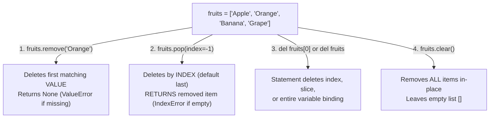

---
tags:
  - python
  - collections
  - lists
  - comprehensions
---

# Lists: Methods, Slicing, Matrices, and Comprehensions in Python

#### TL;DR (Quick Revision)

**Python Lists (`list`)** = Ordered, mutable, duplicate-allowing collection (`[10, 20, 30]`) + 11 built-in methods (`append`, `extend`, `insert`, `remove`, `pop`, `clear`, `index`, `count`, `sort`, `reverse`, `copy`), `del` statement, and list comprehensions ([Data Structures — More on Lists](https://docs.python.org/3/tutorial/datastructures.html)).

> [!abstract] Core Idea
> A `list` stores multiple items in a single variable while preserving insertion order → Because lists are **mutable**, you can update items by index (`fruits[1] = "orange"`), add items (`append`, `extend`, `insert`), delete items (`remove`, `pop`, `del`, `clear`), and sort/reverse in-place → All methods that modify a list in-place return `None` ([Data Structures — More on Lists](https://docs.python.org/3/tutorial/datastructures.html)).

> [!question] Why Use It?
>
> - Store and manage multiple items (student marks, cart items, matrices) in one ordered variable
> - Add, update, sort, or delete elements dynamically in-place without creating a new list every time
> - Use as a fast Last-In, First-Out (LIFO) stack with `.append()` and `.pop()`
> - Build transformed or filtered lists in a single line using List Comprehensions (`[x*2 for x in nums]`)

#### Quick Comparison Table

| Method / Statement | Syntax Example | Modifies List In-Place? | Return Value | Exact Behavior (PDF Pages 22–24 + [Official Tutorial Ch. 5.1–5.2](https://docs.python.org/3/tutorial/datastructures.html)) |
| :--- | :--- | :---: | :--- | :--- |
| **1. `append(val)`** | `n.append(40)` | Yes | `None` | Adds **one single element** to the very end of the list. |
| **2. `extend(iterable)`** | `n.extend([50, 60])` | Yes | `None` | Unpacks and appends **all elements** from another list/iterable to the end. |
| **3. `insert(idx, val)`** | `n.insert(1, 15)` | Yes | `None` | Inserts `val` **before** position `idx` (`n.insert(0, x)` inserts at the front). |
| **4. `remove(val)`** | `n.remove(20)` | Yes | `None` | Removes the **first matching value**; raises **`ValueError`** if not found. |
| **5. `pop(idx=-1)`** | `last = n.pop()` | Yes | **Removed item** | Removes and **returns** item at `idx` (last item by default); raises **`IndexError`** if empty. |
| **6. `clear()`** | `n.clear()` | Yes | `None` | Empties all elements from the list (`[]`), equivalent to `del n[:]`. |
| **7. `index(val[, start])`** | `n.index(30)` | No | `int` (0-based) | Returns first index of `val`; raises **`ValueError`** if not found. |
| **8. `count(val)`** | `n.count(10)` | No | `int` | Counts how many times `val` appears in the list. |
| **9. `sort()`** | `nums.sort(reverse=False)` | Yes | `None` | Sorts the list **in-place** in ascending order (or descending with `reverse=True`). |
| **10. `reverse()`** | `nums.reverse()` | Yes | `None` | Reverses the elements of the list **in-place**. |
| **11. `copy()`** | `b = nums.copy()` | No | New `list` | Returns a **shallow copy** of the list (same as `nums[:]`). |
| **`del` Statement** | `del n[0]`, `del n[1:3]`, `del n` | Yes | None (statement) | Deletes an item by index, deletes a slice, or deletes the entire variable `n`. |

---

## The Learning Concept

### What Problem Does It Solve?

When working with lists, two mistakes trip up almost everyone:
1. Writing `nums = nums.sort()` or `nums = nums.append(40)`—which wipes out your list and sets `nums` to `None`!
2. Confusing `.append([40, 50])` with `.extend([40, 50])`!

```python
# BAD - Assigning the return value of .sort() (which is None!) and nesting a list with .append()
nums = [30, 10, 20]
nums.append([40, 50])           # BAD: Adds [40, 50] as a nested sub-list instead of 2 numbers!
print("Nested append:", nums)

result = [30, 10, 20].sort()    # BAD: .sort() modifies in-place and returns None!
print("Result of .sort():", result)
```

In Python, methods that mutate a list in-place (`sort`, `reverse`, `append`, `extend`, `insert`, `remove`, `clear`) always return `None` to remind you that no new list was created ([Data Structures — More on Lists](https://docs.python.org/3/tutorial/datastructures.html)).

```python
# GOOD - Use .extend() for multiple items and call .sort() directly on the list variable
nums = [30, 10, 20]
nums.extend([40, 50])           # GOOD: Appends 40 and 50 individually -> [30, 10, 20, 40, 50]
nums.sort()                     # GOOD: Sorts 'nums' in-place!
print("Extended and sorted nums:", nums)
```

### How Python Implements It

> [!tip] Four Pillars of Python Lists
>
> 1. **6 Characteristics of a List (PDF Page 22)**: Ordered, Mutable (`fruits[1] = "orange"`), Allows Duplicates, Allows Different Data Types (`[10, "Hi", 3.5]`), Indexed (`0` from start, `-1` from end), and Nestable (`[[1, 2], [3, 4]]`).
> 2. **4 Ways to Delete List Elements (PDF Page 24)**:
>    - `remove(value)` → deletes by **value** (returns `None`)
>    - `pop(index)` → deletes by **index** (last by default) and **returns the deleted item**
>    - `del a[index]` / `del a[1:3]` / `del a` → deletes index, slice, or whole variable
>    - `clear()` → removes all elements leaving `[]`
> 3. **Built-in Functions on Lists**: `len(nums)`, `max(nums)`, `min(nums)`, `sum(nums)` (as shown in your `main.py`), `sorted(nums)` (returns a new sorted list without changing the original), and `list(iterable)`.
> 4. **List Comprehensions**: `[x ** 2 for x in range(6) if x % 2 == 0]` builds a new list concisely in one line without leaving the loop variable `x` hanging around in the outer scope ([Data Structures — List Comprehensions](https://docs.python.org/3/tutorial/datastructures.html)).

#### Full Runnable Example

```python
# Step 1: Accessing, Updating, Sorting & Built-in sum() (from your main.py & PDF pp. 22-24)
nums = [12, 288, 21, 39, 13, 18]
nums.sort()                                     # Sorts in-place: [12, 13, 18, 21, 39, 288]
total = sum(nums)                               # Built-in sum() -> 391

fruits = ["Apple", "Mango", "Banana"]
fruits[1] = "Orange"                            # Update index 1 in-place
fruits.append("Grape")                          # Add 1 item at the end
fruits.extend(["Kiwi", "Apple"])                # Add multiple items at the end
fruits.insert(1, "Pear")                        # Insert 'Pear' at index 1

# Step 2: Searching, Counting & Copying
apple_count = fruits.count("Apple")             # 2
orange_idx = fruits.index("Orange")             # 2
backup = fruits.copy()                          # Shallow copy

# Step 3: All 4 Deletion Methods (remove, pop, del, clear)
fruits.remove("Banana")                         # 1. Remove by value
popped_item = fruits.pop()                      # 2. Remove & return last item ('Apple')
del fruits[0]                                   # 3. Delete index 0 ('Apple')
temp = [1, 2, 3]
temp.clear()                                    # 4. Empty list -> []

# Step 4: List Comprehensions & 2D Matrix Transpose
squares = [x ** 2 for x in range(6)]            # [0, 1, 4, 9, 16, 25]
evens = [x for x in nums if x % 2 == 0]         # Filter even numbers -> [12, 18, 288]
matrix = [
    [1, 2, 3],
    [4, 5, 6],
]
transposed = [[row[i] for row in matrix] for i in range(3)]

print("Sorted nums:", nums, "| sum(nums):", total)
print("Fruits after edits:", fruits, "| Popped:", popped_item, "| Cleared temp:", temp)
print("Count('Apple'):", apple_count, "| Index('Orange'):", orange_idx, "| Backup len:", len(backup))
print("Squares:", squares, "| Evens:", evens)
print("Transposed 2D Matrix:", transposed)
```

**Output:**

```
Sorted nums: [12, 13, 18, 21, 39, 288] | sum(nums): 391
Fruits after edits: ['Pear', 'Orange', 'Grape', 'Kiwi'] | Popped: Apple | Cleared temp: []
Count('Apple'): 2 | Index('Orange'): 2 | Backup len: 6
Squares: [0, 1, 4, 9, 16, 25] | Evens: [12, 18, 288]
Transposed 2D Matrix: [[1, 4], [2, 5], [3, 6]]
```

### Visual Diagram: The 4 Ways to Delete List Elements



### Key Terminology

1. **`append(x)` vs. `extend(iterable)`**: `append(x)` adds `x` as a single item at the end; `extend(iterable)` loops over `iterable` and adds each element individually ([Data Structures — More on Lists](https://docs.python.org/3/tutorial/datastructures.html)).
   Syntax: `[1, 2].extend([3, 4])  # [1, 2, 3, 4]`

2. **`remove(val)` vs. `pop(idx)`**: `remove(val)` deletes the first item equal to `val` (returns `None`); `pop(idx=-1)` removes the item at `idx` and returns it ([Data Structures — More on Lists](https://docs.python.org/3/tutorial/datastructures.html)).
   Syntax: `last = nums.pop()`

3. **List Comprehension**: A compact syntax `[expression for item in iterable if condition]` that creates a new list from an existing iterable ([Data Structures — List Comprehensions](https://docs.python.org/3/tutorial/datastructures.html)).
   Syntax: `[x * 2 for x in nums if x > 10]`

4. **2D Nested List (Matrix)**: A list whose elements are inner lists (`matrix = [[1, 2, 3], [4, 5, 6]]`), accessed via `matrix[row][col]`.
   Syntax: `matrix[1][2]  # 6`

> [!important] Key Rules to Remember
>
> - **In-place methods return `None`** → never write `nums = nums.sort()` or `nums = nums.append(5)`
> - **`sort()` vs `sorted(nums)`** → `nums.sort()` sorts `nums` in-place; `sorted(nums)` returns a **new** sorted list and leaves `nums` unchanged
> - **Parenthesize tuples in comprehensions** → write `[(x, x**2) for x in range(5)]`, not `[x, x**2 for x in range(5)]`
> - **Lists cannot be `dict` keys** → because lists are mutable, they are unhashable (convert to `tuple(lst)` if you need a key)

---

## ◈ Edge Case Analysis

### 1. Shallow Copy (`nums.copy()` / `nums[:]`) on 2D Nested Lists

✗ **Problem:** Calling `matrix.copy()` or `matrix[:]` only copies the **outer list**. The inner row lists are still shared between both variables!
✓ **Fix:** Copy each inner row with a comprehension `[row[:] for row in matrix]` (or `import copy; copy.deepcopy(matrix)`).

```python
matrix = [[1, 2], [3, 4]]
safe_2d_copy = [row[:] for row in matrix]
safe_2d_copy[0][0] = 99
print("Original matrix untouched:", matrix, "| Safe 2D copy:", safe_2d_copy)
```

### 2. The `[[0] * 3] * 3` Row-Aliasing Trap

✗ **Problem:** Writing `grid = [[0] * 2] * 2` creates 2 references to the **exact same inner list**, so changing `grid[0][0] = 9` changes every row!
✓ **Fix:** Use `[[0] * 2 for _ in range(2)]` so each row is a separate list.

```python
bad_grid = [[0] * 2] * 2
bad_grid[0][0] = 9                      # Changes BOTH rows!

good_grid = [[0] * 2 for _ in range(2)]
good_grid[0][0] = 9                     # Changes ONLY row 0!
print("Bad grid:", bad_grid, "| Good grid:", good_grid)
```

### 3. Sorting a List with Mixed Numbers and Strings Crashes

✗ **Problem:** Although a list can store mixed types (`[10, "apple", 2]`), calling `.sort()` on it raises `TypeError: '<' not supported between instances of 'str' and 'int'` ([Data Structures — More on Lists](https://docs.python.org/3/tutorial/datastructures.html)).
✓ **Fix:** Pass `key=str` (`mixed.sort(key=str)`) to compare items by their string representation.

```python
mixed = [10, "apple", 2]
mixed.sort(key=str)
print("Sorted with key=str:", mixed)
```

---

## Going Deeper (Intermediate → Advanced)

### 1. Using Lists as Stacks (LIFO) vs. `collections.deque` for Queues (FIFO)

Appending (`.append()`) and popping (`.pop()`) at the **end** of a list take **O(1)** constant time, making a `list` a great **Stack (Last-In, First-Out)**. However, inserting or popping at the **front** of a list (`nums.pop(0)` or `nums.insert(0, x)`) is slow **O(n)** because Python has to shift every remaining element in memory! For a fast **Queue (First-In, First-Out)**, use `collections.deque` ([Data Structures — Using Lists as Queues](https://docs.python.org/3/tutorial/datastructures.html)):

```python
from collections import deque

queue = deque(["Ramesh", "Ashok", "Hari"])
queue.append("Valay")                   # Arrives at back in O(1)
first_out = queue.popleft()             # Leaves from front in O(1)!
print("Served first:", first_out, "| Remaining queue:", list(queue))
```

### 2. Unpacking Inside Lists (`*`)

You can unpack any iterable directly inside a list literal using `*` ([Data Structures — Unpacking in Lists](https://docs.python.org/3/tutorial/datastructures.html)):

```python
part1 = [10, 20]
part2 = [30, 40]
combined = [0, *part1, *part2, 50]
print("Unpacked list:", combined)
```

---

## Topic Mastery Quiz

Test yourself before moving to the next chapter. Pick the best answer for each question.

**Q1: Given `a = [1, 2, 3]`, what is `a` after `a.append([4, 5])`?**
- [ ] A) `[1, 2, 3, 4, 5]`
- [ ] B) `[1, 2, 3, [4, 5]]`
- [ ] C) `[[1, 2, 3], [4, 5]]`
- [ ] D) `None`

**Q2: Which method removes an item from a list by its index AND returns the removed item?**
- [ ] A) `a.remove(index)`
- [ ] B) `del a[index]`
- [ ] C) `a.pop(index)`
- [ ] D) `a.clear()`

**Q3: What is the value of `res` after running `nums = [3, 1, 2]; res = nums.sort()`?**
- [ ] A) `[1, 2, 3]`
- [ ] B) `[3, 2, 1]`
- [ ] C) `None`
- [ ] D) `TypeError`

**Q4: What does `[x * 2 for x in range(4) if x % 2 == 1]` evaluate to?**
- [ ] A) `[0, 2, 4, 6]`
- [ ] B) `[2, 6]`
- [ ] C) `[0, 4]`
- [ ] D) `[1, 3]`

**Q5: If `fruits = ['apple', 'banana', 'apple']`, what does `fruits.remove('apple')` do?**
- [ ] A) Removes all occurrences of `'apple'`, leaving `['banana']`
- [ ] B) Removes only the first `'apple'`, leaving `['banana', 'apple']`
- [ ] C) Returns `'apple'`
- [ ] D) Raises `ValueError`

<details>
<summary>◈ View Answers & Explanations</summary>

1. **B** — `.append()` always adds its argument as a single element, so `[4, 5]` is added as a nested list. (Use `.extend([4, 5])` to get `[1, 2, 3, 4, 5]`.)
2. **C** — `.pop(index)` removes and returns the element at `index` (or the last element if no index is given).
3. **C** — `.sort()` sorts `nums` in-place and returns `None`.
4. **B** — In `range(4)` (`0, 1, 2, 3`), the odd numbers (`x % 2 == 1`) are `1` and `3`; doubling them gives `[2, 6]`.
5. **B** — `.remove(value)` deletes only the **first** matching element in the list and returns `None`.

</details>

---

## Practice Exercises

**Exercise 1: Cart Manager**
- Start with `cart = ["Milk", "Bread", "Eggs"]`
- Replace `"Bread"` with `"Butter"` by index, append `"Cheese"`, and insert `"Apples"` at index `0`
- Pop the last item and print both the popped item and final `cart`

**Exercise 2: Comprehension Filter & Square**
- Given `nums = [12, 5, 18, 3, 20, 7]`
- Use a single list comprehension to create a list of squares of only the numbers greater than `10`

**Exercise 3: Deduplicate While Preserving Order**
- Given `items = [10, 20, 10, 30, 20, 40]`
- Write a loop that builds a `unique` list containing each number only once in the order it first appeared

---

## Memory Trick / One-Liner

> [!tip] `remove()` vs `pop()` vs `del`
> - **`remove(val)`** = Searches by **Value** (`fruits.remove("Banana")`)
> - **`pop(idx)`** = Pops out by **Index** and **hands it back to you** (`item = fruits.pop(0)`)
> - **`del a[idx]`** = Statement that deletes an index, slice (`del a[1:3]`), or variable (`del a`)

---

## Warning Block (Best Practice)

> [!warning] Common Mistake (Avoid This!)
>
> ```python
> # BAD - Overwriting your list variable with the None return value of .sort()
> nums = [12, 288, 21, 39]
> nums = nums.sort()            # BUG! nums is now None!
> ```
>
> ```python
> # GOOD - Call .sort() on its own line (or use sorted(nums) if you want a new list)
> nums = [12, 288, 21, 39]
> nums.sort()                   # nums is now [12, 21, 39, 288]
> ```