tags:

* python

* variables-and-operators

* casting-and-env

# Lists in Python

## TL;DR (Quick Revision)`int`, `float`, `complex`, `bool`, `str` + collections

**Variables, Casting & Operators** = Dynamic name-to-object bindings () + implicit/explicit type conversions and 7 operator families governed by strict precedence ([General Python FAQ](https://docs.python.org/3/faq/general.html), [Expressions Reference](https://docs.python.org/3/reference/expressions.html)).

> \[!abstract\] Core Idea
> Created by Guido van Rossum in the late 1980s (released in 1991) as a successor to the ABC language and named after *Monty Python's Flying Circus*, Python is a high-level, interpreted, dynamically typed, object-oriented, platform-independent, open-source language ([General Python FAQ](https://docs.python.org/3/faq/general.html)). It stores external configuration via `os.environ`, passes CLI arguments via `sys.argv`, classifies values into scalar/primitive types (`int`, `float`, `complex`, `bool`, `str`) and collection types (`list`, `tuple`, `set`, `dict`), converts types via implicit widening or explicit constructors (`int()`, `float()`, `str()`), and evaluates expressions across 7 operator families ([os Module](https://docs.python.org/3/library/os.html), [Expressions Reference](https://docs.python.org/3/reference/expressions.html)).

> \[!question\] Why Use It?
>
> * **Dynamic Typing**: Binds names (`age = 22`) to objects at runtime without explicit type declarations, inspectable via `type(age)` ([General Python FAQ](https://docs.python.org/3/faq/general.html)).
>
> * **Decoupled Config & CLI**: Reads system/application settings outside code via `os.environ.get()` and CLI arguments via `sys.argv` for headless automation ([os Module](https://docs.python.org/3/library/os.html), [Using the Python Interpreter](https://docs.python.org/3.14/tutorial/interpreter.html)).
>
> * **Safe Type Conversion**: Widens `int` to `float` automatically in mixed arithmetic while providing explicit constructors (`int()`, `float()`, `str()`) for narrowing conversions ([An Informal Introduction to Python](https://docs.python.org/3.14/tutorial/introduction.html)).
>
> * **Rich Operator Set**: Combines mathematical, assignment, comparison, logical, membership (`in`), identity (`is`), and bitwise (`& | ^ ~ << >>`) operators ([Expressions Reference](https://docs.python.org/3/reference/expressions.html)).

## Quick Reference Table

| Category / Operator Family | Syntax / Examples | Mutates In-Place? | Returns Bool? | Key Behavior ([Expressions Reference](https://docs.python.org/3/reference/expressions.html)) | 
| ----- | ----- | ----- | ----- | ----- | 
| **Scalar ("Primitive") Types** | `int`, `float`, `complex`, `bool`, `str` | `✗` | `✗` | Immutable single values (`22`, `19.5`, `3+5j`, `True`, `'text'`). | 
| **Collection ("Non-Primitive") Types** | `list`, `tuple`, `set`, `dict` | `✓` (`list`/`set`/`dict`) | `✗` | Hold multiple items: `list` (mutable), `tuple` (immutable), `set` (unique), `dict` (key-value). | 
| **Implicit Casting (Widening)** | `10 + 3.5` -> `13.5` | `✗` | `✗` | Python automatically converts `int` -> `float` in mixed arithmetic to prevent data loss. | 
| **Explicit Casting (Narrowing)** | `int(19.99)` -> `19` | `✗` | `✗` | Programmer manually calls `int()`, `float()`, or `str()`; `int(float)` truncates toward zero. | 
| **1. Mathematical Operators** | `+`, `-`, `*`, `/`, `//`, `%`, `**` | `✗` | `✗` | `/` returns `float`; `//` floors quotient; `%` returns remainder; `**` raises power (`2**3 = 8`). | 
| **2. Assignment Operators** | `=`, `+=`, `-=`, `*=`, `/=`, `//=`, `%=`, `**=` | `✓` (on mutable) | `✗` | Assigns or updates variable binding (`a += 10` is `a = a + 10` for immutables). | 
| **3. Comparison Operators** | `==`, `!=`, `>`, `<`, `>=`, `<=` | `✗` | `✓` | Compares values (`==` checks value equality; `=` assigns value). | 
| **4. Logical Operators** | `and`, `or`, `not` | `✗` | `✓` (or operand) | `and` (both true), `or` (at least one true), `not` (inverts truth value). | 
| **5. Membership Operators** | `in`, `not in` | `✗` | `✓` | Checks whether an element exists inside a sequence/collection (`'apple' in fruits`). | 
| **6. Identity Operators** | `is`, `is not` | `✗` | `✓` | Checks whether two variables point to the **exact same object in memory** (`id(a) == id(b)`). | 
| **7. Bitwise Operators** | `&`, `|`, `^`, `~`, `<<`, `>>` | `✗` | `✗` | Operates on binary (`0`s and `1`s) representation of integers (AND, OR, XOR, NOT, shifts). | 

## The Learning Concept

#### What Problem Does It Solve?

In a service configuration loader, reading missing environment variables with `os.environ["KEY"]` crashes with `KeyError`, and confusing value equality (`==`) with object identity (`is`) or ignoring operator precedence (`10 + 5 * 2`) causes logic defects ([os Module](https://docs.python.org/3/library/os.html), [Expressions Reference](https://docs.python.org/3/reference/expressions.html)):

```
# BAD - Unsafe env lookup, string-concatenation instead of casting, and 'is' for value check
import os

raw_port = os.environ.get("PORT", "8080")   # Returns str '8080', not int!
# next_port = raw_port + 1                  # BAD: raises TypeError: can only concatenate str to str
calc = 10 + 5 * 2                           # Evaluates 5 * 2 first -> 20 (not 30!)
a = [1, 2]
b = [1, 2]
print("Calc:", calc, "Same object (is):", a is b)  # BAD: 'is' is False for distinct list objects
# Output: Calc: 20 Same object (is): False

```

`os.environ.get()` always returns a `str` (or `None`/default), so arithmetic requires explicit casting via `int()`. Furthermore, `is` compares memory addresses (`id(a) == id(b)`), whereas `==` compares values ([os Module](https://docs.python.org/3/library/os.html), [Expressions Reference](https://docs.python.org/3/reference/expressions.html)).

```
# GOOD - Safe os.environ.get(), explicit int() casting, parentheses, and '==' vs 'is'
import os

raw_port = os.environ.get("PORT", "8080")   # Safe lookup with default fallback
next_port = int(raw_port) + 1               # GOOD: explicit cast str -> int before addition
grouped_calc = (10 + 5) * 2                 # GOOD: parentheses override * precedence -> 30
a = [1, 2]
b = [1, 2]
print("NextPort:", next_port, "Grouped:", grouped_calc, "Equal (==):", a == b)
# Output: NextPort: 8081 Grouped: 30 Equal (==): True

```

#### How Python Implements It

> \[!tip\] Four Pillars of Variables, Casting, and Operators
>
> 1. **Environment & CLI Lifecycle**: `os.environ` caches OS environment variables when Python starts; `python3 script.py arg1` executes `.py` files without an IDE and stores CLI arguments in **`sys.argv`** ([os Module](https://docs.python.org/3/library/os.html), [Using the Python Interpreter](https://docs.python.org/3.14/tutorial/interpreter.html)).
>
> 2. **Everything is an Object**: While study notes group types into **primitive** (`int`, `float`, `bool`, `str`) and **non-primitive** (`list`, `tuple`, `set`, `dict`), every value in Python is an object instance inspectable via **`type(x)`** ([Expressions Reference](https://docs.python.org/3/reference/expressions.html)).
>
> 3. **Implicit vs. Explicit Casting**: Mixed `int` + `float` expressions implicitly widen `int` to `float`; narrowing conversions (`float` -> `int` or `str` -> `int`) require explicit constructor calls ([An Informal Introduction to Python](https://docs.python.org/3.14/tutorial/introduction.html)).
>
> 4. **Operator Precedence Hierarchy**: Parentheses `()` bind tightest, followed by `**`, unary `+ - ~`, `* / // %`, `+ -`, shifts `<< >>`, bitwise `&`, `^`, `|`, comparisons/membership/identity (`== != > < in is`), `not`, `and`, and `or` ([Expressions Reference](https://docs.python.org/3/reference/expressions.html)).

#### Full Runnable Example

```
# Complete runnable demonstration of Env Vars, Data Types, Casting & All 7 Operator Families
import os
import sys

if __name__ == "__main__":
    # 1. Environment variables (os.environ / os.environ.get) & CLI args (sys.argv)
    os.environ["APP_ENV"] = "production"            # Set key-value pair in os.environ
    env_mode = os.environ.get("APP_ENV", "dev")     # Safe read with fallback

    # 2. Variables, Scalar Types (int, float, complex, bool, str) & Collections
    age = 22                                        # int: whole number
    price = 19.50                                   # float: decimal number
    comp = 3 + 5j                                   # complex: real + imaginary part
    fruits = ["apple", "banana", "mango"]           # list: changeable collection

    # 3. Implicit Casting (widening) vs Explicit Casting (narrowing)
    widened = age + price                           # Implicit: int(22) -> float(22.0) = 41.5
    narrowed = int(price)                           # Explicit: float(19.50) -> int(19)

    # 4. Mathematical, Assignment & Precedence
    a, b = 10, 3
    a += 10                                         # Assignment operator: a = 10 + 10 = 20
    prec = 10 + 5 * 2                               # * evaluated before + -> 20

    # 5. Comparison, Logical, Membership, Identity & Bitwise Operators
    has_apple = ("apple" in fruits) and ("grape" not in fruits)
    alias = fruits
    same_memory = (fruits is alias)                 # True: both refer to same object

    print(f"Env:{env_mode} ArgvLen:{len(sys.argv)} Types:{type(age).__name__},{type(comp).__name__}")
    print(f"Widened:{widened} Narrowed:{narrowed} UpdatedA:{a} Precedence:{prec}")
    print(f"Math: div={10/b:.2f} floor={10//b} mod={10%b} pow={2**b}")
    print(f"Logic&Member:{has_apple} Identity(is):{same_memory}")
    print(f"Bitwise(5,3): AND={5&3} OR={5|3} XOR={5^3} NOT(~5)=~5={~5} LShift={5<<1} RShift={5>>1}")

```

**Output:**

```
Env:production ArgvLen:1 Types:int,complex
Widened:41.5 Narrowed:19 UpdatedA:20 Precedence:20
Math: div=3.33 floor=3 mod=1 pow=8
Logic&Member:True Identity(is):True
Bitwise(5,3): AND=1 OR=7 XOR=6 NOT(~5)=~5=-6 LShift=10 RShift=2

```

#### Visual Diagram

```mermaid
flowchart TD
    subgraph ENV["1. External Input"]
        E1["os.environ.get('KEY')"] --> CAST["Explicit Casting: int() / float() / str()"]
        E2["sys.argv (CLI Args)"] --> CAST
    end
    subgraph TYPES["2. Data Types"]
        CAST --> SCALAR["Scalar: int, float, complex, bool, str"]
        CAST --> COLL["Collections: list, tuple, set, dict"]
    end
    subgraph OPS["3. Operator Precedence (High to Low)"]
        SCALAR --> P1["1. () Grouping &amp; ** Power"]
        COLL --> P1
        P1 --> P2["2. ~ Unary &amp; * / // % Multiplicative"]
        P2 --> P3["3. + - Additive &amp; &lt;&lt; &gt;&gt; &amp; ^ &#124; Bitwise"]
        P3 --> P4["4. == != &gt; &lt; in is Comparisons &amp; not → and → or"]
    end
```



#### Key Terminology

1. **Environment Variables (`os.environ`)**: OS-level key-value mapping storing external configuration; accessed safely via `os.environ.get("KEY", default)` ([os Module](https://docs.python.org/3/library/os.html)).
   Syntax: `os.environ.get("PORT", "8080")`

2. **Implicit vs. Explicit Casting**: Automatic widening (`int` -> `float`) performed by Python vs. manual conversion (`int(3.9)` -> `3`) written by the programmer ([An Informal Introduction to Python](https://docs.python.org/3.14/tutorial/introduction.html)).
   Syntax: `total = 10 + 2.5  # implicit; n = int(2.5)  # explicit`

3. **Membership Operators (`in` / `not in`)**: Test whether a value exists inside a sequence (`str`, `list`, `tuple`) or collection (`set`, `dict` keys) ([Expressions Reference](https://docs.python.org/3/reference/expressions.html)).
   Syntax: `"apple" in ["apple", "banana", "mango"]`

4. **Identity Operators (`is` / `is not`)**: Test whether two variables point to the exact same object in memory (`id(x) == id(y)`), not merely equal values ([Expressions Reference](https://docs.python.org/3/reference/expressions.html)).
   Syntax: `x is None`

5. **Bitwise Operators (`&`, `|`, `^`, `~`, `<<`, `>>`)**: Perform binary bit-level AND, OR, XOR, two's-complement inversion (`~x == -(x + 1)`), and left/right bit shifts on integers ([Expressions Reference](https://docs.python.org/3/reference/expressions.html)).
   Syntax: `5 & 3  # 0b0101 & 0b0011 -> 1`

> \[!important\] Key Rules to Remember
>
> * **Equality vs. Identity**: Always use **`==`** to compare values (`a == b`) and **`is`** for singletons like `None` (`x is None`) or checking shared memory references ([Expressions Reference](https://docs.python.org/3/reference/expressions.html)).
>
> * **Bitwise Complement Formula**: Bitwise NOT `~x` inverts all bits in two's complement, which always equals **`-(x + 1)`** (e.g., `~5 == -6`) ([Expressions Reference](https://docs.python.org/3/reference/expressions.html)).
>
> * **Right-Associative Exponentiation**: `**` is right-associative (`2 ** 3 ** 2` evaluates as `2 ** (3 ** 2) = 512`, not `(2 ** 3) ** 2 = 64`) ([Expressions Reference](https://docs.python.org/3/reference/expressions.html)).

## ◈ Edge Case Analysis

#### 1. `is` vs `==` with CPython Integer Caching

**Problem:** In CPython, small integers (`-5` to `256`) are cached and reuse the same object (`x is y` is `True`), whereas larger integers created separately may be distinct objects where `x is y` is `False` even though `x == y` is `True` ([Expressions Reference](https://docs.python.org/3/reference/expressions.html)).
**Fix:** Never use `is` to compare numeric or string equality; always use `==`.

```
# Fix: use == for value comparison; 'is' checks memory identity
small_a, small_b = 7, 7
large_a = int("123456789")
large_b = int("123456789")
print("Small is:", small_a is small_b, "| Large is:", large_a is large_b, "| Large ==:", large_a == large_b)

```

**Output:**

```
Small is: True | Large is: False | Large ==: True

```

#### 2. Explicit `int()` Casting on Numeric Strings with Decimals

**Problem:** Passing a decimal string directly to `int("19.99")` raises `ValueError: invalid literal for int() with base 10: '19.99'`, even though `int(19.99)` works on a `float`.
**Fix:** Convert the string to `float` first, then to `int`: `int(float("19.99"))`.

```
# Fix: parse decimal strings via float() before truncating with int()
raw_price = "19.99"
whole_dollars = int(float(raw_price))
print("Truncated int:", whole_dollars)

```

**Output:**

```
Truncated int: 19

```

#### 3. Augmented Assignment `+=` on Immutable vs. Mutable Targets

**Problem:** For immutable types (`int`, `str`, `tuple`), `a += b` creates a **new object** and rebinds `a`; for mutable `list`, `a += b` mutates the list **in-place** (like `.extend()`), affecting all aliases.
**Fix:** Use `a = a + b` if you need a new list rather than mutating aliased references in-place.

```
# Fix: += mutates lists in-place, whereas a = a + [...] creates a new list
L1 = [1, 2]
alias = L1
L1 += [3]                       # In-place mutation: alias also sees [1, 2, 3]
print("After += :", alias)

```

**Output:**

```
After += : [1, 2, 3]

```

#### 4. Chained Comparisons & Logical Short-Circuit Return Values

**Problem:** `and` and `or` do not force a `bool` return—they return the last evaluated operand (`"" or "fallback"` returns `"fallback"`), and chained comparisons like `1 < 2 == 2` evaluate as `(1 < 2) and (2 == 2)` ([Expressions Reference](https://docs.python.org/3/reference/expressions.html)).
**Fix:** Wrap in `bool(...)` if a strict boolean `True`/`False` is required.

```
# Fix: understand short-circuit operand return and chained comparisons
val = "" or "default_user"      # Returns 'default_user' (truthy operand)
chain = 1 < 5 < 10              # Equivalent to (1 < 5) and (5 < 10)
print("Short-circuit:", val, "| Chained:", chain)

```

**Output:**

```
Short-circuit: default_user | Chained: True

```

## Topic Mastery Quiz

Test yourself on Python runtime environment, dynamic typing, identity vs. equality, and operator precedence.

**Q1: Who created Python, and what language inspired its clean, human-friendly syntax?**
- [ ] A) Bjarne Stroustrup inspired by C
- [ ] B) Guido van Rossum inspired by the ABC language
- [ ] C) James Gosling inspired by Smalltalk
- [ ] D) Dennis Ritchie inspired by B

**Q2: What is the difference between `os.environ["KEY"]` and `os.environ.get("KEY", "default")`?**
- [ ] A) `os.environ["KEY"]` raises `KeyError` if absent, while `.get()` safely returns a default value
- [ ] B) `.get()` raises `KeyError`, while `os.environ["KEY"]` returns `None`
- [ ] C) Both raise `KeyError`
- [ ] D) Neither raises `KeyError`; both return empty string

**Q3: How do `==` and `is` differ in Python?**
- [ ] A) `==` checks value equality, whereas `is` checks memory object identity (`id(x) == id(y)`)
- [ ] B) `==` checks identity, whereas `is` checks value equality
- [ ] C) `is` checks type compatibility only
- [ ] D) Both perform identical bitwise comparisons

**Q4: What is the exact evaluation order and result of `not True or False and True`?**
- [ ] A) `(not True or False) and True` -> `False`
- [ ] B) `(not True) or (False and True)` -> `False or False` -> `False`
- [ ] C) `not (True or False and True)` -> `True`
- [ ] D) Left-to-right evaluation producing `True`

**Q5: Given `a = [1, 2]` and `b = [1, 2]`, what do `a == b` and `a is b` evaluate to?**
- [ ] A) `True` and `True`
- [ ] B) `True` and `False`
- [ ] C) `False` and `True`
- [ ] D) `False` and `False`

**Q6: What is the result of `val = "" or "default_user"` in Python?**
- [ ] A) `True`
- [ ] B) `'default_user'`
- [ ] C) `''`
- [ ] D) `False`

<details>
<summary>◈ View Answers & Explanations</summary>

1. **Answer: B** — Python was conceived by Guido van Rossum in late 1989 and launched in 1991, borrowing indentation syntax from ABC and naming inspiration from *Monty Python's Flying Circus*.
2. **Answer: A** — Dictionary indexing `os.environ["KEY"]` raises `KeyError` when missing, whereas `os.environ.get(key, default)` returns `default` (or `None`).
3. **Answer: A** — `==` invokes `__eq__` to inspect value equivalence, while `is` compares memory pointers (`id(a) == id(b)`).
4. **Answer: B** — Logical operator precedence is `not` > `and` > `or`. Thus `not True` evaluates to `False`, `False and True` evaluates to `False`, and `False or False` evaluates to `False`.
5. **Answer: B** — Two independently created lists hold equal values (`==` is `True`) but occupy distinct heap allocations (`is` is `False`).
6. **Answer: B** — The boolean `or` operator evaluates left to right and returns the first truthy operand, so the empty string `""` evaluates to `'default_user'`.

</details>