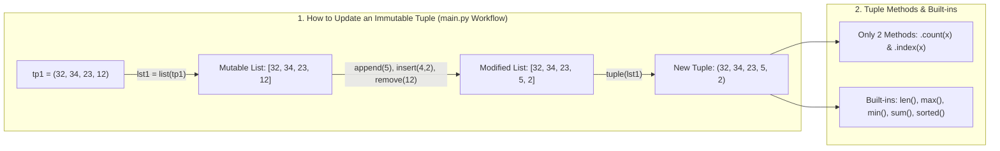

---
tags:
  - python
  - collections
  - tuples
  - sequences
---

# Tuples and Sequences in Python

#### TL;DR (Quick Revision)

**Python Tuples (`tuple`)** = Ordered, **immutable** collection (`tp1 = (32, 34, 23, 12)`) + Update workaround via `list(tp1)` conversion or `+` concatenation, whole-tuple deletion (`del tp1`), 2D matrices, and built-in functions (`len`, `max`, `min`, `sum`, `sorted`, `tuple`) ([Data Structures — Tuples and Sequences](https://docs.python.org/3/tutorial/datastructures.html)).

> [!abstract] Core Idea
> A `tuple` is an ordered sequence like a `list`, but once created it **cannot be changed in-place** (`tp1[0] = 99` raises a `TypeError`) → If you need to update, insert, or remove items from a tuple (as in your `main.py`), convert it to a list with `lst1 = list(tp1)`, modify the list, and convert it back with `tuple(lst1)` ([Data Structures — Tuples and Sequences](https://docs.python.org/3/tutorial/datastructures.html)).

> [!question] Why Use It?
>
> - Protect fixed data records (coordinates, database rows, RGB colors) from accidental changes
> - Use as dictionary keys or `set` elements (lists cannot be dictionary keys, but tuples can!)
> - Return multiple values from a function (`return total, avg`) and unpack them in one step
> - Represent read-only 2D matrices (`((1, 2, 3), (4, 5, 6), (7, 8, 9))`) or pass to `numpy.array()`

#### Quick Comparison Table

| Operation / Sub-Topic | Syntax (`main.py` & Syllabus) | Works Directly on `tuple`? | What It Returns & Does ([Official Tutorial Ch. 5.3](https://docs.python.org/3/tutorial/datastructures.html)) |
| :--- | :--- | :---: | :--- |
| **Create Tuple** | `tp1 = (32, 34, 23, 12)` or `empty = ()` | Yes | Creates an ordered, immutable sequence. |
| **1-Item (Singleton) Tuple** | `tp2 = ('valay',)` (with trailing comma!) | Yes | **Comma is required!** `('valay')` without a comma is just a `str`. |
| **Access & Slice** | `tp1[0]`, `tp1[-1]`, `tp1[1:3]` | Yes | Positive/negative indexing and slicing work just like lists. |
| **Updating a Tuple** | `lst = list(tp1)` → edit → `tuple(lst)` | Workaround | Converts `tuple` → `list`, mutates list, converts back to `tuple` (or uses `tp1 + tp2`). |
| **Deleting Elements** | `del tp1` (whole tuple only) | `del tp1[0]`: No / `del tp1`: Yes | Cannot delete single elements in-place; `del tp1` deletes the entire variable. |
| **Basic Tuple Operations** | `len(tp1)`, `tp1 + tp2`, `('valay',) * 3`, `3 in tp1` | Yes | Length, merging (`+`), repeating elements (`*`), membership (`in`), and `for` loops. |
| **2D Tuple Matrix** | `a = ((1, 2, 3), (4, 5, 6), (7, 8, 9))` | Yes | Nested tuples indexed via `a[row][col]` (or converted via `numpy.array(a)`). |
| **Built-in Functions** | `len(t)`, `max(t)`, `min(t)`, `sum(t)`, `sorted(t)`, `tuple(seq)` | Yes | Count, largest, smallest, sum, sorted `list`, or convert any iterable to `tuple`. |
| **Tuple Methods (Only 2!)** | `tp1.count(3)`, `tp1.index(23)` | Yes | `count(x)` returns occurrences of `x`; `index(x)` returns first index of `x`. |

---

## The Learning Concept

### What Problem Does It Solve? (Fixing the `('valay'*3)` Trap from `main.py`!)

Look at line 99 of your `main.py`: `tp2 = ('valay'*3)`. Because there was **no comma** after `'valay'`, Python treated `('valay')` as a plain string and printed `'valayvalayvalay'` instead of a 3-element tuple `('valay', 'valay', 'valay')`!

```python
# BAD - Forgetting the trailing comma in a 1-item tuple and trying in-place update
tp_wrong = ("valay" * 3)        # BAD: No comma! Repeats the string -> 'valayvalayvalay'
print("Type:", type(tp_wrong).__name__, "| Value:", tp_wrong)

tp1 = (32, 34, 23, 12)
# tp1[0] = 99                   # ERROR! TypeError: 'tuple' object does not support item assignment
```

In Python, **the comma makes the tuple**, not the parentheses! Adding a comma `('valay',)` creates a 1-element tuple, and converting `list(tp1)` lets you add/insert/remove elements cleanly:

```python
# GOOD - Trailing comma ('valay',) * 3 and updating via list() conversion (from your main.py)
tp_right = ("valay",) * 3       # GOOD: Trailing comma creates a tuple of 3 items!
print("Type:", type(tp_right).__name__, "| Value:", tp_right)

# Updating a tuple by converting tuple -> list -> tuple (exact workflow from your main.py)
tp1 = (32, 34, 23, 12)
lst1 = list(tp1)                # Step 1: Convert tuple to list
lst1.append(5)                  # Step 2: Update/insert/remove on the list
lst1.insert(4, 2)
lst1.remove(12)
tp_updated = tuple(lst1)        # Step 3: Convert back to tuple!
print("Updated tuple:", tp_updated)
```

### How Python Implements It

> [!tip] Four Core Tuple Workflows (From Your `main.py` & Syllabus)
>
> 1. **Update via `list()` or Merging (`+`)**: Since tuples are immutable, update them by converting `lst1 = list(tp1)` → mutating → `tuple(lst1)`, or merge two tuples with `tp1 + tuple(lst1)`.
> 2. **Tuple Packing & Unpacking**: `ret = find_sum(18, 22, 12, 15)` returns a packed tuple `(67, 16.75)` that you can access by index (`ret[0]`, `ret[1]`) or unpack directly (`tot, avg = find_sum(...)`) ([Data Structures — Tuples and Sequences](https://docs.python.org/3/tutorial/datastructures.html)).
> 3. **2D Matrix in Tuple**: Store rows as nested tuples `a = ((1, 2, 3), (4, 5, 6), (7, 8, 9))` and access `a[row][col]` (or pass `a` to `numpy.array(a)` as in your `main.py`).
> 4. **Built-in Functions & `.count()` / `.index()`**: Use `len(tp)`, `max(tp)`, `min(tp)`, `sum(tp)`, `sorted(tp)`, plus the only two tuple methods: `tp.count(val)` and `tp.index(val)`.

#### Full Runnable Example (All Tuple Examples from Your `main.py` + Syllabus Built-ins)

```python
# Step 1: Creating, Slicing, and Updating a Tuple via list() (from your main.py)
tp1 = (32, 34, 23, 12)
print("Original tp1:", tp1, "| Slice tp1[1:3]:", tp1[1:3])

lst1 = list(tp1)                                # Convert tuple -> list
lst1.append(5)
lst1.insert(4, 2)
lst1.remove(12)
tp_updated = tuple(lst1)                        # Convert list -> tuple
print("Updated tuple:", tp_updated)

# Step 2: Merging (+) and Repeating (*) Tuples
merged = tp1 + tp_updated
repeated_str = ("valay" * 3)                    # Without comma -> 'valayvalayvalay' (str)
repeated_tup = ("valay",) * 3                   # With comma -> ('valay', 'valay', 'valay') (tuple)
print("Merged:", merged)
print("Without comma:", repr(repeated_str), "| With comma:", repeated_tup)

# Step 3: 2D Matrix in Tuple & Tuple Methods (.count, .index)
matrix_tup = (
    (1, 2, 3),
    (4, 5, 6),
    (7, 8, 9),
)
nums_tup = (3, 4, 3, 2, 5, 6, 2, 3, 1)
print(f"Matrix center [1][1]: {matrix_tup[1][1]} | 3 occurred {nums_tup.count(3)} times | First 5 at index {nums_tup.index(5)}")

# Step 4: Built-in Tuple Functions (len, max, min, sum, sorted, tuple) & del
print(f"Built-ins on tp1 -> len:{len(tp1)}, max:{max(tp1)}, min:{min(tp1)}, sum:{sum(tp1)}, sorted:{sorted(tp1)}")
temp_tup = (10, 20)
del temp_tup                                    # Deletes the entire tuple variable
```

**Output:**

```
Original tp1: (32, 34, 23, 12) | Slice tp1[1:3]: (34, 23)
Updated tuple: (32, 34, 23, 5, 2)
Merged: (32, 34, 23, 12, 32, 34, 23, 5, 2)
Without comma: 'valayvalayvalay' | With comma: ('valay', 'valay', 'valay')
Matrix center [1][1]: 5 | 3 occurred 3 times | First 5 at index 4
Built-ins on tp1 -> len:4, max:34, min:12, sum:101, sorted:[12, 23, 32, 34]
```

### Visual Diagram: Updating & Unpacking Tuples



### Key Terminology

1. **Tuple Packing**: Creating a tuple by separating values with commas (`t = 12345, 54321, 'hello!'`) ([Data Structures — Tuples and Sequences](https://docs.python.org/3/tutorial/datastructures.html)).
   Syntax: `ret = total, avg`

2. **Sequence Unpacking**: Assigning the elements of a tuple (or any sequence) into separate variables on the left side of `=` (`tot, avg = ret`) ([Data Structures — Tuples and Sequences](https://docs.python.org/3/tutorial/datastructures.html)).
   Syntax: `x, y, z = (10, 20, 30)`

3. **Singleton Tuple**: A 1-element tuple that **must** have a trailing comma (`('valay',)`) so Python doesn't treat the parentheses as ordinary grouping ([Data Structures — Tuples and Sequences](https://docs.python.org/3/tutorial/datastructures.html)).
   Syntax: `single = ("valay",)`

4. **Extended Unpacking (`*rest`)**: Using a starred variable during unpacking (`first, *middle, last = tp1`) to capture remaining elements into a **`list`**.
   Syntax: `a, *b, c = (1, 2, 3, 4, 5)  # b is [2, 3, 4]`

> [!important] Key Rules to Remember
>
> - **The comma makes the tuple** → `('valay')` is a `str`; `('valay',)` is a `tuple`
> - **Only 2 methods exist on `tuple`** → `.count(x)` and `.index(x)` (no `.append()`, `.remove()`, or `.sort()`)
> - **`sorted(tp)` returns a `list`** → wrap in `tuple(sorted(tp))` if you want a sorted tuple back
> - **Individual items cannot be deleted** → `del tp1[0]` raises `TypeError`, but `del tp1` deletes the whole tuple variable

---

## ◈ Edge Case Analysis

### 1. Mutating a `list` Stored Inside a `tuple`

✗ **Problem:** While a tuple itself cannot have its slots reassigned (`v[0] = ...`), if a tuple contains a mutable **list** (`v = ([1, 2], [3, 4])`), you **can** still modify that inner list in-place (`v[0].append(99)`)! ([Data Structures — Tuples and Sequences](https://docs.python.org/3/tutorial/datastructures.html)).
✓ **Fix:** Use nested tuples `((1, 2), (3, 4))` when you want a completely read-only 2D structure.

```python
v = ([1, 2], [3, 4])
v[0].append(99)                         # Valid! Modifies the inner list at v[0]
print("Tuple with modified inner list:", v)
```

### 2. `(x * 2 for x in tp1)` Is a Generator, NOT a Tuple!

✗ **Problem:** Writing `[x * 2 for x in tp1]` creates a `list`, so beginners often write `(x * 2 for x in tp1)` expecting a `tuple`. Instead, parentheses create a lazy **`generator` object**! ([Classes — Generator Expressions](https://docs.python.org/3/tutorial/classes.html)).
✓ **Fix:** Pass the generator expression inside `tuple(...)`: `tuple(x * 2 for x in tp1)`.

```python
tp1 = (1, 2, 3)
gen = (x * 2 for x in tp1)
tup = tuple(x * 2 for x in tp1)
print("With parens only:", type(gen).__name__, "| With tuple():", tup)
```

### 3. Accidental Trailing Comma Turning a Variable into a Tuple

✗ **Problem:** Putting an accidental comma at the end of a line (`name = "Valay",`) turns `name` into a 1-element tuple `('Valay',)` instead of a string!
✓ **Fix:** Remove stray trailing commas on single-value assignments.

```python
oops = "Valay",
print("Accidental comma creates:", type(oops).__name__, oops)
```

---

## Going Deeper (Intermediate → Advanced)

### 1. When Can a Tuple Be Used as a Dictionary Key?

Unlike lists, tuples can be used as `dict` keys (e.g., mapping `(latitude, longitude)` or `(row, col)` grid coordinates to values)—**provided every item inside the tuple is also immutable**. If a tuple contains a list (`(1, [2, 3])`), trying to use it as a `dict` key raises `TypeError: unhashable type: 'list'`.

### 2. `collections.namedtuple` — Tuples with Readable Field Names

When a tuple has many fields (like `(name, age, desg, salary)`), remembering index numbers `emp[2]` gets confusing. `namedtuple` gives you both index access (`emp[0]`) and dot-attribute access (`emp.name`) while keeping tuple immutability and memory efficiency:

```python
from collections import namedtuple

EmployeeRecord = namedtuple("EmployeeRecord", ["name", "age", "desg"])
e = EmployeeRecord("Valay", 22, "Admin Support")
print("By name:", e.name, "| By index:", e[0], "| Unpacked:", *e)
```

---

## Topic Mastery Quiz

Test yourself before moving to the next chapter. Pick the best answer for each question.

**Q1: What is the type and value of `x = ("Python")`?**
- [ ] A) `tuple` → `('Python',)`
- [ ] B) `str` → `'Python'`
- [ ] C) `list` → `['Python']`
- [ ] D) `SyntaxError`

**Q2: Given `tp = (3, 4, 3, 2, 5, 3)`, what does `tp.count(3)` return?**
- [ ] A) `1`
- [ ] B) `2`
- [ ] C) `3`
- [ ] D) `0`

**Q3: What happens when you run `tp = (10, 20, 30); del tp[1]`?**
- [ ] A) `tp` becomes `(10, 30)`
- [ ] B) `tp` becomes `(10, None, 30)`
- [ ] C) Raises `TypeError: 'tuple' object doesn't support item deletion`
- [ ] D) Deletes the entire tuple `tp`

**Q4: What does `sorted((30, 10, 20))` return?**
- [ ] A) `(10, 20, 30)` (a `tuple`)
- [ ] B) `[10, 20, 30]` (a `list`)
- [ ] C) `None`
- [ ] D) `TypeError` (tuples cannot be sorted)

**Q5: Given `a, *b, c = (1, 2, 3, 4)`, what is the value of `b`?**
- [ ] A) `(2, 3)`
- [ ] B) `[2, 3]`
- [ ] C) `2`
- [ ] D) `[2, 3, 4]`

<details>
<summary>◈ View Answers & Explanations</summary>

1. **B** — Without a trailing comma, `("Python")` is just a parenthesized string (`str`). You need `("Python",)` for a 1-element tuple.
2. **C** — The number `3` appears 3 times in `tp`.
3. **C** — Tuples are immutable, so deleting an individual element (`del tp[1]`) raises `TypeError`. Only `del tp` (deleting the whole variable) is allowed.
4. **B** — The built-in `sorted()` function accepts any iterable (including a tuple) and always returns a new sorted **`list`** (`[10, 20, 30]`).
5. **B** — Starred unpacking (`*b`) always packs the captured middle elements into a **`list`** (`[2, 3]`).

</details>

---

## Practice Exercises

**Exercise 1: Tuple Update Workflow (From Your `main.py`)**
- Start with `tp = (100, 200, 300, 400)`
- Convert `tp` to a `list`, insert `250` at index `2`, remove `400`, and convert back to a `tuple`

**Exercise 2: Function Multi-Return Unpacking**
- Write a function `min_max_sum(nums)` that returns `min(nums), max(nums), sum(nums)`
- Call it on `(15, 8, 22, 5, 10)` and unpack the returned tuple into `low, high, total`

**Exercise 3: 2D Tuple Matrix Diagonal**
- Given `mat = ((1, 2, 3), (4, 5, 6), (7, 8, 9))`
- Extract the main diagonal elements (`mat[0][0]`, `mat[1][1]`, `mat[2][2]`) into a new tuple `(1, 5, 9)`

---

## Memory Trick / One-Liner

> [!tip] The Comma Rule
> **Parentheses are optional; the COMMA is the constructor!**
> `x = 10,` → Tuple `(10,)`
> `x = (10)` → Just the integer `10`!

---

## Warning Block (Best Practice)

> [!warning] Common Mistake (Avoid This!)
>
> ```python
> # BAD - Forgetting the comma when repeating a 1-element tuple (from main.py!)
> tp2 = ("valay" * 3)           # Produces a string: 'valayvalayvalay'
> ```
>
> ```python
> # GOOD - Put a comma after the item so Python repeats a 1-element tuple!
> tp2 = ("valay",) * 3          # Produces a tuple: ('valay', 'valay', 'valay')
> ```
