---
tags:
  - python
  - collections
  - tuples-and-sequences
---

# Tuples & Sequences in Python

## TL;DR (Quick Revision)

**Python Tuples (`tuple`)** = Comma-constructed, ordered, immutable sequence (`t = 12345, 54321, 'hello!'`) + sequence packing/unpacking (`x, y, z = t`), star-unpacking (`*rest`), `.count()`/`.index()` methods, and lexicographical sequence comparisons.

> [!abstract] Core Idea
> A `tuple` is an immutable standard sequence type constructed by separating values with commas (optionally enclosed in parentheses `()`). Unlike lists, tuples do not support item assignment (`t[0] = 88888` raises `TypeError`), making them hashable (when all their elements are hashable) and ideal for heterogeneous records, dictionary keys, and multi-value function returns.

> [!question] Why Use It?
>
> - **Record Integrity (Immutability)**: Prevents accidental element reassignment (`t[0] = x`) across function calls.
> - **Dictionary Keys & Set Elements**: Hashable tuples (containing only immutable/hashable objects) can be stored in a `set` or used as `dict` keys.
> - **Effortless Packing & Unpacking**: Packs values (`t = 1, 2, 3`) and unpacks any sequence into variables (`x, y, *rest = seq`) in a single statement.
> - **Named Field Access (`namedtuple`)**: `collections.namedtuple` extends tuples with readable attribute access (`p.x`, `p.y`) alongside index/unpacking support.

## Quick Reference Table

| Operation / Method | Syntax Example | Valid on `tuple`? | Returns / Effect | Exact Behavior |
| :--- | :--- | :---: | :--- | :--- |
| **Empty Tuple** | `empty = ()` | ✓ | `()` (len `0`) | Constructed by an empty pair of parentheses `()`. |
| **Singleton (1-Item) Tuple** | `s = 'hello',` or `('hello',)` | ✓ | `('hello',)` (len `1`) | Requires a **trailing comma**; `('hello')` without a comma is just a `str`. |
| **Tuple Packing** | `t = 12345, 54321, 'hi'` | ✓ | `(12345, 54321, 'hi')` | Packs comma-separated values into a single tuple object. |
| **Sequence Unpacking** | `x, y, z = t` | ✓ | Binds `x, y, z` | Requires exact variable count matching `len(t)` (unless starred `*rest` is used). |
| **Extended Unpacking (`*`)** | `first, *mid, last = range(5)` | ✓ | `mid = [1, 2, 3]` | Starred target captures remaining items as a **`list`** (even when unpacking a tuple!). |
| **Tuple Display Unpacking** | `t2 = (0, *t, 99)` | ✓ | New `tuple` | Expands any iterable inline inside a new tuple literal. |
| **`tuple.count(value)`** | `t.count(12345)` | ✓ | `int` | Returns number of occurrences of `value` in the tuple. |
| **`tuple.index(value[, start[, stop]])`** | `t.index('hi')` | ✓ | `int` (0-based) | Returns first index of `value`; raises **`ValueError`** if not present. |
| **Item Assignment** | `t[0] = 88888` | ✗ | `TypeError` | Prohibited because tuple bindings are immutable (`'tuple' object does not support item assignment`). |
| **Lexicographical Comparison** | `(1, 2, 3) < (1, 2, 4)` | ✓ | `bool` (`True`) | Compares element-by-element left-to-right; stops at first differing pair. |

## The Learning Concept

#### What Problem Does It Solve?

When creating a 1-element coordinate record or using composite keys in a cache, forgetting the trailing comma in `singleton = ("hello")` produces a plain `str` instead of a `tuple`, and using a `list` as a dictionary key crashes with `TypeError`:

```python
# BAD - Missing trailing comma on 1-item tuple and using unhashable list as dict key
not_a_tuple = ("hello")                 # BAD: parentheses without a comma just group a str!
print("Type:", type(not_a_tuple).__name__, "Len:", len(not_a_tuple))
# grid_cache = {[10, 20]: "Player"}     # BAD: TypeError: unhashable type: 'list'
# Output: Type: str Len: 5
```

In Python's grammar, **the comma makes the tuple**, not the parentheses (except for the empty tuple `()`) ([Expressions Reference](https://docs.python.org/3/reference/expressions.html)).

```python
# GOOD - Trailing comma for singleton tuple and immutable tuple as dictionary key
singleton = ("hello",)                  # GOOD: trailing comma creates a 1-element tuple
grid_cache = {(10, 20): "Player"}       # GOOD: tuple of ints is immutable & hashable
print("Type:", type(singleton).__name__, "Len:", len(singleton), "| Cache:", grid_cache[(10, 20)])
# Output: Type: tuple Len: 1 | Cache: Player
```

#### How Python Implements It

> [!tip] Four Essential Tuple & Sequence Mechanics
>
> 1. **Comma-Driven Construction**: `t = 12345, 54321, 'hello!'` packs values into a tuple; nested tuples `u = t, (1, 2, 3)` are always printed in parentheses so nesting is unambiguous ([Data Structures — Tuples and Sequences](https://docs.python.org/3/tutorial/datastructures.html)).
> 2. **Immutability vs. Mutable Contents**: A tuple's element references cannot be rebound (`t[0] = x` fails), **but** a tuple can contain mutable objects like lists (`v = ([1, 2, 3], [3, 2, 1])`) whose inner contents can still be mutated in place ([Data Structures — Tuples and Sequences](https://docs.python.org/3/tutorial/datastructures.html)).
> 3. **Unpacking & Starred Targets**: `x, y, z = t` unpacks any sequence; in `a, *b, c = t`, the starred target `b` always receives a `list` (even if 0 items remain, yielding `[]`) ([More Control Flow Tools](https://docs.python.org/3/tutorial/controlflow.html)).
> 4. **Lexicographical Sequence Ordering (Ch. 5.8)**: Sequences of the same type (`tuple` vs `tuple`, `list` vs `list`, `str` vs `str`) compare element-by-element recursively (`(1, 2, ('aa', 'ab')) < (1, 2, ('abc', 'a'), 4)` is `True` because `'aa' < 'abc'`) ([Data Structures — Comparing Sequences](https://docs.python.org/3/tutorial/datastructures.html)).

#### Full Runnable Example

```python
# Complete runnable demonstration of Tuple Packing, Unpacking, Methods, NamedTuple & Comparisons
from collections import namedtuple

# Define a namedtuple for readable coordinate records
Point = namedtuple("Point", ["x", "y"])

if __name__ == "__main__":
    # 1. Empty, Singleton, Packed, Nested & Unpacked Tuples (Tutorial Ch 5.3)
    empty = ()
    singleton = "hello",                        # Trailing comma creates 1-item tuple
    packed = 12345, 54321, "hello!", 12345      # Tuple packing
    nested = packed, (1, 2, 3)                  # Nested tuple
    a, b, msg, dup = packed                     # Sequence unpacking

    # 2. Extended Iterable Unpacking (*rest) & Tuple Literal Unpacking
    head, *middle, tail = (10, 20, 30, 40, 50)  # middle is always a list: [20, 30, 40]
    combined = (0, *middle, 60)                 # Unpack list into a new tuple

    # 3. Tuple Methods: .count() and .index()
    cnt_12345 = packed.count(12345)             # 2
    idx_msg = packed.index("hello!")            # 2

    # 4. namedtuple usage & Lexicographical Sequence Comparison (Tutorial Ch 5.8)
    p = Point(3, 4)
    cmp_result = (1, 2, ("aa", "ab")) < (1, 2, ("abc", "a"), 4)

    print(f"EmptyLen:{len(empty)} | Singleton:{singleton} (len={len(singleton)})")
    print(f"Unpacked: a={a}, b={b}, msg={msg} | NestedLen:{len(nested)}")
    print(f"StarUnpack: head={head}, middle={middle}, tail={tail} | Combined:{combined}")
    print(f"Methods: count(12345)={cnt_12345}, index('hello!')={idx_msg}")
    print(f"NamedTuple: x={p.x}, y={p[1]} | LexCompare:{cmp_result}")
```

**Output:**

```Output
EmptyLen:0 | Singleton:('hello',) (len=1)
Unpacked: a=12345, b=54321, msg=hello! | NestedLen:2
StarUnpack: head=10, middle=[20, 30, 40], tail=50 | Combined:(0, 20, 30, 40, 60)
Methods: count(12345)=2, index('hello!')=2
NamedTuple: x=3, y=4 | LexCompare:True
```

#### Visual Diagram

```mermaid
flowchart LR
    subgraph PACK["1. Packing & Unpacking"]
        P["t = 10, 20, 30, 40 (Tuple Packing)"] --> U["first, *mid, last = t"]
        U --> R1["first = 10 (int)"]
        U --> R2["mid = [20, 30] (Always a list!)"]
        U --> R3["last = 40 (int)"]
    end
    subgraph IMM["2. Tuple Immutability vs Mutable Inner Object"]
        V["v = ([1, 2], [3, 4])"]
        V -.->|"v[0] = [9, 9]"| ERR["TypeError (Cannot rebind tuple slot)"]
        V -->|"v[0].append(99)"| OK["Valid! Inner list mutates to ([1, 2, 99], [3, 4])"]
    end
```



#### Key Terminology

1. **Tuple Packing**: Creating a tuple by separating values with commas on the right-hand side of an assignment (`t = 12345, 54321, 'hello!'`) ([Data Structures — Tuples and Sequences](https://docs.python.org/3/tutorial/datastructures.html)).
   Syntax: `coords = 10.5, 20.8`
2. **Sequence Unpacking**: Assigning any right-hand sequence (`tuple`, `list`, `str`, `range`) to an equal number of comma-separated variables on the left-hand side ([Data Structures — Tuples and Sequences](https://docs.python.org/3/tutorial/datastructures.html)).
   Syntax: `x, y, z = coords_3d`
3. **Singleton Tuple**: A 1-element tuple that requires a trailing comma so Python distinguishes it from a parenthesized expression ([Data Structures — Tuples and Sequences](https://docs.python.org/3/tutorial/datastructures.html)).
   Syntax: `singleton = ('hello',)`
4. **Lexicographical Ordering**: Comparing two sequences of the same type element-by-element from index `0` onward until a mismatch or end-of-sequence determines the result ([Data Structures — Comparing Sequences](https://docs.python.org/3/tutorial/datastructures.html)).
   Syntax: `(1, 2, 3) < (1, 2, 4)  # True`

> [!important] Key Rules to Remember
>
> - **Only 2 Tuple Methods**: Because tuples are immutable, they only have **`.count(value)`** and **`.index(value[, start[, stop]])`**—no `.append()`, `.remove()`, or `.sort()`.
> - **Heterogeneous vs. Homogeneous Convention**: Tuples typically hold **heterogeneous** records unpacked by position, whereas lists typically hold **homogeneous** collections iterated over in loops.
> - **Hashability Depends on Contents**: A tuple is hashable (usable as a `dict` key or `set` member) **only if** every element inside it is also hashable (`(1, [2, 3])` is unhashable).

## ◈ Edge Case Analysis

#### 1. Mutating a `list` Inside an Immutable `tuple` (and the `+=` Trap)
**Problem:** While `v = ([1, 2], [3, 4])` cannot have its slots reassigned (`v[0] = ...`), calling `v[0].append(3)` succeeds. Even trickier: `v[0] += [3]` **both mutates the inner list in-place AND raises `TypeError`** when trying to write the result back into `v[0]`!
**Fix:** Mutate inner lists explicitly via `.append()` / `.extend()`, never via `v[0] += ...`, or store immutable inner tuples `((1, 2), (3, 4))`.

```python
# Fix: inner list mutates via .append(); avoid v[0] += [...] on tuple slots
v = ([1, 2], [3, 4])
v[0].append(99)                         # Mutates the inner list at v[0] without rebinding slot 0
print("Tuple with mutated inner list:", v)
```

**Output:**

```Output
Tuple with mutated inner list: ([1, 2, 99], [3, 4])
```

#### 2. Accidental Trailing Comma Turning a Variable into a 1-Tuple
**Problem:** Leaving a stray trailing comma at the end of an assignment line (`name = "Rahul",`) silently wraps the value in a 1-element tuple `('Rahul',)` instead of a `str`.
**Fix:** Watch for trailing commas when refactoring multi-line dictionaries or function arguments into variable assignments.

```python
# Fix: remove stray trailing comma when a scalar value is intended
accidental_tuple = "Rahul",             # Trailing comma makes it ('Rahul',)
clean_str = "Rahul"
print("Accidental:", type(accidental_tuple).__name__, accidental_tuple, "| Clean:", type(clean_str).__name__)
```

**Output:**

```Output
Accidental: tuple ('Rahul',) | Clean: str
```

#### 3. `(x for x in ...)` Is a Generator Expression, Not a Tuple Comprehension
**Problem:** Unlike `[x for x in range(5)]` (list comprehension) and `{x for x in range(5)}` (set comprehension), writing `(x for x in range(5))` does **not** create a tuple—it creates a lazy **generator object**.
**Fix:** Pass the generator expression to `tuple(...)`: `tuple(x for x in range(5))`.

```python
# Fix: use tuple(...) to materialize a tuple from a comprehension
gen = (x * 2 for x in range(4))
tup = tuple(x * 2 for x in range(4))
print("Paren comprehension type:", type(gen).__name__, "| tuple():", tup)
```

**Output:**

```Output
Paren comprehension type: generator | tuple(): (0, 2, 4, 6)
```

#### 4. Lexicographical Comparison Short-Circuits Before Type Mismatches
**Problem:** Comparing `(1, 2, 'a') < (1, 3, 4)` returns `True` without raising a `TypeError` on `'a' < 4`, because comparison stops as soon as `2 < 3` is decided at index 1.
**Fix:** Ensure tuple schemas match across elements so comparisons don't fail when earlier positions tie.

```python
# Fix: lexicographical comparison resolves at the first unequal index (2 < 3)
res = (1, 2, "text") < (1, 3, 999)
print("Short-circuit tuple comparison:", res)
```

**Output:**

```Output
Short-circuit tuple comparison: True
```

## Topic Mastery Quiz

Test yourself on Python tuple mechanics, memory invariants, and edge cases.

**Q1: How do you construct a 1-element (singleton) tuple in Python?**
- [ ] A) `t = (42)`
- [ ] B) `t = (42,)` or `42,`
- [ ] C) `t = tuple[42]`
- [ ] D) `t = [42,]`

**Q2: Given `t = ([1, 2], 3)`, what happens when executing `t[0] += [4]`?**
- [ ] A) It raises `TypeError`, but `t[0]` is mutated in-place to `[1, 2, 4]`
- [ ] B) It raises `TypeError` and leaves `t[0]` unchanged as `[1, 2]`
- [ ] C) It runs successfully without error
- [ ] D) It raises `ValueError`

**Q3: Can a tuple containing a list `(1, [2, 3])` be used as a dictionary key?**
- [ ] A) Yes, because the outer container is an immutable tuple
- [ ] B) No, raises `TypeError: unhashable type: 'list'` because tuple hashability is recursive
- [ ] C) Yes, but only if the dictionary has string keys
- [ ] D) No, raises `KeyError`

**Q4: In extended unpacking `first, *mid, last = (10, 20)`, what is the type and value of `mid`?**
- [ ] A) `mid = ()` (empty tuple)
- [ ] B) `mid = []` (empty list)
- [ ] C) `mid = None`
- [ ] D) Raises `ValueError`

**Q5: What does the expression `(x for x in range(3))` produce?**
- [ ] A) A tuple `(0, 1, 2)`
- [ ] B) A generator object
- [ ] C) A syntax error
- [ ] D) A tuple iterator

**Q6: What is the result of evaluating `(1, 2, 'alpha') < (1, 3, 100)` in Python 3?**
- [ ] A) Raises `TypeError: '<' not supported between instances of 'str' and 'int'`
- [ ] B) Returns `True`, because comparison short-circuits at index 1 (`2 < 3`)
- [ ] C) Returns `False`
- [ ] D) Returns `None`

<details>
<summary>◈ View Answers & Explanations</summary>

1. **B** — A singleton tuple requires a trailing comma: `(42,)` or `42,`. Without a comma, `(42)` is parsed as an integer in parentheses.
2. **A** — `+=` invokes `__iadd__()` which modifies the inner list in-place, but then assignment back to `t[0]` fails because tuple slots are immutable, raising `TypeError`.
3. **B** — A tuple is hashable only if all of its elements are also hashable. Because `list` is mutable and unhashable, the tuple cannot be hashed.
4. **B** — Starred unpacking targets always produce a `list`, even when unpacking from a tuple and even when 0 elements remain (`[]`).
5. **B** — Parentheses around a comprehension create a generator expression, not a tuple comprehension. To build a tuple, pass it to `tuple(...)`.
6. **B** — Lexicographical comparison evaluates elements left-to-right and short-circuits at the first differing pair (`2 < 3`), so the incompatible types at index 2 are never compared.

</details>

---

### Classic Mistakes / Traps

✗ **Mistake 1:** Forgetting trailing comma for a singleton tuple

```python
# BAD
val = ("admin")  # Type is str, not tuple!
```

✓ **Fix:** Always include a trailing comma: `("admin",)`.

```python
# GOOD
val = ("admin",)  # Type is tuple
```

✗ **Mistake 2:** Attempting augmented assignment `+=` on an inner mutable object

```python
# BAD
t = ([1, 2], 3)
t[0] += [4]  # Mutates AND raises TypeError!
```

✓ **Fix:** Use explicit methods like `.append()` or `.extend()`.

```python
# GOOD
t = ([1, 2], 3)
t[0].append(4)  # Clean in-place mutation
```
