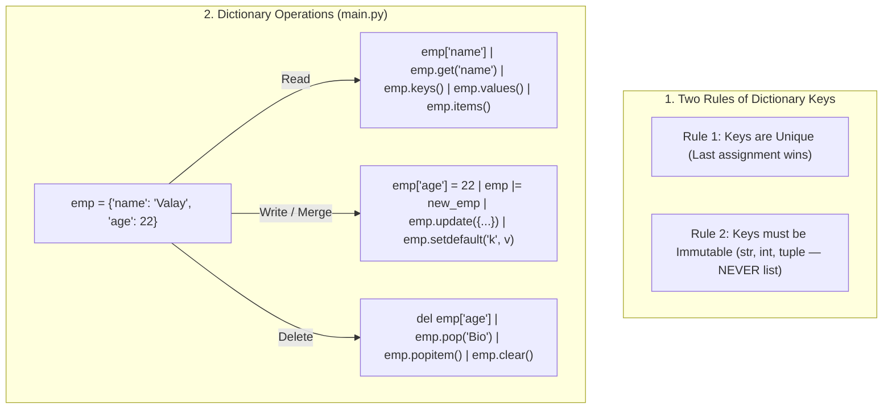

---
tags:
  - python
  - collections
  - dictionaries
  - sets
---

# Dictionaries and Sets in Python

#### TL;DR (Quick Revision)

**Dictionaries & Sets (`dict`, `set`)** = Store `{key: value}` pairs with unique, immutable keys (`emp = {'name': 'valay', 'age': 22}`) + Update, merge (`|=`, `.update()`), delete (`del`, `.pop()`, `.popitem()`, `.clear()`), and loop with `.items()` + Unique `set()` algebra ([Data Structures — Sets & Dictionaries](https://docs.python.org/3/tutorial/datastructures.html)).

> [!abstract] Core Idea
> A `dict` stores data as **`{key: value}` pairs** so you can look up values instantly by name (`emp["name"]` or `emp.get("name")`) instead of index numbers → Keys must be **unique** (the last assignment wins) and **immutable** (`str`, `int`, `tuple`) → A `set` (`{1, 2, 3}` or `set()`) stores only unique items without values ([Data Structures — Dictionaries](https://docs.python.org/3/tutorial/datastructures.html)).

> [!question] Why Use It?
>
> - Look up, update, or delete employee/student fields by key name (`emp["age"] = 22`) in O(1) time
> - Merge multiple dictionaries cleanly using `emp |= new_emp` or `emp.update(...)` (as in your `main.py`)
> - Prevent crashes on missing keys using `emp.get("key")` and `emp.setdefault("desg", "Admin Support")`
> - Remove duplicates from a list instantly and compute intersections/differences using `set()`

#### Quick Comparison Table

| Operation / Method | Syntax (`main.py` & Syllabus) | Modifies Dict In-Place? | What It Returns & Does ([Official Tutorial Ch. 5.4–5.6](https://docs.python.org/3/tutorial/datastructures.html)) |
| :--- | :--- | :---: | :--- |
| **Access Value** | `emp["NAME"]` vs `emp.get("NAME")` | No | `emp["k"]` raises **`KeyError`** if missing; `emp.get("k")` safely returns `None` (or a default). |
| **Update Single Key** | `emp["age"] = 22` | Yes | Overwrites existing key `'age'` (or adds `'age'` if it didn't exist yet). |
| **Merge / Update Multiple** | `emp \|= new_emp` or `emp.update({...})` | Yes | Merges all `key: value` pairs from the second dictionary into `emp`. |
| **Delete Key (`del` / `pop`)** | `del emp["age"]` / `emp.pop("Bio")` | Yes | `del` deletes key; `.pop("Bio")` deletes key AND **returns** its value. |
| **Pop Last Item (`popitem`)** | `item = emp.popitem()` | Yes | Removes and returns the **last inserted `(key, value)` tuple** (LIFO order). |
| **Set Default (`setdefault`)** | `emp.setdefault("desg", "Admin")` | Yes (if missing) | If `'desg'` is missing, inserts `'desg': 'Admin'`; if already present, keeps existing value! |
| **Views (`keys`, `values`, `items`)** | `emp.keys()`, `emp.values()`, `emp.items()` | No | Returns dynamic views of keys, values, or `(key, value)` pairs for `for k, v in emp.items():`. |
| **Clear & Copy & `fromkeys`** | `emp.clear()`, `emp.copy()`, `dict.fromkeys(seq, v)` | `clear`: Yes / Others: No | Empties dict (`{}`), makes a shallow copy, or creates a new dict from a key list. |
| **Built-in Functions** | `len(emp)`, `str(emp)`, `type(emp)` | No | Key count, string representation of the dict, or `<class 'dict'>`. |
| **Sets (`set`)** | `set()`, `a \| b`, `a & b`, `a - b`, `a ^ b` | No | Empty set (`set()`, NOT `{}`!), union (`\|`), intersection (`&`), difference (`-`), XOR (`^`). |

---

## The Learning Concept

### What Problem Does It Solve?

When working with dictionaries (like `emp` in your `main.py`), two common bugs happen:
1. Case-sensitivity with keys (`"name"` vs `"NAME"` are **two completely different keys**!).
2. Using `emp["missing_key"]` when a key might not exist, which crashes with a `KeyError`!

```python
# BAD - Case-sensitive duplicate keys ("name" vs "NAME") and crashing on missing key
emp = {"name": "valay", "age": 22}
emp["NAME"] = "Valay"           # BAD: Does NOT update 'name'! Creates a second key 'NAME'!
print("Both 'name' and 'NAME' exist:", emp)

# print(emp["salary"])          # ERROR! KeyError: 'salary'
```

Use consistent key casing, use `.get("salary", 0)` for safe reads, and use `.setdefault()` when you only want to set a value if the key is missing:

```python
# GOOD - Consistent keys, safe .get() lookup, and .setdefault() (from your main.py)
emp = {"name": "Valay", "age": 22}
salary = emp.get("salary", 0)                           # GOOD: Returns 0 instead of crashing!
emp.setdefault("desg", "Admin Support")                 # GOOD: Adds 'desg' because it was missing
emp.setdefault("name", "Someone Else")                  # Keeps 'Valay' because 'name' already exists!

print("Safe salary:", salary, "| Updated emp:", emp)
```

### How Python Implements It

> [!tip] Four Pillars of Dictionaries & Sets (From Your `main.py` & Syllabus)
>
> 1. **Two Properties of Dictionary Keys**:
>    - **No Duplicate Keys**: If you write `{'age': 18, 'age': 22}`, only the **last value (`22`)** is kept.
>    - **Keys Must Be Immutable**: Strings, numbers, and tuples are allowed as keys; lists (`[1, 2]`) raise `TypeError: unhashable type: 'list'`.
> 2. **Merging & Updating (`|=` and `.update()`)**: In Python 3.9+, `emp |= new_emp` merges `new_emp` into `emp` in-place (just like `emp.update(new_emp)`).
> 3. **Four Ways to Remove Dict Items**: `del emp["age"]` (by key), `emp.pop("Bio")` (by key, returns value), `emp.popitem()` (removes & returns the **last inserted** `(key, value)` pair), and `emp.clear()` (empties everything).
> 4. **Looping Over Key-Value Pairs**: Use `for key, value in emp.items():` to unpack each key and value cleanly in a `for` loop.

#### Full Runnable Example (Your Exact `main.py` Dictionary Workflow + Sets)

```python
# Step 1: Create & Access Dictionary (from your main.py)
emp = {
    "name": "valay",
    "age": 22,
    "Bio": "Not available during lightouts :)",
}
print(f"Name: {emp['name']} | Age: {emp['age']}")

# Step 2: Merge Dictionary with |= and .update() (from your main.py)
new_emp = {
    "NAME": "Valay",
    "LOC": "Near Nagpur",
    "Possibility": "In Dreams!!",
}
emp |= new_emp                                  # In-place merge operator
emp["age"] = 18                                 # Update single key
emp.update({"name": "Valay", "desg": "Admin Support"})  # Update multiple keys
emp["age"] = 22                                 # Restore right age

# Step 3: Delete Keys using del, .pop(), and .popitem() (from your main.py)
del emp["name"]
del emp["age"]
removed_bio = emp.pop("Bio")                    # Removes 'Bio' and returns its value
last_item = emp.popitem()                       # Removes & returns last inserted (key, value) pair

# Step 4: .get(), .setdefault(), .keys(), .values(), and .items() loop
emp.setdefault("desg", "Backup Role")           # Won't overwrite existing 'desg'
emp.setdefault("dept", "IT")                    # Adds 'dept': 'IT' since 'dept' was missing
print("Using get('NAME'):", emp.get("NAME"), "| Popped Bio:", removed_bio)
print("Last popitem():", last_item)
print("Keys:", list(emp.keys()), "| Values:", list(emp.values()))

for key, value in emp.items():
    print(f"  {key} -> {value}")

# Step 5: Sets (Unique items & Set Algebra)
skills_a = {"Python", "SQL", "Git", "Python"}   # Duplicate 'Python' removed automatically!
skills_b = {"SQL", "Java", "Docker"}
print("Common skills (&):", sorted(skills_a & skills_b), "| Only in A (-):", sorted(skills_a - skills_b))
```

**Output:**

```
Name: valay | Age: 22
Using get('NAME'): Valay | Popped Bio: Not available during lightouts :)
Last popitem(): ('desg', 'Admin Support')
Keys: ['NAME', 'LOC', 'Possibility', 'dept'] | Values: ['Valay', 'Near Nagpur', 'In Dreams!!', 'IT']
  NAME -> Valay
  LOC -> Near Nagpur
  Possibility -> In Dreams!!
  dept -> IT
Common skills (&): ['SQL'] | Only in A (-): ['Git', 'Python']
```

### Visual Diagram: Dictionary Operations & Key Rules



### Key Terminology

1. **`emp.get(key, default=None)`**: Reads the value for `key` if it exists; returns `default` (`None` by default) instead of raising `KeyError` if `key` is missing ([Data Structures — Dictionaries](https://docs.python.org/3/tutorial/datastructures.html)).
   Syntax: `emp.get("NAME", "Unknown")`

2. **`emp.setdefault(key, default=None)`**: If `key` is already in the dictionary, returns its current value without changing anything; if `key` is missing, inserts `emp[key] = default` and returns `default`.
   Syntax: `emp.setdefault("desg", "Admin Support")`

3. **`emp.pop(key)` vs. `emp.popitem()`**: `pop(key)` removes the specified `key` and returns its value; `popitem()` removes and returns the **most recently inserted `(key, value)` pair** as a tuple.
   Syntax: `last_pair = emp.popitem()`

4. **Empty Dictionary `{}` vs. Empty Set `set()`**: Writing `{}` always creates an empty **`dict`**. To create an empty set, you must write **`set()`** ([Data Structures — Sets](https://docs.python.org/3/tutorial/datastructures.html)).
   Syntax: `empty_dict = {}; empty_set = set()`

> [!important] Key Rules to Remember
>
> - **`{}` is a `dict`, NOT a `set`** → always use `set()` to create an empty set
> - **In `main.py`, why did `emp.setdefault('desg', 'Admin Support')` re-insert `'desg'`?** → Because `emp.popitem()` on the line right before it had just popped `'desg'` out of `emp` (since `'desg'` was the last newly inserted key)!
> - **`1`, `1.0`, and `True` are the SAME key** → `{1: 'A', 1.0: 'B', True: 'C'}` collapses into `{1: 'C'}` because `1 == 1.0 == True`!
> - **Never use `dict.fromkeys(keys, [])` with a mutable list** → all keys will share the exact same list! Use `{k: [] for k in keys}` instead

---

## ◈ Edge Case Analysis

### 1. Why `emp.popitem()` Removed `'desg'` in Your `main.py`!

✗ **Problem:** Look at lines 155–183 of your `main.py`:
1. First, `emp` had `'name'`, `'age'`, `'Bio'`, `'NAME'`, `'LOC'`, `'Possibility'`.
2. Then `emp.update({"name": "Valay", "desg": "Admin Supppoooooorrrrrttttt"})` updated existing `'name'` and appended `'desg'` as the **very last key**!
3. After deleting `'name'`, `'age'`, and `'Bio'`, calling `item = emp.popitem()` popped the **last inserted key**—which was `('desg', 'Admin Supppoooooorrrrrttttt')`!
4. Then `emp.setdefault('desg', 'Admin Support')` saw `'desg'` was now missing and inserted `'desg': 'Admin Support'`!

```python
emp = {"NAME": "Valay", "LOC": "Near Nagpur", "desg": "Admin Supppoooooorrrrrttttt"}
popped = emp.popitem()                  # Pops ('desg', 'Admin Supppoooooorrrrrttttt')!
emp.setdefault("desg", "Admin Support") # Re-inserts 'desg' with 'Admin Support'!
print("Popped:", popped, "| Final desg:", emp["desg"])
```

### 2. The `{1: "int", 1.0: "float", True: "bool"}` Key Collision Trap

✗ **Problem:** In Python, `bool` is a subclass of `int`, and `1 == 1.0 == True` with the exact same hash (`hash(1) == hash(1.0) == hash(True)`). So putting all three in a dictionary keeps the first key (`1`) and overwrites its value to `"bool"`!
✓ **Fix:** Avoid mixing booleans and numbers as keys in the same dictionary.

```python
tricky = {1: "int", 1.0: "float", True: "bool"}
print("Collided dict:", tricky, "| Length:", len(tricky))
```

### 3. Shared List Bug in `dict.fromkeys(["A", "B"], [])`

✗ **Problem:** `dict.fromkeys(["A", "B"], [])` points both `"A"` and `"B"` to the **exact same list** in memory!
✓ **Fix:** Use a dictionary comprehension `{k: [] for k in ["A", "B"]}`.

```python
bad = dict.fromkeys(["A", "B"], [])
bad["A"].append(99)                     # Mutates BOTH 'A' and 'B'!

good = {k: [] for k in ["A", "B"]}
good["A"].append(99)                    # Mutates ONLY 'A'!
print("Bad fromkeys:", bad, "| Good comprehension:", good)
```

---

## Going Deeper (Intermediate → Advanced)

### 1. Dictionary Comprehensions & `zip()` Looping

You can build dictionaries dynamically in one line using **Dictionary Comprehensions** (`{k: v for ...}`), or pair two lists into a dictionary using `dict(zip(keys, values))` ([Data Structures — Dictionaries](https://docs.python.org/3/tutorial/datastructures.html)):

```python
names = ["Valay", "Hari", "Ramesh"]
salaries = [30000, 24680, 28000]

payroll = dict(zip(names, salaries))
bonus_payroll = {name: sal + 2000 for name, sal in payroll.items() if sal >= 25000}
print("Payroll:", payroll)
print("Bonus Payroll (>=25k):", bonus_payroll)
```

### 2. Set Methods vs. Set Operators (`|` vs `.union()`, `remove()` vs `discard()`)

- **Operators (`a | b`, `a & b`, `a - b`, `a ^ b`)** require both sides to be `set` objects.
- **Methods (`a.union(lst)`, `a.intersection(lst)`)** accept **any iterable** (like a `list` or `tuple`)!
- **`s.remove(x)` vs `s.discard(x)`**: `s.remove(x)` raises `KeyError` if `x` is missing, whereas `s.discard(x)` safely does nothing if `x` is missing!

---

## Topic Mastery Quiz

Test yourself before moving to the next chapter. Pick the best answer for each question.

**Q1: What is the data type of `x = {}` in Python?**
- [ ] A) `set`
- [ ] B) `dict`
- [ ] C) `list`
- [ ] D) `tuple`

**Q2: Given `d = {"a": 10, "b": 20}`, what does `d.setdefault("a", 99)` return, and what is `d["a"]`?**
- [ ] A) Returns `99`, and `d["a"]` becomes `99`
- [ ] B) Returns `10`, and `d["a"]` stays `10` (because `"a"` already exists!)
- [ ] C) Returns `None`
- [ ] D) Raises `KeyError`

**Q3: Which of the following CANNOT be used as a dictionary key?**
- [ ] A) `"name"` (`str`)
- [ ] B) `(10, 20)` (`tuple` of ints)
- [ ] C) `[10, 20]` (`list` of ints)
- [ ] D) `42` (`int`)

**Q4: What does `len({1: "one", 1.0: "float_one", True: "bool_one"})` return?**
- [ ] A) `3`
- [ ] B) `2`
- [ ] C) `1`
- [ ] D) `TypeError`

**Q5: Given `emp = {"name": "Valay", "age": 22}`, which loop correctly prints both keys and values?**
- [ ] A) `for k, v in emp:`
- [ ] B) `for k, v in emp.keys():`
- [ ] C) `for k, v in emp.items():`
- [ ] D) `for k, v in emp.values():`

<details>
<summary>◈ View Answers & Explanations</summary>

1. **B** — Empty curly braces `{}` always create an empty **`dict`**. Use `set()` to create an empty set.
2. **B** — `.setdefault("a", 99)` only sets the default if `"a"` is **missing**. Since `"a"` is already `10`, it leaves `"a": 10` untouched and returns `10`.
3. **C** — Lists (`[10, 20]`) are mutable and therefore unhashable (`TypeError: unhashable type: 'list'`).
4. **C** — Because `1 == 1.0 == True` and all three have the same hash, they refer to the **same single key `1`**, leaving a dictionary of length `1` (`{1: 'bool_one'}`).
5. **C** — `emp.items()` yields `(key, value)` pairs that unpack into `k, v`. (`for k in emp:` only iterates over keys!)

</details>

---

## Practice Exercises

**Exercise 1: Word Frequency Counter**
- Given `sentence = "apple banana apple mango banana apple"`
- Loop through `sentence.split()` and use a dictionary `counts` with `counts.get(word, 0) + 1` to count how many times each word appears

**Exercise 2: Employee Profile Merger (From Your `main.py`)**
- Create `base = {"name": "Valay", "age": 22}` and `extra = {"loc": "Nagpur", "role": "Dev"}`
- Merge `extra` into `base` using `|=`, pop `"age"`, and loop through `.items()` to print the result

**Exercise 3: Set Skill Matcher**
- Given `job_skills = {"Python", "SQL", "AWS", "Docker"}` and `my_skills = {"Python", "SQL", "Git"}`
- Print the matched skills (`&`), missing job skills (`job_skills - my_skills`), and combined skills (`|`)

---

## Memory Trick / One-Liner

> [!tip] `.get()` vs `.setdefault()`
> - **`.get(k, default)`** = **Look Only** (returns `default` if missing, never touches the dict)
> - **`.setdefault(k, default)`** = **Look & Lock In** (if `k` is missing, saves `d[k] = default` inside the dict!)

---

## Warning Block (Best Practice)

> [!warning] Common Mistake (Avoid This!)
>
> ```python
> # BAD - Using {} thinking it creates an empty set!
> visited = {}
> # visited.add("page1")        # CRASH! AttributeError: 'dict' object has no attribute 'add'
> ```
>
> ```python
> # GOOD - Always use set() for an empty set!
> visited = set()
> visited.add("page1")          # Works! visited is {'page1'}
> ```
