---
tags:
  - python
  - collections
  - sets-and-dictionaries
---

# Sets & Dictionaries in Python

## TL;DR (Quick Revision)

**Sets & Dictionaries (`set`, `dict`)** = Unordered unique hash-set (`{a, b}` / `set()`) + insertion-ordered key-value mapping (`{k: v}` / `dict()`) supporting O(1) membership, set algebra (`| & - ^`), dictionary views (`.items()`, `.keys()`, `.values()`), comprehensions, and `enumerate()`/`zip()` looping ([Data Structures — Sets & Dictionaries](https://docs.python.org/3/tutorial/datastructures.html)).

> [!abstract] Core Idea
> A `set` is an unordered collection of unique hashable elements used for fast membership testing, deduplication, and mathematical set operations (union `|`, intersection `&`, difference `-`, symmetric difference `^`) ([Data Structures — Sets](https://docs.python.org/3/tutorial/datastructures.html)). A `dict` maps unique hashable keys to arbitrary values, preserves insertion order (guaranteed since Python 3.7), and provides safe lookups (`.get()`, `.setdefault()`), views (`.items()`), merges (`|`, `|=`), and comprehensions ([Data Structures — Dictionaries](https://docs.python.org/3/tutorial/datastructures.html)).

> [!question] Why Use It?
>
> - **O(1) Deduplication & Set Algebra**: Eliminates duplicates in one call (`set(items)`) and computes intersections (`a & b`) or differences (`a - b`) directly ([Data Structures — Sets](https://docs.python.org/3/tutorial/datastructures.html)).
> - **Fast Key-Value Indexing**: Stores and retrieves records by meaningful immutable keys (`tel['guido']`) rather than numeric positions ([Data Structures — Dictionaries](https://docs.python.org/3/tutorial/datastructures.html)).
> - **Safe & Expressive Dict API**: Prevents `KeyError` via `.get(k, default)` and `.setdefault(k, default)`, and merges mappings with `d1 | d2`.
> - **Idiomatic Looping Helpers (Ch. 5.6)**: Pairs keys/values with `.items()`, indices/values with `enumerate()`, parallel sequences with `zip()`, and non-mutating order with `sorted()` and `reversed()` ([Data Structures — Looping Techniques](https://docs.python.org/3/tutorial/datastructures.html)).

## Quick Reference Table

| Type / Method / Operator             | Syntax Example                        |  Raises on Missing Key/Item?   | Returns / Effect      | Exact Behavior ([Official Tutorial Ch. 5.4–5.7](https://docs.python.org/3/tutorial/datastructures.html))    |
| :----------------------------------- | :------------------------------------ | :----------------------------: | :-------------------- | :---------------------------------------------------------------------------------------------------------- |
| **Empty `set` vs Empty `dict`**      | `set()` vs `{}`                       |              `✗`               | `set` vs `dict`       | **`{}` creates an empty `dict`**; you must use **`set()`** for an empty set.                                |
| **Set Algebra Operators**            | `a \| b`, `a & b`, `a - b`, `a ^ b`   |              `✗`               | New `set`             | Union (`\|`), Intersection (`&`), Difference (`-`), Symmetric Difference (`^`, in `a` or `b` but not both). |
| **`set.add()` & `set.update()`**     | `s.add(x)`, `s.update(it)`            |              `✗`               | `None`                | Adds single hashable element (`add`) or all elements from iterable (`update`).                              |
| **`set.remove()` vs `discard()`**    | `s.remove(x)` vs `s.discard(x)`       | `remove`: `✓` / `discard`: `✗` | `None`                | Both remove `x`; **`remove()` raises `KeyError`** if missing, **`discard()` does nothing**.                 |
| **Dict Lookup: `d[k]` vs `d.get()`** | `d['k']` vs `d.get('k', 0)`           |    `d[k]`: `✓` / `get`: `✗`    | Value / Default       | `d[k]` raises **`KeyError`** if missing; `d.get(k, default)` returns `None` or `default`.                   |
| **`dict.setdefault(k, default)`**    | `d.setdefault('k', []).append(1)`     |              `✗`               | Existing or `default` | Returns `d[k]` if present; otherwise inserts `d[k] = default` and returns it.                               |
| **`dict.pop()` & `popitem()`**       | `d.pop('k', None)`, `d.popitem()`     |  `✓` (if no default / empty)   | Value / `(k, v)`      | `pop(k)` removes key and returns value; `popitem()` removes & returns LIFO `(key, value)` pair.             |
| **`dict.update()` & Merge `\|`**     | `d.update(other)`, `d1 \| d2`         |              `✗`               | `None` / New `dict`   | Updates `d` in-place (`update`) or returns a new merged dictionary (`d1 \| d2`, right side wins).           |
| **Dict Views**                       | `d.keys()`, `d.values()`, `d.items()` |              `✗`               | Dynamic View          | Live view objects; `list(d)` returns keys in insertion order; `sorted(d)` returns sorted keys.              |
| **Looping Techniques (Ch. 5.6)**     | `enumerate(seq)`, `zip(a, b)`         |              `✗`               | Iterator of tuples    | `enumerate` yields `(index, value)`; `zip` pairs elements from multiple iterables.                          |

## The Learning Concept

#### What Problem Does It Solve?

When counting word frequencies or initializing an empty set, writing `seen = {}` creates a `dict` (so `seen.add(x)` fails with `AttributeError`), and accessing `counts[word]` or `s.remove(x)` on missing entries raises `KeyError` ([Data Structures — Sets & Dictionaries](https://docs.python.org/3/tutorial/datastructures.html)):

```python
# BAD - Using {} for an empty set and raw d[k] / s.remove() on missing entries
empty_wrong = {}                        # BAD: creates an empty dict, NOT a set!
print("Type of {}:", type(empty_wrong).__name__)
# empty_wrong.add("apple")              # BAD: AttributeError: 'dict' object has no attribute 'add'
# tel = {"jack": 4098}; print(tel["irv"])  # BAD: raises KeyError: 'irv'
# Output: Type of {}: dict
```

Always initialize an empty set with `set()`, use `s.discard(x)` when the item might not be in the set, and use `d.get(k, default)` for safe dictionary lookups ([Data Structures — Sets & Dictionaries](https://docs.python.org/3/tutorial/datastructures.html)).

```python
# GOOD - Use set() for empty sets, .discard() for safe set removal, and .get() for safe dict lookup
seen = set()                            # GOOD: empty set
seen.add("apple")
seen.discard("missing_fruit")           # GOOD: no KeyError if absent
tel = {"jack": 4098, "sape": 4139}
irv_ext = tel.get("irv", 0)             # GOOD: returns 0 instead of raising KeyError
print("Set:", seen, "| Safe dict get('irv'):", irv_ext)
# Output: Set: {'apple'} | Safe dict get('irv'): 0
```

#### How Python Implements It

> [!tip] Four Pillars of Sets, Dictionaries & Looping
>
> 1. **Set Algebra (`-`, `|`, `&`, `^`)**: Given `a = set('abracadabra')` and `b = set('alacazam')`, `a - b` is letters in `a` but not `b`, `a | b` is either/both, `a & b` is both, and `a ^ b` is in `a` or `b` but not both ([Data Structures — Sets](https://docs.python.org/3/tutorial/datastructures.html)).
> 2. **Dictionary Creation & Comprehensions**: Create dicts via `{k: v}`, `dict([(k, v), ...])`, `dict(a=1, b=2)`, or `{x: x**2 for x in (2, 4, 6)}`; deleting a key uses `del d[k]` or `d.pop(k)` ([Data Structures — Dictionaries](https://docs.python.org/3/tutorial/datastructures.html)).
> 3. **Five Idiomatic Looping Techniques (Ch. 5.6)**: Use `for k, v in d.items():` for dicts, `for i, v in enumerate(seq):` for index+value, `for q, a in zip(questions, answers):` for parallel iteration, `reversed(seq)` for reverse iteration, and `sorted(set(seq))` for sorted unique iteration ([Data Structures — Looping Techniques](https://docs.python.org/3/tutorial/datastructures.html)).
> 4. **Short-Circuit & Chained Conditions (Ch. 5.7)**: Comparisons can be chained (`a < b == c`), and `and`/`or` short-circuit left-to-right and return the **last evaluated operand** (`string1 or 'Trondheim'`) ([Data Structures — More on Conditions](https://docs.python.org/3/tutorial/datastructures.html)).

#### Full Runnable Example

```python
# Complete runnable demonstration of Sets, Set Algebra, Dict Methods, Comprehensions & Looping
if __name__ == "__main__":
    # 1. Set deduplication, algebra (-, |, &, ^), add, discard, and set comprehension (Ch 5.4)
    a = set("abracadabra")                      # {'a', 'b', 'c', 'd', 'r'}
    b = set("alacazam")                         # {'a', 'c', 'l', 'm', 'z'}
    only_a = sorted(a - b)                      # In a but not b -> ['b', 'd', 'r']
    both_ab = sorted(a & b)                     # In both a and b -> ['a', 'c']
    sym_diff = sorted(a ^ b)                    # In a or b, not both -> ['b', 'd', 'l', 'm', 'r', 'z']
    filtered_set = sorted({x for x in "abracadabra" if x not in "abc"})  # ['d', 'r']

    # 2. Dictionary creation, get, setdefault, update/merge (|), pop, and comprehension (Ch 5.5)
    tel = {"jack": 4098, "sape": 4139}
    tel["guido"] = 4127                         # Insert / update key
    del tel["sape"]                             # Delete key
    tel.setdefault("irah", 4199)                # Insert only if 'irah' is absent
    merged = tel | {"jack": 5000}               # Merge operator | (right side overwrites 'jack')
    cubes = {x: x ** 3 for x in (2, 4, 6)}      # Dict comprehension -> {2: 8, 4: 64, 6: 216}

    # 3. Looping Techniques: .items(), enumerate(), zip(), sorted(set()) (Ch 5.6)
    idx_items = [f"{i}:{v}" for i, v in enumerate(["tic", "tac", "toe"])]
    paired = [f"{k}={v}" for k, v in zip(["name", "role"], ["Rahul", "Dev"])]

    # 4. Short-circuit operand return (Ch 5.7)
    s1, s2, s3 = "", "Trondheim", "Hammer Dance"
    non_null = s1 or s2 or s3                   # Evaluates to 'Trondheim'

    print(f"Set a-b:{only_a} | a&b:{both_ab} | a^b:{sym_diff} | Comp:{filtered_set}")
    print(f"Dict keys:{list(merged)} | jack:{merged.get('jack')} | Cubes:{cubes}")
    print(f"Enumerate:{idx_items} | Zip:{paired} | ShortCircuit:'{non_null}'")
```

**Output:**

```Output
Set a-b:['b', 'd', 'r'] | a&b:['a', 'c'] | a^b:['b', 'd', 'l', 'm', 'r', 'z'] | Comp:['d', 'r']
Dict keys:['jack', 'guido', 'irah'] | jack:5000 | Cubes:{2: 8, 4: 64, 6: 216}
Enumerate:['0:tic', '1:tac', '2:toe'] | Zip:['name=Rahul', 'role=Dev'] | ShortCircuit:'Trondheim'
```

#### Visual Diagram

```mermaid
flowchart TD
    subgraph SET["1. Set Operations (Unique, Unordered, Hashable)"]
        SA["a = set('abracadabra')"]
        SB["b = set('alacazam')"]
        SA --> OP1["a &#124; b (Union: in a or b)"]
        SB --> OP1
        SA --> OP2["a &amp; b (Intersection: in both)"]
        SB --> OP2
        SA --> OP3["a - b (Difference: in a, not b)"]
        SB --> OP3
        SA --> OP4["a ^ b (Symmetric Diff: XOR)"]
        SB --> OP4
    end
    subgraph DICT["2. Dictionary Views & Safe Access (Insertion-Ordered)"]
        D["tel = {'jack': 4098, 'guido': 4127}"]
        D -->|".get('irv', 0)"| G["Safe Lookup (No KeyError)"]
        D -->|".items()"| IT["(key, value) Pairs"]
        D -->|"list(tel) / sorted(tel)"| K["Insertion-Ordered / Sorted Keys"]
    end
```



#### Key Terminology

1. **Hashable Requirement**: Both `set` elements and `dict` keys must be **hashable** (immutable types like `str`, `int`, `float`, and `tuple` containing only immutable elements; never `list`, `set`, or `dict`) ([Data Structures — Dictionaries](https://docs.python.org/3/tutorial/datastructures.html)).
   Syntax: `valid_key = (10, 20)`
2. **Symmetric Difference (`a ^ b`)**: Elements present in set `a` or set `b`, but **not in both** (`(a | b) - (a & b)`) ([Data Structures — Sets](https://docs.python.org/3/tutorial/datastructures.html)).
   Syntax: `a ^ b`
3. **Dictionary Comprehension**: Concise `{key_expr: val_expr for item in iterable if cond}` syntax for building dictionaries dynamically ([Data Structures — Dictionaries](https://docs.python.org/3/tutorial/datastructures.html)).
   Syntax: `{x: x**2 for x in (2, 4, 6)}`
4. **`enumerate()` & `zip()`**: `enumerate(seq, start=0)` yields `(index, value)` pairs; `zip(*iterables, strict=False)` yields tuples pairing elements from each iterable until the shortest is exhausted ([Data Structures — Looping Techniques](https://docs.python.org/3/tutorial/datastructures.html)).
   Syntax: `for i, v in enumerate(['a', 'b']):`

> [!important] Key Rules to Remember
>
> - **Duplicate Key Overwrite & Equivalence**: Assigning to an existing `dict` key overwrites its previous value; notably, **`1`, `1.0`, and `True` all hash to `1` and compare equal** (`1 == 1.0 == True`), so `{1: 'a', 1.0: 'b', True: 'c'}` has only **1 key** (`{1: 'c'}`).
> - **Operators vs. Methods on Sets**: Operators (`a | b`, `a & b`) require **both** operands to be sets, whereas methods (`a.union(iterable)`, `a.intersection(iterable)`) accept **any iterable** (such as a `list` or `str`).
> - **Assignment Inside Conditions (`:=`)**: Python forbids `=` inside `if`/`while` conditions to prevent mistyping `==`; use the walrus operator `:=` only when deliberate inline assignment is desired ([Data Structures — More on Conditions](https://docs.python.org/3/tutorial/datastructures.html)).

## ◈ Edge Case Analysis

#### 1. Key Collision Between `1`, `1.0`, and `True` in Dictionaries and Sets

**Problem:** Because `bool` is a subclass of `int` (`True == 1 == 1.0`) and all three share the exact same hash (`hash(1) == hash(1.0) == hash(True)`), inserting `1`, `1.0`, and `True` into a `dict` keeps **the first key (`1`)** and **overwrites its value** with the last assigned value!
**Fix:** Avoid mixing `bool`, `int`, and `float` keys in the same dictionary or set.

```python
# Fix: recognize that 1, 1.0, and True collide as the exact same key in a dict/set
collision_dict = {1: "int_one", 1.0: "float_one", True: "bool_true"}
print("Collided dict:", collision_dict, "| Set len:", len({1, 1.0, True}))
```

**Output:**

```Output
Collided dict: {1: 'bool_true'} | Set len: 1
```

#### 2. `set.remove(x)` vs. `set.discard(x)` vs. `set.pop()`

**Problem:** `s.remove(x)` raises `KeyError` if `x` is absent, and `s.pop()` removes and returns an **arbitrary** element (raising `KeyError` if the set is empty)—unlike `list.pop()` which takes an index.
**Fix:** Use `s.discard(x)` for idempotent deletion when `x` may not exist.

```python
# Fix: .discard() safely ignores missing elements without raising KeyError
tags = {"python", "java"}
tags.discard("rust")                    # No error
tags.remove("java")                     # Removes 'java'
print("Remaining tags:", tags)
```

**Output:**

```Output
Remaining tags: {'python'}
```

#### 3. Filtering Float `NaN` While Iterating (Tutorial Ch. 5.6)

**Problem:** Modifying a list while iterating over it is error-prone, and `float('nan') == float('nan')` is always `False` (`NaN` is never equal to itself!).
**Fix:** As shown in Tutorial Ch. 5.6, build a new filtered list using `math.isnan(value)` ([Data Structures — Looping Techniques](https://docs.python.org/3/tutorial/datastructures.html)).

```python
# Fix: filter NaN values into a new list using math.isnan() (Tutorial Ch 5.6)
import math

raw_data = [56.2, float("NaN"), 51.7, 55.3, float("NaN"), 47.8]
filtered_data = [val for val in raw_data if not math.isnan(val)]
print("Filtered without NaN:", filtered_data)
```

**Output:**

```Output
Filtered without NaN: [56.2, 51.7, 55.3, 47.8]
```

#### 4. `zip()` Silent Truncation on Unequal Lengths

**Problem:** By default, `zip(a, b)` stops silently as soon as the **shortest** iterable is exhausted, dropping trailing items from longer iterables.
**Fix:** Pass `strict=True` (`zip(a, b, strict=True)`, added in Python 3.10) when unequal lengths indicate a data bug.

```python
# Fix: default zip truncates to shortest; strict=True validates equal lengths
keys = ["a", "b"]
vals = [1, 2, 3]
print("Default zip (truncates 3):", list(zip(keys, vals)))
```

**Output:**

```Output
Default zip (truncates 3): [('a', 1), ('b', 2)]
```

## Topic Mastery Quiz

Test yourself on Python sets, dictionaries, set algebra, and iteration mechanics.

**Q1: Why does `{}` create an empty dictionary instead of an empty set in Python, and how do you construct an empty set?**

- [ ] A) `{}` was historically reserved for `dict`; construct an empty set using `set()`
- [ ] B) `{}` creates a set by default, but transitions to `dict` upon key assignment
- [ ] C) Create an empty set using `{None}`
- [ ] D) `{}` creates an empty set; an empty dictionary must be created with `dict()`

**Q2: What does `{1: 'A', True: 'B', 1.0: 'C'}` evaluate to in Python, and why?**

- [ ] A) `{'1': 'A', 'True': 'B', '1.0': 'C'}` with 3 distinct keys
- [ ] B) `TypeError: duplicate hash value`
- [ ] C) `{1: 'C'}` with length 1, preserving the initial key object `1` and latest value `'C'`
- [ ] D) `{True: 'B'}` because booleans take precedence over integers

**Q3: How do `d.keys()`, `d.values()`, and `d.items()` behave on a dictionary `d`?**

- [ ] A) They return static snapshot copies of the dictionary contents
- [ ] B) They return dynamic dictionary view objects that reflect live mutations without copying
- [ ] C) They return one-time exhaustible generators
- [ ] D) They return frozen sets of elements

**Q4: What is the difference between `a | b` and `a.union(b)` when `a` is a `set`?**

- [ ] A) `a | b` accepts any iterable for `b`, while `a.union(b)` requires a set
- [ ] B) `a | b` mutates `a` in-place, while `a.union(b)` creates a new set
- [ ] C) `a | b` requires both operands to be sets, while `a.union(b)` accepts any iterable for `b`
- [ ] D) Both are identical in operand requirements and behavior

**Q5: In `s1, s2, s3 = '', 'Trondheim', 'Hammer Dance'`, what does `non_null = s1 or s2 or s3` return?**

- [ ] A) `True` (boolean coercion)
- [ ] B) `'Hammer Dance'` (the last evaluated operand)
- [ ] C) `'Trondheim'` (the value of the first truthy operand evaluated)
- [ ] D) `('Trondheim', 'Hammer Dance')`

**Q6: What is the difference between `s.remove(x)` and `s.discard(x)` on a set `s` when `x` is absent?**

- [ ] A) `s.remove(x)` raises `KeyError`, whereas `s.discard(x)` silently does nothing
- [ ] B) `s.discard(x)` raises `KeyError`, whereas `s.remove(x)` returns `None`
- [ ] C) Both raise `KeyError` unless handled with `try...except`
- [ ] D) `s.remove(x)` clears the set, whereas `s.discard(x)` pops the first element

<details>
<summary>◈ View Answers & Explanations</summary>

1. **Answer: A** — Dictionaries existed before sets in Python; `{}` was already reserved for an empty `dict`. Use `set()` for an empty mutable set and `frozenset()` for an immutable set.
2. **Answer: C** — In Python, `bool` subclasses `int` (`1 == True == 1.0` and `hash(1) == hash(True) == hash(1.0)`). Python preserves the first inserted key object (`1`) and updates its mapped value to `'C'`.
3. **Answer: B** — Dict views (`.keys()`, `.values()`, `.items()`) are dynamic windows into the dictionary's data. If the underlying dictionary changes, views reflect those changes immediately without copying memory.
4. **Answer: C** — Bitwise operators like `|`, `&`, `-`, `^` require both operands to be `set` (or `frozenset`), raising `TypeError` on non-sets. Methods like `.union()` accept any iterable (list, tuple, generator, string).
5. **Answer: C** — `and` and `or` short-circuit and return the actual operand object that determined the truth value. `s1` (`''`) is falsy, so `or` evaluates `s2` (`'Trondheim'`), which is truthy, stopping evaluation and returning `'Trondheim'`.
6. **Answer: A** — `s.remove(x)` requires `x` to exist and raises `KeyError` if absent. `s.discard(x)` is idempotent: if `x` is absent, it succeeds silently without raising an error.

</details>
