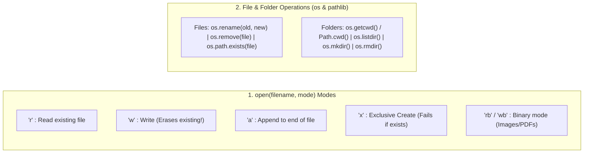

---
tags:
  - python
  - file-io
  - directories
  - os-and-pathlib
---

# File Handling and Directories in Python

#### TL;DR (Quick Revision)

**File Handling & Directories** = Console I/O (`print()`, `input()`) + Open/Read/Write files (`open()`, `with open(...) as f:`, `.name`/`.mode`/`.encoding`/`.closed` attributes, `read`/`readline`/`readlines`, `for line in f:`, `write`/`writelines`) + OS & `pathlib` file/folder operations (`os.rename`, `os.remove`, `os.getcwd`, `os.listdir`, `Path.mkdir`, `Path.rmdir`) ([Input and Output](https://docs.python.org/3/tutorial/inputoutput.html), [os Module](https://docs.python.org/3/library/os.html), [pathlib Module](https://docs.python.org/3/library/pathlib.html)).

> [!abstract] Core Idea
> Python interacts with the outside world through console functions (`print()` and `input()`), file streams (`open(filename, mode)`), and filesystem modules (`os` and `pathlib.Path`) → Opening a file with `with open(...) as f:` lets you read or write text safely and **automatically closes** the file stream when the block ends ([Input and Output](https://docs.python.org/3/tutorial/inputoutput.html)).

> [!question] Why Use It?
>
> - Save data permanently to disk so it isn't lost when your Python program finishes
> - Read large log or data files line-by-line in a `for line in f:` loop without running out of memory
> - Inspect file metadata (`f.name`, `f.mode`, `f.encoding`, `f.closed`) and read exact byte/character counts (`f.read(3)`)
> - Automate renaming/deleting files (`os.rename`, `os.remove`) and creating/listing/removing folders (`os` and `pathlib.Path`)

#### Quick Comparison Table

| Syllabus Sub-Topic                    | Syntax (`main.py` & Official Docs)                                             | Auto-Closes File? | What It Returns & Does ([Official Tutorial Ch. 7](https://docs.python.org/3/tutorial/inputoutput.html) & [os](https://docs.python.org/3/library/os.html)) |
| :------------------------------------ | :----------------------------------------------------------------------------- | :---------------: | :-------------------------------------------------------------------------------------------------------------------------------------------------------- |
| **Screen Output & Keyboard Input**    | `print(msg)` / `text = input("Prompt: ")`                                      |        N/A        | `print()` writes to screen; `input()` reads keyboard line and **always returns a `str`**.                                                                 |
| **File Modes (`open()`)**             | `'r'`, `'w'`, `'a'`, `'x'`, `'rb'`, `'r+'`                                     | With `with`: Yes  | `'r'` read, `'w'` write (erases existing!), `'a'` append, `'x'` create new, `'rb'` read binary.                                                           |
| **File Object Attributes**            | `f.name`, `f.mode`, `f.encoding`, `f.closed`                                   |        N/A        | Filename string, mode (`'r'`, `'w'`), text encoding (`'UTF-8'`), and closed status (`True`/`False`).                                                      |
| **Reading Text Files**                | `f.read()`, `f.read(3)`, `f.readline()`, `f.readlines()`                       |        No         | `read()` reads all; `read(3)` reads 3 chars; `readline()` reads 1 line; `readlines()` returns list of lines.                                              |
| **Looping Through a File**            | `with open("res.txt", "r") as f: for line in f:`                               |      **Yes**      | Streams the file line-by-line in O(1) memory and closes `f` automatically at the end.                                                                     |
| **Writing to Text Files**             | `f.write(text)` / `f.writelines(list_of_strs)`                                 |        No         | Writes string (returns char count) or writes a list of strings (does not add `\n` automatically).                                                         |
| **Rename & Delete Files (`os`)**      | `os.rename(old, new)` / `os.remove(filename)`                                  |        N/A        | Renames/moves a file (`rename`) or deletes a file (`remove`); check with `os.path.exists(f)`.                                                             |
| **Working Directory (`os` & `Path`)** | `os.getcwd()` / `Path.cwd()`                                                   |        N/A        | Returns the current working directory path (`str` in `os`, `Path` object in `pathlib`).                                                                   |
| **List Directory Contents**           | `os.listdir()` / `Path.cwd().iterdir()`                                        |        N/A        | Lists all files and folders inside the directory.                                                                                                         |
| **Create & Remove Folders**           | `os.mkdir("Scripts")` / `os.rmdir("Scripts")` (or `Path.mkdir` / `Path.rmdir`) |        N/A        | Creates a new folder (`mkdir`) or deletes an **empty** folder (`rmdir`).                                                                                  |

---

## The Learning Concept

### What Problem Does It Solve? (Fixing the `Path.mkdir` & `dir_name` Bugs from `main.py`!)

Look at lines 359–368 of your `main.py`:

1. `Path.mkdir("Scripts")` was called on the `Path` **class** instead of a `Path("Scripts")` **object** (`Path("Scripts").mkdir()`).
2. `dir_name = Path.cwd().name` got the parent working directory's name instead of `"Scripts"`, so `if dir_name in os.listdir():` checked the wrong name!

```python
# BAD - Opening a file without closing it, and calling Path.mkdir("Scripts") on the class
f = open("/tmp/test_bad.txt", "w")
f.write("Hello")
# If an error happens here before f.close(), the file stays locked and data may not save!
f.close()

# Path.mkdir("Scripts")         # BAD: Path.mkdir() is an instance method on Path("Scripts")!
print("Always use 'with open(...)' and Path('Scripts').mkdir()!")
```

Using `with open(...) as f:` guarantees the file closes automatically, and `Path("Scripts").mkdir()` / `Path("Scripts").rmdir()` (or `os.mkdir("Scripts")` / `os.rmdir("Scripts")`) manages directories cleanly:

```python
# GOOD - Automatic file closing with 'with' and clean directory creation/deletion (from main.py)
import os
import tempfile
from pathlib import Path

work_dir = Path(tempfile.mkdtemp())
script_dir = work_dir / "Scripts"

# Create and verify directory using pathlib.Path
script_dir.mkdir()                              # GOOD: Call .mkdir() on the Path instance!
print("Created folder exists?:", script_dir.exists())

# Remove directory and verify it is gone
script_dir.rmdir()
print("Deleted successfully?:", not script_dir.exists())
work_dir.rmdir()
```

### How Python Implements It

> [!tip] Four Pillars of File & Directory Handling (From Your `main.py` & Syllabus)
>
> 1. **5 Core `open()` Modes**:
>    - `'r'` → **Read** (default; raises `FileNotFoundError` if file doesn't exist)
>    - `'w'` → **Write** (creates file if missing, or **erases/truncates** existing file!)
>    - `'a'` → **Append** (adds new text to the very end without erasing existing text)
>    - `'x'` → **Create** (creates a new file; raises `FileExistsError` if it already exists)
>    - `'rb'` / `'wb'` → **Binary mode** (reads/writes raw `bytes` for images/PDFs)
> 2. **File Object Attributes**: Once opened (`file_han = open(...)`), inspect `file_han.name`, `file_han.mode`, `file_han.encoding`, and `file_han.closed`.
> 3. **Reading Full Text, 3 Bytes, or Line-by-Line**: Use `f.read()` for everything, `f.read(3)` for the first 3 characters/bytes, or `for line in f:` inside a `with open(...) as f:` block.
> 4. **OS & `pathlib` File/Folder Operations**: Rename files with `os.rename(old, new)`, delete files with `os.remove(fname)`, verify with `os.path.exists(fname)`, list contents with `os.listdir()` or `Path.cwd().iterdir()`, and create/remove folders with `os.mkdir()`/`os.rmdir()`.

#### Full Runnable Example (All File & Directory Workflows from Your `main.py`)

```python
import io
import os
import sys
import tempfile
from pathlib import Path

if __name__ == "__main__":
    orig_cwd = os.getcwd()
    sandbox_dir = tempfile.mkdtemp()
    os.chdir(sandbox_dir)                       # Work safely inside a temporary directory

    # Step 1: Create & Write a File using simulated keyboard input() (from your main.py)
    sys.stdin = io.StringIO("nov5.1.txt\nHello Valay!\nSecond Line of Notes\n")
    filename = input()                          # Reads 'nov5.1.txt'
    first_line = input()                        # Reads 'Hello Valay!'
    second_line = input()                       # Reads 'Second Line of Notes'

    with open(filename, "w", encoding="utf-8") as file_han:
        file_han.write(first_line + "\n" + second_line + "\n")
        print(f"File Attributes -> Name:{file_han.name} | Mode:{file_han.mode} | Encoding:{file_han.encoding} | ClosedInside:{file_han.closed}")
    print("Closed after 'with' block?:", file_han.closed)

    # Step 2: Read first 5 characters with read(5) & Read all lines with a for-loop (from main.py)
    with open(filename, "r", encoding="utf-8") as f:
        first_five = f.read(5)                  # Reads 'Hello'

    with open(filename, "r", encoding="utf-8") as f:
        lines = [line.strip() for line in f]    # Loop over file line-by-line
    print(f"First 5 chars: '{first_five}' | All lines via loop: {lines}")

    # Step 3: Rename File (os.rename) & Verify with os.path.exists() (from your main.py)
    new_file = "nov5.txt"
    os.rename(filename, new_file)
    print("Renamed nov5.1.txt -> nov5.txt exists?:", os.path.exists(new_file))

    # Step 4: Directory Methods (os.getcwd, os.listdir, Path.mkdir, Path.rmdir) (from your main.py)
    folder = Path("Scripts")
    folder.mkdir()                              # Create 'Scripts' folder
    print("Directory entries after mkdir:", sorted(os.listdir()))

    folder.rmdir()                              # Remove 'Scripts' folder
    os.remove(new_file)                         # Delete 'nov5.txt'
    print("After cleanup, entries left:", os.listdir())

    os.chdir(orig_cwd)
    os.rmdir(sandbox_dir)
```

**Output:**

```
File Attributes -> Name:nov5.1.txt | Mode:w | Encoding:utf-8 | ClosedInside:False
Closed after 'with' block?: True
First 5 chars: 'Hello' | All lines via loop: ['Hello Valay!', 'Second Line of Notes']
Renamed nov5.1.txt -> nov5.txt exists?: True
Directory entries after mkdir: ['Scripts', 'nov5.txt']
After cleanup, entries left: []
```

### Visual Diagram: File Modes & Directory Operations



### Key Terminology

1. **Context Manager (`with open(...) as f:`)**: Opens a file and guarantees `f.close()` is called automatically as soon as the indented `with` block finishes—even if an error occurs inside the block ([Input and Output](https://docs.python.org/3/tutorial/inputoutput.html)).
   Syntax: `with open("result1.txt", "r") as f:`

2. **File Object Attributes (`name`, `mode`, `encoding`, `closed`)**: Properties attached to an open file object that tell you its filename, open mode (`'r'`, `'w'`), character encoding (`'utf-8'`), and whether it has been closed (`True`/`False`) ([io Module](https://docs.python.org/3/library/io.html)).
   Syntax: `print(f.name, f.mode, f.encoding, f.closed)`

3. **File Cursor (`f.tell()` & `f.seek()`)**: `f.tell()` returns the current byte/character position of the read/write pointer; `f.seek(0)` rewinds the pointer back to the very beginning of the file ([Input and Output](https://docs.python.org/3/tutorial/inputoutput.html)).
   Syntax: `f.seek(0)`

4. **`os` vs. `pathlib.Path`**: `os` provides procedural functions (`os.getcwd()`, `os.listdir()`, `os.mkdir()`, `os.rmdir()`, `os.rename()`, `os.remove()`), while `pathlib.Path` provides an object-oriented interface (`Path.cwd()`, `Path("Scripts").mkdir()`) ([pathlib Module](https://docs.python.org/3/library/pathlib.html)).
   Syntax: `from pathlib import Path; cur = Path.cwd()`

> [!important] Key Rules to Remember
>
> - **Mode `'w'` wipes out existing files!** → if you want to add lines to the end of an existing file without erasing it, use mode **`'a'` (append)**
> - **`for line in f:` includes `\n`** → each line read from a file ends with a newline character `\n`, so use `print(line, end="")` or `line.strip()` to avoid double blank lines!
> - **`os.rmdir()` only works on EMPTY folders** → delete all files inside the folder with `os.remove()` first (or use `shutil.rmtree()` to delete a folder and everything inside it)
> - **Reading twice requires `f.seek(0)`** → once `f.read()` reaches the end of the file, calling `f.read()` again returns `''` unless you rewind with `f.seek(0)`

---

## ◈ Edge Case Analysis

### 1. Double Blank Lines When Printing Lines in `for line in f:` (From Your `main.py`!)

✗ **Problem:** In your `main.py`, `for line in f: print(line)` prints an extra blank line between every line of the file! Why? Because `line` already has a `\n` at the end from the file, and `print()` adds a _second_ `\n`!
✓ **Fix:** Use `print(line, end="")` or `print(line.rstrip())`.

```python
import io

fake_file = io.StringIO("Line 1\nLine 2\n")
for line in fake_file:
    print(line, end="")                 # GOOD: end="" prevents double-spacing!
```

### 2. Calling `f.read()` Twice Without Rewinding (`f.seek(0)`)

✗ **Problem:** After `text1 = f.read()` reads to the end of the file, the file cursor sits at the end (EOF). Calling `text2 = f.read()` right after returns an empty string `''`!
✓ **Fix:** Call `f.seek(0)` to move the file cursor back to the beginning.

```python
import io

f = io.StringIO("Python Notes")
first_read = f.read()
second_read_without_seek = f.read()     # Empty ''!
f.seek(0)                               # Rewind to start
second_read_with_seek = f.read()
print("1st:", first_read, "| Without seek:", repr(second_read_without_seek), "| With seek:", second_read_with_seek)
```

### 3. `os.rmdir()` Fails If the Folder Is Not Empty

✗ **Problem:** Calling `os.rmdir("Scripts")` or `Path("Scripts").rmdir()` when there is still a file inside `"Scripts"` raises `OSError: Directory not empty` ([os Module](https://docs.python.org/3/library/os.html)).
✓ **Fix:** Remove the files inside first with `os.remove()`, or use `import shutil; shutil.rmtree("Scripts")`.

---

## Going Deeper (Intermediate → Advanced)

### 1. `os` Module vs. `pathlib.Path` Side-by-Side Comparison

Your `main.py` uses both `os` and `from pathlib import Path`. Here is how every command maps between the two ([pathlib Module](https://docs.python.org/3/library/pathlib.html)):

| Task                      | `os` Module Way                   | `pathlib.Path` Way                  |
| :------------------------ | :-------------------------------- | :---------------------------------- |
| **Get Current Directory** | `os.getcwd()`                     | `Path.cwd()`                        |
| **List Directory Items**  | `os.listdir()`                    | `list(Path.cwd().iterdir())`        |
| **Create a Folder**       | `os.mkdir("Scripts")`             | `Path("Scripts").mkdir()`           |
| **Remove Empty Folder**   | `os.rmdir("Scripts")`             | `Path("Scripts").rmdir()`           |
| **Check If File Exists**  | `os.path.exists("nov5.txt")`      | `Path("nov5.txt").exists()`         |
| **Rename / Move File**    | `os.rename("old.txt", "new.txt")` | `Path("old.txt").rename("new.txt")` |
| **Delete a File**         | `os.remove("nov5.txt")`           | `Path("nov5.txt").unlink()`         |

### 2. Saving Dictionaries & Lists to Files with `json`

`f.write()` only accepts strings (`str`). When you want to save a Python `dict` or `list` to a file and load it back later, use the built-in `json` module ([Input and Output — Saving structured data with json](https://docs.python.org/3/tutorial/inputoutput.html)):

```python
import io
import json

emp_data = {"name": "Valay", "age": 22, "skills": ["Python", "SQL"]}
buffer = io.StringIO()

json.dump(emp_data, buffer)             # Save dict as JSON into file stream
buffer.seek(0)
loaded_data = json.load(buffer)         # Load dict back from JSON file stream
print("Loaded from JSON:", loaded_data["name"], loaded_data["skills"])
```

---

## Topic Mastery Quiz

Test yourself before moving to the next chapter. Pick the best answer for each question.

**Q1: What happens if you open an existing file `"notes.txt"` (which has 100 lines) using `open("notes.txt", "w")`?**

- [ ] A) New text is added after line 100
- [ ] B) Raises `FileExistsError`
- [ ] C) All 100 existing lines are immediately erased (truncated)!
- [ ] D) Reads all 100 lines

**Q2: Given a file containing `"Python"`, what does `f.read(3)` return?**

- [ ] A) `"Python"`
- [ ] B) `"Pyt"`
- [ ] C) `"hon"`
- [ ] D) `3`

**Q3: Which attribute on a file object `f` returns `True` after `f.close()` has been called?**

- [ ] A) `f.is_closed()`
- [ ] B) `f.closed`
- [ ] C) `f.mode`
- [ ] D) `f.done`

**Q4: Which `os` function deletes a file (not a folder)?**

- [ ] A) `os.delete("file.txt")`
- [ ] B) `os.rmdir("file.txt")`
- [ ] C) `os.remove("file.txt")`
- [ ] D) `os.erase("file.txt")`

**Q5: What does `input("Enter age: ")` return if the user types `22` and presses Enter?**

- [ ] A) `22` (`int`)
- [ ] B) `"22"` (`str`)
- [ ] C) `"22\n"` (`str` with newline)
- [ ] D) `22.0` (`float`)

<details>
<summary>◈ View Answers & Explanations</summary>

1. **C** — Mode `'w'` truncates (erases) any existing file with the same name immediately upon opening. Use mode `'a'` to append without erasing, or `'x'` to prevent overwriting.
2. **B** — In text mode, `f.read(3)` reads and returns the first 3 characters (`"Pyt"`).
3. **B** — `f.closed` is a boolean data attribute (`True` when closed, `False` when open).
4. **C** — `os.remove(filename)` (or `os.unlink(filename)`) deletes a file, whereas `os.rmdir(dirname)` deletes an empty folder.
5. **B** — `input()` strips the trailing newline and **always** returns a string (`"22"`).

</details>

---

## Practice Exercises

**Exercise 1: Safe Log Appender**

- Write a script using `with open("app.log", "a", encoding="utf-8") as f:` that appends 3 timestamped log lines
- Re-open `"app.log"` in `'r'` mode and print each line with its line number using `enumerate(f, start=1)`

**Exercise 2: File Attribute & Partial Read Inspector**

- Create a file `"sample.txt"` containing `"ABCDEFGHIJ"`
- Open it, print `f.name`, `f.mode`, `f.encoding`, read the first 4 characters with `f.read(4)`, check `f.tell()`, rewind with `f.seek(0)`, and read the full string

**Exercise 3: Folder Organizer (`pathlib.Path`)**

- Create a temporary folder `"Backup"` using `Path("Backup").mkdir(exist_ok=True)`
- Create an empty file inside it, list the folder contents with `.iterdir()`, then delete the file and remove the folder

---

## Memory Trick / One-Liner

> [!tip] File Modes Memory Trick (`r`, `w`, `a`, `x`)
>
> - **`'r'` = Read Only** (Fails if missing)
> - **`'w'` = Wipe & Write** (Erases existing file!)
> - **`'a'` = Add at the End** (Safe append)
> - **`'x'` = eXclusive Create** (Fails if file already exists!)

---

## Warning Block (Best Practice)

> [!warning] Common Mistake (Avoid This!)
>
> ```python
> # BAD - Calling Path.mkdir("Scripts") on the Path class instead of a Path object (from main.py!)
> from pathlib import Path
> # Path.mkdir("Scripts")       # Confusing! And Path.cwd().name is the parent folder, not 'Scripts'!
> ```
>
> ```python
> # GOOD - Create a Path("Scripts") object first, then call .mkdir() and .rmdir() on it!
> from pathlib import Path
> folder = Path("Scripts")
> folder.mkdir(exist_ok=True)
> folder.rmdir()
> ```
