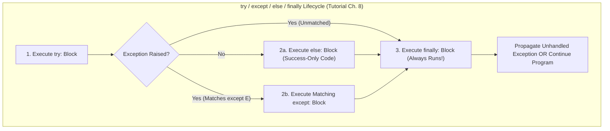

---
tags:
  - python
  - modules-and-io
  - exceptions
---

# Modules, Files & Exceptions in Python

## TL;DR (Quick Revision)

**Modules, File I/O & Exceptions** = Reusable `.py` namespaces & packages (`import`, `__name__ == "__main__"`, `sys.path`) + context-managed UTF-8/binary file & `json` persistence (`with open(...)`) + structured `try` / `except` / `else` / `finally` error handling ([Modules](https://docs.python.org/3/tutorial/modules.html), [Input and Output](https://docs.python.org/3/tutorial/inputoutput.html), [Errors and Exceptions](https://docs.python.org/3/tutorial/errors.html)).

> [!abstract] Core Idea
> Python organizes larger programs into **modules** (`.py` files cached as `.pyc` bytecode in `__pycache__`) and **packages** (directories with `__init__.py` and `__all__`), persists data safely using `with open(filename, mode, encoding="utf-8")` and the `json` module, and handles runtime errors via `try` / `except` / `else` / `finally`, exception chaining (`raise ... from`), `ExceptionGroup` / `except*`, and `.add_note()` ([Modules](https://docs.python.org/3/tutorial/modules.html), [Input and Output](https://docs.python.org/3/tutorial/inputoutput.html), [Errors and Exceptions](https://docs.python.org/3/tutorial/errors.html)).

> [!question] Why Use It?
>
> - **Modular Code Reuse & Isolation**: Splits definitions across `.py` files with isolated global namespaces, running CLI code only when `__name__ == "__main__"` ([Modules](https://docs.python.org/3/tutorial/modules.html)).
> - **Guaranteed File Cleanup (`with open`)**: Automatically flushes and closes files when exiting the `with` block, even if an exception occurs ([Input and Output](https://docs.python.org/3/tutorial/inputoutput.html)).
> - **Safe Cross-Language Serialization (`json`)**: Serializes (`json.dumps` / `json.dump`) and deserializes (`json.loads` / `json.load`) nested lists and dicts safely in UTF-8, unlike `pickle` which is insecure on untrusted data ([Input and Output](https://docs.python.org/3/tutorial/inputoutput.html)).
> - **Granular Fault Recovery**: Separates protected code (`try`), error recovery (`except` / `except*`), success-only logic (`else`), and mandatory cleanup (`finally`) ([Errors and Exceptions](https://docs.python.org/3/tutorial/errors.html)).

## Quick Reference Table

| Feature / Construct | Syntax Example | Auto-Closes / Cleans Up? | Key Behavior ([Official Tutorial Ch. 6, 7 & 8](https://docs.python.org/3/tutorial/index.html)) |
| :--- | :--- | :---: | :--- |
| **`__name__ == "__main__"`** | `if __name__ == "__main__":` | `✗` | `True` when executed directly as a script; equals module name when imported. |
| **Module Search (`sys.path`)** | `sys.builtin_module_names` -> `sys.path` | `✗` | Searches built-ins first, then script directory, `PYTHONPATH`, and `site-packages`. |
| **Bytecode Cache** | `__pycache__/mod.cpython-XY.pyc` | `✓` | Speeds up **module loading time** (does not make execution speed faster). |
| **Package Wildcard (`__all__`)** | `__all__ = ["echo", "surround"]` | `✗` | Defines which submodules `from pkg import *` loads from `__init__.py`. |
| **`str()` vs `repr()` & `f"{x=}"`** | `f"{val!r}"`, `f"{bugs=}"` | `✗` | `str()` is human-readable; `repr()` (`!r`) is unambiguous interpreter syntax; `=` prints `expr=val`. |
| **File Modes (`open()`)** | `'r'`, `'w'`, `'a'`, `'r+'`, `'rb'` | `✓` (with `with`) | `'r'` read (default), `'w'` write (erases existing!), `'a'` append, `'b'` binary (`bytes`, no encoding arg). |
| **File Object Methods** | `.read(n)`, `.readline()`, `.write(s)`, `.tell()`, `.seek(off, whence)` | `✗` | `readline()` keeps `\n` (returns `''` at EOF); `write(s)` returns char count written. |
| **JSON Serialization** | `json.dumps(x)` / `json.loads(s)` / `dump` / `load` | `✗` | Converts Python hierarchies to/from JSON strings (`dumps`/`loads`) or files (`dump`/`load`). |
| **`try` / `except` / `else` / `finally`** | `try: ... except E as e: ... else: ... finally:` | `✓` | `else` runs if **no exception** was raised in `try`; `finally` runs **always**. |
| **Chaining, Groups & Notes** | `raise E from cause`, `except* E:`, `e.add_note(s)` | `✗` | `from None` suppresses chaining; `except*` filters `ExceptionGroup`; `add_note()` appends context. |

## The Learning Concept

#### What Problem Does It Solve?

When reading and parsing a configuration file, opening a file without `with` risks leaving file descriptors open or losing unwritten buffer data, and placing post-read processing inside the `try` block can accidentally catch exceptions unrelated to file opening ([Input and Output](https://docs.python.org/3/tutorial/inputoutput.html), [Errors and Exceptions](https://docs.python.org/3/tutorial/errors.html)):

```python
# BAD - Opening file without 'with', bare except, and overly broad try block
f = open("/tmp/demo_bad.txt", "w")
f.write("42\n")
# If an error happens before f.close(), data may not flush to disk!
f.close()

try:
    f2 = open("/tmp/demo_bad.txt", "r")
    val = int(f2.readline())            # If this raises ValueError, bare except hides why!
    f2.close()
except:                                 # BAD: bare except catches KeyboardInterrupt & SystemExit!
    print("Something failed")
print("Closed status:", f2.closed)
# Output: Closed status: True
```

Catching bare `except:` intercepts `KeyboardInterrupt` and `SystemExit` (which inherit from `BaseException`, not `Exception`), and omitting `with` leaves files unclosed if an exception occurs ([Errors and Exceptions](https://docs.python.org/3/tutorial/errors.html)).

```python
# GOOD - Use 'with open(...)' for guaranteed close and specific try / except / else / finally
with open("/tmp/demo_good.txt", "w", encoding="utf-8") as f:
    chars_written = f.write("42\n")     # Automatically flushed & closed on block exit

try:
    with open("/tmp/demo_good.txt", "r", encoding="utf-8") as f:
        raw_line = f.readline()
except OSError as err:
    print("File error:", err)
else:
    # Runs ONLY if try succeeded without raising OSError
    parsed = int(raw_line.strip())
    print(f"Written:{chars_written} | Parsed:{parsed=} | Closed:{f.closed}")
finally:
    print("Cleanup check complete")
# Output:
# Written:3 | Parsed:parsed=42 | Closed:True
# Cleanup check complete
```

#### How Python Implements It

> [!tip] Four Pillars of Modules, I/O, and Exceptions
>
> 1. **Module Loading & `__pycache__`**: Each module is imported **only once** per interpreter session (use `importlib.reload(mod)` to reload); `.pyc` files in `__pycache__` speed up **loading**, not runtime execution ([Modules](https://docs.python.org/3/tutorial/modules.html)).
> 2. **Formatting & File Streams**: f-strings support format specifiers (`{math.pi:.3f}`), conversions (`!r`, `!s`, `!a`), and self-documenting debug (`{count=}`); `for line in f:` streams files line-by-line in O(1) memory ([Input and Output](https://docs.python.org/3/tutorial/inputoutput.html)).
> 3. **Exception Hierarchy**: `BaseException` is the root; `SystemExit`, `KeyboardInterrupt`, and `GeneratorExit` inherit directly from `BaseException`, while all normal runtime errors inherit from **`Exception`** ([Errors and Exceptions](https://docs.python.org/3/tutorial/errors.html)).
> 4. **Modern Exception Features**: Use `raise RuntimeError("msg") from exc` (or `from None` to hide cause), `e.add_note("context")` (3.11+), `ExceptionGroup` with `except*` (3.11+), and bracketless `except ValueError, TypeError:` in Python 3.14 (PEP 758) ([Errors and Exceptions](https://docs.python.org/3/tutorial/errors.html), [What's New in Python 3.14](https://docs.python.org/3/whatsnew/3.14.html)).

#### Full Runnable Example

```python
# Complete runnable demonstration of Modules (dir/sys), Formatting, File I/O, JSON & Exceptions
import json
import math
import sys
import tempfile

def parse_record(raw_json: str) -> dict:
    try:
        data = json.loads(raw_json)
        if "score" not in data:
            raise KeyError("Missing 'score' field")
    except (json.JSONDecodeError, KeyError) as err:
        err.add_note("Failed while validating student JSON record")
        raise ValueError("Invalid record payload") from err
    else:
        return data


if __name__ == "__main__":
    # 1. Module introspection (__name__, sys.path, dir) & Fancier Formatting (Ch 6 & 7.1)
    user = "Rahul"
    pi_fmt = f"User={user!r} | {user=} | Pi={math.pi:.3f}"

    # 2. Reading/Writing Files with 'with open' & JSON Serialization (Ch 7.2)
    payload = {"name": "Rahul", "skills": ["Python", "SQL"], "score": 95}
    with tempfile.NamedTemporaryFile("w+", encoding="utf-8", delete=True) as tmp:
        json.dump(payload, tmp)                 # Serialize dict to file
        tmp.seek(0)                             # Rewind file pointer to byte 0
        raw_text = tmp.read()                   # Read entire file string
        loaded = parse_record(raw_text)         # Deserialize & validate

    # 3. Exception Chaining & Notes Inspection (Ch 8.5 & 8.10)
    try:
        parse_record('{"name": "Priya"}')       # Missing 'score' -> triggers chained ValueError
    except ValueError as exc:
        caught_msg = f"{type(exc).__name__} caused by {type(exc.__cause__).__name__}"
        note_msg = exc.__cause__.__notes__[0]

    print(f"Module:{__name__} | Formatting -> {pi_fmt}")
    print(f"JSON Roundtrip:{loaded['name']} ({loaded['score']}) | FileClosed:{tmp.closed}")
    print(f"ChainedException:{caught_msg} | Note:'{note_msg}'")
```

**Output:**

```Output
Module:__main__ | Formatting -> User='Rahul' | user='Rahul' | Pi=3.142
JSON Roundtrip:Rahul (95) | FileClosed:True
ChainedException:ValueError caused by KeyError | Note:'Failed while validating student JSON record'
```

#### Visual Diagram



#### Key Terminology

1. **Module vs. Package**: A **module** is a single `.py` file; a **package** is a directory of modules containing an `__init__.py` file (which may define `__all__` for `from pkg import *`) ([Modules](https://docs.python.org/3/tutorial/modules.html)).
   Syntax: `from sound.effects import echo`
2. **Context Manager (`with open(...) as f:`)**: Protocol that guarantees deterministic resource cleanup (`f.close()`) upon leaving the `with` block, even if an exception is raised ([Input and Output](https://docs.python.org/3/tutorial/inputoutput.html), [Errors and Exceptions](https://docs.python.org/3/tutorial/errors.html)).
   Syntax: `with open("workfile.txt", "r", encoding="utf-8") as f:`
3. **Exception Chaining (`raise ... from ...`)**: Attaches an explicit `__cause__` to a newly raised exception (`from exc`) or suppresses automatic context chaining (`from None`) ([Errors and Exceptions](https://docs.python.org/3/tutorial/errors.html)).
   Syntax: `raise RuntimeError("DB failed") from exc`
4. **`ExceptionGroup` & `except*`**: Wraps multiple unrelated exceptions so they can be raised together and selectively filtered by type using `except*` ([Errors and Exceptions](https://docs.python.org/3/tutorial/errors.html)).
   Syntax: `except* OSError as eg:`

> [!important] Key Rules to Remember
>
> - **`.pyc` Files Only Speed Up Loading**: Compiled bytecode in `__pycache__` does **not** make a program run faster once loaded—it only speeds up `import` time ([Modules](https://docs.python.org/3/tutorial/modules.html)).
> - **Submodule Shadowing in `__init__.py`**: If `sound/effects/__init__.py` defines a function `def reverse():`, it shadows the `reverse.py` submodule during `from sound.effects import *` ([Modules](https://docs.python.org/3/tutorial/modules.html)).
> - **Order `except` Clauses from Most Specific to Most General**: Placing `except BaseClass:` before `except DerivedClass:` makes the derived handler unreachable because the first matching `except` wins ([Errors and Exceptions](https://docs.python.org/3/tutorial/errors.html)).

## ◈ Edge Case Analysis

#### 1. Returning Inside a `finally` Block Swallows Exceptions (PEP 765 Warning in 3.14)
**Problem:** If a `finally` block executes a `return`, `break`, or `continue` statement, it **overrides** any `return` value from `try` and **silently swallows** any unhandled exception! Starting in Python 3.14 (PEP 765), the compiler emits a `SyntaxWarning` for `return`/`break`/`continue` exiting `finally` ([Errors and Exceptions](https://docs.python.org/3/tutorial/errors.html), [What's New in Python 3.14](https://docs.python.org/3/whatsnew/3.14.html)).
**Fix:** Never put `return`, `break`, or `continue` inside a `finally` block.

```python
# Demonstration of why return in finally is dangerous (warned in Python 3.14 PEP 765)
def clean_divide(a: int, b: int) -> float:
    cleanup_done = False
    try:
        return a / b
    finally:
        cleanup_done = True     # GOOD: perform state cleanup without returning in finally

print("Clean divide:", clean_divide(10, 2))
```

**Output:**

```Output
Clean divide: 5.0
```

#### 2. Shadowing Standard Library Modules via `sys.path[0]`
**Problem:** Because `sys.path` places the directory containing the input script **ahead** of the standard library path, naming your own script `json.py`, `random.py`, or `string.py` shadows the standard library module of the same name ([Modules](https://docs.python.org/3/tutorial/modules.html)).
**Fix:** Never name local scripts after built-in or standard library modules (`import os` instead of `from os import *` also prevents `os.open()` from shadowing built-in `open()`).

```python
# Fix: inspect sys.builtin_module_names and keep module names distinct
import sys

print("Is 'sys' built-in?:", "sys" in sys.builtin_module_names)
```

**Output:**

```Output
Is 'sys' built-in?: True
```

#### 3. Text Mode vs. Binary Mode `seek()` Restrictions
**Problem:** In binary files (`'rb+'`), `f.seek(offset, whence)` allows seeking from beginning (`0`), current position (`1`), or end (`2`). In **text files**, only seeks from the beginning (`whence=0`) using offsets returned by `f.tell()` (or `0`, or `seek(0, 2)` to EOF) are valid ([Input and Output](https://docs.python.org/3/tutorial/inputoutput.html)).
**Fix:** Open in binary mode (`'rb+'`) whenever arbitrary byte-offset seeking (`seek(-3, 2)`) is required.

```python
# Fix: use binary mode ('wb+' / 'rb+') for relative/end byte seeking
import tempfile

with tempfile.TemporaryFile("wb+") as bf:
    bf.write(b"0123456789abcdef")
    bf.seek(-3, 2)              # 3rd byte before the end (valid in binary mode)
    print("Byte at -3 from EOF:", bf.read(1))
```

**Output:**

```Output
Byte at -3 from EOF: b'd'
```

#### 4. Python 3.14 Bracketless `except` Clauses (PEP 758)
**Problem:** In Python 3.0–3.13, catching multiple exception types required parentheses: `except (ValueError, TypeError):`. In Python 3.14 (PEP 758), parentheses may be omitted (`except ValueError, TypeError:`) **unless** an `as var` clause is used (`except (ValueError, TypeError) as e:` still requires parentheses!) ([Errors and Exceptions](https://docs.python.org/3/tutorial/errors.html), [What's New in Python 3.14](https://docs.python.org/3/whatsnew/3.14.html)).
**Fix:** Keep parentheses `except (ValueError, TypeError) as e:` for backwards compatibility and whenever binding `as e`.

```python
# Compatible across Python 3.0 - 3.14+: parenthesized tuple with 'as err'
try:
    int("not_a_number")
except (ValueError, TypeError) as err:
    print("Caught:", type(err).__name__)
```

**Output:**

```Output
Caught: ValueError
```

## Topic Mastery Quiz

Test yourself on Python modules, package resolution, file I/O semantics, and exception handling.

**Q1: What is the exact search order when Python executes `import spam`?**
- [ ] A) Script directory → `sys.builtin_module_names` → `PYTHONPATH` → `site-packages`
- [ ] B) `sys.builtin_module_names` → directory of the script → `PYTHONPATH` → installation defaults (`site-packages`)
- [ ] C) `PYTHONPATH` → `sys.builtin_module_names` → current working directory
- [ ] D) Virtual environment → standard library → built-ins

**Q2: Why is the `else:` clause useful in a `try ... except ... else` statement instead of placing all follow-up code inside `try:`?**
- [ ] A) Code in `else:` executes even if an exception was caught in `except:`
- [ ] B) Exceptions raised in `else:` are automatically caught by the preceding `except:` handlers
- [ ] C) It prevents accidentally catching unintended exceptions from follow-up code that was not meant to be protected
- [ ] D) It executes faster by suppressing Python traceback frames

**Q3: Why should application code catch `Exception` instead of `BaseException` or using a bare `except:`?**
- [ ] A) `BaseException` cannot catch file I/O errors
- [ ] B) `BaseException` intercepts system-exiting signals like `SystemExit` and `KeyboardInterrupt`, preventing clean script shutdown
- [ ] C) `Exception` is the only class supported by Python's `try...except` statement
- [ ] D) Catching `BaseException` causes a compiler error in Python 3.14+

**Q4: How does `f.readline()` distinguish between a blank line in a file and the end of the file (EOF)?**
- [ ] A) A blank line returns `'\n'` (length 1, truthy), whereas EOF returns `''` (empty string, falsy)
- [ ] B) A blank line returns `''`, whereas EOF raises `EOFError`
- [ ] C) A blank line returns `None`, whereas EOF returns `''`
- [ ] D) Both return `'\n'`, but EOF sets `f.closed` to `True`

**Q5: What is the fundamental security difference between `json` and `pickle` when deserializing data?**
- [ ] A) `json` executes arbitrary code during parsing, whereas `pickle` is strictly data-only
- [ ] B) `pickle` is encrypted by default, whereas `json` is plaintext
- [ ] C) `json` safely parses primitive standard types, whereas `pickle` can construct arbitrary objects and execute arbitrary code
- [ ] D) There is no security difference between them

**Q6: What happens if a `finally` block executes an explicit `return` statement while an unhandled exception occurred in `try`?**
- [ ] A) The exception is raised, and the `finally` return statement is discarded
- [ ] B) The exception is silently swallowed, and the function returns the value from the `finally` block
- [ ] C) Python raises a `RuntimeError` due to collision
- [ ] D) The exception is wrapped into an `ExceptionGroup` and returned

<details>
<summary>◈ View Answers & Explanations</summary>

1. **Answer: B** — Python checks `sys.builtin_module_names` first. If not found, it searches `sys.path`: starting with the directory of the running script (or current directory), then `PYTHONPATH`, and finally installation-dependent paths including `site-packages`.
2. **Answer: C** — `else` runs only if the `try` block completed without exceptions. Crucially, exceptions raised inside `else` are NOT caught by the preceding `except` handlers, avoiding masked bugs.
3. **Answer: B** — `BaseException` is the root class for all exceptions, including `SystemExit`, `KeyboardInterrupt` (Ctrl+C), and `GeneratorExit`. Catching `Exception` allows termination signals to exit naturally.
4. **Answer: A** — `f.readline()` preserves trailing newlines. An empty line reads as `'\n'`, which is non-empty and truthy. When the end of the file is reached, `f.readline()` returns an empty string `''` (falsy).
5. **Answer: C** — `json` is a safe, text-based standard format restricted to primitive structures. `pickle` executes object construction bytecode upon deserialization, making untrusted pickles prone to arbitrary remote code execution.
6. **Answer: B** — When `finally` executes `return`, `break`, or `continue`, it silently overrides and discards any active exception from `try` or `except` (in Python 3.14+, this emits a `SyntaxWarning` via PEP 765).

</details>
