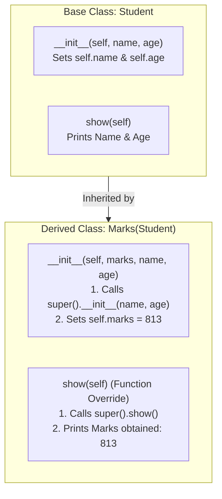

---
tags:
  - python
  - oops
  - classes
  - inheritance
  - polymorphism
---

# Object-Oriented Programming (OOP) in Python

#### TL;DR (Quick Revision)

**Object-Oriented Programming (OOP)** = Create a **Class** blueprint (`class Emp:`) + Create **Objects** (`emp_obj = Emp("Valay", 22)`) where **`__init__`** is the constructor that saves data on **`self`**, **`super()`** reuses parent classes in inheritance, and **`__`** hides private data ([Classes](https://docs.python.org/3/tutorial/classes.html)).

> [!abstract] Core Idea
> A **class** is a blueprint that bundles **data (fields/properties)** and **functions (methods)** together → When you create an object (`Emp("Valay", 22)`), Python automatically runs the constructor **`__init__(self, ...)`** to store that object's fields on **`self`** (the current object itself) ([Classes](https://docs.python.org/3/tutorial/classes.html)).

> [!question] Why Use It?
>
> - Group related data (`name`, `age`, `marks`) and methods (`show()`, `Add()`) into one reusable blueprint
> - Automatically initialize every new object's memory fields using the `__init__(self, ...)` constructor
> - Reuse existing classes without copy-pasting code using **Inheritance** (`class Marks(Student):` and `super()`)
> - Protect internal fields with **Private** two-underscore names (`__num`, `__show()`) and swap behaviors with **Polymorphism**

#### Quick Comparison Table

| OOP Concept / Keyword | Syntax (`main.py` Examples) | Accessible Outside Class? | What It Means in Plain English ([Official Tutorial Ch. 9](https://docs.python.org/3/tutorial/classes.html)) |
| :--- | :--- | :---: | :--- |
| **`class Emp:`** | `class Emp: pass` | Yes | A **blueprint** (template) defining what attributes and methods objects will have. |
| **Object Instantiation** | `emp_obj = Emp("Valay", 22)` | Yes | Creates a concrete **object (instance)** in memory from the `Emp` blueprint. |
| **`def __init__(self, ...):`** | `def __init__(self, name, age):` | Yes (auto-called) | **Constructor method**: runs automatically when `Emp(...)` is called to set up `self` fields. |
| **`self` Argument** | `self.name = name` | Yes (`emp_obj.name`) | Refers to **THIS specific object** calling the method (`emp_obj.show()` passes `emp_obj` as `self`). |
| **Class Functions & `return`** | `def Add(self): return self.num1 + self.num2` | Yes | Performs an action using `self`'s fields and returns the result to the caller. |
| **Private Fields & Methods (`__`)** | `__num = 12` / `def __show(self):` | **No** (`AttributeError`) | Two leading underscores (`__`) make a field or method **private** to the class (`_Calc__num`). |
| **Delete Object / Attribute** | `del h.name` / `del h` | N/A | Deletes a single property (`del h.name`) or deletes the object reference (`del h`). |
| **Inheritance & Override** | `class Marks(Student):` + `super().__init__(...)` | Yes | Child class `Marks` inherits `Student`'s methods and overrides `show()`. |
| **Polymorphism** | `online_payment.show()` & `neft_payment.show()` | Yes | Different classes implement the **same method name** (`show`) so one function can call either. |
| **Class Docstring (`__doc__`)** | `print(emp.__doc__)` | Yes | Reads the triple-quoted `"""..."""` documentation comment at the top of a class. |

---

## The Learning Concept

### What Problem Does It Solve? (Fixing the 2 Bugs in `Calculations` & `Calc` from `main.py`!)

Look at `class Calculations:` and `class Calc:` in your `main.py`. Two tiny mistakes caused them to throw errors:
1. In `Calculations`, `__init__` saved `self.num1` and `self.num2`, but `Add(self)` wrote `return self.a + self.b` (which doesn't exist!), and `Calculations()` was called with `0` arguments instead of `2`!
2. In `Calc`, `def __show(self):` wrote `print(f"Private method {__num}")` without `self.` in front of `__num`!

```python
# BAD - Mismatched field names (self.num1 vs self.a) and missing arguments in Calculations()
class BadCalculations:
    def __init__(self, num1, num2):
        self.num1 = num1
        self.num2 = num2

    def Add(self):
        return self.a + self.b          # ERROR! AttributeError: 'BadCalculations' has no attribute 'a'

# calc_obj = BadCalculations()          # ERROR! TypeError: __init__() missing 2 required arguments!
print("Fix: Always use the exact same self.num1 name and pass (20, 5) to Calculations(20, 5)!")
```

When you save a variable as `self.num1 = num1` inside `__init__`, every other method in that class must also read `self.num1` (and inside `Calc`, read `self.__num`):

```python
# GOOD - Fixed Calculations class & Private Calc class from your main.py
class Calculations:
    def __init__(self, num1, num2):
        self.num1 = num1                # Saved on self as self.num1
        self.num2 = num2                # Saved on self as self.num2

    def Add(self):
        return self.num1 + self.num2    # GOOD: Reads self.num1 and self.num2

    def Sub(self):
        if self.num1 > self.num2:
            return self.num1 - self.num2
        else:
            return self.num2 - self.num1

    def Mult(self):
        return self.num1 * self.num2

    def Div(self):
        if self.num1 != 0 and self.num2 != 0:
            return self.num1 // self.num2

calc_obj = Calculations(20, 5)          # GOOD: Pass 20 and 5 to __init__!
print("Add:", calc_obj.Add(), "| Sub:", calc_obj.Sub(), "| Mult:", calc_obj.Mult(), "| Div:", calc_obj.Div())
```

### How Python Implements It

> [!tip] Four Pillars of OOP in Your `main.py`
>
> 1. **Constructor (`__init__`) & `self`**: When you write `emp_obj = Emp("Valay", 22)`, Python allocates a new object in memory and calls `Emp.__init__(emp_obj, "Valay", 22)`—setting `emp_obj.name = "Valay"` and `emp_obj.age = 22`.
> 2. **Inheritance (`Student` → `Marks`)**: `class Marks(Student):` inherits from `Student`. Inside `Marks.__init__`, calling `super().__init__(name, age)` lets `Student` initialize `name` and `age`, while `Marks` adds `self.marks = marks` and overrides `show()`.
> 3. **Encapsulation / Private Members (`__num` & `__show`)**: Prefixing a field or method with two underscores (`__num = 12`, `def __show(self):`) hides it from outside access (`cl.__show()` raises `AttributeError`).
> 4. **Polymorphism (`online_payment` & `neft_payment`)**: Both classes define a `.show(self, amount)` method, so `payments(modes, amount)` can call `modes.show(amount)` on any payment object!

#### Full Runnable Example (All OOP Classes from Your `main.py`, Verified & Running)

```python
# Step 1: Class with Constructor (__init__), self, and Docstring (__doc__)
class Emp:
    """This class holds employee salary details like PF and HRA."""

    def __init__(self, name, age):
        self.name = name
        self.age = age

    def show(self):
        print(f"Emp -> Name: {self.name} | Age: {self.age}")


# Step 2: Inheritance & Function Override (Student -> Marks from your main.py)
class Student:
    def __init__(self, name, age):
        self.name = name
        self.age = age

    def show(self):
        print(f"Student -> Name: {self.name} | Age: {self.age}")


class Marks(Student):                           # Inherits from base/super class Student
    def __init__(self, marks, name, age):
        super().__init__(name, age)             # Calls Student.__init__
        self.marks = marks

    def show(self):                             # Overrides Student.show()
        super().show()                          # Calls Student.show() first
        print(f"Marks obtained: {self.marks}")


# Step 3: Private Variable (__num) & Private Method (__show) from your main.py
class Calc:
    __num = 12                                  # Private variable

    def __show(self):                           # Private method
        return f"Private method accessed self.__num = {self.__num}"

    def run_private(self):                      # Public method calling private method internally
        return self.__show()


# Step 4: Polymorphism (online_payment & neft_payment from your main.py)
class online_payment:
    def show(self, amount):
        return f"Wire transfer with the salary of {amount}"


class neft_payment:
    def show(self, amount):
        return f"NEFT payment of salary {amount}"


def payments(modes, amount):
    return modes.show(amount)


if __name__ == "__main__":
    emp_obj = Emp("Valay", 22)
    print("Docstring:", emp_obj.__doc__)
    emp_obj.show()

    mark = Marks(name="Valay", age=22, marks=813)
    mark.show()

    cl = Calc()
    print(cl.run_private())

    onl = online_payment()
    nf = neft_payment()
    print(payments(onl, 21000))
    print(payments(nf, 21000))
```

**Output:**

```
Docstring: This class holds employee salary details like PF and HRA.
Emp -> Name: Valay | Age: 22
Student -> Name: Valay | Age: 22
Marks obtained: 813
Private method accessed self.__num = 12
Wire transfer with the salary of 21000
NEFT payment of salary 21000
```

### Visual Diagram: How `__init__`, Inheritance (`super()`), and Private Mangling Work



### Key Terminology

1. **Class & Object**: A **class** (`class Emp:`) is the blueprint; an **object** (`emp_obj = Emp("Valay", 22)`) is a concrete instance created in memory from that blueprint ([Classes](https://docs.python.org/3/tutorial/classes.html)).
   Syntax: `emp_obj = Emp("Valay", 22)`

2. **Constructor (`__init__`)**: The special method `def __init__(self, ...):` that executes automatically whenever a new object is created ([Classes](https://docs.python.org/3/tutorial/classes.html)).
   Syntax: `def __init__(self, name, age):`

3. **`self` Parameter**: The first parameter of every instance method, pointing to the specific object that called the method (`emp_obj.show()` passes `emp_obj` as `self`) ([Classes](https://docs.python.org/3/tutorial/classes.html)).
   Syntax: `self.name = name`

4. **Private Name Mangling (`__`)**: Prefixing an attribute or method with two underscores (`__num`, `__show`) causes Python to rename it internally to `_ClassName__num` so accidental outside access (`cl.__num`) raises `AttributeError` ([Classes](https://docs.python.org/3/tutorial/classes.html)).
   Syntax: `self.__num = 12`

> [!important] Key Rules to Remember
>
> - **Always include `self` as the first parameter** of instance methods (`def show(self):`)
> - **Always prefix object attributes with `self.`** inside methods (`self.num1`, `self.__num`)
> - **Use `super().__init__(...)` in child classes** so the parent class's attributes get initialized properly
> - **Deleting an object (`del h`)** removes the variable name `h`; calling `h.disp()` afterward raises `NameError`

---

## ◈ Edge Case Analysis

### 1. Deleting an Object (`del h` in `Hosp` from Your `main.py`)

✗ **Problem:** In your `main.py`, after running `del h`, the next line `h.disp` throws `NameError: name 'h' is not defined` because `del h` deleted the variable `h` from memory!
✓ **Fix:** Only call methods on `h` before `del h` (or delete a single property with `del h.attr` if you want to keep the object `h`).

```python
class Hosp:
    def disp(self):
        print("Normal Class")

h = Hosp()
h.disp()
del h                                   # Deletes the variable 'h'
print("Is 'h' still defined?:", "h" in locals())
```

### 2. Mutable Class Variable Shared by All Objects (`tricks = []` Trap)

✗ **Problem:** If you define a mutable list `tricks = []` directly inside `class Dog:` (outside `__init__`), **every Dog object shares that exact same list**! ([Classes — Class and Instance Variables](https://docs.python.org/3/tutorial/classes.html)).
✓ **Fix:** Initialize mutable lists on `self` inside `__init__` (`self.tricks = []`).

```python
class Dog:
    kind = "canine"                     # Immutable class variable (safe to share)

    def __init__(self, name):
        self.name = name
        self.tricks = []                # GOOD: Fresh list created per Dog object!

d1 = Dog("Fido")
d2 = Dog("Buddy")
d1.tricks.append("roll over")
print("Fido:", d1.tricks, "| Buddy:", d2.tricks)
```

### 3. Accessing Mangled Private Attributes (`_ClassName__attr`)

✗ **Problem:** While `cl.__num` raises `AttributeError`, Python's `__` privacy is **name mangling**, not strict encryption—Python renames `__num` inside `class Calc:` to `_Calc__num` ([Classes — Private Variables](https://docs.python.org/3/tutorial/classes.html)).
✓ **Fix:** Use a public method on `Calc` for clean access, and never rely on `__` to hide cryptographic secrets.

```python
class Calc:
    __num = 12

cl = Calc()
print("Has __num directly?:", hasattr(cl, "__num"), "| Mangled _Calc__num:", cl._Calc__num)
```

---

## Going Deeper (Intermediate → Advanced)

### 1. Iterators (`__iter__` and `__next__`) vs. Generators (`yield`)

Behind the scenes, when you run `for x in [1, 2, 3]:`, Python calls `it = iter([1, 2, 3])` and repeatedly calls `next(it)` until `StopIteration` is raised ([Classes — Iterators](https://docs.python.org/3/tutorial/classes.html)).
You can build your own lazy sequence generator without writing a whole class just by using the **`yield`** keyword inside a function ([Classes — Generators](https://docs.python.org/3/tutorial/classes.html)):

```python
def reverse_generator(data):
    # Yields characters one by one from back to front, pausing between calls!
    for idx in range(len(data) - 1, -1, -1):
        yield data[idx]

rev_word = "".join(reverse_generator("Valay"))
print("Generated reverse:", rev_word)
```

### 2. Checking Inheritance with `isinstance()` and `issubclass()`

- **`isinstance(obj, Class)`**: Returns `True` if `obj` is an instance of `Class` **or any subclass derived from `Class`** (`isinstance(mark, Student)` is `True`!).
- **`issubclass(Child, Parent)`**: Returns `True` if `Child` inherits from `Parent` (`issubclass(Marks, Student)` is `True`, and `issubclass(bool, int)` is also `True`!) ([Classes — Inheritance](https://docs.python.org/3/tutorial/classes.html)).

---

## Topic Mastery Quiz

Test yourself before moving to the next chapter. Pick the best answer for each question.

**Q1: When you run `emp_obj = Emp("Valay", 22)`, which method inside `class Emp:` runs automatically?**
- [ ] A) `def Emp(self, name, age):`
- [ ] B) `def __main__(self, name, age):`
- [ ] C) `def __init__(self, name, age):`
- [ ] D) `def __start__(self, name, age):`

**Q2: How do you declare a private variable or private method inside a Python class?**
- [ ] A) Use the `private` keyword (`private num = 12`)
- [ ] B) Prefix the name with two leading underscores (`__num = 12`, `def __show(self):`)
- [ ] C) Prefix the name with `#`
- [ ] D) Put it outside the class

**Q3: In `class Marks(Student):`, how do you call `Student`'s `__init__` constructor inside `Marks.__init__`?**
- [ ] A) `base.__init__(name, age)`
- [ ] B) `this.super(name, age)`
- [ ] C) `super().__init__(name, age)`
- [ ] D) `Parent.__init__(name, age)`

**Q4: What happens if you run `h = Hosp(); del h; h.disp()`?**
- [ ] A) Prints `"Normal Class"`
- [ ] B) Prints `None`
- [ ] C) Raises `NameError: name 'h' is not defined`
- [ ] D) Raises `SyntaxError`

**Q5: Which attribute holds the triple-quoted documentation string `"""..."""` of a class or object `emp`?**
- [ ] A) `emp.__info__`
- [ ] B) `emp.__doc__`
- [ ] C) `emp.__comment__`
- [ ] D) `emp.__help__`

<details>
<summary>◈ View Answers & Explanations</summary>

1. **C** — `__init__(self, ...)` is Python's constructor/initializer method, called automatically when instantiating a class.
2. **B** — Two leading underscores (`__num`, `__show`) trigger Python's private name mangling (`_ClassName__num`).
3. **C** — `super().__init__(name, age)` delegates initialization to the parent class (`Student`).
4. **C** — `del h` deletes the variable binding `h`, so referencing `h` afterward raises `NameError`.
5. **B** — `__doc__` automatically stores the docstring written on the first line of a class, module, or function.

</details>

---

## Practice Exercises

**Exercise 1: BankAccount Class with Validation**
- Create `class BankAccount:` with `def __init__(self, owner, balance):` storing `self.owner` and private `self.__balance`
- Add `deposit(self, amount)`, `withdraw(self, amount)` (rejecting withdrawals larger than `self.__balance`), and `get_balance(self)`

**Exercise 2: Vehicle → ElectricCar Inheritance**
- Create `class Vehicle:` with `__init__(self, brand, speed)` and `show(self)`
- Create `class ElectricCar(Vehicle):` that calls `super().__init__(brand, speed)`, adds `self.battery_kwh`, and overrides `show(self)`

**Exercise 3: Polymorphic Notification Sender**
- Create `class EmailNotifier:` and `class SMSNotifier:`, each with a `send(self, msg)` method
- Write a function `notify_all(notifiers, msg)` that loops through a list of notifier objects and calls `.send(msg)` on each

---

## Memory Trick / One-Liner

> [!tip] Cookie-Cutter Analogy (`class` vs `object` vs `__init__` vs `self`)
> - **`class Emp:`** = The **Cookie Cutter** (blueprint)
> - **`emp_obj = Emp("Valay", 22)`** = An actual **Cookie** stamped from the cutter
> - **`__init__`** = The **Decorating Machine** that automatically stamps `"Valay"` and `22` onto each new cookie as it's made
> - **`self`** = The label saying **"Put the icing on THIS cookie right here!"**

---

## Warning Block (Best Practice)

> [!warning] Common Mistake (Avoid This!)
>
> ```python
> # BAD - Using self.num1 in __init__ but self.a in Add(), or forgetting self. on __num (from main.py!)
> class Calc:
>     __num = 12
>     def __show(self):
>         # print(__num)        # CRASH! NameError: name '_Calc__num' is not defined!
>         pass
> ```
>
> ```python
> # GOOD - Always access class/instance variables through 'self.' inside methods!
> class Calc:
>     __num = 12
>     def __show(self):
>         print(self.__num)     # Works! Accesses self._Calc__num → 12
> ```