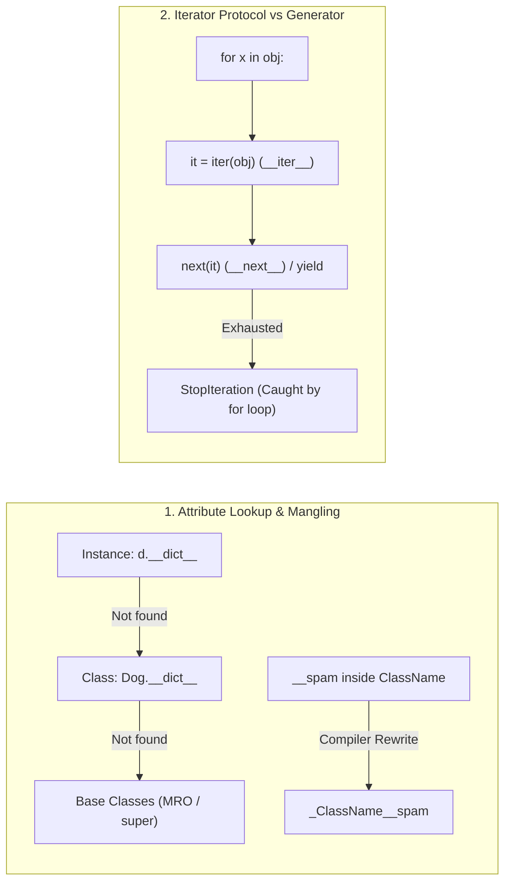

---
tags:
  - python
  - oops
  - iterators-and-generators
---

# Classes, OOP & Generators in Python

## TL;DR (Quick Revision)

**Classes, Iterators & Generators** = Runtime class blueprints (`class`, `__init__`, `self`, inheritance MRO, `_Class__private` mangling) + iterator protocol (`__iter__`, `__next__`, `StopIteration`) and lazy `yield` generators ([Classes](https://docs.python.org/3/tutorial/classes.html), [Virtual Environments and Packages](https://docs.python.org/3/tutorial/venv.html)).

> [!abstract] Core Idea
> Python classes bundle state (instance variables on `self` vs. shared class variables) and virtual methods (`x.f()` is `MyClass.f(x)`), supporting single and multiple inheritance (`super()` MRO linearization), `isinstance()` / `issubclass()` checks, and `__spam` private name mangling ([Classes](https://docs.python.org/3/tutorial/classes.html)). Under the hood, `for` loops drive the **iterator protocol** (`iter(obj)` -> `next(it)` until `StopIteration`), which **generators** (`yield`) and **generator expressions** implement automatically by preserving local execution state across calls ([Classes](https://docs.python.org/3/tutorial/classes.html)).

> [!question] Why Use It?
>
> - **Encapsulation & Polymorphism**: Bundles data and behavior into custom object types where all methods are effectively virtual and overridable by subclasses ([Classes](https://docs.python.org/3/tutorial/classes.html)).
> - **Cooperative Multiple Inheritance**: Linearizes diamond inheritance hierarchies monotonically via MRO and `super()` so base classes run once ([Classes](https://docs.python.org/3/tutorial/classes.html)).
> - **Boilerplate-Free Iterators (`yield`)**: Generators automatically create `__iter__()` and `__next__()`, saving local variables and instruction pointers between `yield` points ([Classes](https://docs.python.org/3/tutorial/classes.html)).
> - **Isolated Project Dependencies (`venv`)**: `python3 -m venv .venv` isolates project packages from system Python installations ([Virtual Environments and Packages](https://docs.python.org/3/tutorial/venv.html)).

## Quick Reference Table

| Concept / Mechanism | Syntax Example | Shared Across Instances? | Key Behavior ([Official Tutorial Ch. 9–12](https://docs.python.org/3/tutorial/classes.html)) |
| :--- | :--- | :---: | :--- |
| **Class Variable** | `class Dog: kind = 'canine'` | `✓` | Defined in class body; shared by all instances (unless shadowed on `self`). |
| **Instance Variable** | `def __init__(self, n): self.n = n` | `✗` | Bound to `self` inside `__init__` or methods; unique to each instance. |
| **Method Binding** | `x.f()` == `MyClass.f(x)` | `✗` (bound per access) | Accessing a function attribute on an instance packs `(instance, function)` into a method object. |
| **Inheritance Checks** | `isinstance(x, C)`, `issubclass(D, C)` | `✗` | Checks instance type (`isinstance`) or class lineage (`issubclass(bool, int)` is `True`). |
| **Private Name Mangling** | `self.__spam` -> `self._ClassName__spam` | `✗` | At least 2 leading underscores and at most 1 trailing underscore; prevents subclass collisions. |
| **Iterator Protocol** | `it = iter(c); next(it)` | `✗` | `__iter__()` returns an object with `__next__()`, which raises `StopIteration` when exhausted. |
| **Generator Function** | `def rev(d): ... yield d[i]` | `✗` | Uses `yield`; pauses execution and resumes from the exact same state on next `next()`. |
| **Generator Expression** | `sum(i*i for i in range(10))` | `✗` | Parenthesized comprehension yielding items lazily in O(1) memory (more compact than listcomp). |
| **Virtual Env (`venv`)** | `python -m venv .venv` | `✗` | Creates isolated `bin`/`Scripts` and `site-packages` managed with `pip install` ([Ch. 12](https://docs.python.org/3/tutorial/venv.html)). |

## The Learning Concept

#### What Problem Does It Solve?

When modeling a `Dog` class, placing a mutable list (`tricks = []`) as a **class variable** instead of an **instance variable** (`self.tricks = []`) causes every dog instance to share the exact same list in memory ([Classes](https://docs.python.org/3/tutorial/classes.html)):

```python
# BAD - Mutable class variable shared across all instances (Tutorial Ch. 9.3.5)
class BadDog:
    tricks = []                         # BAD: single list shared by ALL BadDog instances!

    def __init__(self, name: str) -> None:
        self.name = name

    def add_trick(self, trick: str) -> None:
        self.tricks.append(trick)

d1 = BadDog("Fido")
d2 = BadDog("Buddy")
d1.add_trick("roll over")
d2.add_trick("play dead")
print("Fido's tricks (polluted!):", d1.tricks)
# Output: Fido's tricks (polluted!): ['roll over', 'play dead']
```

Class variables live in the class namespace and are shared across all instances; mutable state unique to each object must be initialized on `self` inside `__init__()` ([Classes](https://docs.python.org/3/tutorial/classes.html)).

```python
# GOOD - Initialize mutable attributes on 'self' inside __init__() (Tutorial Ch. 9.3.5)
class GoodDog:
    kind = "canine"                     # GOOD: immutable class variable shared by all dogs

    def __init__(self, name: str) -> None:
        self.name = name
        self.tricks: list[str] = []     # GOOD: creates a fresh list for each instance

    def add_trick(self, trick: str) -> None:
        self.tricks.append(trick)

d1 = GoodDog("Fido")
d2 = GoodDog("Buddy")
d1.add_trick("roll over")
d2.add_trick("play dead")
print("Fido:", d1.tricks, "| Buddy:", d2.tricks, "| Shared kind:", d1.kind)
# Output: Fido: ['roll over'] | Buddy: ['play dead'] | Shared kind: canine
```

#### How Python Implements It

> [!tip] Four Pillars of Classes, Iterators, and Generators
>
> 1. **Attribute Lookup Priority & Method Binding**: When evaluating `obj.attr`, Python checks the **instance dictionary first**, then the **class**, and then **base classes** (MRO); if the class attribute is a function, Python binds `obj` as the first argument (`self`) ([Classes](https://docs.python.org/3/tutorial/classes.html)).
> 2. **Name Mangling (`__spam`)**: Identifiers with `>=2` leading underscores and `<=1` trailing underscore (`__update`) are textually rewritten to `_ClassName__update` so subclasses can define their own `__update` without breaking base class calls ([Classes](https://docs.python.org/3/tutorial/classes.html)).
> 3. **Custom Iterators vs. `yield` Generators**: Writing a class-based iterator requires implementing `__iter__(self)` and `__next__(self)` (raising `StopIteration`); a generator function using `yield` builds both methods automatically and raises `StopIteration` when the function returns ([Classes](https://docs.python.org/3/tutorial/classes.html)).
> 4. **Standard Library & `venv` Workflow (Ch. 10–12)**: Use `os`, `shutil`, `glob`, `argparse`, `re`, `math`, `random`, `statistics`, `datetime`, `zlib`, `timeit`, `doctest`, and `unittest` from the standard library, and manage third-party packages with `python -m venv .venv` and `pip` ([Brief Tour of the Standard Library](https://docs.python.org/3/tutorial/stdlib.html), [Virtual Environments and Packages](https://docs.python.org/3/tutorial/venv.html)).

#### Full Runnable Example

```python
# Complete runnable script: Inheritance, Name Mangling, Custom Iterator, Generator & GenExp
class Mapping:
    def __init__(self, iterable) -> None:
        self.items_list: list = []
        self.__update(iterable)                 # Calls _Mapping__update()

    def update(self, iterable) -> None:
        for item in iterable:
            self.items_list.append(item)

    __update = update                           # Private copy of original update() method


class MappingSubclass(Mapping):
    # Overrides update() with a new signature without breaking Mapping.__init__()!
    def update(self, keys, values) -> None:
        for item in zip(keys, values):
            self.items_list.append(item)


class ReverseIterator:
    """Class-based iterator for looping over a sequence backwards (Tutorial Ch. 9.8)."""

    def __init__(self, data: str) -> None:
        self.data = data
        self.index = len(data)

    def __iter__(self):
        return self

    def __next__(self) -> str:
        if self.index == 0:
            raise StopIteration
        self.index -= 1
        return self.data[self.index]


def reverse_gen(data: str):
    """Generator equivalent of ReverseIterator using yield (Tutorial Ch. 9.9)."""
    for idx in range(len(data) - 1, -1, -1):
        yield data[idx]


if __name__ == "__main__":
    # 1. Inheritance, isinstance/issubclass & Private Name Mangling (Tutorial Ch. 9.5-9.6)
    sub = MappingSubclass([1, 2])
    sub.update(["a", "b"], [10, 20])
    checks = (isinstance(sub, Mapping), issubclass(bool, int), issubclass(float, int))

    # 2. Class Iterator vs Generator Function vs Generator Expression (Tutorial Ch. 9.8-9.10)
    rev_iter_str = "".join(ReverseIterator("golf"))
    rev_gen_str = "".join(reverse_gen("golf"))
    dot_product = sum(x * y for x, y in zip([10, 20, 30], [7, 5, 3]))  # Generator expression

    print(f"MangledSubclassItems:{sub.items_list} | TypeChecks:{checks}")
    print(f"ReverseIterator:'{rev_iter_str}' | ReverseGenerator:'{rev_gen_str}'")
    print(f"GeneratorExpr DotProduct:{dot_product}")
```

**Output:**

```Output
MangledSubclassItems:[1, 2, ('a', 10), ('b', 20)] | TypeChecks:(True, True, False)
ReverseIterator:'flog' | ReverseGenerator:'flog'
GeneratorExpr DotProduct:260
```

#### Visual Diagram



#### Key Terminology

1. **Method Object (`x.f`)**: Bound object created when accessing a function attribute of a class through an instance `x`; calling `x.f(arg)` automatically calls `MyClass.f(x, arg)` ([Classes](https://docs.python.org/3/tutorial/classes.html)).
   Syntax: `xf = x.f; xf()`
2. **Name Mangling (`__spam`)**: Textual replacement of any class-body identifier having at least two leading underscores and at most one trailing underscore with `_classname__spam` ([Classes](https://docs.python.org/3/tutorial/classes.html)).
   Syntax: `self.__private_attr` -> `self._MyClass__private_attr`
3. **Iterator Protocol (`__iter__` and `__next__`)**: The standard two-method contract where `iter(obj)` returns an iterator and `next(it)` returns successive items before raising `StopIteration` ([Classes](https://docs.python.org/3/tutorial/classes.html)).
   Syntax: `it = iter("abc"); next(it)`
4. **Generator (`yield`) & Generator Expression**: A function containing `yield` (or a parenthesized `(expr for x in it)` expression) that produces values lazily on demand while suspending local state between steps ([Classes](https://docs.python.org/3/tutorial/classes.html)).
   Syntax: `sum(i * i for i in range(10))`

> [!important] Key Rules to Remember
>
> - **Instance Attributes Shadow Class Attributes**: If the same attribute name exists on both the instance (`w2.region = 'east'`) and the class (`Warehouse.region = 'west'`), attribute lookup prioritizes the instance ([Classes](https://docs.python.org/3/tutorial/classes.html)).
> - **`bool` Is a Subclass of `int`**: `issubclass(bool, int)` is `True` and `isinstance(True, int)` is `True` ([Classes](https://docs.python.org/3/tutorial/classes.html)).
> - **Generators Are Single-Pass Iterators**: Once a generator or generator expression is exhausted (`StopIteration`), iterating over it a second time yields nothing (`[]`).

## ◈ Edge Case Analysis

#### 1. Exhausting a Generator / Iterator on Second Pass
**Problem:** Unlike a `list` or `tuple` (which creates a fresh iterator every time `iter(seq)` is called), a generator object is **its own iterator** (`iter(g) is g`)—so looping over a generator twice yields an empty sequence on the second pass.
**Fix:** Convert to a `list`/`tuple` if multiple passes are needed, or call the generator function again.

```python
# Fix: generators exhaust after one pass; re-invoke the generator function for a second pass
gen = (x * 2 for x in range(3))
first_pass = list(gen)
second_pass = list(gen)                 # Already exhausted -> []
print("1st pass:", first_pass, "| 2nd pass on exhausted generator:", second_pass)
```

**Output:**

```Output
1st pass: [0, 2, 4] | 2nd pass on exhausted generator: []
```

#### 2. When Double-Underscore Names Are NOT Mangled
**Problem:** Identifiers with **two leading AND two trailing underscores** (dunder methods like `__init__`, `__str__`, `__repr__`) or classes whose names consist **only of underscores** (`class _:`) are **never** name-mangled ([Expressions Reference](https://docs.python.org/3/reference/expressions.html)).
**Fix:** Use single leading underscore `_internal` for non-public convention, `__private` (max 1 trailing underscore) for subclass collision avoidance, and reserve `__dunder__` strictly for Python special methods.

```python
# Fix: __secret is mangled to _Vault__secret, whereas __dunder__ is NOT mangled
class Vault:
    def __init__(self) -> None:
        self.__secret = 42
        self.__not_mangled__ = 99

v = Vault()
print("Mangled attr:", v._Vault__secret, "| Unmangled dunder:", v.__not_mangled__)
```

**Output:**

```Output
Mangled attr: 42 | Unmangled dunder: 99
```

#### 3. Class Scope Is NOT an Enclosing Scope for Methods
**Problem:** Methods inside a class cannot reference class attributes by bare name (`return kind` raises `NameError`) because a class body is **not** part of the LEGB enclosing function scopes searched by methods ([Classes](https://docs.python.org/3/tutorial/classes.html)).
**Fix:** Always qualify class and instance attributes inside methods using `self.kind` or `ClassName.kind`.

```python
# Fix: access class attributes via self.kind or ClassName.kind inside methods
class Server:
    default_port = 8080

    def get_port(self) -> int:
        return self.default_port        # Must qualify with self or Server

print("Port:", Server().get_port())
```

**Output:**

```Output
Port: 8080
```

#### 4. `isinstance(True, int)` Is `True`
**Problem:** Because `bool` inherits from `int`, checking `isinstance(val, int)` returns `True` when `val` is `True` or `False`! ([Classes](https://docs.python.org/3/tutorial/classes.html)).
**Fix:** Check `isinstance(val, int) and not isinstance(val, bool)` (or `type(val) is int`) when booleans must be rejected.

```python
# Fix: exclude bool explicitly when checking for strict int instances
val = True
print("isinstance(True, int):", isinstance(val, int), "| Strict check:", isinstance(val, int) and not isinstance(val, bool))
```

**Output:**

```Output
isinstance(True, int): True | Strict check: False
```

## Topic Mastery Quiz

Test yourself on Python OOP internals, MRO linearization, name mangling, and generator semantics.

**Q1: What happens under the hood when you evaluate and call `x.f(10)` on an instance `x` of `MyClass`?**
- [ ] A) Python looks up `f` directly in `x.__dict__` and executes it in global scope
- [ ] B) Python packs `x` and `MyClass.f` into a bound method object that automatically prepends `x` as `self`, equivalent to `MyClass.f(x, 10)`
- [ ] C) Python clones `MyClass.f` into `x`'s instance memory
- [ ] D) Python executes `f` in static method mode without passing `x`

**Q2: How does Python resolve method lookup in multiple inheritance diamond hierarchies?**
- [ ] A) Depth-first search visiting base classes multiple times if reached through separate branches
- [ ] B) Dynamic C3 linearization (Method Resolution Order) ensuring each parent is visited once monotonically from left to right
- [ ] C) Arbitrary hashing order dependent on runtime dictionary layout
- [ ] D) By requiring explicit subclass overrides for every shared base method

**Q3: What is the exact rule for private attribute name mangling in Python classes?**
- [ ] A) Any identifier starting with a single underscore `_var` is made read-only
- [ ] B) Any identifier with at least two leading underscores and at most one trailing underscore (e.g. `__spam`) is textually transformed to `_ClassName__spam`
- [ ] C) Any identifier ending with two underscores `var__` is hidden from introspection
- [ ] D) Any identifier wrapped in dunders `__var__` is stripped of leading underscores

**Q4: How does a generator function using `yield` differ from a regular function returning a list?**
- [ ] A) It executes immediately on definition and stores results in a hidden cache
- [ ] B) It produces values lazily one at a time, preserving its local execution frame between `next()` calls without allocating memory for all items
- [ ] C) It runs on a separate OS thread asynchronously
- [ ] D) It can only yield integers and primitive numeric values

**Q5: Why does the official Python tutorial warn against `from os import *`?**
- [ ] A) It is deprecated in modern Python versions
- [ ] B) It imports low-level `os.open()` which shadows the built-in `open()` function with incompatible arguments and return types
- [ ] C) It unloads the `sys` module from the import cache
- [ ] D) It forces file reads to run exclusively in binary mode

**Q6: Given `gen = (x * 2 for x in range(3))`, what is the output of `list(gen)` followed by a second `list(gen)`?**
- [ ] A) `[0, 2, 4]` followed by `[0, 2, 4]`
- [ ] B) `[0, 2, 4]` followed by `[]` (exhausted iterator raises StopIteration)
- [ ] C) `[0, 2, 4]` followed by `TypeError: generator cannot be cast to list`
- [ ] D) `[]` followed by `[0, 2, 4]`

<details>
<summary>◈ View Answers & Explanations</summary>

1. **Answer: B** — When `x.f` references a class function, Python constructs a bound method object holding references to `x` and `MyClass.f`. Invoking it injects `x` as the first argument (`self`), exactly like `MyClass.f(x, 10)`.
2. **Answer: B** — Python uses C3 linearization to produce the Method Resolution Order (MRO). This guarantees monotonic order, respects local precedence (subclasses before base classes), and ensures diamond ancestors like `object` are visited only once.
3. **Answer: B** — Any identifier with at least 2 leading underscores and at most 1 trailing underscore (like `__secret`) is mangled into `_ClassName__secret`. Its goal is preventing accidental attribute collisions in subclasses.
4. **Answer: B** — A function containing `yield` returns a generator object. It suspends execution on `yield` and resumes exactly where it left off on `next()`, maintaining local variables with O(1) memory overhead.
5. **Answer: B** — `from os import *` imports POSIX/OS-level `os.open()`, which expects an integer file descriptor flags bitmask and returns an int descriptor. This shadows Python's high-level built-in `open()`, breaking text file handling.
6. **Answer: B** — Generators are single-pass iterators (`iter(gen) is gen`). Once iterated through to `StopIteration`, they remain exhausted, so subsequent iteration passes yield an empty list `[]`.

</details>
