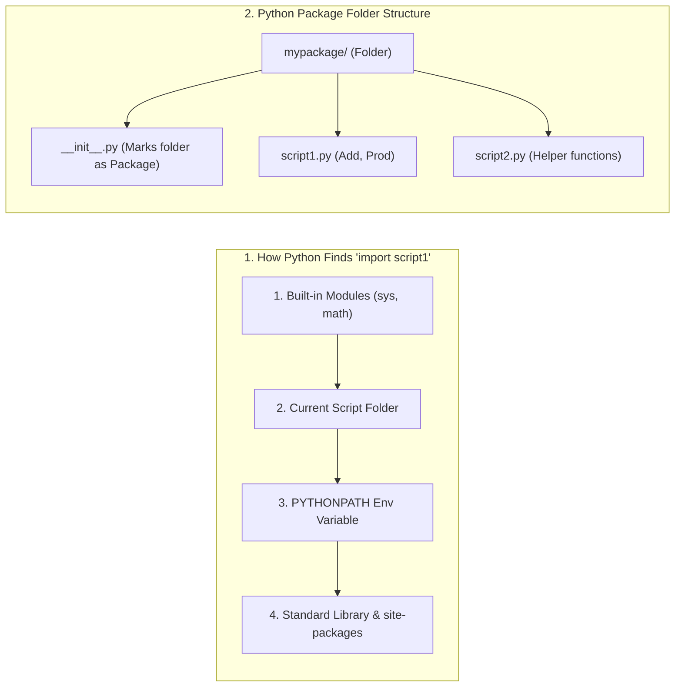

---
tags:
  - python
  - modules
  - packages
  - namespaces
---

# Modules, Namespaces (`dir`/`globals`/`locals`), `reload()`, and Packages in Python

#### TL;DR (Quick Revision)

**Python Modules & Packages** = Put reusable functions/classes in a `.py` file (`script1.py`) + Import them (`import script1`, `from script1 import Prod`, `import script1 as scp1`) + Locate via `sys.path` / `PYTHONPATH`, inspect with `dir()`, `globals()`, `locals()`, hot-reload with `importlib.reload()`, and group into folder **Packages** (`__init__.py`) ([Modules](https://docs.python.org/3/tutorial/modules.html)).

> [!abstract] Core Idea
> When you close the interactive Python shell, your functions and variables are lost → Saving definitions in a separate **`.py` file (a module)** lets you `import` and reuse them across any number of scripts → Python finds modules using `sys.path` (and the `PYTHONPATH` environment variable), inspects them with `dir()`, and groups multiple modules into folder **packages** ([Modules](https://docs.python.org/3/tutorial/modules.html)).

> [!question] Why Use It?
>
> - Split large programs into clean, maintainable `.py` files instead of one giant file
> - Reuse helper functions (`script1.Add(a, b)`, `script1.Prod(2, 3)`) across multiple projects without copy-pasting
> - Inspect everything inside a module (`dir(os)`, `dir(script1)`) or current scope (`globals()`, `locals()`)
> - Run a file both as a standalone CLI script (`if __name__ == "__main__":`) and as an importable library

#### Quick Comparison Table

| Syllabus Sub-Topic | Syntax (`main.py` & Official Docs) | Needs `module.` Prefix? | Exact Behavior ([Official Tutorial Ch. 6](https://docs.python.org/3/tutorial/modules.html), [Built-ins](https://docs.python.org/3/library/functions.html), [importlib](https://docs.python.org/3/library/importlib.html)) |
| :--- | :--- | :---: | :--- |
| **1. `import` Statement** | `import script1` → `script1.Add(12, 21)` | **Yes** (`script1.`) | Loads `script1.py` and binds only the module name `script1` in your current file. |
| **2. `import ... as` (Alias)** | `import script1 as scp1` → `scp1.Add(12, 21)` | **Yes** (`scp1.`) | Imports `script1` under a shorter nickname `scp1`. |
| **3. `from...import` Statement** | `from script1 import Prod` → `Prod(2, 3)` | **No** (Direct!) | Imports `Prod` directly into your file; note that `script1` itself is **not** defined! |
| **4. `from...import *` Statement** | `from script1 import *` | **No** | Imports all names from `script1` except those starting with `_` (use sparingly!). |
| **5. Executing as Script** | `if __name__ == "__main__":` | N/A | `__name__` is `"__main__"` when run directly (`python script1.py`), or `"script1"` when imported. |
| **6. Locating Modules (`sys.path`)** | `import sys; print(sys.path)` | N/A | Searches: 1. Built-ins (`sys`) → 2. Current script folder → 3. `PYTHONPATH` → 4. `site-packages`. |
| **7. `PYTHONPATH` Variable** | Set via OS Environment / Terminal | N/A | Extra folder paths added to `sys.path` so Python can find custom modules anywhere on disk. |
| **8. `dir()` Function** | `dir(os)` / `dir(script1)` / `dir()` | N/A | Returns a **sorted list of strings** of all functions, classes, and variables in a module. |
| **9. `globals()` & `locals()`** | `globals()` / `locals()` | N/A | Returns **dictionaries** of all global variables (`globals()`) or local function variables (`locals()`). |
| **10. `reload()` Function** | `import importlib; importlib.reload(script1)` | N/A | Recompiles and re-runs an already-imported module if you edited its `.py` file mid-session. |
| **11. Packages in Python** | Folder with `__init__.py` (`import pkg.mod`) | Depends on import | Organizes related `.py` modules into a directory hierarchy using dotted names. |

---

## The Learning Concept

### What Problem Does It Solve? (Fixing the `from script1 import Prod` Trap in `main.py`!)

Look at lines 381–383 of your `main.py`:
```python
# In main.py:
# from script1 import Prod
# print(f"Product: {script1.Prod(2,3)}")  # Only works if 'import script1' also ran!
```
Why does `script1.Prod(2, 3)` throw a `NameError` if you **only** ran `from script1 import Prod` (without running `import script1` earlier)? Because `from script1 import Prod` imports the function `Prod` directly into your file—it does **not** define the module name `script1`! ([Modules](https://docs.python.org/3/tutorial/modules.html)):

```python
# BAD - Using 'from math import sqrt' and then trying to write 'math.sqrt(16)'
from math import sqrt

# print(math.sqrt(16))          # ERROR! NameError: name 'math' is not defined!
print("When using 'from mod import fn', call fn() directly without 'mod.'!")
```

Here are the three clean ways to import and call a function from a module:

```python
# GOOD - The 3 clean ways to import and call functions (matching your main.py)
import math                             # Way 1: 'import mod' -> call math.sqrt()
import math as m                        # Way 2: 'import mod as alias' -> call m.sqrt()
from math import sqrt                   # Way 3: 'from mod import fn' -> call sqrt() directly!

print("Way 1 (math.sqrt):", math.sqrt(16))
print("Way 2 (m.sqrt):   ", m.sqrt(16))
print("Way 3 (sqrt):     ", sqrt(16))
```

### How Python Implements It

> [!tip] Four Pillars of Modules & Packages (From Your `main.py` & Syllabus)
>
> 1. **How `script1.py` Works When Imported vs. Run Directly**:
>    - Every `.py` file has a built-in variable called `__name__`.
>    - When you run `python script1.py` directly, `__name__` is set to `"__main__"`.
>    - When you write `import script1` inside `main.py`, `script1.__name__` is set to `"script1"`. Putting test code inside `if __name__ == "__main__":` prevents it from running accidentally when imported!
> 2. **How Python Locates Modules (`sys.path` & `PYTHONPATH`)**: When you write `import script1`, Python checks:
>    - (1) Built-in C modules (`sys.builtin_module_names`),
>    - (2) The folder containing your current `main.py` script,
>    - (3) Folders listed in your **`PYTHONPATH`** environment variable, and
>    - (4) Standard library & `site-packages` folders ([Modules — The Module Search Path](https://docs.python.org/3/tutorial/modules.html)).
> 3. **Inspecting Namespaces (`dir()`, `globals()`, `locals()`)**:
>    - `dir(script1)` lists all attributes/functions inside `script1`.
>    - `globals()` returns a dictionary of module-level global variables; `locals()` returns a dictionary of variables in the current local function scope.
> 4. **Reloading (`importlib.reload`) & Packages (`__init__.py`)**: Python imports each module **only once** per program run for speed. Use `importlib.reload(script1)` to reload changes without restarting Python, and group multiple `.py` files into a **Package** folder containing an `__init__.py` file.

#### Full Runnable Example (Your `script1.py` + `main.py` Workflow + Packages & `reload()`)

```python
import importlib
import os
import sys
import tempfile
from pathlib import Path

GLOBAL_ORG = "ValayVault"                       # Global variable at module level


def check_namespaces(local_arg):
    local_note = "Modules"                      # Local variable inside function
    # locals() has local variables; globals() has module-level variables
    return sorted(locals().keys()), ("GLOBAL_ORG" in globals())


if __name__ == "__main__":
    # Step 1: Create 'script1.py' dynamically (matching your main.py!)
    tmp_dir = tempfile.mkdtemp()
    sys.path.insert(0, tmp_dir)                 # Add tmp_dir to sys.path so Python finds script1

    script1_path = Path(tmp_dir) / "script1.py"
    script1_path.write_text(
        "def Add(a, b):\n    return a + b\n\ndef Prod(a, b):\n    return a * b\n",
        encoding="utf-8",
    )

    # Step 2: Import script1 in all 3 ways (from your main.py)
    import script1
    from script1 import Prod
    import script1 as scp1

    a, b = 12, 21
    sum_res = script1.Add(a, b)                 # Way 1: module.Function()
    prod_res = Prod(2, 3)                       # Way 2: Direct Function() from 'from...import'
    alias_res = scp1.Add(5, 5)                  # Way 3: alias.Function()

    # Step 3: Inspect module with dir() and check sys.path (from your main.py)
    defined_in_script1 = [n for n in dir(script1) if not n.startswith("__")]

    # Step 4: Edit script1.py and hot-reload with importlib.reload()
    script1_path.write_text(
        "def Add(a, b):\n    return a + b + 100\n\ndef Prod(a, b):\n    return a * b\n",
        encoding="utf-8",
    )
    importlib.reload(script1)
    reloaded_sum = script1.Add(12, 21)          # Now uses the updated Add() (+100)!

    # Step 5: Check globals() and locals()
    local_vars, has_global = check_namespaces(42)

    print(f"script1.Add(12,21): {sum_res} | Prod(2,3): {prod_res} | scp1.Add(5,5): {alias_res}")
    print(f"dir(script1) public names: {defined_in_script1}")
    print(f"After importlib.reload(script1), Add(12,21): {reloaded_sum}")
    print(f"locals() inside function: {local_vars} | 'GLOBAL_ORG' in globals(): {has_global}")
    print(f"First entry in sys.path is our module folder?: {sys.path[0] == tmp_dir}")
```

**Output:**

```
script1.Add(12,21): 33 | Prod(2,3): 6 | scp1.Add(5,5): 10
dir(script1) public names: ['Add', 'Prod']
After importlib.reload(script1), Add(12,21): 133
locals() inside function: ['local_arg', 'local_note'] | 'GLOBAL_ORG' in globals(): True
First entry in sys.path is our module folder?: True
```

### Visual Diagram: Module Search Order & Package Structure



### Key Terminology

1. **Module**: Any `.py` file containing Python functions, classes, or variables that can be imported into other scripts ([Modules](https://docs.python.org/3/tutorial/modules.html)).
   Syntax: `import script1`

2. **`sys.path` & `PYTHONPATH`**: `sys.path` is the Python list of directory strings searched during `import`; `PYTHONPATH` is an OS environment variable you can set in PowerShell/CMD/bash to add custom folders to `sys.path` ([Modules](https://docs.python.org/3/tutorial/modules.html)).
   Syntax: `import sys; print(sys.path)`

3. **`dir()`, `globals()`, and `locals()`**: Built-in functions for inspecting namespaces—`dir(mod)` returns a sorted `list` of names in `mod`, while `globals()` and `locals()` return `dict` mappings of global and local variables ([Built-in Functions](https://docs.python.org/3/library/functions.html)).
   Syntax: `print(dir(script1))`

4. **Package (`__init__.py`)**: A folder containing an `__init__.py` file that groups multiple `.py` modules together under a dotted namespace (`import sound.effects.echo`) ([Modules — Packages](https://docs.python.org/3/tutorial/modules.html)).
   Syntax: `from mypackage import script1`

> [!important] Key Rules to Remember
>
> - **Never name your own file after a standard library module** → naming your file `os.py`, `random.py`, or `math.py` shadows Python's built-in module because the current folder is searched before standard libraries!
> - **Each module is imported only ONCE per session** → if you edit `script1.py` while Python is open, run `import importlib; importlib.reload(script1)`
> - **Guard script test code with `if __name__ == "__main__":`** → so your test `print()` or `input()` lines don't run automatically when another file imports your module
> - **Avoid `from module import *` in production** → it dumps unknown names into your file and can silently overwrite your own functions (e.g., `from os import *` overwrites built-in `open()`!)

---

## ◈ Edge Case Analysis

### 1. Naming Your File `random.py` or `math.py` Breaks `import`!

✗ **Problem:** Because Python searches your current script's directory **before** the standard library (except for built-in C modules like `sys`), if you save a practice file named `random.py` and write `import random; random.randint(1, 10)` inside it, Python imports **your own file** instead of the standard library `random` module and crashes with `AttributeError`! ([Modules](https://docs.python.org/3/tutorial/modules.html)).
✓ **Fix:** Always give your practice scripts distinct names like `my_random_practice.py` or `script1.py`.

### 2. Why `from os import *` Is Dangerous (Official Tutorial Warning!)

✗ **Problem:** The `os` module has a low-level function called `os.open()`. If you write `from os import *`, `os.open()` overwrites Python's built-in `open()` function for reading files! ([Brief Tour of the Standard Library](https://docs.python.org/3/tutorial/stdlib.html)).
✓ **Fix:** Always use `import os` and access `os.getcwd()`, `os.listdir()`, etc.

```python
import os

# Built-in open() stays safe because we used 'import os' instead of 'from os import *'
print("Built-in open is safe:", open.__module__ == "_io" or open.__name__ == "open")
```

### 3. `importlib.reload(script1)` Doesn't Update `from script1 import Prod` Automatically

✗ **Problem:** If you imported `Prod` via `from script1 import Prod`, calling `importlib.reload(script1)` updates `script1.Prod`, but your local variable `Prod` still points to the old version! ([importlib](https://docs.python.org/3/library/importlib.html)).
✓ **Fix:** Either call `script1.Prod()` or re-run `from script1 import Prod` after reloading.

---

## Going Deeper (Intermediate → Advanced)

### 1. How `__pycache__` and `.pyc` Bytecode Files Work

When you import `script1.py`, Python automatically creates a folder named `__pycache__` containing `script1.cpython-314.pyc` ([Modules — Compiled Python files](https://docs.python.org/3/tutorial/modules.html)).
- **Does a `.pyc` file make your code run faster?** **No!** It only makes **loading (`import`)** the module faster the next time you run Python, because Python can skip parsing the `.py` text into bytecode if the file hasn't changed.

### 2. Controlling Package Wildcard Imports with `__all__` in `__init__.py`

When you create a package folder `sound/effects/` with `__init__.py`, what happens if someone writes `from sound.effects import *`? By default, Python does **not** load all `.py` files in the folder unless you list their names inside `__all__` in `__init__.py` ([Modules — Importing * From a Package](https://docs.python.org/3/tutorial/modules.html)):

```python
# Inside sound/effects/__init__.py:
__all__ = ["echo", "surround", "reverse"]
```

---

## Topic Mastery Quiz

Test yourself before moving to the next chapter. Pick the best answer for each question.

**Q1: If you write `from script1 import Prod` at the top of a fresh file, how should you call `Prod`?**
- [ ] A) `script1.Prod(2, 3)`
- [ ] B) `Prod(2, 3)`
- [ ] C) `import.Prod(2, 3)`
- [ ] D) `scp1.Prod(2, 3)`

**Q2: What is the value of `__name__` inside `script1.py` when it is imported into `main.py` via `import script1`?**
- [ ] A) `"__main__"`
- [ ] B) `"main"`
- [ ] C) `"script1"`
- [ ] D) `None`

**Q3: What data types do `dir(os)` and `globals()` return, respectively?**
- [ ] A) `list` and `dict`
- [ ] B) `dict` and `list`
- [ ] C) `tuple` and `dict`
- [ ] D) `set` and `dict`

**Q4: Which file inside a folder tells Python to treat that folder as a regular Package?**
- [ ] A) `__main__.py`
- [ ] B) `__package__.py`
- [ ] C) `__init__.py`
- [ ] D) `config.py`

**Q5: What do the `.pyc` files inside `__pycache__` actually speed up?**
- [ ] A) They make `for` loops run 10x faster
- [ ] B) They speed up the **loading (`import`) time** of modules, not the execution speed of the program
- [ ] C) They compress your hard drive
- [ ] D) They encrypt your source code

<details>
<summary>◈ View Answers & Explanations</summary>

1. **B** — `from script1 import Prod` binds `Prod` directly in your local namespace without defining `script1`.
2. **C** — When imported, a module's `__name__` equals its module name (`"script1"`). It is only `"__main__"` when executed directly as the top-level script.
3. **A** — `dir(os)` returns a sorted `list` of attribute name strings; `globals()` returns a `dict` representing the global namespace.
4. **C** — `__init__.py` initializes a package directory (and can optionally define `__all__`).
5. **B** — As stated in the official Python Tutorial (Ch. 6.1.3), a program doesn't run any faster when read from a `.pyc` file than from a `.py` file; the only thing that's faster about `.pyc` files is the speed with which they are loaded.

</details>

---

## Practice Exercises

**Exercise 1: Build Your Own `math_utils.py` Module**
- Create a file `math_utils.py` with `square(n)` and `cube(n)` functions
- Add an `if __name__ == "__main__":` block at the bottom that prints `"Testing math_utils directly"`
- Import `math_utils` into `main.py` and verify that the test message does **not** print on import

**Exercise 2: Module Explorer with `dir()`**
- Import the `math` module and use a list comprehension with `dir(math)` to list all functions in `math` that do not start with `"_"`

**Exercise 3: Create a 2-Module Package**
- Create a folder ` converter_pkg/` containing `__init__.py`, `temp.py` (`c_to_f`), and `distance.py` (`km_to_miles`)
- Import and call both functions from outside the folder

---

## Memory Trick / One-Liner

> [!tip] File vs. Folder Analogy (`Module` vs `Package`)
> - **A Module (`.py`)** = A single **Word Document**
> - **A Package (`folder/` + `__init__.py`)** = A **Folder** holding multiple Word Documents!

---

## Warning Block (Best Practice)

> [!warning] Common Mistake (Avoid This!)
>
> ```python
> # BAD - Importing 'sqrt' via 'from math import sqrt' and then prefixing with 'math.'
> from math import sqrt
> # print(math.sqrt(16))        # CRASH if 'import math' wasn't run first!
> ```
>
> ```python
> # GOOD - Call sqrt(16) directly after 'from math import sqrt'!
> from math import sqrt
> print(sqrt(16))               # Prints: 4.0
> ```
