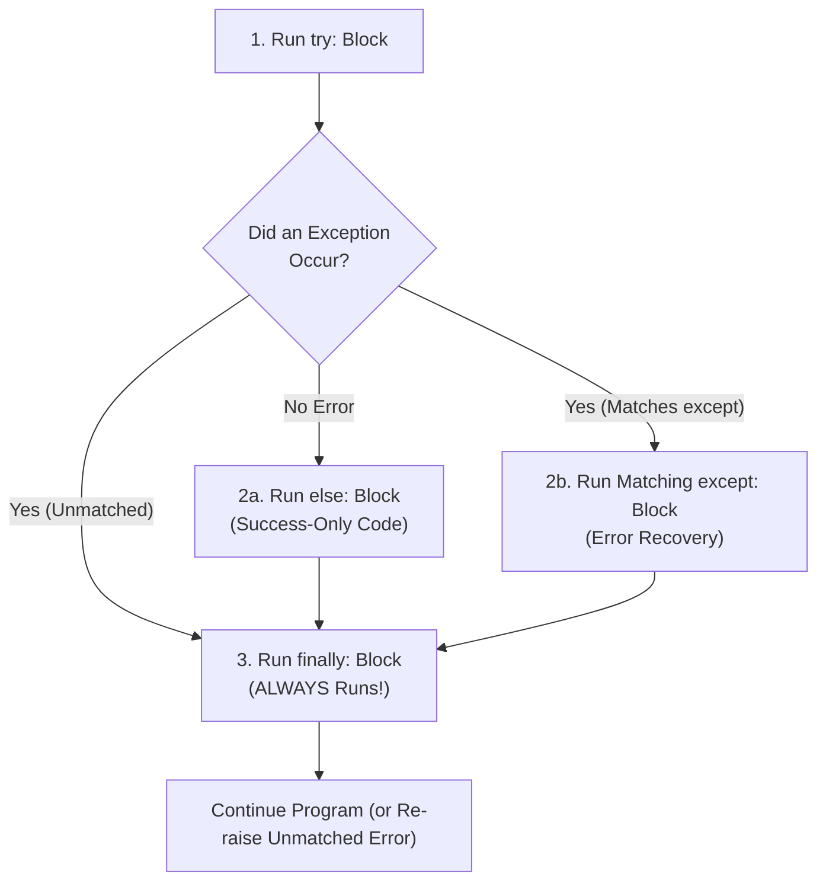

---
tags:
  - python
  - exceptions
  - error-handling
  - debugging
---

# Errors and Exception Handling in Python

#### TL;DR (Quick Revision)

**Exception Handling** = Catch runtime errors inside `try:` using specific `except ErrorType as e:` blocks + Run success-only code in `else:` + Run guaranteed cleanup in `finally:` + Raise custom errors with `raise` ([Errors and Exceptions](https://docs.python.org/3/tutorial/errors.html)).

> [!abstract] Core Idea
> Python has two kinds of errors: **Syntax Errors** (typos caught before the program starts) and **Exceptions** (runtime errors like dividing by zero `1/0` or missing files that happen while the program is running) → Wrapping risky code in `try` / `except` / `else` / `finally` lets your program recover gracefully instead of crashing ([Errors and Exceptions](https://docs.python.org/3/tutorial/errors.html)).

> [!question] Why Use It?
>
> - Prevent your entire program from crashing when a user types invalid input (`int("abc")` → `ValueError`)
> - Handle missing files (`FileNotFoundError`) or network timeouts cleanly with helpful messages
> - Run follow-up code in `else:` **only** when the `try:` block succeeded without any errors
> - Guarantee that locks, database connections, or temporary resources are cleaned up in `finally:`

#### Quick Comparison Table

| Keyword / Exception | Syntax Example | When Does It Run? | Exact Behavior ([Official Tutorial Ch. 8](https://docs.python.org/3/tutorial/errors.html)) |
| :--- | :--- | :---: | :--- |
| **`try` Block** | `try: res = 10 / n` | Always starts first | Runs the risky code; if an error occurs, jumps immediately to `except`. |
| **`except` Block** | `except ZeroDivisionError as e:` | When matching error occurs | Catches the error so the program doesn't crash; `e` holds the error details. |
| **Multi-Exception `except`** | `except (ValueError, TypeError) as e:` | When either error occurs | Catches multiple exception types in a single handler (3.14 allows `except A, B:` without `as`). |
| **`else` Block** | `else: print("Success:", res)` | When **NO** error happened in `try` | Runs only if `try:` finished completely without raising any exception. |
| **`finally` Block** | `finally: print("Cleanup done")` | **ALWAYS!** | Runs no matter what—whether `try` succeeded, was caught, or even hit `return`! |
| **`raise` Statement** | `raise ValueError("Age must be > 0")` | When you trigger it | Manually throws an exception (or bare `raise` inside `except` re-throws the current error). |
| **Exception Chaining** | `raise RuntimeError("DB Error") from e` | When wrapping errors | Links the new error to the original cause `e` (or `from None` to hide the old traceback). |
| **Custom Exception Class** | `class InsufficientFundsError(Exception): pass` | User-defined | Creates your own domain-specific exception by inheriting from `Exception`. |

---

## The Learning Concept

### What Problem Does It Solve?

Imagine asking a user to enter their age and dividing a bonus pool among employees. If you don't handle exceptions—or if you use a bare `except:` that catches everything blindly—your program either crashes or hides real bugs:

```python
# BAD - Bare 'except:' hides what went wrong and even blocks Ctrl+C (KeyboardInterrupt)!
raw_input = "twenty"

try:
    age = int(raw_input)                # Raises ValueError
    ratio = 100 / 0                     # Raises ZeroDivisionError
except:                                 # BAD: Catches EVERYTHING (even SystemExit & KeyboardInterrupt)!
    print("Something went wrong, but we have no idea what!")
```

Always catch **specific exception classes** (like `ValueError` or `ZeroDivisionError`), put success-only code in `else:`, and put mandatory cleanup in `finally:` ([Errors and Exceptions](https://docs.python.org/3/tutorial/errors.html)):

```python
# GOOD - Specific except blocks + else (for success) + finally (for guaranteed cleanup)
def safe_divide(raw_num, divisor):
    try:
        num = int(raw_num)              # Might raise ValueError
        result = num / divisor          # Might raise ZeroDivisionError
    except ValueError as err:
        print("Invalid number text:", err)
    except ZeroDivisionError:
        print("Error: Cannot divide by zero!")
    else:
        # Runs ONLY if no exception happened in 'try'
        print("Success! Result is:", result)
    finally:
        # Runs ALWAYS (whether an error happened or not)
        print("--- Calculation attempt finished ---")

safe_divide("100", 4)
safe_divide("100", 0)
```

### How Python Implements It

> [!tip] Four Pillars of Exception Handling
>
> 1. **Common Built-in Exceptions to Know**:
>    - `SyntaxError`: Missing colon `:`, unmatched parenthesis, or bad indentation (`IndentationError`).
>    - `NameError`: Using a variable name that hasn't been defined (or after `del h`).
>    - `TypeError`: Operation on wrong type (`"2" + 2` or `tp[0] = 99`).
>    - `ValueError`: Right type, wrong content (`int("abc")` or `[1, 2].remove(99)`).
>    - `IndexError` / `KeyError`: Out-of-range sequence index (`lst[99]`) or missing dict key (`emp["missing"]`).
>    - `ZeroDivisionError` / `FileNotFoundError` (`OSError`).
> 2. **Order Handlers from Most Specific to Most General**: Because `FileNotFoundError` is a subclass of `OSError`, which is a subclass of `Exception`, always put `except FileNotFoundError:` **above** `except Exception:`.
> 3. **Custom Exceptions**: Create your own readable error types by inheriting from `Exception` (`class NegativeBalanceError(Exception): pass`).
> 4. **Enriching Errors with `.add_note()` (Python 3.11+)**: Inside an `except` block, you can attach extra debugging info with `err.add_note("Failed on user ID 42")` before re-raising ([Errors and Exceptions](https://docs.python.org/3/tutorial/errors.html)).

#### Full Runnable Example

```python
# Step 1: Define a custom exception class (inherits from Exception)
class NegativeAmountError(Exception):
    pass


def process_payment(raw_amount, split_ways):
    steps = []
    try:
        amount = int(raw_amount)                    # May raise ValueError
        if amount < 0:
            raise NegativeAmountError(f"Amount cannot be negative: {amount}")
        per_person = amount / split_ways            # May raise ZeroDivisionError
    except ValueError:
        steps.append("Caught ValueError (bad int string)")
        return None, steps
    except ZeroDivisionError:
        steps.append("Caught ZeroDivisionError (split_ways=0)")
        return None, steps
    except NegativeAmountError as err:
        steps.append(f"Caught Custom Error: {err}")
        return None, steps
    else:
        steps.append(f"Else ran: per_person={per_person}")
        return per_person, steps
    finally:
        steps.append("Finally ran (cleanup)")


if __name__ == "__main__":
    print("Case 1 (Valid):   ", process_payment("100", 4))
    print("Case 2 (Bad str): ", process_payment("abc", 4))
    print("Case 3 (Div 0):   ", process_payment("100", 0))
    print("Case 4 (Negative):", process_payment("-50", 2))
```

**Output:**

```
Case 1 (Valid):    (25.0, ['Else ran: per_person=25.0', 'Finally ran (cleanup)'])
Case 2 (Bad str):  (None, ['Caught ValueError (bad int string)', 'Finally ran (cleanup)'])
Case 3 (Div 0):    (None, ['Caught ZeroDivisionError (split_ways=0)', 'Finally ran (cleanup)'])
Case 4 (Negative): (None, ['Caught Custom Error: Amount cannot be negative: -50', 'Finally ran (cleanup)'])
```

### Visual Diagram: `try` / `except` / `else` / `finally` Execution Flow



### Key Terminology

1. **`try` and `except`**: `try:` wraps statements that might fail; `except SpecificError as err:` catches and handles matching runtime exceptions ([Errors and Exceptions](https://docs.python.org/3/tutorial/errors.html)).
   Syntax: `except ValueError as err:`

2. **`else` in `try` Statements**: Optional block placed after all `except` blocks that executes **only if the `try` block raised no exceptions** ([Errors and Exceptions](https://docs.python.org/3/tutorial/errors.html)).
   Syntax: `try: ... except OSError: ... else: ...`

3. **`finally` Block**: Cleanup block that executes under **all circumstances** before leaving the `try` statement ([Errors and Exceptions](https://docs.python.org/3/tutorial/errors.html)).
   Syntax: `finally: conn.close()`

4. **`raise` Statement**: Forces a specified exception to occur (or re-raises the active exception when written as a bare `raise` inside `except`) ([Errors and Exceptions](https://docs.python.org/3/tutorial/errors.html)).
   Syntax: `raise ValueError("Invalid input")`

> [!important] Key Rules to Remember
>
> - **Catch `Exception`, NOT `BaseException`** → `SystemExit` and `KeyboardInterrupt` inherit from `BaseException` so they can stop your program cleanly; catching `Exception` only catches normal runtime errors
> - **Specific before General** → always list child exceptions (`except ZeroDivisionError:`) *before* parent exceptions (`except ArithmeticError:` or `except Exception:`)
> - **Never put `return` or `break` inside `finally:`** → a `return` inside `finally:` silently swallows any unhandled exception from `try:`! (Python 3.14 emits a `SyntaxWarning` for this via PEP 765)
> - **Exception variable `as err` is local to `except:`** → Python automatically deletes `err` when the `except` block ends

---

## ◈ Edge Case Analysis

### 1. Putting `except Exception:` First Blocks All Specific Handlers Below It!

✗ **Problem:** Python checks `except` clauses from top to bottom and runs **only the first match**. Since almost every error inherits from `Exception`, putting `except Exception:` at the top means `except ValueError:` below it will **never** run! ([Errors and Exceptions](https://docs.python.org/3/tutorial/errors.html)).
✓ **Fix:** Always put specific exceptions (`ValueError`, `KeyError`) first and `except Exception:` last.

```python
try:
    int("invalid")
except ValueError:                      # Checked 1st (Most specific)
    print("Caught specific ValueError!")
except Exception:                       # Checked last (Fallback)
    print("Caught general Exception")
```

### 2. Why `return` Inside `finally:` Is Dangerous (Warned in Python 3.14!)

✗ **Problem:** If a `try` block returns `"From Try"` (or raises an error!) AND the `finally` block also has `return "From Finally"`, the `finally` block's return value **overwrites** the `try` block's return value and **deletes any active exception**! ([Errors and Exceptions](https://docs.python.org/3/tutorial/errors.html)).
✓ **Fix:** Only put cleanup actions in `finally:`, never `return`, `break`, or `continue`.

### 3. `err` Variable Is Deleted Outside the `except Exception as err:` Block

✗ **Problem:** If you write `except ValueError as err:` and then try to `print(err)` *after* the `except` block finishes, Python raises `NameError: name 'err' is not defined`!
✓ **Fix:** Save `error_msg = str(err)` to a normal variable inside the `except` block if you need it later.

```python
saved_error = None
try:
    int("not_a_number")
except ValueError as err:
    saved_error = str(err)              # Save message before 'err' is cleared!

print("Saved error message:", saved_error)
```

---

## Going Deeper (Intermediate → Advanced)

### 1. Exception Chaining (`raise ... from exc` vs. `raise ... from None`)

When catching a low-level error (like `KeyError`) and raising a higher-level error (like `RuntimeError`), you can either explicitly link the root cause with `from exc` or hide the noisy internal traceback with `from None` ([Errors and Exceptions — Exception Chaining](https://docs.python.org/3/tutorial/errors.html)):

```python
try:
    try:
        data = {}["missing_key"]
    except KeyError as root_cause:
        raise RuntimeError("Failed to load user profile") from root_cause
except RuntimeError as final_err:
    print("Caught:", final_err, "| Root cause:", type(final_err.__cause__).__name__)
```

### 2. Handling Multiple Simultaneous Errors (`ExceptionGroup` & `except*`)

When running batch validations or concurrent tasks where multiple errors can happen at once, wrap them in an `ExceptionGroup` and filter them by type using `except*` ([Errors and Exceptions — Raising and Handling Multiple Unrelated Exceptions](https://docs.python.org/3/tutorial/errors.html)):

```python
try:
    raise ExceptionGroup("Validation errors", [ValueError("Bad age"), TypeError("Bad name")])
except* ValueError as eg:
    print("Handled ValueErrors:", eg.exceptions)
except* TypeError as eg:
    print("Handled TypeErrors:", eg.exceptions)
```

---

## Topic Mastery Quiz

Test yourself before moving to the next chapter. Pick the best answer for each question.

**Q1: Which exception is raised when you evaluate `"2" + 2` in Python?**
- [ ] A) `ValueError`
- [ ] B) `TypeError`
- [ ] C) `SyntaxError`
- [ ] D) `NameError`

**Q2: Which exception is raised when you evaluate `int("hello")` in Python?**
- [ ] A) `TypeError`
- [ ] B) `ValueError`
- [ ] C) `KeyError`
- [ ] D) `ArithmeticError`

**Q3: In a `try ... except ... else ... finally` block, which blocks run if NO exception occurs in `try`?**
- [ ] A) `try` and `except` only
- [ ] B) `try` and `else` only
- [ ] C) `try`, `else`, and `finally`
- [ ] D) `try`, `except`, `else`, and `finally`

**Q4: What happens if an exception occurs inside `try:` that does NOT match any `except:` clause, but there IS a `finally:` clause?**
- [ ] A) `finally:` is skipped and the program crashes immediately
- [ ] B) `finally:` runs first, and then the unhandled exception is automatically re-raised
- [ ] C) `finally:` catches and silences the exception
- [ ] D) `else:` runs before `finally:`

**Q5: How do you define a custom exception `InvalidMarksError` in Python?**
- [ ] A) `def InvalidMarksError(Exception): pass`
- [ ] B) `class InvalidMarksError(Exception): pass`
- [ ] C) `raise class InvalidMarksError:`
- [ ] D) `except InvalidMarksError:`

<details>
<summary>◈ View Answers & Explanations</summary>

1. **B** — `"2" + 2` attempts to concatenate an `int` to a `str`, which is an invalid operation for those types (`TypeError`).
2. **B** — `int()` accepts a `str` type, but the content `"hello"` is not a valid base-10 integer value (`ValueError`).
3. **C** — When no error occurs in `try`, `except` is skipped, `else` runs, and `finally` always runs.
4. **B** — `finally` is guaranteed to run first for cleanup, after which the unmatched exception continues propagating upward.
5. **B** — Custom exceptions are classes that inherit from `Exception`: `class InvalidMarksError(Exception): pass`.

</details>

---

## Practice Exercises

**Exercise 1: Resilient Number Input Loop**
- Write a function `parse_int_list(raw_strings)` given `["10", "twenty", "30", "forty", "50"]`
- Loop through the strings using `try` / `except ValueError` to collect valid integers into `valid_nums` and invalid strings into `bad_inputs`

**Exercise 2: Safe Dictionary & Index Reader**
- Write `get_student_mark(data, name, subject_idx)` that looks up `data[name][subject_idx]`
- Handle both `KeyError` (student not found) and `IndexError` (subject index out of range) with distinct friendly messages

**Exercise 3: Custom `InsufficientBalanceError`**
- Define `class InsufficientBalanceError(Exception): pass`
- Write `withdraw(balance, amount)` that raises `InsufficientBalanceError` if `amount > balance`, and test catching it in a `try` / `except` / `else` / `finally` block

---

## Memory Trick / One-Liner

> [!tip] `TypeError` vs `ValueError` Memory Trick
> Imagine a blender that only blends **Fruit**:
> - **`TypeError`** = You put a **Brick** in the blender (*Wrong Type of object entirely!*, e.g. `int([1, 2])`)
> - **`ValueError`** = You put a **Rotten Apple** in the blender (*Right Type `str`, but bad Value inside!*, e.g. `int("apple")`)

---

## Warning Block (Best Practice)

> [!warning] Common Mistake (Avoid This!)
>
> ```python
> # BAD - Using bare 'except: pass' silently swallows bugs and typos!
> try:
>     total = prcie * qty       # Typo in 'prcie' (NameError)!
> except:
>     pass                      # Bug is completely hidden; program continues with broken state!
> ```
>
> ```python
> # GOOD - Always catch the specific exception you expect and log/handle it!
> price, raw_qty = 100, "two"
> try:
>     total = price * int(raw_qty)
> except ValueError as err:
>     print("Invalid quantity entered:", err)
> ```