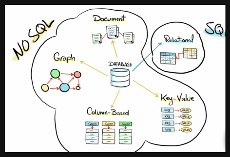
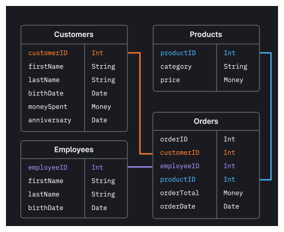
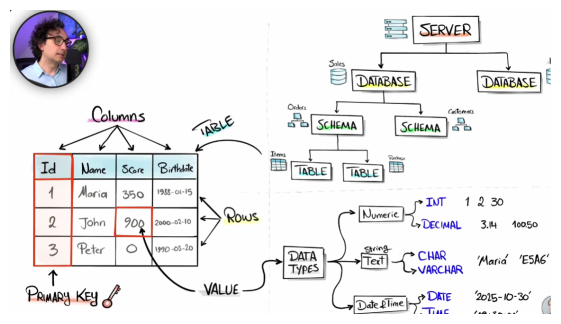

SQL (Pronounced as either `SQL` or `SeQueL`) is a programming language designed for managing data in relational database.

> To Understand what and why is SQL read below:

We use a lot of data on our everyday purposes by data I meant our chats, bills, files, numbers, anything that is stored on a Database (an organized, electronic collection of structured information or data, typically stored and accessed from a computer system)
As the data is stored on the servers the applications need to get our data in order to use it,
so _How Do We Do it._
Here comes the `SQL` programming language which is used to **READ**, **MANIPULATE** and **CHANGE** data on the server as the users need.

In simpler terms, If we have to

> In order to speak or ask questions (queries) to your database you've to speak `SQL`.

Though SQL is commonly used by programmer/engineers in software development, it's also popular with Data Analyst for a few reasons:

- It's semantically (_simplified language_) easy to understand and learn.
- It can be used to access large amounts of data directly where it is stored, analysts don't have to copy data into other applications.
- Compared to spreadsheet tools, data analysis done in SQL is easy to audit and replicate. For, analysts this means no more looking for the cell with the typo in the formula.

---

## DBMS & SQL server

We know a Database is an organized, electronic collection of structured information or data, typically stored and accessed from a computer system.

And SQL is the language we use to connect/talk to the Database.

But Database is only a container which has data so _we need a software/system_ that can **handle the SQL queries**, thus the concept of DBMS comes.

DBMS (Database Management System) is a system that handles all the requested queries of SQL to the Database.

> It's a middleman between the Database and SQL query.

DBMS are critical for organizing, securing and efficiently managing data, acting as the backbone for modern application functionality and decision-making.

> [!IMPORTANT] IMPORTANT
> They eliminate **_data redundancy_**, ensure **_data consistency_** across systems, **_enhance security_** through role-based access, and provide **_reliable backup and recovery_**.

And to perform all these things (execution of queries and transfer of huge amount of data) requires a system that can run `24/7` with faster process execution which are in our case SQL servers.

**SQL server** or simply a server are the software that run databases all the time to provide better service and accessibility to the data.

Server can either be **physical** (Our own home-managed) or **Cloud** based (Azure, AWS, Google Cloud, etc..)

**Key points:**

- Database : Stores Data
- SQL : Speak to Database
- DBMS : Manages Database
- Server : Where Database lives

---

## Database Types

Databases can be broadly categorized into various types based on their data model, structure, and functionality.

Some common types of databases are as follows:

### 1. Relational Databases (RDBMS)

> Data is organized into tables with rows and columns, and relationships between tables are established using keys.

Examples: MySQL, PostgreSQL, Oracle Database, Microsoft SQL Server.

### 2. NoSQL Databases:

> Designed to handle unstructured or semi-structured data and offer flexibility. It's a broader term and these type of databases are often categorized into `key-value` stores, document stores, column-family stores, and `graph` databases.

Examples: MongoDB (Document Store), Cassandra (Column-Family Store), Redis (Key-Value Store), Neo4j (Graph Database).

### 3. Graph Databases

> Optimized for storing and querying graph-structured data, where relationships between entities are crucial.

Example: Neo4j, Amazon Neptune.

### 4. Document Stores

> Designed to store and retrieve semi-structured or document-oriented data, often using formats like JSON or BSON.

Examples: MongoDB, CouchDB, ElasticSearch.

### 5. Key-Value Stores

> Simplest form of NoSQL databases, storing data as key-value pairs. Efficient for basic read and write operations

Example: Redis, DynamoDB, Memcached.

You can check others in this article [GFG](https://www.geeksforgeeks.org/dbms/types-of-databases/)

## Database Structure

As shown in the above image in the structure of a **database** on top of the hierarchy is the **Server** which stores all the databases, then the databases store different **schemas** to work with. In those schemas we have many different tables connected to each other via keys (is required), and in those tables we have our data of different type, it can be Numeric, Text, or Date and Time.

A table consist of two things

- Columns (_fields/attributes_)
- Rows (_tuples/records_)
