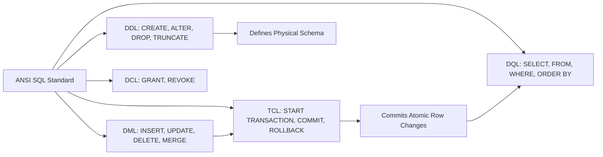

---
tags:
  - sql
  - ansi-sql-overview
  - beginner
---

# Overview of ANSI SQL in SQL

#### TL;DR (Quick Revision)

**ANSI SQL** = Standardized declarative database language (`SELECT`, `INSERT`, `CREATE`, `GRANT`, `COMMIT`) + Write _what_ data you want once, and let the database engine figure out _how_ to fetch it across MySQL, SQL Server, or PostgreSQL.

> [!abstract] Core Idea
> **ANSI SQL** (American National Standards Institute Structured Query Language) is the official global standard language used to create, modify, and query relational databases ([What is SQL? - ApX Machine Learning](https://apxml.com/courses/sql-for-data-science/chapter-1-intro-databases-sql/what-is-sql)). Instead of writing step-by-step loops to search through files, you write a single declarative statement that passes through SQL's logical execution pipeline (`FROM -> WHERE -> GROUP BY -> HAVING -> SELECT -> DISTINCT -> ORDER BY -> LIMIT`).

> [!question] Why Use It?
>
> - **Write Once, Run Anywhere (Portability)**: Core ANSI SQL syntax (`SELECT`, `WHERE`, `JOIN`, `GROUP BY`) works across [MySQL 8.4](https://dev.mysql.com/doc/refman/8.4/en/create-table.html), [Microsoft SQL Server (T-SQL)](https://learn.microsoft.com/en-us/sql/t-sql/language-reference?view=sql-server-ver17), PostgreSQL, and Oracle without rewriting your core logic.
> - **Declarative Simplicity**: You describe the result set you want, and the database engine's Query Optimizer automatically selects the fastest index and execution path.
> - **Five Specialized Command Sub-Languages**: Cleanly separates structure (`DDL`), row modifications (`DML`), data retrieval (`DQL`), permissions (`DCL`), and atomic transactions (`TCL`).
> - **Foundation for Data Science & Engineering**: Directly extracts, filters, and aggregates raw organizational data before feeding dashboards or machine learning pipelines ([Why SQL is Important for Data Science](https://apxml.com/courses/sql-for-data-science/chapter-1-intro-databases-sql/what-is-sql)).

#### Quick Comparison Table

| Aspect / Sub-Topic                     | ANSI SQL / SQL Server (T-SQL)                                                                                                                                                                | MySQL 8.4+ Equivalent                                                                                                                           | Key Behavior                                                                                                                                                                                               |
| :------------------------------------- | :------------------------------------------------------------------------------------------------------------------------------------------------------------------------------------------- | :---------------------------------------------------------------------------------------------------------------------------------------------- | :--------------------------------------------------------------------------------------------------------------------------------------------------------------------------------------------------------- |
| **DDL (Data Definition Language)**     | `CREATE TABLE`, `ALTER TABLE`, `DROP TABLE`, `TRUNCATE TABLE` ([CREATE TABLE T-SQL](https://learn.microsoft.com/en-us/sql/t-sql/statements/create-table-transact-sql?view=sql-server-ver17)) | `CREATE TABLE`, `ALTER TABLE`, `DROP TABLE`, `TRUNCATE TABLE` ([CREATE TABLE MySQL](https://dev.mysql.com/doc/refman/8.4/en/create-table.html)) | Defines or alters table structures; triggers an [Implicit Commit](https://dev.mysql.com/doc/refman/8.4/en/implicit-commit.html) in MySQL 8.4, whereas T-SQL can roll back DDL inside a transaction.        |
| **DML (Data Manipulation Language)**   | `INSERT INTO`, `UPDATE`, `DELETE`, `MERGE` ([MERGE T-SQL](https://learn.microsoft.com/en-us/sql/t-sql/statements/merge-transact-sql?view=sql-server-ver17))                                  | `INSERT INTO`, `UPDATE`, [DELETE](https://dev.mysql.com/doc/refman/8.4/en/delete.html), `INSERT ... ON DUPLICATE KEY UPDATE`                    | Adds, modifies, or removes rows inside existing tables.                                                                                                                                                    |
| **DQL (Data Query Language)**          | `SELECT ... FROM ... WHERE ...` ([SELECT T-SQL](https://learn.microsoft.com/en-us/sql/t-sql/queries/select-transact-sql?view=sql-server-ver17))                                              | `SELECT ... FROM ... WHERE ...`                                                                                                                 | Reads and projects rows without mutating stored data.                                                                                                                                                      |
| **DCL (Data Control Language)**        | `GRANT`, `REVOKE`, `DENY` (T-SQL extension)                                                                                                                                                  | `GRANT`, `REVOKE` ([CREATE USER Statement](https://dev.mysql.com/doc/refman/8.4/en/create-user.html))                                           | Controls security permissions; T-SQL adds `DENY` which explicitly overrides `GRANT`.                                                                                                                       |
| **TCL (Transaction Control Language)** | `BEGIN TRANSACTION`, `COMMIT TRANSACTION`, `ROLLBACK TRANSACTION`, `SAVEPOINT`                                                                                                               | `START TRANSACTION` (or `BEGIN`), `COMMIT`, `ROLLBACK`, `SAVEPOINT` ([InnoDB ACID](https://dev.mysql.com/doc/refman/8.4/en/mysql-acid.html))    | Bundles multiple DML changes into an all-or-nothing atomic unit of work.                                                                                                                                   |
| **Identifier Quotes**                  | `"column_name"` (ANSI) or `[column_name]` (T-SQL brackets)                                                                                                                                   | `` `column_name` `` (Backticks) or `"column_name"` (`ANSI_QUOTES` mode)                                                                         | Escapes reserved keywords or spaces in table/column names ([Reserved Keywords T-SQL](https://learn.microsoft.com/en-us/sql/t-sql/language-elements/reserved-keywords-transact-sql?view=sql-server-ver17)). |

---

## The Learning Concept

### What Problem Does It Solve?

Imagine trying to manage a company's course catalog when every developer uses proprietary, vendor-locked commands or mixes structural changes with unvalidated text queries:

```sql
-- BAD - Relying on vendor-locked syntax and unquoted reserved words without ANSI structure
SELECT TOP 3 [course id], course_title
FROM training_courses
WHERE duration_hours = NULL;
```

This query fails on MySQL and PostgreSQL because `TOP 3` and square brackets `[course id]` are proprietary Microsoft T-SQL extensions, and `duration_hours = NULL` never matches any row in any SQL database because comparing anything to `NULL` with `=` produces `UNKNOWN`. Now compare the clean ANSI SQL solution:

```sql
-- GOOD - Portable ANSI SQL syntax that runs cleanly across MySQL 8.4+, SQL Server, and SQLite
SELECT
    course_id,
    course_title,
    duration_hours
FROM training_courses
WHERE duration_hours IS NOT NULL
  AND duration_hours >= 28
ORDER BY duration_hours ASC;
```

### How SQL Implements It

> [!tip] Three Simple Steps in Every SQL Workflow
>
> 1. **Define Structure (`DDL`)**: Use `CREATE TABLE` to declare table names, column data types, and primary keys.
> 2. **Populate & Mutate Rows (`DML` & `TCL`)**: Use `INSERT INTO` and `UPDATE` wrapped in transactions (`COMMIT`) to store clean records.
> 3. **Query & Analyze Sets (`DQL`)**: Use `SELECT ... FROM ... WHERE ... ORDER BY` to retrieve filtered, sorted datasets.

#### Full Runnable Example

```sql
-- Step 1 (DDL): Create the training_courses table using pure ANSI SQL
CREATE TABLE training_courses (
    course_id INT PRIMARY KEY,
    course_code VARCHAR(15) NOT NULL UNIQUE,
    course_title VARCHAR(60) NOT NULL,
    duration_hours INT NOT NULL,
    fee_usd DECIMAL(8, 2) NOT NULL
);

-- Step 2 (DML): Insert 4 courses and update one course fee
INSERT INTO training_courses VALUES
(101, 'SQL-101', 'ANSI SQL Foundations', 24, 199.00),
(102, 'SQL-201', 'MySQL 8.4 Query Optimization', 32, 299.00),
(103, 'TSQL-301', 'SQL Server Enterprise T-SQL', 40, 349.00),
(104, 'DATA-105', 'SQL for Data Science', 28, 249.00);

UPDATE training_courses
SET fee_usd = 279.00
WHERE course_code = 'SQL-201';

-- Step 3 (DQL): Retrieve courses lasting at least 28 hours sorted by duration
SELECT
    course_id,
    course_code,
    course_title,
    duration_hours,
    fee_usd
FROM training_courses
WHERE duration_hours >= 28
ORDER BY duration_hours ASC;
```

**Output:**

```
+-------------+---------------+------------------------------+------------------+-----------+
| course_id   | course_code   | course_title                 | duration_hours   | fee_usd   |
|-------------+---------------+------------------------------+------------------+-----------|
| 104         | DATA-105      | SQL for Data Science         | 28               | 249       |
| 102         | SQL-201       | MySQL 8.4 Query Optimization | 32               | 279       |
| 103         | TSQL-301      | SQL Server Enterprise T-SQL  | 40               | 349       |
+-------------+---------------+------------------------------+------------------+-----------+
```

### Visual Diagram: ANSI SQL Sub-Languages in Action



### Key Terminology

1. **Declarative Language**: A programming paradigm where you state _what_ result you want (`WHERE duration_hours >= 28`) rather than coding _how_ to iterate over storage blocks.
   Syntax: `SELECT course_title FROM training_courses WHERE fee_usd < 300.00;`
2. **DDL (Data Definition Language)**: Commands that create, modify, or drop schema objects (`TABLE`, `VIEW`, `INDEX`) in the database catalog ([CREATE TABLE MySQL](https://dev.mysql.com/doc/refman/8.4/en/create-table.html)).
   Syntax: `CREATE TABLE departments (dept_id INT PRIMARY KEY);`
3. **DML (Data Manipulation Language)**: Commands that insert, update, delete, or merge row records inside tables.
   Syntax: `UPDATE training_courses SET fee_usd = 279.00 WHERE course_id = 102;`
4. **SQL Dialect**: A database vendor's implementation of ANSI SQL plus proprietary extensions—such as **T-SQL** in Microsoft SQL Server ([Transact-SQL Reference](https://learn.microsoft.com/en-us/sql/t-sql/language-reference?view=sql-server-ver17)) or **MySQL 8.4 SQL** ([MySQL HELP Statement](https://dev.mysql.com/doc/refman/8.4/en/help.html)).
   Syntax: `SELECT course_id FROM training_courses LIMIT 5;`

> [!important] Key Rules to Remember
>
> - **String Literals vs. Identifiers** → Always wrap text strings in single quotes (`'SQL-101'`), never double quotes (`"SQL-101"`), because ANSI SQL reserves double quotes for table and column identifiers ([Filtering Data Using WHERE](https://apxml.com/courses/sql-for-data-science/chapter-3-filtering-sorting-data/intro-filtering-where)).
> - **DDL Implicit Commit in MySQL** → Running `CREATE TABLE`, `ALTER TABLE`, or `TRUNCATE TABLE` in MySQL 8.4 automatically commits any open transaction ([Statements That Cause an Implicit Commit](https://dev.mysql.com/doc/refman/8.4/en/implicit-commit.html)).
> - **Semicolon Statement Terminator** → Terminate every SQL statement with `;` (mandatory in MySQL batch scripts and required before `WITH` CTEs or `MERGE` in SQL Server T-SQL).
> - **Case Insensitivity of Keywords** → SQL keywords (`SELECT`, `select`, `Select`) are case-insensitive, but writing uppercase keywords and lowercase `snake_case` table/column names is the industry standard.

---

## Edge Case Analysis

### 1. Double Quotes vs. Single Quotes for Text Strings

**Problem:** In MySQL (by default), `"SQL-101"` is tolerated as a string literal, but in ANSI SQL and SQL Server (when `SET QUOTED_IDENTIFIER ON` is active, which is the default), `"SQL-101"` is parsed as a **column name** and throws `Invalid column name 'SQL-101'`.
**Fix:** Always enclose text and date literals in single quotes (`'SQL-101'`).

```sql
-- Portable across ANSI SQL, MySQL 8.4+, and SQL Server T-SQL
SELECT course_id, course_title
FROM training_courses
WHERE course_code = 'SQL-101';
```

### 2. Rolling Back `DDL` in SQL Server T-SQL vs. MySQL 8.4

**Problem:** If you start a transaction, delete rows, run `DROP TABLE temp_logs;`, and then issue `ROLLBACK;`, SQL Server rolls back both the `DELETE` and the `DROP TABLE`, whereas MySQL 8.4 implicitly commits the `DELETE` the instant `DROP TABLE` runs ([Implicit Commit](https://dev.mysql.com/doc/refman/8.4/en/implicit-commit.html))!
**Fix:** Never mix `DDL` statements (`CREATE`, `ALTER`, `DROP`, `TRUNCATE`) inside an active `DML` transaction block.

```sql
-- Keep DML transactions strictly free of DDL statements
START TRANSACTION;
UPDATE training_courses SET fee_usd = 259.00 WHERE course_id = 101;
COMMIT;
```

### 3. `TRUNCATE TABLE` (`DDL`) vs. `DELETE FROM` (`DML`)

**Problem:** Beginners often assume `TRUNCATE TABLE training_courses;` is just a faster `DELETE FROM training_courses;`. However, `TRUNCATE` is a `DDL` statement that deallocates data pages, resets `AUTO_INCREMENT`/`IDENTITY` counters back to `1`, does not fire `ON DELETE` triggers, and fails if a `FOREIGN KEY` references the table ([DELETE Statement MySQL](https://dev.mysql.com/doc/refman/8.4/en/delete.html)).
**Fix:** Use `DELETE FROM table_name WHERE ...` when you need row-level filtering, trigger execution, or foreign key cascades.

```sql
-- Safe row-level DML deletion
DELETE FROM training_courses
WHERE course_code = 'SQL-101';
```

---

## Going Deeper (Intermediate -> Advanced)

### 1. Evolution of the ANSI/ISO SQL Standard (`SQL-86` to `SQL:2023`)

| Standard Year           | Milestone Features Introduced                                                                                 |
| :---------------------- | :------------------------------------------------------------------------------------------------------------ |
| **SQL-86 / SQL-89**     | First ANSI/ISO standard (`SELECT`, `INSERT`, `UPDATE`, `DELETE`, basic integrity constraints).                |
| **SQL-92**              | Explicit `INNER JOIN`, `LEFT OUTER JOIN`, `RIGHT OUTER JOIN`, `FULL OUTER JOIN`, `CASE` expressions, `CAST`.  |
| **SQL:1999**            | Recursive Common Table Expressions (`WITH RECURSIVE`), `ROLLUP`, `CUBE`, `GROUPING SETS`, triggers.           |
| **SQL:2003 / SQL:2008** | Window functions (`OVER`, `PARTITION BY`, `ROW_NUMBER`), `MERGE` statement, standard `OFFSET ... FETCH NEXT`. |
| **SQL:2016 / SQL:2023** | Native `JSON` path functions (`JSON_VALUE`, `JSON_TABLE`), Property Graph Queries (`SQL/PGQ`) `[VERIFY]`.     |

### 2. Dialect Bridge: MySQL 8.4 vs. Microsoft SQL Server (T-SQL)

While 85% of everyday SQL is identical ANSI syntax, keep these core dialect differences in mind when reading your syllabus:

```sql
-- 1. Limiting output to 3 rows in ANSI SQL / SQL Server (T-SQL):
SELECT course_id, course_title
FROM training_courses
ORDER BY course_id ASC
OFFSET 0 ROWS FETCH NEXT 3 ROWS ONLY; -- (or T-SQL shorthand: SELECT TOP (3) ...)

-- 2. Limiting output to 3 rows in MySQL 8.4+:
SELECT course_id, course_title
FROM training_courses
ORDER BY course_id ASC
LIMIT 3 OFFSET 0;
```

---

## Interview Corner

### Common Questions & Concise Answers

**Q1: Why is SQL called a declarative language rather than a procedural language?**  
A: In a procedural language (like Java or Python), you write explicit loops, index pointers, and memory structures telling the CPU _how_ to find data step by step. In declarative SQL, you specify _what_ conditions the final dataset must satisfy, and the RDBMS Query Optimizer determines the physical execution plan.

**Q2: What are the 5 sub-languages of ANSI SQL and their primary commands?**  
A: **DDL** (`CREATE`, `ALTER`, `DROP`, `TRUNCATE`), **DML** (`INSERT`, `UPDATE`, `DELETE`, `MERGE`), **DQL** (`SELECT`), **DCL** (`GRANT`, `REVOKE`), and **TCL** (`BEGIN`/`START TRANSACTION`, `COMMIT`, `ROLLBACK`, `SAVEPOINT`).

**Q3: Is `TRUNCATE TABLE` a DML or DDL statement, and how does it differ from `DELETE`?**  
A: `TRUNCATE TABLE` is a **DDL** operation that deallocates entire data pages rather than logging row-by-row deletions. Unlike `DELETE`, `TRUNCATE` cannot have a `WHERE` clause, resets `AUTO_INCREMENT`/`IDENTITY` seeds, does not fire `DELETE` triggers, and causes an implicit commit in MySQL 8.4.

**Q4: What is the difference between SQL Server's `DENY` and `REVOKE` in DCL?**  
A: `REVOKE` simply removes a previously granted or denied permission (falling back to role-inherited permissions), whereas T-SQL's `DENY` explicitly blocks a user from performing an action even if they belong to another role that has `GRANT` access. MySQL only uses `GRANT` and `REVOKE`.

**Q5: Why should you avoid quoting identifiers with `[brackets]` or `` `backticks` `` when naming tables and columns?**  
A: Square brackets `[col name]` only work in SQL Server/SQLite, and backticks `` `col name` `` only work in MySQL. Using lowercase `snake_case` names without spaces or reserved words (`course_id`, `hire_date`) requires zero quotes and runs unchanged across every database engine.

### Interactive Revision Quiz

**Q1: Which SQL sub-language do `CREATE TABLE`, `ALTER TABLE`, and `TRUNCATE TABLE` belong to?**

- [ ] A) DML (Data Manipulation Language)
- [ ] B) DDL (Data Definition Language)
- [ ] C) DCL (Data Control Language)
- [ ] D) TCL (Transaction Control Language)

**Q2: What happens in MySQL 8.4 if you execute `CREATE TABLE audit_log (id INT);` inside an uncommitted transaction?**

- [ ] A) MySQL throws a syntax error because DDL is forbidden inside transactions
- [ ] B) MySQL queues the table creation until you run `COMMIT`
- [ ] C) MySQL performs an implicit `COMMIT` of all prior uncommitted DML statements in that session
- [ ] D) MySQL automatically rolls back the prior DML statements

**Q3: According to the ANSI SQL standard, how should text literals vs. quoted column identifiers be delimited?**

- [ ] A) Single quotes `'text'` for string literals; double quotes `"column"` for identifiers
- [ ] B) Double quotes `"text"` for string literals; single quotes `'column'` for identifiers
- [ ] C) Backticks `` `text` `` for string literals; brackets `[column]` for identifiers
- [ ] D) Single quotes for both string literals and column identifiers

**Q4: Which clause in a `SELECT` query is evaluated FIRST by the database engine's logical execution order?**

- [ ] A) `SELECT`
- [ ] B) `WHERE`
- [ ] C) `FROM`
- [ ] D) `ORDER BY`

**Q5: Which of the following row-limiting clauses is part of the official ANSI SQL:2008+ standard and supported in SQL Server 2012+?**

- [ ] A) `SELECT TOP 10`
- [ ] B) `LIMIT 10`
- [ ] C) `OFFSET 0 ROWS FETCH NEXT 10 ROWS ONLY`
- [ ] D) `ROWNUM <= 10`

<details>
<summary>Show Quiz Answers & Explanations</summary>

1. **B** — `CREATE`, `ALTER`, `DROP`, and `TRUNCATE` define or reset physical schema structures and belong to **DDL**.
2. **C** — In MySQL 8.4, DDL statements trigger an immediate implicit commit of any active transaction ([Implicit Commit](https://dev.mysql.com/doc/refman/8.4/en/implicit-commit.html)).
3. **A** — ANSI SQL uses single quotes (`'...'`) strictly for string/date literals and double quotes (`"..."`) for delimited identifiers.
4. **C** — The database engine must first locate and bind the source tables in `FROM` before it can filter (`WHERE`) or project (`SELECT`) columns.
5. **C** — `OFFSET ... ROWS FETCH NEXT ... ROWS ONLY` is the official ANSI SQL pagination syntax (`TOP` is T-SQL proprietary; `LIMIT` is MySQL/PostgreSQL/SQLite syntax).

</details>

---

## Practice Exercises

**Exercise 1: Classify the SQL Sub-Languages**

- Label each of the following statements as `DDL`, `DML`, `DQL`, `DCL`, or `TCL`:
  1. `GRANT SELECT ON training_courses TO analyst_role;`
  2. `INSERT INTO training_courses VALUES (105, 'SQL-401', 'Window Functions', 16, 149.00);`
  3. `ALTER TABLE training_courses ADD COLUMN is_active INT DEFAULT 1;`
  4. `ROLLBACK;`

**Exercise 2: Fix the Non-ANSI Query**

- Rewrite `SELECT "course_title", "fee_usd" FROM [training_courses] WHERE "course_code" = "SQL-101";` so it uses clean, unquoted `snake_case` identifiers and ANSI single-quoted string literals.

**Exercise 3: Dialect Bridge (T-SQL to MySQL 8.4)**

- Convert the T-SQL query `SELECT TOP (2) course_code, fee_usd FROM dbo.training_courses ORDER BY fee_usd DESC;` into both (a) ANSI SQL `OFFSET ... FETCH` syntax and (b) MySQL 8.4 `LIMIT` syntax.

---

## Memory Trick / One-Liner

> [!tip] Restaurant Order Analogy
> Procedural code is walking into the kitchen and telling the chef which pan to heat and how many seconds to stir; **ANSI SQL** is ordering off the menu—**DDL builds the kitchen, DML stocks the ingredients, TCL prints the receipt, DCL checks your staff badge, and DQL serves the dish!**

---

## Warning Block (Best Practice)

> [!warning] Common Mistake (Avoid This!)
>
> ```sql
> -- BAD - Using double quotes for string literals and spaces in column names
> SELECT [Course Title]
> FROM training_courses
> WHERE course_code = "SQL-101";
> ```
>
> ```sql
> -- GOOD - Using snake_case identifiers and single quotes for string literals
> SELECT course_title
> FROM training_courses
> WHERE course_code = 'SQL-101';
> ```
