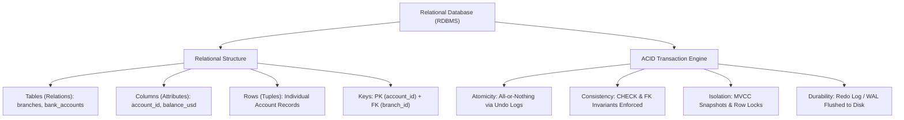

---
tags:
  - sql
  - database-design-intro
  - beginner
---

# Introduction to Database Design in SQL

#### TL;DR (Quick Revision)

**Relational Database (RDBMS)** = Data organized into 2D **Tables** (**Columns** = attributes, **Rows** = records) linked by **Keys** + Protected by **ACID Transactions** so data is never duplicated, corrupted, or half-written.

> [!abstract] Core Idea
> A **Database** is an organized, persistent collection of data, and a **Relational Database Management System (RDBMS)**—invented by E.F. Codd—stores data in structured **tables** (relations) made of **columns** (attributes) and **rows** (tuples/records) ([Tables, Columns, Rows - ApX Machine Learning](https://apxml.com/courses/sql-for-data-science/chapter-1-intro-databases-sql/tables-columns-rows)). Unlike flat spreadsheets or schema-less NoSQL stores, an RDBMS enforces strict schema validation, referential links between tables ([Why Combine Data? - ApX Machine Learning](https://apxml.com/courses/sql-for-data-science/chapter-5-combining-data-multiple-tables/why-combine-data)), and [InnoDB ACID guarantees](https://dev.mysql.com/doc/refman/8.4/en/mysql-acid.html).

> [!question] Why Use It?
>
> - **Zero Data Duplication**: Store each branch or customer once in its own table and link to it via an ID (`branch_id`), avoiding contradictory copies across thousands of rows.
> - **ACID Transactional Safety**: Guarantees that multi-step operations (like debiting Account A and crediting Account B) either complete 100% together or roll back completely ([InnoDB and the ACID Model](https://dev.mysql.com/doc/refman/8.4/en/mysql-acid.html)).
> - **High-Concurrency Multi-User Access**: Uses row-level locking and [InnoDB Multi-Versioning (MVCC)](https://dev.mysql.com/doc/refman/8.4/en/innodb-multi-versioning.html) so thousands of readers and writers can query the database simultaneously without corrupting files.
> - **Declarative Data Integrity**: Rejects invalid data types, negative balances, or orphaned links at the storage engine level before bad data can be saved.

#### Quick Comparison Table

| Database Type / Concept                                   | Structure & Storage Model                                                                                                                                                                                            | ACID & Integrity Support                                                                                                         | Best Production Use Case                                                          |
| :-------------------------------------------------------- | :------------------------------------------------------------------------------------------------------------------------------------------------------------------------------------------------------------------- | :------------------------------------------------------------------------------------------------------------------------------- | :-------------------------------------------------------------------------------- |
| **Relational (RDBMS: MySQL 8.4, SQL Server, PostgreSQL)** | Normalized 2D tables (`rows` and typed `columns`) linked via [Primary and Foreign Keys](https://learn.microsoft.com/en-us/sql/relational-databases/tables/primary-and-foreign-key-constraints?view=sql-server-ver17) | Full **ACID** compliance ([MySQL InnoDB ACID](https://dev.mysql.com/doc/refman/8.4/en/mysql-acid.html)) + strict schema-on-write | Banking, ERP, e-commerce orders, inventory, structured analytics.                 |
| **Document NoSQL (MongoDB, Firestore)**                   | Nested JSON/BSON documents in collections                                                                                                                                                                            | Tunable/eventual consistency (or multi-doc ACID with overhead); schema-on-read                                                   | Content management catalogs, rapidly changing user profile attributes `[VERIFY]`. |
| **Key-Value NoSQL (Redis, DynamoDB)**                     | Hash map (`key -> blob/value`) in RAM or partitioned SSD                                                                                                                                                             | Atomic per-key operations; no cross-table relational joins                                                                       | Session caches, real-time leaderboards, rate limiters `[VERIFY]`.                 |
| **Flat Files / Spreadsheets (CSV, Excel)**                | Single unvalidated grid without foreign keys or concurrency locks                                                                                                                                                    | None (single-writer file lock; prone to silent formula/type corruption)                                                          | Small personal exports or one-off data transfers.                                 |

---

## The Learning Concept

### What Problem Does It Solve?

Imagine tracking bank accounts in a flat CSV file or an unvalidated table without relational links or ACID transactions:

```sql
-- BAD - A flat, unvalidated table where branch details repeat and crashes leave half-transfers
CREATE TABLE flat_accounts_bad (
    account_id INT,
    holder_name VARCHAR(60),
    branch_city VARCHAR(40),
    branch_manager VARCHAR(60),
    balance_usd DECIMAL(12, 2)
);
-- If the server crashes after subtracting $800 from 9001 but before adding $800 to 9002, $800 vanishes!
```

Storing `branch_city` and `branch_manager` on every account row wastes disk space and causes inconsistencies when a branch manager changes. Worse, running two separate updates without an atomic transaction risks losing money during a power failure. Here is how a relational database solves both problems:

```sql
-- GOOD - Split into related tables (branches + bank_accounts) and wrap transfers in an ACID transaction
START TRANSACTION;

UPDATE bank_accounts SET balance_usd = balance_usd - 800.00 WHERE account_id = 9001;
UPDATE bank_accounts SET balance_usd = balance_usd + 800.00 WHERE account_id = 9002;

COMMIT; -- Both updates succeed together, or both roll back if any constraint fails!
```

### How SQL Implements It

> [!tip] Four Pillars of the Relational & ACID Model
>
> 1. **Tables (Relations), Columns (Attributes), Rows (Tuples)**: Each table represents one real-world entity type; columns define fixed data types, and each row is a unique instance ([Tables, Columns, Rows](https://apxml.com/courses/sql-for-data-science/chapter-1-intro-databases-sql/tables-columns-rows)).
> 2. **Primary & Foreign Keys**: A `PRIMARY KEY` uniquely identifies each row (`account_id`), while a `FOREIGN KEY` (`branch_id`) links a child row to its parent row ([Primary and Foreign Key Constraints](https://learn.microsoft.com/en-us/sql/relational-databases/tables/primary-and-foreign-key-constraints?view=sql-server-ver17)).
> 3. **ACID Transactions**: **Atomicity** (all or nothing), **Consistency** (constraints always satisfied), **Isolation** (concurrent transactions do not interfere), and **Durability** (committed changes survive crashes via redo/write-ahead logs) ([InnoDB and the ACID Model](https://dev.mysql.com/doc/refman/8.4/en/mysql-acid.html)).

#### Full Runnable Example

```sql
-- Step 1: Create parent 'branches' table and child 'bank_accounts' table with CHECK & FK constraints
CREATE TABLE branches (
    branch_id INT PRIMARY KEY,
    branch_city VARCHAR(40) NOT NULL UNIQUE
);

CREATE TABLE bank_accounts (
    account_id INT PRIMARY KEY,
    holder_name VARCHAR(60) NOT NULL,
    branch_id INT NOT NULL,
    balance_usd DECIMAL(12, 2) NOT NULL CHECK (balance_usd >= 0.00),
    FOREIGN KEY (branch_id) REFERENCES branches(branch_id)
);

-- Step 2: Insert branches and initial bank accounts
INSERT INTO branches VALUES
(1, 'Chennai'),
(2, 'Bengaluru');

INSERT INTO bank_accounts VALUES
(9001, 'Aarav Sharma', 1, 5000.00),
(9002, 'Meera Nair', 1, 3200.00),
(9003, 'Rohan Verma', 2, 7400.00);

-- Step 3: Execute an atomic $800.00 transfer from Account 9001 to Account 9002 and verify balances
UPDATE bank_accounts SET balance_usd = balance_usd - 800.00 WHERE account_id = 9001;
UPDATE bank_accounts SET balance_usd = balance_usd + 800.00 WHERE account_id = 9002;

SELECT
    a.account_id,
    a.holder_name,
    b.branch_city,
    a.balance_usd
FROM bank_accounts AS a
INNER JOIN branches AS b
    ON a.branch_id = b.branch_id
ORDER BY a.account_id ASC;
```

**Output:**

```
+--------------+---------------+---------------+---------------+
| account_id   | holder_name   | branch_city   | balance_usd   |
|--------------+---------------+---------------+---------------|
| 9001         | Aarav Sharma  | Chennai       | 4200          |
| 9002         | Meera Nair    | Chennai       | 4000          |
| 9003         | Rohan Verma   | Bengaluru     | 7400          |
+--------------+---------------+---------------+---------------+
```

### Visual Diagram: RDBMS Anatomy & ACID Guarantees



### Key Terminology

1. **Relation (Table)**: A two-dimensional structure composed of a fixed set of named, typed columns and a variable set of unordered rows ([Tables, Columns, Rows](https://apxml.com/courses/sql-for-data-science/chapter-1-intro-databases-sql/tables-columns-rows)).
   Syntax: `CREATE TABLE branches (branch_id INT PRIMARY KEY, branch_city VARCHAR(40));`
2. **Tuple (Row / Record)**: A single horizontal entry in a table representing one specific entity instance (e.g., Account `9001` belonging to `'Aarav Sharma'`).
   Syntax: `INSERT INTO branches VALUES (1, 'Chennai');`
3. **Attribute (Column / Field)**: A vertical slot in a table with a strict data type and domain rule (e.g., `balance_usd DECIMAL(12, 2)`).
   Syntax: `balance_usd DECIMAL(12, 2) NOT NULL`
4. **MVCC (Multi-Version Concurrency Control)**: The mechanism used by [MySQL InnoDB](https://dev.mysql.com/doc/refman/8.4/en/innodb-multi-versioning.html) and SQL Server (under `READ_COMMITTED_SNAPSHOT`) to keep historical row versions in an undo log so `SELECT` queries read a consistent point-in-time snapshot without blocking concurrent `UPDATE` statements.
   Syntax: `START TRANSACTION; SELECT * FROM bank_accounts; COMMIT;`

> [!important] Key Rules to Remember
>
> - **Rows Are Unordered Sets** → A relational table has no guaranteed row order unless your `SELECT` query explicitly includes an `ORDER BY` clause ([ORDER BY Clause T-SQL](https://learn.microsoft.com/en-us/sql/t-sql/queries/select-order-by-clause-transact-sql?view=sql-server-ver17)).
> - **Default Storage Engine in MySQL 8.4** → Always use `ENGINE=InnoDB` (the default in MySQL 8.4) because legacy engines like `MyISAM` do **not** support ACID transactions or foreign keys ([InnoDB and the ACID Model](https://dev.mysql.com/doc/refman/8.4/en/mysql-acid.html)).
> - **Autocommit Mode** → Both MySQL and SQL Server default to committing each standalone DML statement automatically unless you start an explicit transaction (`START TRANSACTION` in MySQL; `BEGIN TRANSACTION` in T-SQL).
> - **Schema vs. Database Dialect Rule** → In **MySQL 8.4**, `CREATE SCHEMA` is an exact synonym for `CREATE DATABASE`. In **SQL Server (T-SQL)**, a `DATABASE` is the physical container, while a `SCHEMA` (such as `dbo` or `sales`) is a logical namespace _inside_ a database (`sales.bank_accounts`) `[VERIFY]`.

---

## Edge Case Analysis

### 1. Overdraft Violation Triggering Automatic Transaction Rollback

**Problem:** What happens during a transfer if Account `9001` only has `$500.00`, and a transaction tries to subtract `$800.00` when `CHECK (balance_usd >= 0.00)` is defined?
**Fix:** The `CHECK` constraint aborts the `UPDATE` immediately, and rolling back the transaction guarantees Account `9002` never receives phantom money.

```sql
-- If the first UPDATE violates CHECK (balance_usd >= 0.00), ROLLBACK restores the entire transaction
START TRANSACTION;
UPDATE bank_accounts SET balance_usd = balance_usd - 800.00 WHERE account_id = 9001;
-- Constraint violation occurs if balance_usd < 0; issue ROLLBACK:
ROLLBACK;
```

### 2. Legacy MySQL `MyISAM` Engine Silently Ignoring Transactions & Foreign Keys

**Problem:** If a legacy script specifies `CREATE TABLE accounts (...) ENGINE=MyISAM;`, MySQL parses `FOREIGN KEY` and `ROLLBACK` without syntax errors, but **silently ignores them**—leaving partial writes on disk!
**Fix:** Verify your tables use `ENGINE=InnoDB` via `SHOW TABLE STATUS` ([SHOW TABLE STATUS Statement](https://dev.mysql.com/doc/refman/8.4/en/show-table-status.html)).

```sql
-- Explicitly ensure InnoDB in MySQL 8.4+
CREATE TABLE audit_entries (
    entry_id INT PRIMARY KEY,
    account_id INT NOT NULL
) ENGINE=InnoDB;
```

### 3. `DATABASE` vs. `SCHEMA` Naming Across MySQL and SQL Server

**Problem:** Running `SELECT * FROM finance_db.dbo.bank_accounts;` works in SQL Server (3-part naming: `database.schema.table`), but fails in MySQL because MySQL treats `schema` and `database` as the exact same level (2-part naming: `database.table`).
**Fix:** Use 2-part naming (`schema_name.table_name`) or set the default database context before running queries.

```sql
-- Works cleanly once the database/schema context is active
SELECT account_id, balance_usd FROM bank_accounts;
```

---

## Going Deeper (Intermediate -> Advanced)

### 1. How MySQL 8.4 InnoDB & SQL Server Implement ACID Internally

| ACID Property   | MySQL 8.4 InnoDB Mechanism ([MySQL ACID Docs](https://dev.mysql.com/doc/refman/8.4/en/mysql-acid.html))                                                   | SQL Server (T-SQL) Mechanism                                                                                              |
| :-------------- | :-------------------------------------------------------------------------------------------------------------------------------------------------------- | :------------------------------------------------------------------------------------------------------------------------ |
| **Atomicity**   | Undo log records stored in rollback segments (`DB_ROLL_PTR` pointer per row) revert uncommitted changes on `ROLLBACK`.                                    | Write-Ahead Transaction Log (`.ldf`) undo phase rolls back uncommitted transactions.                                      |
| **Consistency** | `PRIMARY KEY`, `FOREIGN KEY`, `UNIQUE`, `CHECK` constraints + **InnoDB Doublewrite Buffer** (prevents torn 16KB pages).                                   | Constraint validation + 8KB page checksums before committing.                                                             |
| **Isolation**   | Default **`REPEATABLE READ`** using [MVCC consistent snapshots](https://dev.mysql.com/doc/refman/8.4/en/innodb-multi-versioning.html) and Next-Key Locks. | Default **`READ COMMITTED`** (uses shared locks on-prem, or row versioning when `READ_COMMITTED_SNAPSHOT ON` is enabled). |
| **Durability**  | Redo log (`ib_logfile` / `#innodb_redo`) flushed on commit when `innodb_flush_log_at_trx_commit = 1`.                                                     | Write-Ahead Logging (WAL) hardens log records to disk before acknowledging `COMMIT TRANSACTION`.                          |

---

## Interview Corner

### Common Questions & Concise Answers

**Q1: What are the main benefits of a Relational Database (RDBMS) over a NoSQL document or key-value store?**  
A: An RDBMS provides normalized storage (eliminating update anomalies), declarative cross-table `JOIN` operations, strict schema-on-write type validation, referential integrity via `FOREIGN KEY` constraints, and full multi-table **ACID** transaction safety.

**Q2: Explain each letter of ACID using a bank transfer example.**  
A: **Atomicity** ensures neither account changes unless both debit and credit succeed; **Consistency** ensures `CHECK (balance_usd >= 0)` is never violated; **Isolation** prevents another user from seeing an intermediate total mid-transfer; **Durability** guarantees that once `COMMIT` returns, the transfer survives a power outage.

**Q3: What is the difference between a `SCHEMA` and a `DATABASE` in MySQL 8.4 vs. Microsoft SQL Server?**  
A: In MySQL 8.4, `SCHEMA` and `DATABASE` are 100% synonymous (`CREATE SCHEMA` = `CREATE DATABASE`). In SQL Server, a `DATABASE` is the physical storage container, while a `SCHEMA` (like `dbo`, `hr`, `sales`) is a security and naming container _inside_ a database.

**Q4: How does InnoDB Multi-Versioning (MVCC) allow `SELECT` queries to run without waiting for `UPDATE` locks?**  
A: According to [MySQL 8.4 InnoDB Multi-Versioning](https://dev.mysql.com/doc/refman/8.4/en/innodb-multi-versioning.html), every InnoDB row has a hidden 6-byte `DB_TRX_ID` and 7-byte `DB_ROLL_PTR`. When a row is being updated by another transaction, a standard `SELECT` follows `DB_ROLL_PTR` into the undo log to reconstruct the committed version of the row as of the snapshot's start time.

**Q5: What is the default transaction isolation level in MySQL InnoDB vs. SQL Server?**  
A: MySQL InnoDB defaults to **`REPEATABLE READ`**, whereas Microsoft SQL Server defaults to **`READ COMMITTED`**.

### Interactive Revision Quiz

**Q1: In relational database terminology, what do the formal terms _Relation_, _Tuple_, and _Attribute_ correspond to?**

- [ ] A) Database, Table, Index
- [ ] B) Table, Row, Column
- [ ] C) Column, Row, Foreign Key
- [ ] D) Schema, View, Trigger

**Q2: Which ACID property guarantees that once a transaction is committed, its changes remain saved even if the server loses power 1 millisecond later?**

- [ ] A) Atomicity
- [ ] B) Consistency
- [ ] C) Isolation
- [ ] D) Durability

**Q3: According to the MySQL 8.4 documentation, what is the purpose of the InnoDB Doublewrite Buffer?**

- [ ] A) To speed up `SELECT` queries by caching tables twice in RAM
- [ ] B) To prevent data corruption from partially written ("torn") pages during an operating system or power crash
- [ ] C) To replicate data automatically to a secondary server
- [ ] D) To allow two users to edit the exact same column simultaneously without locks

**Q4: How do `SCHEMA` and `DATABASE` differ between MySQL 8.4 and SQL Server (T-SQL)?**

- [ ] A) They are identical in both MySQL and SQL Server
- [ ] B) In MySQL `SCHEMA` is a synonym for `DATABASE`, whereas in SQL Server a `SCHEMA` is a namespace inside a `DATABASE`
- [ ] C) MySQL does not support the `SCHEMA` keyword at all
- [ ] D) SQL Server does not support multiple schemas inside a database

**Q5: What hidden columns does MySQL InnoDB store inside every row to support MVCC and clustering?**

- [ ] A) `ROW_GUID`, `CREATED_AT`, and `UPDATED_AT`
- [ ] B) `DB_TRX_ID` (6B), `DB_ROLL_PTR` (7B), and `DB_ROW_ID` (6B)
- [ ] C) `MVCC_VERSION` and `LOCK_STATUS`
- [ ] D) `SYS_CHANGE_VERSION` and `ROWVERSION`

<details>
<summary>Show Quiz Answers & Explanations</summary>

1. **B** — E.F. Codd's formal relational terms map directly to **Relation = Table**, **Tuple = Row**, and **Attribute = Column**.
2. **D** — **Durability** ensures committed transactions are persisted to non-volatile redo/write-ahead logs on disk.
3. **B** — Before writing pages to their final data file location, InnoDB writes them contiguously to the **Doublewrite Buffer** so recovery can restore any torn page ([InnoDB and the ACID Model](https://dev.mysql.com/doc/refman/8.4/en/mysql-acid.html)).
4. **B** — In MySQL `CREATE SCHEMA` and `CREATE DATABASE` are synonyms; in SQL Server `database.schema.table` has a distinct schema namespace layer.
5. **B** — InnoDB stores a 6-byte `DB_TRX_ID`, a 7-byte `DB_ROLL_PTR` (pointing to the undo log), and a 6-byte `DB_ROW_ID` ([InnoDB Multi-Versioning](https://dev.mysql.com/doc/refman/8.4/en/innodb-multi-versioning.html)).

</details>

---

## Practice Exercises

**Exercise 1: Map Real-World Concepts to Relational Terms**

- For a university course registration system, identify 2 **Tables (Relations)**, 3 **Columns (Attributes)** for each table, and 2 example **Rows (Tuples)**.

**Exercise 2: Trace an ACID Failure**

- Write a 2-statement SQL transaction transferring 5 units of inventory from `warehouse_id = 1` to `warehouse_id = 2`. Explain which ACID property protects you if `warehouse_id = 2` does not exist.

**Exercise 3: Dialect Bridge (3-Part vs. 2-Part Object Naming)**

- Rewrite the SQL Server query `SELECT account_id, holder_name FROM retail_bank.dbo.bank_accounts;` so it runs cleanly in MySQL 8.4 (`retail_bank.bank_accounts`).

---

## Memory Trick / One-Liner

> [!tip] Vault Safe Analogy
> Think of an RDBMS as a **Swiss Bank Vault**: **Tables** are labeled safety deposit boxes, **Keys** are the numbered brass keys linking owners to boxes, and **ACID** is the airlock door—**either both sides of a trade walk out completed, or nobody leaves the room!**

---

## Warning Block (Best Practice)

> [!warning] Common Mistake (Avoid This!)
>
> ```sql
> -- BAD - Running multi-step financial updates in autocommit mode without a transaction block
> UPDATE bank_accounts SET balance_usd = balance_usd - 500.00 WHERE account_id = 9001;
> -- If the connection drops right here, $500.00 is lost forever!
> UPDATE bank_accounts SET balance_usd = balance_usd + 500.00 WHERE account_id = 9002;
> ```
>
> ```sql
> -- GOOD - Wrapping multi-step mutations in an explicit ACID transaction
> START TRANSACTION;
> UPDATE bank_accounts SET balance_usd = balance_usd - 500.00 WHERE account_id = 9001;
> UPDATE bank_accounts SET balance_usd = balance_usd + 500.00 WHERE account_id = 9002;
> COMMIT;
> ```
