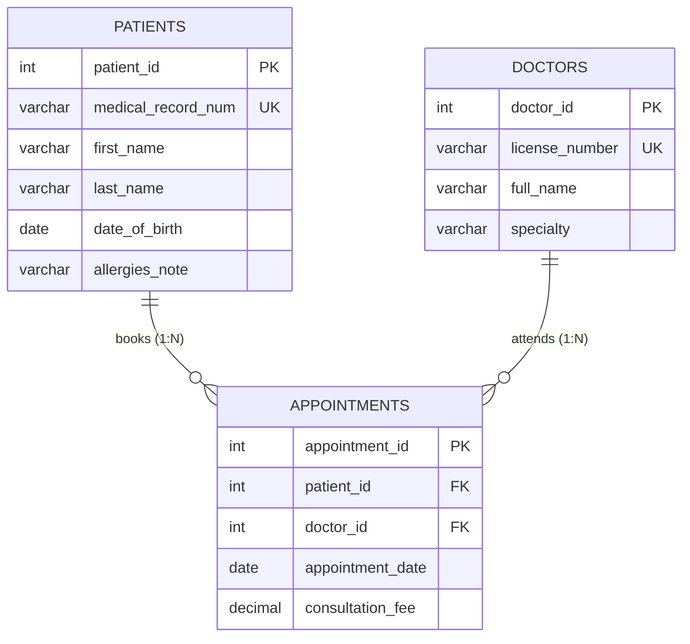

---
tags:
  - sql
  - data-modelling-process
  - beginner
---

# Data Modelling Process in SQL

#### TL;DR (Quick Revision)

**Data Modelling Process** = Translating real-world business requirements into **Conceptual** (Entities), **Logical** (Attributes & Keys), and **Physical** (`CREATE TABLE` DDL) blueprints before writing a single line of application code.

> [!abstract] Core Idea
> **Data Modelling** is the structured engineering process of analyzing how an organization operates and turning those rules into a clean relational database blueprint. Following your syllabus workflow—**Determine the Goal of the Database -> Consider the Current System -> Gather Requirements -> Identify Entities -> Define Attributes**—ensures every real-world noun becomes a well-defined **Entity** (table) and every property becomes an atomic, typed **Attribute** (column) ([Tables, Columns, Rows - ApX Machine Learning](https://apxml.com/courses/sql-for-data-science/chapter-1-intro-databases-sql/tables-columns-rows)).

> [!question] Why Use It?
>
> - **Prevents Costly Schema Rewrites**: Fixing a missing entity or relationship on a whiteboard ERD takes 30 seconds; fixing it after 50 million production rows exist requires risky data migrations.
> - **Aligns Business Stakeholders & Engineers**: Conceptual and Logical diagrams let domain experts verify business rules ("Can one patient see multiple doctors?") without reading raw SQL code.
> - **Separates Atomic Attributes from Derived Data**: Identifies why `first_name`, `last_name`, and `date_of_birth` should be stored as atomic attributes rather than storing a constantly changing `current_age` integer.
> - **Establishes Clear Natural & Surrogate Identifiers**: Distinguishes business identifiers (`medical_record_num`, `license_number`) from compact internal surrogate primary keys (`patient_id`, `doctor_id`).

#### Quick Comparison Table

| Modelling Stage / Syllabus Step | Primary Focus & Deliverable | Audience | SQL / Database Equivalent |
| :--- | :--- | :--- | :--- |
| **1. Determine Goal & Consider Current System** | Audit existing spreadsheets/legacy paper forms; define scope (OLTP clinic booking vs. OLAP reporting) | Product Owners & Architects | Scope document & pain-point inventory |
| **2. Gather Requirements & Identify Entities** | **Conceptual Data Model**: High-level nouns (`Patient`, `Doctor`, `Appointment`) and relationships | Business Stakeholders & Analysts | High-level Entity-Relationship Diagram (ERD) |
| **3. Define the Attributes (Logical Model)** | **Logical Data Model**: Specify atomic attributes, candidate keys, foreign keys, and nullability (vendor-agnostic) | Data Architects & Developers | Normalized schema blueprint (`1NF`–`3NF`) |
| **4. Physical Schema Implementation** | **Physical Data Model**: Engine-specific types, collations, indexes, and partitions ([CREATE TABLE MySQL](https://dev.mysql.com/doc/refman/8.4/en/create-table.html) / [CREATE TABLE T-SQL](https://learn.microsoft.com/en-us/sql/t-sql/statements/create-table-transact-sql?view=sql-server-ver17)) | DBAs & Backend Engineers | Executable `.sql` DDL script with B-Tree indexes |

---

## The Learning Concept

### What Problem Does It Solve?

Imagine jumping straight into `CREATE TABLE` for a hospital clinic without following the 5-step data modelling process:

```sql
-- BAD - Skipping entity identification and stuffing composite/derived attributes into one table
CREATE TABLE clinic_log_bad (
    log_id INT PRIMARY KEY,
    patient_info VARCHAR(200),  -- Composite attribute: "Karthik Subramanian, Age 28, DOB 1998-04-12"
    patient_age INT,            -- Derived attribute: becomes wrong on the patient's next birthday!
    doctor_and_dept VARCHAR(100) -- Mixes two separate entities (Doctor + Specialty) in one string!
);
```

Because `patient_info` packs name, age, and date of birth into a single string, you cannot sort patients by `last_name` or filter by `date_of_birth` without slow string parsing, and `patient_age` silently becomes inaccurate every year. By applying the **Data Modelling Process**, we separate the entities and define atomic attributes:

```sql
-- GOOD - Distinct entities (patients, doctors, appointments) with atomic, non-derived attributes
CREATE TABLE patients (
    patient_id INT PRIMARY KEY,
    medical_record_num VARCHAR(15) NOT NULL UNIQUE,
    first_name VARCHAR(30) NOT NULL,
    last_name VARCHAR(30) NOT NULL,
    date_of_birth DATE NOT NULL
);
```

### How SQL Implements It

> [!tip] The 5 Syllabus Steps of the Data Modelling Process
>
> 1. **Determine the Goal of the Database**: Define the exact purpose (e.g., "Track clinic appointments, patient allergies, and doctor consultation fees with zero double-bookings").
> 2. **Consider the Current System**: Inspect existing paper forms, Excel sheets, or legacy tables to find missing fields and pain points.
> 3. **Gather Requirements**: Interview users to capture business rules (e.g., "Every patient has a unique Medical Record Number, but allergies may be unknown/`NULL`").
> 4. **Identify Entities**: Extract distinct real-world nouns that have independent lifecycles (`patients`, `doctors`, `appointments`).
> 5. **Define the Attributes**: Assign atomic columns, data domains (`DATE`, `DECIMAL(8,2)`), `PRIMARY KEY`s, and `FOREIGN KEY` links to each entity.

#### Full Runnable Example

```sql
-- Step 1: Physical DDL translated from our Logical Data Model (3 Entities: patients, doctors, appointments)
CREATE TABLE patients (
    patient_id INT PRIMARY KEY,
    medical_record_num VARCHAR(15) NOT NULL UNIQUE,
    first_name VARCHAR(30) NOT NULL,
    last_name VARCHAR(30) NOT NULL,
    date_of_birth DATE NOT NULL,
    allergies_note VARCHAR(100)
);

CREATE TABLE doctors (
    doctor_id INT PRIMARY KEY,
    license_number VARCHAR(20) NOT NULL UNIQUE,
    full_name VARCHAR(60) NOT NULL,
    specialty VARCHAR(40) NOT NULL
);

CREATE TABLE appointments (
    appointment_id INT PRIMARY KEY,
    patient_id INT NOT NULL,
    doctor_id INT NOT NULL,
    appointment_date DATE NOT NULL,
    consultation_fee DECIMAL(8, 2) NOT NULL CHECK (consultation_fee >= 0.00),
    FOREIGN KEY (patient_id) REFERENCES patients(patient_id),
    FOREIGN KEY (doctor_id) REFERENCES doctors(doctor_id)
);

-- Step 2: Populate entities (including NULL for optional allergies_note)
INSERT INTO patients VALUES
(1, 'MRN-1001', 'Karthik', 'Subramanian', '1998-04-12', 'Penicillin'),
(2, 'MRN-1002', 'Divya', 'Krishnan', '2001-09-25', NULL),
(3, 'MRN-1003', 'Neha', 'Verma', '1992-12-03', 'Peanuts');

INSERT INTO doctors VALUES
(10, 'LIC-TN-8821', 'Dr. R. Narayanan', 'Cardiology'),
(20, 'LIC-TN-4410', 'Dr. S. Padma', 'Dermatology');

INSERT INTO appointments VALUES
(5001, 1, 10, '2026-11-10', 80.00),
(5002, 2, 20, '2026-11-11', 60.00),
(5003, 1, 20, '2026-11-14', 60.00);

-- Step 3: Query the modelled entities to produce a complete appointment schedule
SELECT
    a.appointment_id,
    p.medical_record_num,
    p.first_name || ' ' || p.last_name AS patient_name,
    COALESCE(p.allergies_note, 'None Recorded') AS allergies,
    d.full_name AS doctor_name,
    d.specialty,
    a.appointment_date,
    a.consultation_fee
FROM appointments AS a
INNER JOIN patients AS p
    ON a.patient_id = p.patient_id
INNER JOIN doctors AS d
    ON a.doctor_id = d.doctor_id
ORDER BY a.appointment_id ASC;
```

**Output:**

```
+------------------+----------------------+---------------------+---------------+------------------+-------------+--------------------+--------------------+
| appointment_id   | medical_record_num   | patient_name        | allergies     | doctor_name      | specialty   | appointment_date   | consultation_fee   |
|------------------+----------------------+---------------------+---------------+------------------+-------------+--------------------+--------------------|
| 5001             | MRN-1001             | Karthik Subramanian | Penicillin    | Dr. R. Narayanan | Cardiology  | 2026-11-10         | 80                 |
| 5002             | MRN-1002             | Divya Krishnan      | None Recorded | Dr. S. Padma     | Dermatology | 2026-11-11         | 60                 |
| 5003             | MRN-1001             | Karthik Subramanian | Penicillin    | Dr. S. Padma     | Dermatology | 2026-11-14         | 60                 |
+------------------+----------------------+---------------------+---------------+------------------+-------------+--------------------+--------------------+
```

### Visual Diagram: Data Modelling Pipeline & ERD



### Key Terminology

1. **Entity**: A distinct real-world person, place, object, or event (`patients`, `doctors`, `appointments`) represented as a **Table** in the physical database.
   Syntax: `CREATE TABLE patients (...);`
2. **Simple (Atomic) vs. Composite Attribute**: A **composite attribute** (like `full_address` containing street, city, and PIN code) can be subdivided into smaller meaningful parts; in relational modelling, decompose composite attributes into **simple atomic columns** (`street_line`, `city_name`, `postal_code`) if you ever need to filter or sort by those parts.
   Syntax: `first_name VARCHAR(30) NOT NULL, last_name VARCHAR(30) NOT NULL`
3. **Derived Attribute**: An attribute whose value can be calculated at any time from other stored attributes (such as calculating `age` from `date_of_birth` or `order_total` from `quantity * unit_price`). Store the base attribute (`date_of_birth`), or use a **Generated / Computed Column**!
   Syntax: `line_total DECIMAL(10,2) GENERATED ALWAYS AS (qty * price) VIRTUAL` (MySQL 8.4)
4. **Natural Key vs. Surrogate Key**: A **Natural Key** is a real-world business identifier (`medical_record_num`, `license_number`), whereas a **Surrogate Key** is an internal system-generated integer (`patient_id INT AUTO_INCREMENT` / `IDENTITY(1,1)`) used as the `PRIMARY KEY` ([Primary and Foreign Key Constraints](https://learn.microsoft.com/en-us/sql/relational-databases/tables/primary-and-foreign-key-constraints?view=sql-server-ver17)).
   Syntax: `patient_id INT PRIMARY KEY, medical_record_num VARCHAR(15) NOT NULL UNIQUE`

> [!important] Key Rules to Remember
>
> - **Nouns Become Entities, Verbs Become Relationships** → In requirement interviews, nouns ("Patient", "Doctor") map to tables, descriptive properties ("Date of Birth", "Specialty") map to columns, and verbs ("books", "treats") map to relationships/foreign keys.
> - **Never Lose the Natural Key When Adding a Surrogate Key** → If you use `patient_id INT` as the surrogate `PRIMARY KEY`, always place a `NOT NULL UNIQUE` constraint on the natural key (`medical_record_num`) so duplicate patients cannot be inserted!
> - **Avoid Stored Derived Columns in OLTP** → Never store a static `age` column that goes stale tomorrow; store `date_of_birth` and compute age dynamically in queries or via a virtual computed column.
> - **Distinguish Unknown (`NULL`) from Empty (`''`)** → During attribute definition, mark required attributes `NOT NULL` and reserve `NULL` strictly for optional/unknown attributes (`allergies_note`).

---

## Edge Case Analysis

### 1. Storing Derived Attributes (`age`) vs. Computing from `date_of_birth`
**Problem:** If a table stores `patient_age INT`, that number becomes wrong on the patient's birthday unless a nightly batch job updates every row.
**Fix:** Store `date_of_birth DATE NOT NULL` and compute age dynamically (`TIMESTAMPDIFF(YEAR, date_of_birth, CURDATE())` in MySQL 8.4; `DATEDIFF(YEAR, date_of_birth, GETDATE())` in T-SQL).

```sql
-- In MySQL 8.4: Dynamically compute exact age in years from date_of_birth
SELECT
    patient_id,
    first_name,
    date_of_birth,
    TIMESTAMPDIFF(YEAR, date_of_birth, CURDATE()) AS current_age_years
FROM patients;
```

### 2. Multi-Valued Attributes (`phone_numbers = '9840011111, 9840022222'`)
**Problem:** During attribute definition, a stakeholder states: "A patient can have multiple emergency phone numbers." Packing multiple phone numbers into one `VARCHAR` column makes searching or indexing individual numbers impossible.
**Fix:** Promote multi-valued attributes into a separate child table (`patient_phones(patient_id, phone_number)`).

```sql
-- Dedicated child table for multi-valued attributes
CREATE TABLE patient_phones (
    patient_id INT NOT NULL,
    phone_number VARCHAR(15) NOT NULL,
    phone_type VARCHAR(15) NOT NULL DEFAULT 'MOBILE',
    PRIMARY KEY (patient_id, phone_number),
    FOREIGN KEY (patient_id) REFERENCES patients(patient_id)
);
```

### 3. Virtual vs. Stored Generated/Computed Columns (MySQL 8.4 vs. SQL Server T-SQL)
**Problem:** What if you want a derived attribute (like `full_name` or `net_amount`) to appear as a table column without risking manual update drift?
**Fix:** Use a **Generated Column** in MySQL 8.4 ([CREATE TABLE Generated Columns](https://dev.mysql.com/doc/refman/8.4/en/create-table-generated-columns.html)) or a **Computed Column** in SQL Server T-SQL.

```sql
-- MySQL 8.4 Generated Column:
CREATE TABLE invoice_lines_mysql (
    line_id INT PRIMARY KEY,
    qty INT NOT NULL,
    unit_price DECIMAL(10, 2) NOT NULL,
    line_total DECIMAL(12, 2) GENERATED ALWAYS AS (qty * unit_price) VIRTUAL
);

-- SQL Server (T-SQL) Computed Column equivalent:
-- CREATE TABLE dbo.invoice_lines_tsql (
--     line_id INT PRIMARY KEY,
--     qty INT NOT NULL,
--     unit_price DECIMAL(10, 2) NOT NULL,
--     line_total AS (qty * unit_price) PERSISTED
-- );
```

---

## Going Deeper (Intermediate -> Advanced)

### 1. Conceptual vs. Logical vs. Physical Data Models

| Characteristic | Conceptual Model | Logical Model | Physical Model |
| :--- | :--- | :--- | :--- |
| **Entity Names** | Business terms (`Patient`, `Doctor`) | Normalized singular/plural names (`patients`, `doctors`) | Exact SQL identifiers (`dbo.patients`) |
| **Attributes** | None or high-level only | Full attributes & keys (`date_of_birth`, `PK`, `FK`) | Exact columns & types (`date_of_birth DATE NOT NULL`) |
| **DBMS Specific?** | No (100% vendor-independent) | No (applies to any RDBMS) | Yes (MySQL 8.4 `InnoDB` / `utf8mb4` vs. SQL Server `T-SQL`) |

### 2. Dialect Bridge: String Concatenation in Queries (`CONCAT` vs. `+` vs. `||`)

Notice in our runnable lab how we combined `first_name` and `last_name`. Here is how string concatenation behaves across dialects:

| Dialect | Syntax | Behavior When One Operand Is `NULL` |
| :--- | :--- | :--- |
| **ANSI SQL / SQLite / PostgreSQL** | `first_name \|\| ' ' \|\| last_name` | Returns `NULL` if either operand is `NULL`. |
| **MySQL 8.4+** | `CONCAT(first_name, ' ', last_name)` or `CONCAT_WS(' ', first_name, last_name)` | `CONCAT()` returns `NULL` if any argument is `NULL`; `CONCAT_WS()` safely skips `NULL` arguments! Note: in MySQL, `\|\|` is logical `OR` unless `PIPES_AS_CONCAT` mode is enabled! |
| **SQL Server (T-SQL)** | `CONCAT(first_name, ' ', last_name)` or `first_name + ' ' + last_name` | `CONCAT()` treats `NULL` as an empty string `''`; `+` returns `NULL` if any operand is `NULL` (when `CONCAT_NULL_YIELDS_NULL ON`). |

---

## Interview Corner

### Common Questions & Concise Answers

**Q1: Walk through the 5 steps of the Data Modelling Process in order.**  
A: (1) **Determine the Goal of the Database** (define scope and business purpose), (2) **Consider the Current System** (audit legacy spreadsheets/workflows), (3) **Gather Requirements** (capture business rules and constraints), (4) **Identify Entities** (extract core nouns/tables), and (5) **Define the Attributes** (assign atomic columns, domains, and keys).

**Q2: What is the difference between a Conceptual, Logical, and Physical Data Model?**  
A: A **Conceptual Model** shows only high-level business entities and their relationships; a **Logical Model** adds all attributes, primary keys, foreign keys, and normalization (`1NF`–`3NF`) independent of any vendor; a **Physical Model** translates the logical design into vendor-specific SQL (`CREATE TABLE`, exact data types like `DATETIME2` vs. `DATETIME(6)`, indexes, and storage engines).

**Q3: Why do database architects usually pair a Surrogate Primary Key (`patient_id INT`) with a `UNIQUE` constraint on the Natural Key (`medical_record_num`)?**  
A: Integer surrogate keys (`4` or `8` bytes) make clustered indexes and foreign key joins compact and immune to business format changes (e.g., if a hospital changes its MRN format from 8 characters to 12 characters). Meanwhile, keeping `UNIQUE NOT NULL` on the natural key prevents duplicate business records.

**Q4: How should you handle a Derived Attribute (such as `total_price = quantity * unit_price`) during data modelling?**  
A: Avoid storing derived attributes as ordinary mutable columns because an `UPDATE` to `quantity` could forget to update `total_price`. Either calculate it in your `SELECT` query, or define it as a database **Generated / Computed Column** (`GENERATED ALWAYS AS (quantity * unit_price)` in MySQL 8.4; `AS (quantity * unit_price)` in T-SQL).

**Q5: Why is `CONCAT(first_name, ' ', middle_name, ' ', last_name)` safer in SQL Server T-SQL than in MySQL 8.4 when `middle_name` is `NULL`?**  
A: In SQL Server T-SQL, `CONCAT()` automatically converts `NULL` arguments into empty strings `''`. In MySQL 8.4, `CONCAT()` returns `NULL` if **any** argument is `NULL`—so in MySQL you should use `CONCAT_WS(' ', first_name, middle_name, last_name)` (Concatenate With Separator), which cleanly skips `NULL` values!

### Interactive Revision Quiz

**Q1: Which of the following is the correct chronological order of the 3 Data Modelling phases?**
- [ ] A) Physical -> Logical -> Conceptual
- [ ] B) Logical -> Conceptual -> Physical
- [ ] C) Conceptual -> Logical -> Physical
- [ ] D) Conceptual -> Physical -> Logical

**Q2: In a hospital database, `date_of_birth` is stored in a column, and `patient_age` can be calculated from `date_of_birth`. What kind of attribute is `patient_age`?**
- [ ] A) A Composite Attribute
- [ ] B) A Derived Attribute
- [ ] C) A Surrogate Key Attribute
- [ ] D) A Multi-Valued Attribute

**Q3: If you use an auto-incrementing surrogate key `doctor_id INT PRIMARY KEY`, what constraint should you place on the real-world `license_number` column?**
- [ ] A) No constraint is needed because `doctor_id` is already unique
- [ ] B) `FOREIGN KEY`
- [ ] C) `NOT NULL UNIQUE`
- [ ] D) `DEFAULT NULL`

**Q4: What does `SELECT CONCAT('Hello', NULL, 'World');` return in MySQL 8.4 vs. `SELECT CONCAT_WS(' ', 'Hello', NULL, 'World');`?**
- [ ] A) Both return `'Hello World'`
- [ ] B) `CONCAT` returns `NULL`; `CONCAT_WS` skips the `NULL` and returns `'Hello World'`
- [ ] C) Both return `NULL`
- [ ] D) `CONCAT` returns `'HelloNULLWorld'`; `CONCAT_WS` throws an error

**Q5: During requirement gathering, you discover that a single product can have 1 to 5 supplier tags. How should this multi-valued attribute be modelled in a relational database?**
- [ ] A) As a single column `tags VARCHAR(500)` containing comma-separated values
- [ ] B) As 5 columns `tag1, tag2, tag3, tag4, tag5` on the `products` table
- [ ] C) As a separate related table `product_tags` linked by `product_id`
- [ ] D) Multi-valued attributes cannot be stored in SQL databases

<details>
<summary>Show Quiz Answers & Explanations</summary>

1. **C** — You start with the business-level **Conceptual** model, refine attributes and keys in the **Logical** model, and implement vendor-specific DDL in the **Physical** model.
2. **B** — Any attribute calculated from another stored attribute (`date_of_birth`) is a **Derived Attribute**.
3. **C** — Always protect natural business identifiers (`license_number`) with `NOT NULL UNIQUE` so two rows cannot represent the same real-world doctor.
4. **B** — In MySQL 8.4, `CONCAT()` returns `NULL` if any argument is `NULL`, whereas `CONCAT_WS()` ignores `NULL` values after the separator argument.
5. **C** — Multi-valued attributes must be placed in a separate child/junction table so each row holds a single atomic value.

</details>

---

## Practice Exercises

**Exercise 1: Identify Entities & Attributes from a Requirement Paragraph**
- Read this requirement: *"Our library needs to track books (ISBN, title, publication year), members (member card number, full name, email), and book loans (loan date, due date, return date)."*
- List the 3 **Entities**, their **Attributes**, and identify both a **Surrogate Key** and a **Natural Key** for `books` and `members`.

**Exercise 2: Decompose Composite & Derived Attributes**
- A legacy spreadsheet has columns `Customer_Full_Name_And_Title`, `Street_City_PinCode`, `Birth_Date`, and `Current_Age`. Redesign these into clean atomic SQL columns for a `customers` table.

**Exercise 3: Write the Physical DDL**
- Write the `CREATE TABLE` statements for the library `books`, `members`, and `book_loans` tables from Exercise 1, ensuring `return_date` allows `NULL` (for books still out on loan).

---

## Memory Trick / One-Liner

> [!tip] Architectural House Blueprint Analogy
> **Conceptual Model** = Pencil sketch of the rooms for the homeowner; **Logical Model** = Exact room dimensions and plumbing layout; **Physical Model** = Pouring the concrete with specific brands of steel and pipes (`MySQL InnoDB` or `SQL Server T-SQL`)!

---

## Warning Block (Best Practice)

> [!warning] Common Mistake (Avoid This!)
>
> ```sql
> -- BAD - Adding an auto-increment surrogate key but forgetting UNIQUE on the business key
> CREATE TABLE doctors (
>     doctor_id INT PRIMARY KEY,
>     license_number VARCHAR(20) NOT NULL, -- BUG: Same doctor license can be inserted 10 times!
>     full_name VARCHAR(60) NOT NULL
> );
> ```
>
> ```sql
> -- GOOD - Pairing a compact surrogate PRIMARY KEY with a NOT NULL UNIQUE natural key
> CREATE TABLE doctors (
>     doctor_id INT PRIMARY KEY,
>     license_number VARCHAR(20) NOT NULL UNIQUE,
>     full_name VARCHAR(60) NOT NULL
> );
> ```
