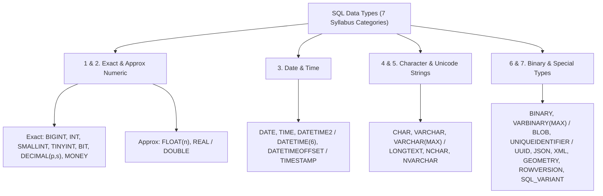

---
tags:
  - sql
  - sql-data-types
  - data-types-and-constraints
---

# SQL Data Types (ANSI, MySQL & T-SQL) in SQL

#### TL;DR (Quick Revision)

**SQL Data Types** = Strict storage contracts on every column (`INT`, `DECIMAL`, `VARCHAR`, `DATETIME2`/`DATETIME(6)`, `JSON`, `UNIQUEIDENTIFIER`/`BINARY(16)`) + Prevents rounding bugs, wasted RAM, and index-killing implicit type conversions.

> [!abstract] Core Idea
> Every column, variable, and expression in SQL has a **Data Type** that dictates how many bytes it consumes on disk, what values are valid, and how the engine compares or converts values during `WHERE`, `JOIN`, and `ORDER BY` execution ([Data Types Transact-SQL](https://learn.microsoft.com/en-us/sql/t-sql/data-types/data-types-transact-sql?view=sql-server-ver17)). Because your syllabus lists **7 categories of ANSI and SQL Server (T-SQL) data types**, this note maps every single one directly to its [MySQL 8.4 equivalent](https://dev.mysql.com/doc/refman/8.4/en/other-vendor-data-types.html).

> [!question] Why Use It?
>
> - **Eliminates Financial Rounding Bugs**: Using fixed-point `DECIMAL(19,4)` instead of binary floating-point `FLOAT`/`REAL` prevents the classic IEEE 754 bug where `0.1 + 0.2 = 0.30000000000000004` ([decimal and numeric Transact-SQL](https://learn.microsoft.com/en-us/sql/t-sql/data-types/decimal-and-numeric-transact-sql?view=sql-server-ver17)).
> - **Protects B-Tree Index Seeks (SARGability)**: Matching column and parameter types prevents implicit `CAST`/`CONVERT` scans caused by [Data Type Precedence](https://learn.microsoft.com/en-us/sql/t-sql/data-types/data-type-precedence-transact-sql?view=sql-server-ver17).
> - **Prevents Dialect Migration Crashes**: Bridges T-SQL-only types (`money`, `smallmoney`, `datetime2`, `smalldatetime`, `datetimeoffset`, `nvarchar(max)`, `uniqueidentifier`, `rowversion`, `hierarchyid`, `sql_variant`, `cursor`, `table`) to native MySQL 8.4 types.
> - **Packs More Rows into RAM**: Choosing `SMALLINT` (2 bytes) or `INT` (4 bytes) instead of oversized strings keeps clustered indexes compact in memory.

#### Quick Comparison Table

| Syllabus Category & Sub-Topics | ANSI SQL / SQL Server (T-SQL) | MySQL 8.4+ Equivalent | Key Behavior & Byte Size |
| :--- | :--- | :--- | :--- |
| **1. Exact Numeric** (`bigint`, `int`, `smallint`, `tinyint`, `bit`, `decimal`, `numeric`, `money`, `smallmoney`) | `BIGINT` (8B), `INT` (4B), `SMALLINT` (2B), `TINYINT` (1B, **unsigned `0..255`**!) ([int, bigint, smallint, tinyint](https://learn.microsoft.com/en-us/sql/t-sql/data-types/int-bigint-smallint-and-tinyint-transact-sql?view=sql-server-ver17)), `BIT`, `DECIMAL(p,s)` / `NUMERIC(p,s)`, [MONEY (8B) & SMALLMONEY (4B)](https://learn.microsoft.com/en-us/sql/t-sql/data-types/money-and-smallmoney-transact-sql?view=sql-server-ver17) | `BIGINT` (8B), `INT` (4B), `MEDIUMINT` (3B), `SMALLINT` (2B), `TINYINT` (1B, **signed `-128..127`** default; use `TINYINT UNSIGNED` for `0..255`), `BIT(1)` / `BOOLEAN`, `DECIMAL(p,s)` (use `DECIMAL(19,4)` for `MONEY`) | Prefer `DECIMAL(p,s)` over T-SQL `MONEY` because `MONEY` truncates intermediate division at 4 decimal places! |
| **2. Approximate Numeric** (`float(n)`, `real`) | `FLOAT(n)` (`n=1..24` is 4B `REAL`; `n=25..53` is 8B `FLOAT`), `REAL` (4B) | `FLOAT` (4B single-precision), `DOUBLE` / `REAL` (8B double-precision) | Base-2 IEEE 754 floating-point; fast for scientific sensors, **never** use for currency or exact `=` checks. |
| **3. Date & Time** (`datetime`, `smalldatetime`, `date`, `time`, `datetimeoffset`, `datetime2`) | `DATE` (3B), `TIME(0..7)`, [DATETIME2(0..7)](https://learn.microsoft.com/en-us/sql/t-sql/data-types/datetime2-transact-sql?view=sql-server-ver17) (100ns precision), [DATETIMEOFFSET(0..7)](https://learn.microsoft.com/en-us/sql/t-sql/data-types/datetimeoffset-transact-sql?view=sql-server-ver17), legacy `DATETIME` (3.33ms rounding!) & [SMALLDATETIME](https://learn.microsoft.com/en-us/sql/t-sql/data-types/smalldatetime-transact-sql?view=sql-server-ver17) (1-min rounding) | `DATE` (3B), `TIME(0..6)`, `DATETIME(0..6)` (`1000`–`9999`, microseconds), `TIMESTAMP(0..6)` (UTC epoch `1970`–`2038-01-19`), `YEAR` ([Date and Time Syntax](https://dev.mysql.com/doc/refman/8.4/en/date-and-time-type-syntax.html)) | Use `DATETIME2` in T-SQL and `DATETIME(6)` in MySQL 8.4. MySQL `TIMESTAMP` converts to UTC; T-SQL `TIMESTAMP` is **not** a date! |
| **4. Character Strings** (`char`, `varchar`, `varchar(max)`, `text`) | `CHAR(n)` (fixed `1..8000`B), `VARCHAR(n)` (variable `1..8000`B), `VARCHAR(MAX)` (up to 2GB), deprecated `TEXT` ([char and varchar](https://learn.microsoft.com/en-us/sql/t-sql/data-types/char-and-varchar-transact-sql?view=sql-server-ver17)) | `CHAR(0..255)`, `VARCHAR(n)` (up to 65,535B row limit), `TINYTEXT`, `TEXT` (64KB), `MEDIUMTEXT` (16MB), `LONGTEXT` (4GB) | T-SQL `VARCHAR(MAX)` maps to MySQL `LONGTEXT`. Never use deprecated T-SQL `TEXT` in new tables! |
| **5. Unicode Character Strings** (`nchar`, `nvarchar`, `ntext`) | `NCHAR(1..4000)`, `NVARCHAR(1..4000)`, `NVARCHAR(MAX)` (2GB UTF-16), deprecated `NTEXT` | Standard `CHAR(n)`, `VARCHAR(n)`, `LONGTEXT` with default `CHARACTER SET utf8mb4` | In MySQL 8.4, `utf8mb4` is default on all `VARCHAR` columns. In T-SQL, prefix Unicode string literals with `N'...'`. |
| **6. Binary Strings** (`binary`, `varbinary`, `image`) | `BINARY(1..8000)`, `VARBINARY(1..8000)`, `VARBINARY(MAX)` (2GB), deprecated `IMAGE` ([String and Binary Types](https://learn.microsoft.com/en-us/sql/t-sql/data-types/string-and-binary-types?view=sql-server-ver17)) | `BINARY(0..255)`, `VARBINARY(n)`, `TINYBLOB`, `BLOB` (64KB), `MEDIUMBLOB` (16MB), `LONGBLOB` (4GB) | `BINARY(n)` pads trailing bytes with `0x00`! T-SQL `VARBINARY(MAX)` replaces legacy `IMAGE`. |
| **7. Other Syllabus Types** (`cursor`, `rowversion`, `hierarchyid`, `uniqueidentifier`, `sql_variant`, `XML`, Spatial `Geometry`, Spatial `Geography`, `table`) | `CURSOR`, [ROWVERSION](https://learn.microsoft.com/en-us/sql/t-sql/data-types/rowversion-transact-sql?view=sql-server-ver17) (8B binary counter), `HIERARCHYID`, `UNIQUEIDENTIFIER` (16B GUID), [SQL_VARIANT](https://learn.microsoft.com/en-us/sql/t-sql/data-types/sql-variant-transact-sql?view=sql-server-ver17), `XML`, `GEOMETRY` & `GEOGRAPHY`, [TABLE](https://learn.microsoft.com/en-us/sql/t-sql/data-types/table-transact-sql?view=sql-server-ver17) (`DECLARE @t TABLE`) | `DECLARE cur CURSOR`, `BIGINT` version counter, path `VARCHAR` + recursive CTE, `BINARY(16)` with `UUID_TO_BIN(UUID(), 1)` (or `CHAR(36)`), native binary `JSON` ([JSON Functions](https://dev.mysql.com/doc/refman/8.4/en/json-search-functions.html)), `LONGTEXT`, `GEOMETRY`/`POINT` (`SRID 4326`), `CREATE TEMPORARY TABLE` | T-SQL `CURSOR` and `TABLE` are procedural variable/parameter types, **not** physical table column types! |

---

## The Learning Concept

### What Problem Does It Solve?

Imagine creating a billing table using `FLOAT` for prices, comparing an indexed `VARCHAR` SKU column against an integer, and assuming T-SQL `TIMESTAMP` stores a date:

```sql
-- BAD - Using FLOAT for money, legacy T-SQL DATETIME, and comparing VARCHAR to an integer
SELECT item_id, sku_code, approx_weight_kg
FROM product_type_catalog
WHERE approx_weight_kg = 0.1 + 0.2   -- BUG: 0.1 + 0.2 in IEEE 754 binary float is 0.30000000000000004!
  AND sku_code = 1001;               -- BUG: Implicit CAST(sku_code AS INT) destroys the B-Tree index seek!
```

In base-2 floating-point (`FLOAT`/`REAL`), `0.1` and `0.2` have infinite repeating binary representations, so `0.1 + 0.2` does not equal `0.3`. Furthermore, because `INT` has higher [Data Type Precedence](https://learn.microsoft.com/en-us/sql/t-sql/data-types/data-type-precedence-transact-sql?view=sql-server-ver17) than `VARCHAR`, `WHERE sku_code = 1001` forces the engine to convert every row's `sku_code` to an integer—disabling the index on `sku_code`! Here is the production pattern:

```sql
-- GOOD - Exact DECIMAL(10,4) arithmetic and strictly typed SARGable string literals
SELECT
    item_id,
    sku_code,
    exact_unit_price,
    ROUND(exact_unit_price, 2) AS billed_price
FROM product_type_catalog
WHERE sku_code = 'HW-GPU-001'
  AND exact_unit_price >= 0.1000;
```

### How SQL Implements It

> [!tip] Three Steps to Choose the Right Data Type
>
> 1. **Pick the Exact Domain Category**: Use `INT`/`BIGINT` for whole numbers, `DECIMAL(p,s)` for exact currency, `DATETIME(6)` / `DATETIME2` for timestamps, and `VARCHAR` for variable-length text.
> 2. **Size for the Tightest Realistic Bound**: Use `CHAR(2)` for fixed 2-letter country codes and `VARCHAR(80)` for titles so memory buffers are not bloated.
> 3. **Match Literal Types in Queries**: Always pass `'1001'` (quoted string) when filtering a `VARCHAR` column and `N'text'` when filtering a T-SQL `NVARCHAR` column.

#### Full Runnable Example

```sql
-- Step 1: Create a multi-type catalog table covering numeric, string, timestamp, UUID, and JSON types
CREATE TABLE product_type_catalog (
    item_id INT PRIMARY KEY,
    sku_code CHAR(10) NOT NULL UNIQUE,
    item_title VARCHAR(80) NOT NULL,
    exact_unit_price DECIMAL(10, 4) NOT NULL,
    approx_weight_kg FLOAT NOT NULL,
    is_available INT NOT NULL DEFAULT 1,
    created_at_ts VARCHAR(26) NOT NULL,
    item_uuid CHAR(36) NOT NULL,
    specs_json TEXT
);

-- Step 2: Insert sample rows including 4-decimal prices, UUIDs, and a NULL JSON row
INSERT INTO product_type_catalog VALUES
(1, 'HW-GPU-001', 'RTX Workstation Card', 0.1000, 0.1, 1, '2026-11-14 09:15:00.123456', '550e8400-e29b-41d4-a716-446655440000', '{"vram_gb":16,"ecc":true}'),
(2, 'HW-GPU-002', 'Server Compute Node', 0.2000, 0.2, 1, '2026-11-14 09:16:30.654321', '6ba7b810-9dad-11d1-80b4-00c04fd430c8', '{"vram_gb":80,"ecc":true}'),
(3, 'SW-LIC-010', 'Enterprise SQL License', 1499.9950, 1499.995, 1, '2026-11-14 10:00:00.000000', '6ba7b811-9dad-11d1-80b4-00c04fd430c8', NULL);

-- Step 3: Compare exact DECIMAL(10,4) rounding vs IEEE 754 FLOAT drift and extract JSON attributes
SELECT
    item_id,
    sku_code,
    exact_unit_price,
    ROUND(exact_unit_price, 2) AS billed_price_2dp,
    CASE
        WHEN (0.1 + 0.2) = 0.3 THEN 'FLOAT_EXACT'
        ELSE 'FLOAT_DRIFT: ' || printf('%.17f', 0.1 + 0.2)
    END AS ieee754_float_check,
    COALESCE(json_extract(specs_json, '$.vram_gb'), 'N/A') AS vram_gb
FROM product_type_catalog
ORDER BY item_id ASC;
```

**Output:**

```
+-----------+------------+--------------------+--------------------+----------------------------------+-----------+
| item_id   | sku_code   | exact_unit_price   | billed_price_2dp   | ieee754_float_check              | vram_gb   |
|-----------+------------+--------------------+--------------------+----------------------------------+-----------|
| 1         | HW-GPU-001 | 0.1                | 0.1                | FLOAT_DRIFT: 0.30000000000000000 | 16        |
| 2         | HW-GPU-002 | 0.2                | 0.2                | FLOAT_DRIFT: 0.30000000000000000 | 80        |
| 3         | SW-LIC-010 | 1499.995           | 1500.0             | FLOAT_DRIFT: 0.30000000000000000 | N/A       |
+-----------+------------+--------------------+--------------------+----------------------------------+-----------+
```

### Visual Diagram: Syllabus Data Type Hierarchy



### Key Terminology

1. **Precision (`p`) and Scale (`s`) in `DECIMAL(p, s)`**: **Precision (`p`)** is the total count of digits stored on both sides of the decimal point (`1..65` in MySQL; `1..38` in T-SQL), and **Scale (`s`)** is the number of digits to the right of the decimal point ([decimal and numeric Transact-SQL](https://learn.microsoft.com/en-us/sql/t-sql/data-types/decimal-and-numeric-transact-sql?view=sql-server-ver17)). For example, `DECIMAL(8, 2)` stores up to `6` digits before the decimal and `2` after (`-999999.99` to `999999.99`).
   Syntax: `unit_price DECIMAL(8, 2) NOT NULL`
2. **`CHAR(n)` vs. `VARCHAR(n)`**: `CHAR(n)` is **fixed-length** (always right-padded with spaces to `n` characters, ideal for fixed codes like `CHAR(2)` state codes or `CHAR(36)` UUIDs), whereas `VARCHAR(n)` is **variable-length** (stores only the actual characters plus a 1-byte or 2-byte length prefix) ([char and varchar Transact-SQL](https://learn.microsoft.com/en-us/sql/t-sql/data-types/char-and-varchar-transact-sql?view=sql-server-ver17)).
   Syntax: `country_iso CHAR(2) NOT NULL, city_name VARCHAR(60) NOT NULL`
3. **`ROWVERSION` (T-SQL `TIMESTAMP`) vs. MySQL `TIMESTAMP`**: In SQL Server, [rowversion](https://learn.microsoft.com/en-us/sql/t-sql/data-types/rowversion-transact-sql?view=sql-server-ver17) (and its deprecated synonym `TIMESTAMP`) is an 8-byte auto-incrementing binary counter (`BINARY(8)`) used for optimistic concurrency control—it holds **no date or time**! In MySQL 8.4, `TIMESTAMP` is a UTC epoch date/time column (`1970-01-01` to `2038-01-19`) ([Date and Time Syntax](https://dev.mysql.com/doc/refman/8.4/en/date-and-time-type-syntax.html)).
   Syntax: `row_ver ROWVERSION NOT NULL` (T-SQL) vs. `updated_at TIMESTAMP DEFAULT CURRENT_TIMESTAMP` (MySQL).
4. **Spatial Types (`GEOMETRY` vs. `GEOGRAPHY`)**: `GEOMETRY` calculates flat Euclidean (planar X/Y) distances, whereas `GEOGRAPHY` (or `GEOMETRY` with `SRID 4326` in MySQL 8.4, [MySQL Geometry Class](https://dev.mysql.com/doc/refman/8.4/en/gis-class-geometry.html)) calculates curved round-earth (geodetic latitude/longitude) distances in meters.
   Syntax: `location POINT SRID 4326 NOT NULL` (MySQL 8.4)

> [!important] Key Rules to Remember
>
> - **`TINYINT` Sign Trap (MySQL vs. T-SQL)** → In **SQL Server T-SQL**, `TINYINT` is **unsigned (`0` to `255`)**, so inserting `-1` throws an overflow error! In **MySQL 8.4**, `TINYINT` is **signed (`-128` to `127`)** unless you specify `TINYINT UNSIGNED` ([int, bigint, smallint, and tinyint T-SQL](https://learn.microsoft.com/en-us/sql/t-sql/data-types/int-bigint-smallint-and-tinyint-transact-sql?view=sql-server-ver17)).
> - **Legacy T-SQL `DATETIME` 3.33ms Rounding Trap** → Legacy SQL Server `DATETIME` rounds fractional seconds to `.000`, `.003`, or `.007` seconds (`'2026-11-14 23:59:59.999'` rounds up to **tomorrow** `'2026-11-15 00:00:00.000'`!). Always use `DATETIME2(6)` in T-SQL and `DATETIME(6)` in MySQL 8.4.
> - **Deprecated T-SQL LOB Types (`TEXT`, `NTEXT`, `IMAGE`)** → Never use `TEXT`, `NTEXT`, or `IMAGE` in SQL Server; always use `VARCHAR(MAX)`, `NVARCHAR(MAX)`, and `VARBINARY(MAX)`.
> - **Procedural-Only Syllabus Types (`CURSOR`, `TABLE`)** → In T-SQL, `CURSOR` and [TABLE (`DECLARE @t TABLE`)](https://learn.microsoft.com/en-us/sql/t-sql/data-types/table-transact-sql?view=sql-server-ver17) are local variable/parameter types inside stored procedures and functions—you cannot create a table column of type `CURSOR` or `TABLE`!

---

## Edge Case Analysis

### 1. Integer Division Truncation (`100 / 400 = 0`) in ANSI SQL & T-SQL
**Problem:** In SQL Server (T-SQL) and ANSI SQL/SQLite, dividing two integers (`SELECT 100 / 400;`) performs **integer division** and truncates the decimal fraction to `0`! (By contrast, MySQL `/` returns `0.2500` and uses `100 DIV 400` for integer division.)
**Fix:** Multiply by `1.0` or explicitly `CAST(numerator AS DECIMAL(10,4))` before dividing so your math works identically in every SQL dialect.

```sql
-- Safe portable division across SQL Server T-SQL, MySQL 8.4, and ANSI SQL
SELECT
    100 / 400 AS truncated_integer_div,
    CAST(100 AS DECIMAL(10, 4)) / 400 AS exact_decimal_div;
```

### 2. Implicit Conversion Killing Index Seeks (`VARCHAR` Column vs. `NVARCHAR` Parameter)
**Problem:** In SQL Server, if `sku_code` is `VARCHAR(10)` with a B-Tree index, running `WHERE sku_code = N'HW-GPU-001'` (passing a Unicode `NVARCHAR` parameter from an ORM) forces SQL Server to convert every row's `sku_code` to `NVARCHAR` because `NVARCHAR` has higher [Data Type Precedence](https://learn.microsoft.com/en-us/sql/t-sql/data-types/data-type-precedence-transact-sql?view=sql-server-ver17)—turning a 1-millisecond Index Seek into a full Index Scan!
**Fix:** Match the literal/parameter type to the column type (`'HW-GPU-001'` for `VARCHAR`; `N'HW-GPU-001'` for `NVARCHAR`).

```sql
-- SARGable exact type match on VARCHAR(10)
SELECT item_id, item_title
FROM product_type_catalog
WHERE sku_code = 'HW-GPU-001';
```

### 3. `BINARY(n)` Zero-Byte Padding (`0x00`) vs. `CHAR(n)` Space Padding (`0x20`)
**Problem:** Storing a 4-byte hash inside `BINARY(8)` pads the remaining 4 bytes with `0x00` null bytes, causing equality checks against a 4-byte `VARBINARY` value to fail!
**Fix:** Use `VARBINARY(n)` for variable-length binary payloads and `BINARY(16)` strictly for fixed 16-byte UUIDs (`UUID_TO_BIN(UUID(), 1)` in MySQL 8.4).

```sql
-- In MySQL 8.4: Store 36-char UUIDs in a compact 16-byte BINARY(16) column
-- INSERT INTO items (id_bin) VALUES (UUID_TO_BIN('550e8400-e29b-41d4-a716-446655440000', 1));
```

---

## Going Deeper (Intermediate -> Advanced)

### 1. Deep Dive into the "Other Data Types" Row of Your Syllabus

Your syllabus explicitly lists 9 special types under **Other data types**. Here is how each one works and how to bridge it to MySQL 8.4:

| Syllabus Special Type | What It Does in SQL Server (T-SQL) | How to Implement It in MySQL 8.4+ |
| :--- | :--- | :--- |
| **`cursor`** | Procedural variable (`DECLARE @c CURSOR`) for row-by-row iteration in T-SQL batches | `DECLARE cur_name CURSOR FOR SELECT ...;` inside MySQL stored procedures (avoid cursors when set-based SQL works!). |
| **`rowversion`** | Auto-incrementing `BINARY(8)` counter updated on every `UPDATE` ([rowversion T-SQL](https://learn.microsoft.com/en-us/sql/t-sql/data-types/rowversion-transact-sql?view=sql-server-ver17)) | Use an explicit `row_version BIGINT NOT NULL DEFAULT 1` incremented on `UPDATE`, or `TIMESTAMP(6) ON UPDATE CURRENT_TIMESTAMP(6)`. |
| **`hierarchyid`** | Built-in CLR slash-path type (`'/1/2/1/'`) for org charts and trees | Store materialized path `VARCHAR(255)` (`'/1/2/1/'`) or `parent_id INT` queried with `WITH RECURSIVE` CTEs ([WITH Common Table Expressions](https://dev.mysql.com/doc/refman/8.4/en/with.html)). |
| **`uniqueidentifier`** | 16-byte binary GUID (`NEWID()` or sequential `NEWSEQUENTIALID()`) | `BINARY(16)` populated via `UUID_TO_BIN(UUID(), 1)` and read via `BIN_TO_UUID(col, 1)`. |
| **`sql_variant`** | Stores values of different data types in one column ([sql_variant T-SQL](https://learn.microsoft.com/en-us/sql/t-sql/data-types/sql-variant-transact-sql?view=sql-server-ver17)) | Use MySQL 8.4's native binary **`JSON`** data type ([JSON Search Functions](https://dev.mysql.com/doc/refman/8.4/en/json-search-functions.html)). |
| **`XML`** | Native typed/untyped XML column with XQuery (`.value()`, `.nodes()`) | Store in `LONGTEXT` or `TEXT` and query with XPath `ExtractValue(xml_col, '/root/item')`. |
| **`Spatial Geometry` / `Geography`** | Planar (`GEOMETRY`) and round-earth (`GEOGRAPHY`) spatial objects | OpenGIS `GEOMETRY`, `POINT`, `LINESTRING`, `POLYGON` with `SRID 0` (planar) or `SRID 4326` (WGS 84 geographic). |
| **`table`** | In-memory/tempdb table variable `DECLARE @t TABLE (id INT)` ([table T-SQL](https://learn.microsoft.com/en-us/sql/t-sql/data-types/table-transact-sql?view=sql-server-ver17)) | Use `CREATE TEMPORARY TABLE temp_t (id INT);` or a `WITH` Common Table Expression (CTE). |

---

## Interview Corner

### Common Questions & Concise Answers

**Q1: What does `DECIMAL(8, 2)` mean, and what is the largest number it can store?**  
A: In `DECIMAL(8, 2)`, `8` is the **precision** (total digits on both sides of the decimal point) and `2` is the **scale** (digits to the right of the decimal point). That leaves $8 - 2 = 6$ digits to the left of the decimal point, so the maximum value is **`999999.99`** (and minimum is `-999999.99`).

**Q2: Why should you use `DECIMAL` instead of `FLOAT` or T-SQL `MONEY` for financial calculations?**  
A: `FLOAT` and `REAL` use base-2 IEEE 754 floating-point math, which cannot represent `0.1` or `0.01` exactly and introduces rounding errors. Meanwhile, T-SQL's `MONEY` type uses a fixed 4-decimal scale that truncates intermediate division results (`$10 / 3 * 3`), whereas `DECIMAL(19, 4)` preserves exact base-10 precision.

**Q3: What is the difference between `TIMESTAMP` in MySQL 8.4 and `TIMESTAMP` (`ROWVERSION`) in SQL Server?**  
A: In MySQL 8.4, `TIMESTAMP` is a 4-byte UTC epoch date/time column (`1970` to `2038`) that automatically converts between the session time zone and UTC. In SQL Server, `TIMESTAMP` is a deprecated synonym for `ROWVERSION`—an 8-byte binary counter (`BINARY(8)`) that increments when a row is updated and contains **no date or time information**.

**Q4: How does `TINYINT` differ between MySQL 8.4 and SQL Server (T-SQL)?**  
A: In SQL Server, `TINYINT` is strictly **unsigned** (`0` to `255`). In MySQL 8.4, `TINYINT` is **signed** by default (`-128` to `127`) unless declared as `TINYINT UNSIGNED`.

**Q5: Why does comparing a `VARCHAR` column to an `NVARCHAR` parameter in SQL Server cause an Index Scan?**  
A: Because `NVARCHAR` has higher data type precedence than `VARCHAR`, SQL Server implicitly wraps the indexed `VARCHAR` column in `CONVERT_IMPLICIT(NVARCHAR, col)` for every row in the table, making the query non-SARGable.

### Interactive Revision Quiz

**Q1: What is the maximum positive value that can be stored in a column defined as `DECIMAL(6, 2)`?**
- [ ] A) `999999.99`
- [ ] B) `9999.99`
- [ ] C) `99.9999`
- [ ] D) `600.00`

**Q2: What happens if you try to insert `-10` into a `TINYINT` column in Microsoft SQL Server (T-SQL)?**
- [ ] A) It succeeds because `TINYINT` holds `-128` to `127`
- [ ] B) It rounds `-10` to `0` automatically
- [ ] C) It fails with an arithmetic overflow error because T-SQL `TINYINT` is unsigned (`0` to `255`)
- [ ] D) It converts the column to `SMALLINT` automatically

**Q3: In SQL Server (T-SQL), what is the `ROWVERSION` (formerly `TIMESTAMP`) data type actually used for?**
- [ ] A) Storing UTC dates and times with microsecond precision
- [ ] B) Recording the creation date of a table
- [ ] C) An auto-incrementing 8-byte binary number (`BINARY(8)`) used to detect if a row was modified since it was read
- [ ] D) Storing time-zone offsets like `+05:30`

**Q4: Which modern SQL Server data types replace the deprecated `TEXT`, `NTEXT`, and `IMAGE` types?**
- [ ] A) `CHAR(8000)`, `NCHAR(4000)`, and `BINARY(8000)`
- [ ] B) `VARCHAR(MAX)`, `NVARCHAR(MAX)`, and `VARBINARY(MAX)`
- [ ] C) `SQL_VARIANT`, `XML`, and `HIERARCHYID`
- [ ] D) `LONGTEXT`, `LONGBLOB`, and `JSON`

**Q5: In MySQL 8.4, how do you store a 36-character UUID in a compact 16-byte indexed column?**
- [ ] A) `UUID_COL UNIQUEIDENTIFIER`
- [ ] B) `UUID_COL BINARY(16)` using `UUID_TO_BIN(UUID(), 1)`
- [ ] C) `UUID_COL SQL_VARIANT`
- [ ] D) `UUID_COL ROWVERSION`

<details>
<summary>Show Quiz Answers & Explanations</summary>

1. **B** — `DECIMAL(6, 2)` has 6 total digits, with 2 after the decimal point and $6 - 2 = 4$ before the decimal point (`9999.99`).
2. **C** — T-SQL `TINYINT` only supports `0` to `255` ([int, bigint, smallint, and tinyint T-SQL](https://learn.microsoft.com/en-us/sql/t-sql/data-types/int-bigint-smallint-and-tinyint-transact-sql?view=sql-server-ver17)); use `SMALLINT` in T-SQL for negative small numbers.
3. **C** — T-SQL `ROWVERSION` (`TIMESTAMP`) is an 8-byte binary row-modification counter, not a date/time type ([rowversion T-SQL](https://learn.microsoft.com/en-us/sql/t-sql/data-types/rowversion-transact-sql?view=sql-server-ver17)).
4. **B** — `VARCHAR(MAX)`, `NVARCHAR(MAX)`, and `VARBINARY(MAX)` replace legacy `TEXT`, `NTEXT`, and `IMAGE` in SQL Server.
5. **B** — MySQL 8.4 converts 36-character UUID strings into 16-byte `BINARY(16)` values via `UUID_TO_BIN(uuid, 1)` (reordering time bits for sequential B-Tree inserts).

</details>

---

## Practice Exercises

**Exercise 1: Choose the Optimal Data Type**
- Select the ideal MySQL 8.4 and SQL Server (T-SQL) data types for:
  1. An e-commerce product price up to `$999,999.99` (`DECIMAL(8,2)`)
  2. A 2-character ISO country code like `'IN'` or `'US'` (`CHAR(2)`)
  3. An order timestamp with microsecond precision (`DATETIME(6)` / `DATETIME2(6)`)
  4. A user's age from `0` to `120` (`TINYINT UNSIGNED` in MySQL / `TINYINT` in T-SQL)

**Exercise 2: Fix the Implicit Conversion & Float Trap**
- Rewrite `SELECT * FROM invoices WHERE invoice_num_varchar = 50012 AND amount_float = 19.99;` (along with its column types) so it uses exact decimal storage and SARGable indexing.

**Exercise 3: Dialect Bridge (T-SQL to MySQL 8.4 DDL)**
- Translate this SQL Server table to MySQL 8.4:
  `CREATE TABLE dbo.audit_events (event_id UNIQUEIDENTIFIER PRIMARY KEY, event_time DATETIME2(6) NOT NULL, fee MONEY NOT NULL, payload NVARCHAR(MAX));`

---

## Memory Trick / One-Liner

> [!tip] Shipping Container Analogy
> **Data Types** are your warehouse shipping containers: **never ship gold coins (`Currency`) in a leaky net (`FLOAT`)—lock them in a counted vault (`DECIMAL(p,s)`), and never rent a 40-foot truck (`BIGINT`/`VARCHAR(4000)`) to mail a postcard (`TINYINT`/`CHAR(2)`)!**

---

## Warning Block (Best Practice)

> [!warning] Common Mistake (Avoid This!)
>
> ```sql
> -- BAD - Using FLOAT for money and legacy T-SQL DATETIME (which rounds .999s to the next day!)
> CREATE TABLE payments_bad (
>     payment_id INT PRIMARY KEY,
>     amount_paid FLOAT NOT NULL,
>     paid_at DATETIME NOT NULL
> );
> ```
>
> ```sql
> -- GOOD - Using exact DECIMAL(12, 2) and microsecond DATETIME(6) / DATETIME2(6)
> CREATE TABLE payments_good (
>     payment_id INT PRIMARY KEY,
>     amount_paid DECIMAL(12, 2) NOT NULL,
>     paid_at DATETIME(6) NOT NULL
> );
> ```
