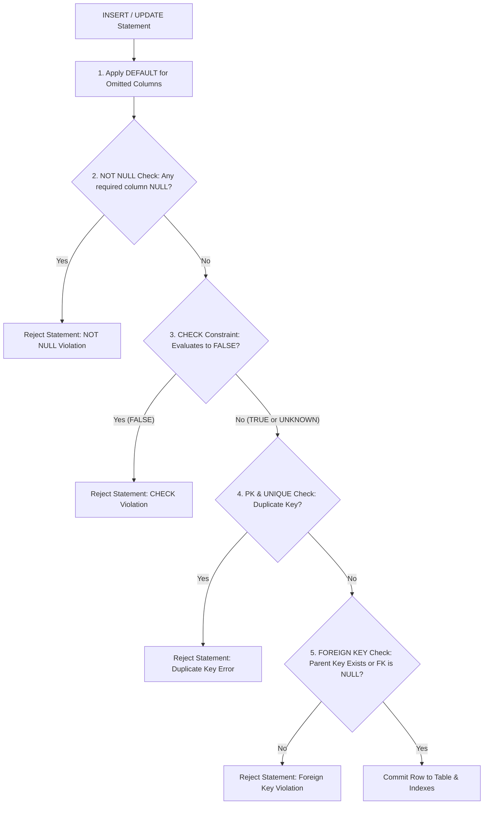

---
tags:
  - sql
  - sql-constraints
  - data-types-and-constraints
---

# SQL Constraints (PK, FK, Unique, Check, Not Null) in SQL

#### TL;DR (Quick Revision)

**SQL Constraints** = Built-in database rule guards (`PRIMARY KEY`, `FOREIGN KEY`, `NOT NULL`, `UNIQUE`, `CHECK`, `DEFAULT`) + Automatically block invalid, duplicate, or orphaned rows before any `INSERT` or `UPDATE` can be saved.

> [!abstract] Core Idea
> **Constraints** are declarative rules attached to columns or tables that enforce **Entity Integrity** (`PRIMARY KEY`, `UNIQUE`), **Domain Integrity** (`NOT NULL`, `CHECK`, `DEFAULT`), and **Referential Integrity** (`FOREIGN KEY`) right inside the storage engine ([Primary and Foreign Key Constraints](https://learn.microsoft.com/en-us/sql/relational-databases/tables/primary-and-foreign-key-constraints?view=sql-server-ver17) & [Unique and Check Constraints](https://learn.microsoft.com/en-us/sql/relational-databases/tables/unique-constraints-and-check-constraints?view=sql-server-ver17)). Even if an application bug or bulk import script tries to insert bad data, the database rejects the statement immediately.

> [!question] Why Use It?
>
> - **Guarantees Unique Row Identity (`PRIMARY KEY`)**: Ensures every row has a unique, non-null identifier and builds the table's clustered B+ Tree index.
> - **Prevents Duplicate Business Identifiers (`UNIQUE`)**: Ensures no two users register the same `email` or `referral_code` ([Create Unique Constraints](https://learn.microsoft.com/en-us/sql/relational-databases/tables/create-unique-constraints?view=sql-server-ver17)).
> - **Prevents Orphaned Child Records (`FOREIGN KEY`)**: Guarantees every `tier_code` in `members` points to a real row in `membership_tiers` ([MySQL FOREIGN KEY Constraints](https://dev.mysql.com/doc/refman/8.4/en/create-table-foreign-keys.html)).
> - **Enforces Business Rules Without Triggers (`CHECK`, `NOT NULL`, `DEFAULT`)**: Blocks underage signups (`CHECK (age_years >= 18)`) or missing emails (`NOT NULL`) automatically.

#### Quick Comparison Table

| Constraint Type | ANSI SQL / SQL Server (T-SQL) | MySQL 8.4+ Equivalent | `NULL` Behavior & Key Rule |
| :--- | :--- | :--- | :--- |
| **`PRIMARY KEY`** | `CONSTRAINT pk_tbl PRIMARY KEY (id)` ([Primary and Foreign Keys](https://learn.microsoft.com/en-us/sql/relational-databases/tables/primary-and-foreign-key-constraints?view=sql-server-ver17)) | `PRIMARY KEY (id)` ([CREATE TABLE MySQL](https://dev.mysql.com/doc/refman/8.4/en/create-table.html)) | Maximum **1 per table**; **`NULL` is strictly forbidden**. Always the clustered index in MySQL InnoDB (default `CLUSTERED` in T-SQL). |
| **`FOREIGN KEY`** | `CONSTRAINT fk_name FOREIGN KEY (c_id) REFERENCES parent(id) ON DELETE CASCADE ON UPDATE NO ACTION` | `CONSTRAINT fk_name FOREIGN KEY (c_id) REFERENCES parent(id) ON DELETE SET NULL ON UPDATE CASCADE` ([MySQL Foreign Keys](https://dev.mysql.com/doc/refman/8.4/en/create-table-foreign-keys.html)) | Allows `NULL` if the child column is nullable! InnoDB supports `RESTRICT`, `NO ACTION`, `CASCADE`, `SET NULL` (rejects `SET DEFAULT`). |
| **`NOT NULL`** | `email VARCHAR(80) NOT NULL` | `email VARCHAR(80) NOT NULL` | Rejects any `INSERT` or `UPDATE` that attempts to store `NULL` in the column. |
| **`UNIQUE`** | `CONSTRAINT uq_code UNIQUE (referral_code)` ([Unique and Check Constraints](https://learn.microsoft.com/en-us/sql/relational-databases/tables/unique-constraints-and-check-constraints?view=sql-server-ver17)) | `CONSTRAINT uq_code UNIQUE (referral_code)` | **Dialect Trap**: ANSI SQL & MySQL 8.4 allow **multiple `NULL`s** in a `UNIQUE` column; SQL Server T-SQL allows **only ONE `NULL`** (use a filtered unique index `WHERE col IS NOT NULL` in T-SQL). |
| **`CHECK`** | `CONSTRAINT chk_age CHECK (age_years >= 18)` | `CONSTRAINT chk_age CHECK (age_years >= 18) ENFORCED` (enforced since MySQL 8.0.16+) | **NULL Trap**: `CHECK` only rejects `FALSE`! If `age_years` is `NULL`, `NULL >= 18` evaluates to `UNKNOWN` and **passes** unless `NOT NULL` is also specified! |
| **`DEFAULT`** | `tier_code VARCHAR(15) CONSTRAINT df_tier DEFAULT ('FREE')` | `tier_code VARCHAR(15) DEFAULT 'FREE'` (or expression `DEFAULT (UUID())`) | Applied **only** when the column is omitted from the `INSERT` column list (passing explicit `NULL` bypasses `DEFAULT`!). |

---

## The Learning Concept

### What Problem Does It Solve?

Imagine creating a `members` table where `age_years` has `CHECK (age_years >= 18)` without `NOT NULL`, and `tier_code` is marked `NOT NULL` while its foreign key says `ON DELETE SET NULL`:

```sql
-- BAD - Conflicting NOT NULL + ON DELETE SET NULL, and NULL bypassing CHECK
CREATE TABLE members_bad (
    member_id INT PRIMARY KEY,
    tier_code VARCHAR(15) NOT NULL,
    age_years INT CHECK (age_years >= 18), -- BUG: Inserting age_years = NULL passes this CHECK!
    FOREIGN KEY (tier_code) REFERENCES membership_tiers(tier_code)
        ON DELETE SET NULL                 -- ERROR: Cannot SET NULL on a NOT NULL column!
);
```

This table fails to create in both MySQL 8.4 (`errno: 150`) and SQL Server because `ON DELETE SET NULL` requires `tier_code` to be nullable. Furthermore, if someone inserts `age_years = NULL`, SQL evaluates `NULL >= 18` as `UNKNOWN`—and because `CHECK` constraints only reject `FALSE`, the `NULL` age is silently accepted! Here is the clean, production-safe design:

```sql
-- GOOD - Named constraints, NOT NULL paired with CHECK, and nullable FK for ON DELETE SET NULL
CREATE TABLE members_good (
    member_id INT,
    email VARCHAR(80) NOT NULL,
    tier_code VARCHAR(15) DEFAULT 'FREE',
    age_years INT NOT NULL,
    CONSTRAINT pk_members PRIMARY KEY (member_id),
    CONSTRAINT uq_members_email UNIQUE (email),
    CONSTRAINT chk_members_age CHECK (age_years >= 18),
    CONSTRAINT fk_members_tier FOREIGN KEY (tier_code)
        REFERENCES membership_tiers(tier_code)
        ON UPDATE CASCADE
        ON DELETE SET NULL
);
```

### How SQL Implements It

> [!tip] Order of Constraint Evaluation on `INSERT` / `UPDATE`
>
> 1. **`DEFAULT` Binding**: If a column was omitted from the `INSERT` list, SQL fills in its `DEFAULT` value.
> 2. **`NOT NULL` & `CHECK` Validation**: SQL verifies no `NOT NULL` column is `NULL` and verifies no `CHECK` expression evaluates to `FALSE`.
> 3. **`PRIMARY KEY`, `UNIQUE` & `FOREIGN KEY` Index Probes**: The storage engine checks the unique B-Tree indexes for duplicates and verifies the `FOREIGN KEY` exists in the parent table ([Locks Set by SQL Statements in InnoDB](https://dev.mysql.com/doc/refman/8.4/en/innodb-locks-set.html)).

#### Full Runnable Example

```sql
-- Step 1: Create parent membership_tiers and child members table with all 6 constraints
CREATE TABLE membership_tiers (
    tier_code VARCHAR(15) PRIMARY KEY,
    monthly_price DECIMAL(8, 2) NOT NULL CHECK (monthly_price >= 0.00)
);

CREATE TABLE members (
    member_id INT PRIMARY KEY,
    email VARCHAR(80) NOT NULL UNIQUE,
    referral_code VARCHAR(20) UNIQUE,
    tier_code VARCHAR(15) DEFAULT 'FREE',
    age_years INT CHECK (age_years >= 18),
    account_status VARCHAR(15) NOT NULL DEFAULT 'ACTIVE'
        CHECK (account_status IN ('ACTIVE', 'PAUSED', 'CLOSED')),
    CONSTRAINT fk_members_tier FOREIGN KEY (tier_code)
        REFERENCES membership_tiers(tier_code)
        ON UPDATE CASCADE
        ON DELETE SET NULL
);

-- Step 2: Insert tiers and members (including multiple NULL referral_codes, a NULL age, and an omitted DEFAULT column)
INSERT INTO membership_tiers VALUES
('FREE', 0.00),
('PRO', 29.00),
('LEGACY', 15.00);

INSERT INTO members (member_id, email, referral_code, tier_code, age_years, account_status) VALUES
(1, 'ananya@example.com', 'REF-100', 'PRO', 25, 'ACTIVE'),
(2, 'vikram@example.com', NULL, 'PRO', NULL, 'ACTIVE'),
(3, 'sanjay@example.com', NULL, 'LEGACY', 32, 'PAUSED');

-- Omitting tier_code and account_status triggers DEFAULT 'FREE' and DEFAULT 'ACTIVE'
INSERT INTO members (member_id, email, age_years) VALUES
(4, 'meera@example.com', 21);

-- Step 3: Trigger ON UPDATE CASCADE ('PRO' -> 'PRO_PLUS') and ON DELETE SET NULL ('LEGACY')
UPDATE membership_tiers SET tier_code = 'PRO_PLUS' WHERE tier_code = 'PRO';
DELETE FROM membership_tiers WHERE tier_code = 'LEGACY';

SELECT
    member_id,
    email,
    COALESCE(referral_code, 'NULL_ALLOWED_IN_UNIQUE') AS referral_code,
    COALESCE(tier_code, 'NULL_AFTER_DELETE') AS current_tier,
    COALESCE(CAST(age_years AS VARCHAR), 'NULL_BYPASSED_CHECK') AS age_years,
    account_status
FROM members
ORDER BY member_id ASC;
```

**Output:**

```
+-------------+--------------------+------------------------+-------------------+---------------------+------------------+
| member_id   | email              | referral_code          | current_tier      | age_years           | account_status   |
|-------------+--------------------+------------------------+-------------------+---------------------+------------------|
| 1           | ananya@example.com | REF-100                | PRO_PLUS          | 25                  | ACTIVE           |
| 2           | vikram@example.com | NULL_ALLOWED_IN_UNIQUE | PRO_PLUS          | NULL_BYPASSED_CHECK | ACTIVE           |
| 3           | sanjay@example.com | NULL_ALLOWED_IN_UNIQUE | NULL_AFTER_DELETE | 32                  | PAUSED           |
| 4           | meera@example.com  | NULL_ALLOWED_IN_UNIQUE | FREE              | 21                  | ACTIVE           |
+-------------+--------------------+------------------------+-------------------+---------------------+------------------+
```

### Visual Diagram: Constraint Validation Pipeline



### Key Terminology

1. **`PRIMARY KEY` Constraint**: Uniquely identifies each row in a table; implicitly enforces `NOT NULL` and allows at most one `PRIMARY KEY` per table ([Primary and Foreign Key Constraints](https://learn.microsoft.com/en-us/sql/relational-databases/tables/primary-and-foreign-key-constraints?view=sql-server-ver17)).
   Syntax: `CONSTRAINT pk_members PRIMARY KEY (member_id)`
2. **`FOREIGN KEY` Referential Actions (`CASCADE`, `SET NULL`, `RESTRICT`, `NO ACTION`)**: Rules defining what happens to child rows when a parent key is updated or deleted ([MySQL FOREIGN KEY Constraints](https://dev.mysql.com/doc/refman/8.4/en/create-table-foreign-keys.html)).
   Syntax: `FOREIGN KEY (tier_code) REFERENCES membership_tiers(tier_code) ON DELETE SET NULL ON UPDATE CASCADE`
3. **`UNIQUE` Constraint**: Ensures all non-null values in a column (or group of columns) are distinct; a table can have multiple `UNIQUE` constraints.
   Syntax: `CONSTRAINT uq_members_email UNIQUE (email)`
4. **`CHECK` Constraint**: Evaluates a boolean condition on each inserted/updated row and rejects the change if the expression returns `FALSE` ([Unique and Check Constraints](https://learn.microsoft.com/en-us/sql/relational-databases/tables/unique-constraints-and-check-constraints?view=sql-server-ver17)).
   Syntax: `CONSTRAINT chk_positive_price CHECK (monthly_price >= 0.00)`

> [!important] Key Rules to Remember
>
> - **`CHECK` Passes on `NULL` (`UNKNOWN`)** → Whereas `WHERE` only keeps rows where a condition is `TRUE`, a `CHECK` constraint only rejects rows where the condition is `FALSE`. If a column is `NULL`, `CHECK (age_years >= 18)` evaluates to `UNKNOWN` and **succeeds**! Always add `NOT NULL` if `NULL` should be blocked.
> - **Constraint Names Must Be Unique Across the Schema** → Both MySQL 8.4 InnoDB and SQL Server require `CONSTRAINT` names (`fk_...`, `chk_...`, `uq_...`) to be unique across the entire schema/database, not just inside one table. Prefix them with the table name (`fk_members_tier`).
> - **Explicit `NULL` Bypasses `DEFAULT`** → `INSERT INTO members (member_id, email, tier_code) VALUES (5, 'a@b.com', NULL);` stores `NULL` even though `tier_code` has `DEFAULT 'FREE'`. `DEFAULT` only triggers when the column is omitted or the keyword `DEFAULT` is passed.
> - **MySQL 8.0.16+ Enforces `CHECK` Constraints** → Older MySQL versions (5.7 and earlier) parsed `CHECK` constraints and silently ignored them; MySQL 8.0.16+ and MySQL 8.4 strictly enforce them!

---

## Edge Case Analysis

### 1. Multiple `NULL`s in a `UNIQUE` Column (MySQL 8.4 vs. SQL Server T-SQL)
**Problem:** In our runnable lab above, both Member `2` and Member `3` have `referral_code = NULL` inside a `UNIQUE` column. In **ANSI SQL and MySQL 8.4**, that succeeds because `NULL` is never equal to `NULL`. In **SQL Server (T-SQL)**, a standard `UNIQUE` constraint treats two `NULL`s as duplicates and **rejects the second `NULL` row** ([Create Unique Constraints](https://learn.microsoft.com/en-us/sql/relational-databases/tables/create-unique-constraints?view=sql-server-ver17))!
**Fix:** In SQL Server T-SQL, replace the `UNIQUE` constraint on a nullable column with a **filtered unique index**:

```sql
-- SQL Server (T-SQL) Filtered Unique Index allowing multiple NULL referral codes
CREATE UNIQUE NONCLUSTERED INDEX ux_members_referral_notnull
ON dbo.members(referral_code)
WHERE referral_code IS NOT NULL;
```

### 2. Dropping a Column with a `DEFAULT` Constraint in SQL Server vs. MySQL
**Problem:** In MySQL 8.4, `ALTER TABLE members DROP COLUMN tier_code;` works immediately. In SQL Server T-SQL, if a column has a `DEFAULT` constraint, `ALTER TABLE dbo.members DROP COLUMN tier_code;` fails with an error because the `DEFAULT` is stored as a separate schema object!
**Fix:** Always name your `DEFAULT` constraints in T-SQL (`CONSTRAINT df_members_tier DEFAULT ('FREE')`) and drop the constraint before dropping the column.

```sql
-- SQL Server (T-SQL): Drop the named DEFAULT constraint first, then drop the column
-- ALTER TABLE dbo.members DROP CONSTRAINT df_members_tier;
-- ALTER TABLE dbo.members DROP COLUMN tier_code;
```

### 3. Adding Constraints to Existing Tables (`ALTER TABLE ... ADD CONSTRAINT`)
**Problem:** What if a table already exists in production and you need to add a `CHECK` or `FOREIGN KEY` constraint later?
**Fix:** Use `ALTER TABLE ... ADD CONSTRAINT` (both MySQL 8.4 and SQL Server validate existing rows before activating the constraint).

```sql
-- Portable ANSI / MySQL 8.4 / T-SQL syntax to add a named CHECK constraint to an existing table
ALTER TABLE membership_tiers
ADD CONSTRAINT chk_tiers_max_price CHECK (monthly_price <= 9999.00);
```

---

## Going Deeper (Intermediate -> Advanced)

### 1. Comparing All 5 Foreign Key Referential Actions

| Action | Behavior on Parent `DELETE` / `UPDATE` | Supported in MySQL 8.4 InnoDB? | Supported in SQL Server (T-SQL)? |
| :--- | :--- | :--- | :--- |
| **`NO ACTION`** | Default. Rejects parent delete/update if matching child rows exist. | Yes (checked immediately, same as `RESTRICT`). | Yes (default). |
| **`RESTRICT`** | Immediately rejects parent delete/update if child rows exist. | Yes ([MySQL Foreign Keys](https://dev.mysql.com/doc/refman/8.4/en/create-table-foreign-keys.html)). | No `RESTRICT` keyword in T-SQL (use `NO ACTION`). |
| **`CASCADE`** | Automatically deletes or updates matching child rows. | Yes. | Yes (blocks cycles / multiple cascade paths with `Msg 1785`). |
| **`SET NULL`** | Sets the child foreign key column to `NULL` (child column must be nullable!). | Yes. | Yes. |
| **`SET DEFAULT`** | Sets the child foreign key column to its `DEFAULT` value. | **No** (InnoDB rejects `SET DEFAULT`). | Yes. |

### 2. Dropping Constraints in MySQL 8.4 vs. SQL Server (T-SQL)

```sql
-- Generic ANSI / SQL Server T-SQL / MySQL 8.0.19+ syntax:
ALTER TABLE members DROP CONSTRAINT fk_members_tier;
ALTER TABLE members DROP CONSTRAINT chk_members_age;

-- Traditional MySQL-specific syntax:
-- ALTER TABLE members DROP FOREIGN KEY fk_members_tier;
-- ALTER TABLE members DROP CHECK chk_members_age;
-- ALTER TABLE members DROP INDEX uq_members_email;
```

---

## Interview Corner

### Common Questions & Concise Answers

**Q1: What are the 4 main differences between a `PRIMARY KEY` and a `UNIQUE` constraint?**  
A: (1) A table can have only **one** `PRIMARY KEY` but **multiple** `UNIQUE` constraints; (2) `PRIMARY KEY` never allows `NULL`, whereas `UNIQUE` allows `NULL`; (3) In MySQL InnoDB, the `PRIMARY KEY` is always the physical clustered index; (4) `PRIMARY KEY` automatically forces `NOT NULL` on all its columns.

**Q2: Why did `INSERT INTO members (member_id, email, age_years) VALUES (2, 'v@x.com', NULL);` succeed even when `CHECK (age_years >= 18)` was on the table?**  
A: Under SQL's Three-Valued Logic, `NULL >= 18` evaluates to `UNKNOWN`. Unlike `WHERE` clauses (which require `TRUE`), `CHECK` constraints only reject `FALSE` and allow both `TRUE` and `UNKNOWN` through. To reject `NULL`, you must also declare `age_years INT NOT NULL`.

**Q3: How does `UNIQUE` handle `NULL` values differently in MySQL 8.4 compared to SQL Server (T-SQL)?**  
A: MySQL 8.4 (following ANSI SQL) permits **multiple `NULL` rows** in a `UNIQUE` column because `NULL` is never equal to `NULL`. SQL Server T-SQL permits **at most one `NULL` row** in a standard `UNIQUE` constraint; to allow multiple `NULL`s in T-SQL, you must create a filtered unique index (`WHERE col IS NOT NULL`).

**Q4: What happens in MySQL 5.7 vs. MySQL 8.4 when you define a `CHECK` constraint?**  
A: MySQL 5.7 accepted `CHECK (...)` syntax without errors but completely ignored it at runtime. Starting in MySQL 8.0.16 (and in MySQL 8.4/9.0), `CHECK` constraints are natively evaluated and enforced.

**Q5: Why does `ON DELETE SET NULL` fail during `CREATE TABLE` if the child foreign key column is defined as `INT NOT NULL`?**  
A: `ON DELETE SET NULL` instructs the database to set the child column to `NULL` when its parent row is deleted, which directly contradicts the `NOT NULL` constraint on that same column.

### Interactive Revision Quiz

**Q1: How many `PRIMARY KEY` and `UNIQUE` constraints can a single SQL table have?**
- [ ] A) Unlimited `PRIMARY KEY`s and 1 `UNIQUE` constraint
- [ ] B) At most 1 `PRIMARY KEY` and multiple `UNIQUE` constraints
- [ ] C) At most 1 `PRIMARY KEY` and at most 1 `UNIQUE` constraint
- [ ] D) 2 `PRIMARY KEY`s (one clustered, one nonclustered) and unlimited `UNIQUE` constraints

**Q2: A table has `salary DECIMAL(10,2) CHECK (salary > 0)` (without `NOT NULL`). What happens if you run `INSERT INTO employees (emp_id, salary) VALUES (10, NULL);`?**
- [ ] A) The insert fails with a `CHECK` constraint violation
- [ ] B) The insert succeeds because `NULL > 0` evaluates to `UNKNOWN`, and `CHECK` only rejects `FALSE`
- [ ] C) The database automatically converts `NULL` to `0.01`
- [ ] D) The insert fails with a `PRIMARY KEY` violation

**Q3: In SQL Server (T-SQL), how many rows with `NULL` are allowed in a standard single-column `UNIQUE` constraint (without a `WHERE` filter)?**
- [ ] A) Unlimited `NULL` rows
- [ ] B) Zero `NULL` rows
- [ ] C) Exactly 1 `NULL` row
- [ ] D) Exactly 2 `NULL` rows

**Q4: Which `FOREIGN KEY` referential action automatically updates a child table's `tier_code` from `'PRO'` to `'PRO_PLUS'` when the parent row in `membership_tiers` is updated?**
- [ ] A) `ON DELETE CASCADE`
- [ ] B) `ON UPDATE CASCADE`
- [ ] C) `ON UPDATE SET NULL`
- [ ] D) `ON UPDATE RESTRICT`

**Q5: If `tier_code VARCHAR(15) DEFAULT 'FREE'` is nullable, what gets stored when you execute `INSERT INTO members (member_id, email, tier_code) VALUES (9, 'test@example.com', NULL);`?**
- [ ] A) `'FREE'`
- [ ] B) `NULL`
- [ ] C) An empty string `''`
- [ ] D) The statement fails with a syntax error

<details>
<summary>Show Quiz Answers & Explanations</summary>

1. **B** — Every table can have at most **one** `PRIMARY KEY` (which may be single-column or composite) and **multiple** `UNIQUE` constraints.
2. **B** — `CHECK` constraints pass whenever the predicate evaluates to `TRUE` or `UNKNOWN` (`NULL`); always pair `CHECK` with `NOT NULL` if `NULL` is invalid.
3. **C** — SQL Server treats `NULL` values as equal inside a standard `UNIQUE` constraint, allowing only **one `NULL`** unless a filtered unique index (`WHERE col IS NOT NULL`) is used ([Unique and Check Constraints](https://learn.microsoft.com/en-us/sql/relational-databases/tables/unique-constraints-and-check-constraints?view=sql-server-ver17)).
4. **B** — `ON UPDATE CASCADE` propagates parent key updates directly to matching child rows.
5. **B** — Passing an explicit `NULL` in the `VALUES` list overrides the `DEFAULT` constraint and stores `NULL`.

</details>

---

## Practice Exercises

**Exercise 1: Write a Complete Table with All 6 Constraints**
- Write a `CREATE TABLEcoupons` statement with:
  1. `coupon_id INT` as the named `PRIMARY KEY` (`pk_coupons`)
  2. `coupon_code VARCHAR(20)` as `NOT NULL` and named `UNIQUE` (`uq_coupons_code`)
  3. `discount_pct INT NOT NULL` with a named `CHECK` ensuring it is between `5` and `80` (`chk_coupons_pct`)
  4. `is_active INT NOT NULL` with `DEFAULT 1`
  5. `created_by_emp_id INT` as a nullable `FOREIGN KEY` referencing `employees(emp_id)` with `ON DELETE SET NULL`

**Exercise 2: Fix the Silent `CHECK` Bypass**
- A teammate wrote `CREATE TABLE products (id INT PRIMARY KEY, stock_qty INT CHECK (stock_qty >= 0));` and noticed `NULL` quantities are appearing in production. Show the fixed DDL.

**Exercise 3: Dialect Bridge (Multiple `NULL`s in T-SQL vs. MySQL)**
- Write the SQL Server T-SQL `CREATE UNIQUE NONCLUSTERED INDEX` statement that allows `employees(passport_number)` to accept multiple `NULL` rows while still enforcing uniqueness on non-null passport numbers.

---

## Memory Trick / One-Liner

> [!tip] Nightclub Bouncer Analogy
> **SQL Constraints** are the bouncers at the database door: **`NOT NULL` checks you actually showed up, `CHECK` verifies you are 18+, `UNIQUE` ensures nobody else is wearing your exact VIP wristband, `PRIMARY KEY` assigns your permanent club ID, and `FOREIGN KEY` verifies your sponsor is inside!**

---

## Warning Block (Best Practice)

> [!warning] Common Mistake (Avoid This!)
>
> ```sql
> -- BAD - Assuming CHECK (price >= 0) blocks NULLs, and leaving constraints unnamed
> CREATE TABLE items_bad (
>     item_id INT PRIMARY KEY,
>     price DECIMAL(8, 2) CHECK (price >= 0.00) -- Allows price = NULL!
> );
> ```
>
> ```sql
> -- GOOD - Pairing NOT NULL with a named CHECK constraint
> CREATE TABLE items_good (
>     item_id INT,
>     price DECIMAL(8, 2) NOT NULL,
>     CONSTRAINT pk_items PRIMARY KEY (item_id),
>     CONSTRAINT chk_items_price CHECK (price >= 0.00)
> );
> ```
