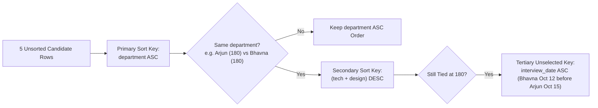

---
tags:
  - sql
  - sorting-order-by
  - querying-sorting-filtering
---

# Sorting Data with ORDER BY in SQL

#### TL;DR (Quick Revision)

**`ORDER BY` Clause** = Sorts query output by one column (`ASC`/`DESC`), multiple columns with mixed directions, unselected columns, expressions, or ordinal positions + Executed at **Step 7** right after `SELECT` and `DISTINCT`.

> [!abstract] Core Idea
> In relational database theory, a table is an **unordered set of rows**—the database engine is free to return rows in whatever physical page order is fastest unless you explicitly specify an **`ORDER BY` clause** ([ORDER BY Clause Transact-SQL](https://learn.microsoft.com/en-us/sql/t-sql/queries/select-order-by-clause-transact-sql?view=sql-server-ver17)). Evaluated at **Step 7** of the logical execution pipeline, `ORDER BY` covers all 7 sorting patterns in your syllabus: single-column `ASC`, single-column `DESC`, multiple columns, multiple columns with different directions, columns **not** in the `SELECT` list, expressions, and ordinal column positions.

> [!question] Why Use It?
>
> - **Guarantees Deterministic Output Order**: Without `ORDER BY`, running the exact same `SELECT` query twice can return rows in different orders after page splits or parallel scans.
> - **Multi-Tier Tie-Breaking**: Sort first by `department ASC` (A to Z), and break ties within the same department by `combined_score DESC` (highest to lowest).
> - **Sort by Computed Formulas or Unselected Columns**: Order candidates by `(technical_score + system_design_score) DESC` or by `interview_date ASC` even when `interview_date` is not displayed in the `SELECT` output.
> - **Prerequisite for Pagination (`LIMIT` / `OFFSET-FETCH` / `TOP`)**: Top-N leaderboard queries and paginated API responses are meaningless without a deterministic `ORDER BY` ([TOP Transact-SQL](https://learn.microsoft.com/en-us/sql/t-sql/queries/top-transact-sql?view=sql-server-ver17)).

#### Quick Comparison Table

| Syllabus Sub-Topic (Row 9: *Sorting data*) | ANSI SQL / SQL Server (T-SQL) | MySQL 8.4+ Equivalent | Key Behavior & Execution Rule |
| :--- | :--- | :--- | :--- |
| **1. Sort by One Column in Ascending Order** | `ORDER BY full_name ASC` (or `ORDER BY full_name`) | `ORDER BY full_name ASC` (or `ORDER BY full_name`) | `ASC` is the default direction (`A -> Z`, `0 -> 9`, earliest date -> latest date). |
| **2. Sort by One Column in Descending Order** | `ORDER BY technical_score DESC` | `ORDER BY technical_score DESC` | `DESC` sorts highest to lowest (`Z -> A`, `9 -> 0`, latest date -> earliest date). |
| **3. Sort by Multiple Columns** | `ORDER BY department, full_name` | `ORDER BY department, full_name` | Sorts by `department ASC` first; only rows with the **exact same** `department` are sorted by `full_name ASC`. |
| **4. Sort by Multiple Columns & Different Orders** | `ORDER BY department ASC, technical_score DESC` | `ORDER BY department ASC, technical_score DESC` | `DESC` applies **only** to the column immediately preceding it! Always write `ASC` or `DESC` explicitly on each column. |
| **5. Sort by a Column Not in the `SELECT` List** | `SELECT full_name FROM job_candidates ORDER BY interview_date ASC;` | `SELECT full_name FROM job_candidates ORDER BY interview_date ASC;` | Allowed in standard queries, **forbidden** when `SELECT DISTINCT`, `GROUP BY`, or `UNION` is used! |
| **6. Sort by an Expression** | `ORDER BY (technical_score + system_design_score) DESC` | `ORDER BY (technical_score + system_design_score) DESC` | Can sort by arithmetic formulas, `CASE` expressions, string functions (`LEN(full_name)` / `CHAR_LENGTH(full_name)`), or `SELECT` aliases. |
| **7. Sort by Ordinal Positions of Columns** | `ORDER BY 3 ASC, 4 DESC` ([ORDER BY Clause T-SQL](https://learn.microsoft.com/en-us/sql/t-sql/queries/select-order-by-clause-transact-sql?view=sql-server-ver17)) | `ORDER BY 3 ASC, 4 DESC` | `3` means the 3rd column in the `SELECT` list. Avoid in production code because changing the `SELECT` list silently changes what gets sorted! |

---

## The Learning Concept

### What Problem Does It Solve?

Two classic bugs occur when developers write `ORDER BY` clauses carelessly:
1. Writing `ORDER BY department, technical_score DESC` expecting **both** columns to be sorted descending (in reality, `department` defaults to `ASC`, and only `technical_score` is `DESC`!).
2. Relying on ordinal numbers (`ORDER BY 2, 3`) or trying to sort by an unselected column while `SELECT DISTINCT` is active:

```sql
-- BAD - Ambiguous direction, brittle ordinal position, and illegal unselected column with DISTINCT
SELECT DISTINCT
    department,
    technical_score
FROM job_candidates
ORDER BY 2, interview_date DESC; -- ERROR: 'interview_date' must appear in SELECT list when DISTINCT is used!
```

When `SELECT DISTINCT` runs at Step 6, multiple candidates with different `interview_date` values are collapsed into a single row, so by Step 7 (`ORDER BY`), there is no single `interview_date` left to sort by! Here is the clean, self-documenting pattern:

```sql
-- GOOD - Explicit ASC/DESC on every sort column, using named columns and expressions
SELECT
    candidate_id,
    full_name,
    department,
    (technical_score + system_design_score) AS combined_score
FROM job_candidates
ORDER BY
    department ASC,
    combined_score DESC,
    interview_date ASC;
```

### How SQL Implements It

> [!tip] How the Engine Executes `ORDER BY` (Index Order vs. Sort Operator)
>
> 1. **Index-Ordered Scan (Zero Extra Sort Cost)**: If a B-Tree index already matches your `ORDER BY` columns (`(department ASC, technical_score DESC)`), the storage engine simply reads the index in order ([ORDER BY Optimization MySQL](https://dev.mysql.com/doc/refman/8.4/en/order-by-optimization.html)).
> 2. **In-Memory / Disk Sort (`Using filesort` in MySQL / `Sort` in T-SQL)**: If no matching index exists (or you sort by a calculated expression), the engine buffers the projected rows in sort memory (`sort_buffer_size`) and runs Quicksort/Mergesort.
> 3. **Tie-Breaker Stability**: If two rows have the exact same `ORDER BY` values, their relative order is non-deterministic unless you append the `PRIMARY KEY` (`candidate_id ASC`) as the final tie-breaker!

#### Full Runnable Example

```sql
-- Step 1: Create job_candidates table
CREATE TABLE job_candidates (
    candidate_id INT PRIMARY KEY,
    full_name VARCHAR(50) NOT NULL,
    department VARCHAR(30) NOT NULL,
    technical_score INT NOT NULL,
    system_design_score INT NOT NULL,
    referral_bonus_usd DECIMAL(8, 2),
    interview_date DATE NOT NULL
);

-- Step 2: Insert 5 candidates (including NULL referral bonuses and tied scores)
INSERT INTO job_candidates VALUES
(1, 'Arjun Mehta', 'Backend', 88, 92, 2000.00, '2026-10-15'),
(2, 'Bhavna Iyer', 'Backend', 95, 85, NULL, '2026-10-12'),
(3, 'Chirag Gupta', 'Data Science', 91, 89, 1500.00, '2026-10-18'),
(4, 'Deepa Nair', 'Data Science', 91, 94, NULL, '2026-10-10'),
(5, 'Eshan Verma', 'Security', 84, 88, 1000.00, '2026-10-20');

-- Step 3: Sort by multiple columns (department ASC), expression (combined_score DESC),
-- and a column NOT in the SELECT list (interview_date ASC breaks the 180-point tie between Candidate 1 & 2!)
SELECT
    candidate_id,
    full_name,
    department,
    technical_score,
    system_design_score,
    (technical_score + system_design_score) AS combined_score
FROM job_candidates
ORDER BY
    department ASC,
    (technical_score + system_design_score) DESC,
    interview_date ASC;
```

**Output:**

```
+----------------+--------------+--------------+-------------------+-----------------------+------------------+
| candidate_id   | full_name    | department   | technical_score   | system_design_score   | combined_score   |
|----------------+--------------+--------------+-------------------+-----------------------+------------------|
| 2              | Bhavna Iyer  | Backend      | 95                | 85                    | 180              |
| 1              | Arjun Mehta  | Backend      | 88                | 92                    | 180              |
| 4              | Deepa Nair   | Data Science | 91                | 94                    | 185              |
| 3              | Chirag Gupta | Data Science | 91                | 89                    | 180              |
| 5              | Eshan Verma  | Security     | 84                | 88                    | 172              |
+----------------+--------------+--------------+-------------------+-----------------------+------------------+
```

### Visual Diagram: Multi-Column & Tie-Breaker Sorting Flow



### Key Terminology

1. **Primary vs. Secondary Sort Key**: In `ORDER BY col1 ASC, col2 DESC`, `col1` is the primary sort key that dictates the overall order, and `col2` is the secondary tie-breaker evaluated **only** when two rows have identical values in `col1`.
   Syntax: `ORDER BY department ASC, technical_score DESC`
2. **Sorting by Expression**: Ordering rows based on a mathematical formula, string function, or `CASE` statement evaluated per row.
   Syntax: `ORDER BY (technical_score + system_design_score) DESC`
3. **Ordinal Position Sorting (`ORDER BY 1, 2`)**: Sorting by the 1-based integer index of columns in the `SELECT` clause. If the integer exceeds the number of selected columns, SQL Server raises **Error 108** ([ORDER BY Clause T-SQL](https://learn.microsoft.com/en-us/sql/t-sql/queries/select-order-by-clause-transact-sql?view=sql-server-ver17)).
   Syntax: `SELECT department, full_name FROM job_candidates ORDER BY 1 ASC, 2 ASC;`
4. **Deterministic vs. Non-Deterministic Sort**: A sort is **deterministic** only when the combination of `ORDER BY` columns is guaranteed to be unique (for example, by including `candidate_id ASC` as the final tie-breaker).
   Syntax: `ORDER BY department ASC, candidate_id ASC`

> [!important] Key Rules to Remember
>
> - **Direction Keyword Scope** → In `ORDER BY col1, col2 DESC`, `col1` is sorted **`ASC`** and only `col2` is sorted **`DESC`**! To sort both descending, you must write `ORDER BY col1 DESC, col2 DESC`.
> - **How `NULL`s Sort in MySQL 8.4 & SQL Server T-SQL** → Both MySQL 8.4 and SQL Server treat `NULL` as the **lowest possible value**: `NULL`s appear **first** in `ORDER BY col ASC` and **last** in `ORDER BY col DESC`.
> - **`ORDER BY` Inside Views, Derived Tables, & CTEs (T-SQL Rule)** → SQL Server **forbids** `ORDER BY` inside a `VIEW`, subquery, derived table, or CTE unless `TOP` or `OFFSET ... FETCH` is also specified ([ORDER BY Clause T-SQL](https://learn.microsoft.com/en-us/sql/t-sql/queries/select-order-by-clause-transact-sql?view=sql-server-ver17))! Always put `ORDER BY` on the outermost `SELECT` query.
> - **When Unselected Columns Are Forbidden in `ORDER BY`** → You cannot sort by a column omitted from the `SELECT` list if the query uses `SELECT DISTINCT`, `GROUP BY`, or `UNION`.

---

## Edge Case Analysis

### 1. Pushing `NULL` Values Last on an Ascending or Descending Sort (`NULLS LAST` Emulation)
**Problem:** Neither MySQL 8.4 nor SQL Server T-SQL supports the ANSI `NULLS FIRST` / `NULLS LAST` keywords directly. If you sort `ORDER BY referral_bonus_usd ASC`, the `NULL` rows appear at the very top!
**Fix:** Use a 2-key sort starting with `CASE WHEN referral_bonus_usd IS NULL THEN 1 ELSE 0 END ASC` to push all `NULL` rows to the bottom cleanly:

```sql
-- Portable NULLS LAST emulation in MySQL 8.4, SQL Server T-SQL, and SQLite
SELECT
    candidate_id,
    full_name,
    COALESCE(CAST(referral_bonus_usd AS VARCHAR), 'NULL') AS referral_bonus
FROM job_candidates
ORDER BY
    CASE WHEN referral_bonus_usd IS NULL THEN 1 ELSE 0 END ASC,
    referral_bonus_usd DESC;
```

**Output:**

```
+----------------+--------------+------------------+
| candidate_id   | full_name    | referral_bonus   |
|----------------+--------------+------------------|
| 1              | Arjun Mehta  | 2000             |
| 3              | Chirag Gupta | 1500             |
| 5              | Eshan Verma  | 1000             |
| 2              | Bhavna Iyer  | NULL             |
| 4              | Deepa Nair   | NULL             |
+----------------+--------------+------------------+
```

### 2. Numbers Stored as `VARCHAR` Sorting Alphabetically (`'100'` Before `'20'`)
**Problem:** If a numeric code or price is accidentally stored in a `VARCHAR` column, `ORDER BY score_str ASC` sorts character-by-character from left to right: `'100'` comes **before** `'20'` because `'1' < '2'`!
**Fix:** Store numbers in numeric columns (`INT`, `DECIMAL`), or cast the string in `ORDER BY CAST(score_str AS INT) ASC`.

```sql
-- Casting a numeric string so '20' sorts before '100'
SELECT '20' AS val UNION ALL SELECT '100' AS val
ORDER BY CAST(val AS INT) ASC;
```

### 3. Pagination Drift Without a Unique Tie-Breaker in `ORDER BY`
**Problem:** Suppose Candidate `1` and Candidate `2` both have `combined_score = 180`. If Page 1 fetches `ORDER BY combined_score DESC LIMIT 1 OFFSET 0` and Page 2 fetches `LIMIT 1 OFFSET 1`, the database might return Candidate `1` on **both** pages if no unique tie-breaker column is included!
**Fix:** Always append the table's `PRIMARY KEY` (`candidate_id ASC`) as the final column in paginated `ORDER BY` clauses.

```sql
-- Deterministic pagination sort with primary key tie-breaker
SELECT candidate_id, full_name, (technical_score + system_design_score) AS combined_score
FROM job_candidates
ORDER BY combined_score DESC, candidate_id ASC
LIMIT 2 OFFSET 0;
```

---

## Going Deeper (Intermediate -> Advanced)

### 1. Custom Business-Order Sorting with `CASE` (e.g., Priority `'HIGH' -> 'MEDIUM' -> 'LOW'`)

Alphabetical sorting puts `'HIGH'`, `'LOW'`, `'MEDIUM'` in the wrong business order (`H -> L -> M`). You can sort by any custom business sequence using an expression in `ORDER BY`:

```sql
-- Portable ANSI / MySQL 8.4 / T-SQL custom sort order using CASE in ORDER BY
SELECT candidate_id, full_name, department
FROM job_candidates
ORDER BY
    CASE department
        WHEN 'Security' THEN 1
        WHEN 'Backend' THEN 2
        WHEN 'Data Science' THEN 3
        ELSE 4
    END ASC,
    full_name ASC;
-- (Note: MySQL also has a shorthand function: ORDER BY FIELD(department, 'Security', 'Backend', 'Data Science'))
```

### 2. Dialect Bridge: Pagination Syntax (`OFFSET-FETCH` vs. `TOP` vs. `LIMIT`)

| Dialect | Top 3 Rows Syntax | Page 2 (Skip 3, Take 3) Syntax |
| :--- | :--- | :--- |
| **ANSI SQL:2008+ & SQL Server (T-SQL)** | `ORDER BY score DESC OFFSET 0 ROWS FETCH NEXT 3 ROWS ONLY` ([ORDER BY T-SQL](https://learn.microsoft.com/en-us/sql/t-sql/queries/select-order-by-clause-transact-sql?view=sql-server-ver17)) | `ORDER BY score DESC OFFSET 3 ROWS FETCH NEXT 3 ROWS ONLY` |
| **SQL Server Legacy Shorthand** | `SELECT TOP (3) ... ORDER BY score DESC` ([TOP T-SQL](https://learn.microsoft.com/en-us/sql/t-sql/queries/top-transact-sql?view=sql-server-ver17)) | Must use `OFFSET ... FETCH` |
| **MySQL 8.4+ / PostgreSQL / SQLite** | `ORDER BY score DESC LIMIT 3` | `ORDER BY score DESC LIMIT 3 OFFSET 3` |

---

## Interview Corner

### Common Questions & Concise Answers

**Q1: In `SELECT full_name, department, technical_score FROM job_candidates ORDER BY department, technical_score DESC;`, how is `department` sorted?**  
A: `department` is sorted in **ascending (`ASC`)** order! The `DESC` keyword only applies to the column immediately before it (`technical_score`).

**Q2: Where do `NULL` values appear when you run `ORDER BY referral_bonus_usd ASC` vs. `DESC` in MySQL 8.4 and SQL Server?**  
A: Both MySQL 8.4 and SQL Server treat `NULL` as the lowest possible value—so `NULL` rows appear **first** in `ASC` order and **last** in `DESC` order.

**Q3: When is it illegal to sort by a column that is NOT in the `SELECT` list?**  
A: Whenever the query includes **`SELECT DISTINCT`**, **`GROUP BY`**, or a **`UNION` / `INTERSECT` / `EXCEPT`** set operator, because deduplication/grouping collapses multiple source rows before `ORDER BY` executes.

**Q4: Why is sorting by ordinal position (`ORDER BY 2, 4`) considered an anti-pattern in production code?**  
A: If another developer later adds or reorders a column in the `SELECT` list, `ORDER BY 2, 4` silently sorts by the wrong column without throwing any syntax error.

**Q5: Why does SQL Server throw an error if you put `ORDER BY full_name ASC` inside a `CREATE VIEW` definition?**  
A: In relational theory (and [SQL Server T-SQL rules](https://learn.microsoft.com/en-us/sql/t-sql/queries/select-order-by-clause-transact-sql?view=sql-server-ver17)), a view represents a virtual table, and tables are unordered sets. SQL Server forbids `ORDER BY` in views, derived tables, and CTEs unless `TOP` or `OFFSET ... FETCH` is used to restrict which rows belong to the set.

### Interactive Revision Quiz

**Q1: If you write `ORDER BY department, technical_score DESC`, how are the rows sorted?**
- [ ] A) Both `department` and `technical_score` are sorted descending (`DESC`)
- [ ] B) `department` is sorted ascending (`ASC`), and ties in `department` are sorted by `technical_score` descending (`DESC`)
- [ ] C) The query fails with a syntax error because `department` has no direction keyword
- [ ] D) `technical_score` is sorted first, then `department`

**Q2: Which of the following queries will FAIL with an error in both MySQL 8.4 and SQL Server?**
- [ ] A) `SELECT full_name FROM job_candidates ORDER BY interview_date DESC;`
- [ ] B) `SELECT DISTINCT department FROM job_candidates ORDER BY interview_date DESC;`
- [ ] C) `SELECT full_name, technical_score FROM job_candidates ORDER BY 2 DESC;`
- [ ] D) `SELECT full_name FROM job_candidates ORDER BY (technical_score + system_design_score) DESC;`

**Q3: How do you force `NULL` values in `referral_bonus_usd` to appear at the bottom of an ascending sort in both MySQL 8.4 and SQL Server?**
- [ ] A) `ORDER BY referral_bonus_usd ASC` (they already appear at the bottom by default)
- [ ] B) `ORDER BY CASE WHEN referral_bonus_usd IS NULL THEN 1 ELSE 0 END ASC, referral_bonus_usd ASC`
- [ ] C) `ORDER BY ISNULL(referral_bonus_usd) DESC`
- [ ] D) `WHERE referral_bonus_usd IS NOT NULL`

**Q4: In Candidate 1 (`Arjun`, Backend, Tech `88` + Design `92` = `180`, Date `'2026-10-15'`) and Candidate 2 (`Bhavna`, Backend, Tech `95` + Design `85` = `180`, Date `'2026-10-12'`), who appears first when sorted by `ORDER BY (technical_score + system_design_score) DESC, interview_date ASC`?**
- [ ] A) Arjun (`candidate_id = 1`)
- [ ] B) Bhavna (`candidate_id = 2`)
- [ ] C) Neither, because expressions cannot be combined with column names in `ORDER BY`
- [ ] D) Random order

**Q5: What happens in SQL Server if a query selects 3 columns (`SELECT a, b, c FROM tbl`) and specifies `ORDER BY 4`?**
- [ ] A) It sorts by the 4th column of the underlying table on disk
- [ ] B) It ignores `ORDER BY 4` and returns unsorted rows
- [ ] C) It fails with Error 108 (`The ORDER BY position number 4 is out of range of the number of items in the select list`)
- [ ] D) It wraps around and sorts by column `1` (`a`)

<details>
<summary>Show Quiz Answers & Explanations</summary>

1. **B** — Each column in `ORDER BY` has its own independent sort direction, defaulting to `ASC` when omitted.
2. **B** — When `SELECT DISTINCT` is specified, every column in `ORDER BY` must appear in the `SELECT` list.
3. **B** — Because MySQL and SQL Server sort `NULL`s first in `ASC` order, `CASE WHEN col IS NULL THEN 1 ELSE 0 END ASC` assigns `0` to non-nulls and `1` to `NULL`s, pushing `NULL`s to the bottom.
4. **B** — Both Arjun and Bhavna tie at `180` on the primary expression key, so the secondary key `interview_date ASC` places Bhavna (`'2026-10-12'`) ahead of Arjun (`'2026-10-15'`).
5. **C** — Ordinal position numbers in `ORDER BY` must be between `1` and the number of columns in the `SELECT` list.

</details>

---

## Practice Exercises

**Exercise 1: Multi-Column Mixed-Direction Sort**
- Write a query on `job_candidates` returning `candidate_id`, `full_name`, `department`, and `technical_score`, sorted by `department` alphabetically (`A -> Z`) and then by `technical_score` highest-to-lowest within each department.

**Exercise 2: Expression & Unselected Column Sort**
- Write a query that selects **only** `full_name` and `department`, but sorts the rows by the candidate's average score `((technical_score + system_design_score) / 2.0) DESC`, breaking ties by `interview_date ASC`.

**Exercise 3: Custom Priority & `NULLS LAST` Sort**
- Write an `ORDER BY` clause that sorts `referral_bonus_usd ASC` while keeping `NULL` rows at the very bottom of the result set.

---

## Memory Trick / One-Liner

> [!tip] Olympic Medal Table Analogy
> Multi-column `ORDER BY gold DESC, silver DESC, bronze DESC` works just like the **Olympic Medal Table**: **Silver (`col2`) only matters when two countries are tied on Gold (`col1`), and Bronze (`col3`) only matters when they are tied on both Gold and Silver!**

---

## Warning Block (Best Practice)

> [!warning] Common Mistake (Avoid This!)
>
> ```sql
> -- BAD - Assuming DESC applies to both columns, and using fragile ordinal positions
> SELECT full_name, department, technical_score, system_design_score
> FROM job_candidates
> ORDER BY 3, 4 DESC; -- Column 3 (technical_score) is sorted ASC, not DESC!
> ```
>
> ```sql
> -- GOOD - Explicitly naming every sort column and specifying ASC or DESC on each one
> SELECT full_name, department, technical_score, system_design_score
> FROM job_candidates
> ORDER BY
>     technical_score DESC,
>     system_design_score DESC,
>     candidate_id ASC;
> ```
