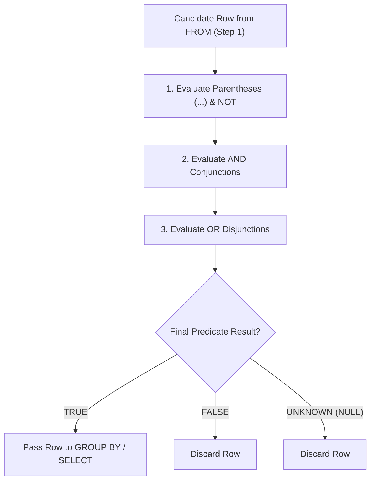

---
tags:
  - sql
  - filtering-data-where
  - querying-sorting-filtering
---

# Filtering Data (WHERE, IN, BETWEEN, LIKE, Aliases) in SQL

#### TL;DR (Quick Revision)

**Filtering & Deduplication** = Filter individual rows at **Step 2 (`WHERE`)** using `AND`, `OR`, `IN`, `BETWEEN`, `LIKE`, and `IS NULL`, deduplicate output rows at **Step 6 (`DISTINCT`)**, and keep queries clean with **Table Aliases (`FROM tbl AS s`)** and **Column Aliases (`SELECT col AS name`)**.

> [!abstract] Core Idea
> This note covers every sub-topic in **Syllabus Row 10 (*Filtering data*)**: `DISTINCT`, `WHERE`, `AND`, `OR`, `IN`, `BETWEEN`, `LIKE`, **SQL Server table alias**, and **SQL Server column alias** ([Search Condition Transact-SQL](https://learn.microsoft.com/en-us/sql/t-sql/queries/search-condition-transact-sql?view=sql-server-ver17) & [Filtering Data Using WHERE - ApX Machine Learning](https://apxml.com/courses/sql-for-data-science/chapter-3-filtering-sorting-data/intro-filtering-where)). At **Step 2 (`WHERE`)**, the database engine evaluates a boolean search condition for each row—keeping **only** rows where the condition evaluates to `TRUE` and discarding both `FALSE` and `UNKNOWN` (`NULL`).

> [!question] Why Use It?
>
> - **Eliminates Unneeded Rows Early (Step 2)**: Filtering rows in `WHERE` via B-Tree index seeks prevents scanning, sorting, or grouping millions of irrelevant rows ([Avoiding Full Table Scans](https://dev.mysql.com/doc/refman/8.4/en/table-scan-avoidance.html)).
> - **Clean Set & Range Checks (`IN` & `BETWEEN`)**: Replace long chains of `OR` conditions with concise `region_code IN ('ap-south-1', 'us-east-1')` and inclusive range checks `monthly_cost_usd BETWEEN 180.00 AND 500.00` ([BETWEEN Transact-SQL](https://learn.microsoft.com/en-us/sql/t-sql/language-elements/between-transact-sql?view=sql-server-ver17)).
> - **Flexible Text Pattern Matching (`LIKE`)**: Match prefixes (`'prod-%'`), suffixes (`'%_01'`), or specific character patterns ([LIKE Transact-SQL](https://learn.microsoft.com/en-us/sql/t-sql/language-elements/like-transact-sql?view=sql-server-ver17)).
> - **Deduplication & Readable Naming (`DISTINCT` & Aliases)**: Strip duplicate combinations with [DISTINCT](https://dev.mysql.com/doc/refman/8.4/en/distinct-optimization.html) and shorten table/column references with table and column aliases.

#### Quick Comparison Table

| Syllabus Sub-Topic (Row 10: *Filtering data*) | ANSI SQL / SQL Server (T-SQL) | MySQL 8.4+ Equivalent | `NULL` & Execution Rule |
| :--- | :--- | :--- | :--- |
| **`DISTINCT`** | `SELECT DISTINCT region_code, environment FROM dbo.cloud_servers;` | `SELECT DISTINCT region_code, environment FROM cloud_servers;` ([DISTINCT Optimization](https://dev.mysql.com/doc/refman/8.4/en/distinct-optimization.html)) | **Step 6**: Deduplicates across **all** columns in the `SELECT` list; treats two `NULL`s as duplicates. |
| **`WHERE` (`=`, `<>`, `<`, `>`, `<=`, `>=`)** | `WHERE monthly_cost_usd >= 200.00` ([Search Condition T-SQL](https://learn.microsoft.com/en-us/sql/t-sql/queries/search-condition-transact-sql?view=sql-server-ver17)) | `WHERE monthly_cost_usd >= 200.00` | **Step 2**: Keeps only `TRUE` rows. Never write `= NULL` or `<> NULL`; use `IS NULL` or `IS NOT NULL`! |
| **`AND` & `OR` Precedence** | `WHERE a = 1 AND (b = 2 OR c = 3)` | `WHERE a = 1 AND (b = 2 OR c = 3)` | **`AND` has higher precedence than `OR`**! Always wrap `OR` conditions in parentheses `(...)`. |
| **`IN` / `NOT IN`** | `WHERE region_code IN ('ap-south-1', 'us-east-1')` | `WHERE region_code IN ('ap-south-1', 'us-east-1')` | Shorthand for `col = v1 OR col = v2`. **Trap**: `col NOT IN ('A', NULL)` always returns **0 rows**! |
| **`BETWEEN` / `NOT BETWEEN`** | `WHERE cost BETWEEN 180.00 AND 500.00` ([BETWEEN T-SQL](https://learn.microsoft.com/en-us/sql/t-sql/language-elements/between-transact-sql?view=sql-server-ver17)) | `WHERE cost BETWEEN 180.00 AND 500.00` | **Inclusive** of both endpoints (`cost >= 180.00 AND cost <= 500.00`). Lower bound **must** come first! |
| **`LIKE` Wildcards (`%`, `_`, `[a-z]`)** | `%` (0+ chars), `_` (1 char), **`[a-f]` (char set)**, **`[^a-f]` (not in set)** ([LIKE T-SQL](https://learn.microsoft.com/en-us/sql/t-sql/language-elements/like-transact-sql?view=sql-server-ver17) & [`[]` Wildcard](https://learn.microsoft.com/en-us/sql/t-sql/language-elements/wildcard-character-s-to-match-transact-sql?view=sql-server-ver17)) | `%` (0+ chars), `_` (1 char) + `ESCAPE '!'`. **MySQL `LIKE` does NOT support `[a-f]`** -> use `REGEXP '^[a-f]'`! | Prefix `LIKE 'prod%'` uses a B-Tree index seek; leading wildcard `LIKE '%db%'` forces a full scan. |
| **Table Alias & Column Alias** | `FROM dbo.cloud_servers AS s` / `SELECT s.hostname AS server_host` (or T-SQL `server_host = s.hostname`) | `FROM cloud_servers AS s` / `SELECT s.hostname AS server_host` | Table alias (`s`) is created at Step 1 (`FROM`) and usable everywhere; Column alias (`server_host`) is created at Step 5 (`SELECT`) and **cannot** be used in `WHERE`! |

---

## The Learning Concept

### What Problem Does It Solve?

Three filtering bugs trip up almost every SQL developer in interviews and production incidents:
1. Mixing `OR` and `AND` without parentheses (`WHERE environment = 'PROD' OR environment = 'STAGING' AND monthly_cost_usd < 300`), which evaluates `AND` first and returns **every** `'PROD'` server regardless of cost!
2. Using `_` or `%` in `LIKE` without realizing `_` is a wildcard that matches *any* single character (`'prod-db_01'` and `'prod-db-02'` both match `LIKE 'prod-db_0%'`!).
3. Referencing the original table name after giving the table an alias (`FROM cloud_servers AS s WHERE cloud_servers.cpu_cores >= 16`).

```sql
-- BAD - Operator precedence bug (AND before OR) + unescaped '_' wildcard in LIKE
SELECT hostname, environment, monthly_cost_usd
FROM cloud_servers
WHERE environment = 'PROD'
   OR environment = 'STAGING' AND monthly_cost_usd <= 200.00 -- BUG: Returns the $810 PROD server!
  AND hostname LIKE 'prod-db_0%';                            -- BUG: '_' matches the '-' in 'prod-db-02'!
```

Because `AND` binds tighter than `OR`, SQL evaluates the `AND` branch first and lets any row with `environment = 'PROD'` bypass the cost check and `LIKE` filter completely! Here is the safe, parenthesized solution:

```sql
-- GOOD - Parenthesized OR logic, IN list, inclusive BETWEEN, and escaped literal '_' in LIKE
SELECT
    s.server_id,
    s.hostname AS server_host,
    s.environment AS env,
    s.monthly_cost_usd AS cost_usd
FROM cloud_servers AS s
WHERE s.environment IN ('PROD', 'STAGING')
  AND s.monthly_cost_usd BETWEEN 180.00 AND 500.00
  AND s.hostname LIKE '%!_0%' ESCAPE '!';
```

### How SQL Implements It

> [!tip] Three Golden Rules of SQL Filtering
>
> 1. **Boolean Operator Precedence (`NOT -> AND -> OR`)**: SQL always evaluates `NOT` first, then `AND`, and finally `OR`. Whenever you write `OR` alongside `AND`, wrap the `OR` expression in parentheses `(...)`.
> 2. **Three-Valued Logic (`TRUE`, `FALSE`, `UNKNOWN`)**: Comparing anything to `NULL` with `=`, `<>`, `<`, `>`, `BETWEEN`, or `LIKE` produces `UNKNOWN`, and `WHERE` discards `UNKNOWN` rows. Always test for `NULL` with `IS NULL` or `IS NOT NULL`.
> 3. **SARGable Prefix Patterns**: Keep indexed columns bare on one side of the operator (`WHERE s.hostname LIKE 'prod-%'`) so the storage engine can jump straight to `'prod-'` in the B-Tree index.

#### Full Runnable Example

```sql
-- Step 1: Create cloud_servers table (notice literal '_' and '-' in hostnames and '%' in patch_tag)
CREATE TABLE cloud_servers (
    server_id INT PRIMARY KEY,
    hostname VARCHAR(30) NOT NULL UNIQUE,
    region_code VARCHAR(15) NOT NULL,
    environment VARCHAR(15) NOT NULL,
    cpu_cores INT NOT NULL,
    monthly_cost_usd DECIMAL(8, 2) NOT NULL,
    patch_tag VARCHAR(20)
);

-- Step 2: Insert 6 server rows
INSERT INTO cloud_servers VALUES
(1, 'prod-db_01', 'ap-south-1', 'PROD', 16, 420.00, 'PATCH_100%_OK'),
(2, 'prod-db-02', 'ap-south-1', 'PROD', 32, 810.00, 'PATCH_100_PENDING'),
(3, 'stg-api_01', 'us-east-1', 'STAGING', 8, 190.00, NULL),
(4, 'dev-ml_01', 'eu-west-1', 'DEV', 4, 95.00, 'PATCH_50%_OK'),
(5, 'prod-cache_01', 'us-east-1', 'PROD', 8, 240.00, NULL),
(6, 'stg-worker_02', 'ap-south-1', 'STAGING', 16, 360.00, 'PATCH_100%_OK');

-- Step 3A: Filter using table alias (s), column aliases, IN, BETWEEN, parenthesized OR, and escaped LIKE
SELECT
    s.server_id,
    s.hostname AS server_host,
    s.region_code AS region,
    s.environment AS env,
    s.cpu_cores,
    s.monthly_cost_usd AS cost_usd
FROM cloud_servers AS s
WHERE s.region_code IN ('ap-south-1', 'us-east-1')
  AND s.monthly_cost_usd BETWEEN 180.00 AND 500.00
  AND (s.environment = 'PROD' OR s.cpu_cores >= 16)
  AND s.hostname LIKE '%!_0%' ESCAPE '!'
ORDER BY s.monthly_cost_usd DESC;
```

**Output (Query 3A - Filtered with `IN`, `BETWEEN`, `OR`, and Escaped `LIKE`):**

```
+-------------+---------------+------------+---------+-------------+------------+
| server_id   | server_host   | region     | env     | cpu_cores   | cost_usd   |
|-------------+---------------+------------+---------+-------------+------------|
| 1           | prod-db_01    | ap-south-1 | PROD    | 16          | 420        |
| 6           | stg-worker_02 | ap-south-1 | STAGING | 16          | 360        |
| 5           | prod-cache_01 | us-east-1  | PROD    | 8           | 240        |
+-------------+---------------+------------+---------+-------------+------------+
```

```sql
-- Step 3B: Deduplicate (region_code, environment) pairs using SELECT DISTINCT
SELECT DISTINCT
    s.region_code AS active_region,
    s.environment AS deployment_env
FROM cloud_servers AS s
ORDER BY active_region ASC, deployment_env ASC;
```

**Output (Query 3B - Deduplicated Tuples via `SELECT DISTINCT`):**

```
+-----------------+------------------+
| active_region   | deployment_env   |
|-----------------+------------------|
| ap-south-1      | PROD             |
| ap-south-1      | STAGING          |
| eu-west-1       | DEV              |
| us-east-1       | PROD             |
| us-east-1       | STAGING          |
+-----------------+------------------+
```

### Visual Diagram: `WHERE` Evaluation & Operator Precedence



### Key Terminology

1. **Table Alias (`FROM table_name AS alias`)**: A short nickname assigned to a table in the `FROM` or `JOIN` clause. Once assigned, you **must** use the alias (`s.hostname`) and cannot use the full table name (`cloud_servers.hostname`) in that query block.
   Syntax: `SELECT s.hostname FROM cloud_servers AS s;`
2. **Column Alias (`SELECT col AS alias`)**: A display label assigned to a column or expression in the `SELECT` clause (`AS cost_usd`). Created at Step 5, so it can be referenced in `ORDER BY` (Step 7) but **never** in `WHERE` (Step 2).
   Syntax: `SELECT monthly_cost_usd AS cost_usd FROM cloud_servers;`
3. **`BETWEEN low AND high`**: An inclusive range operator equivalent to `col >= low AND col <= high` ([BETWEEN Transact-SQL](https://learn.microsoft.com/en-us/sql/t-sql/language-elements/between-transact-sql?view=sql-server-ver17)).
   Syntax: `WHERE monthly_cost_usd BETWEEN 180.00 AND 500.00`
4. **`LIKE` Pattern Wildcards (`%` and `_`)**: `%` matches **zero, one, or many** characters; `_` matches **exactly one** character. Use `ESCAPE '!'` when searching for a literal `%` or `_` character in your text.
   Syntax: `WHERE patch_tag LIKE '%100!%%' ESCAPE '!'`

> [!important] Key Rules to Remember
>
> - **The `NOT IN` with `NULL` Trap** → `WHERE env NOT IN ('DEV', NULL)` translates to `env <> 'DEV' AND env <> NULL`. Because `env <> NULL` is always `UNKNOWN`, `TRUE AND UNKNOWN` is `UNKNOWN`, and the query returns **0 rows**!
> - **`BETWEEN` Lower Bound Must Come First** → `WHERE cpu_cores BETWEEN 32 AND 8` evaluates to `cpu_cores >= 32 AND cpu_cores <= 8`, which is impossible and always returns **0 rows**.
> - **T-SQL `[a-z]` Bracket Wildcard vs. MySQL `REGEXP`** → SQL Server's `LIKE` supports bracket character sets (`LIKE '[a-c]%'` and `LIKE '[^a-c]%'`, [`[]` Wildcard T-SQL](https://learn.microsoft.com/en-us/sql/t-sql/language-elements/wildcard-character-s-to-match-transact-sql?view=sql-server-ver17)). **MySQL 8.4 `LIKE` does NOT support `[...]`**—use `WHERE hostname REGEXP '^[a-c]'` in MySQL!
> - **Quotes Around Column Aliases with Spaces** → Prefer `AS monthly_cost` (`snake_case` without spaces). If a report requires spaces in a header, use `AS "Monthly Cost"` (ANSI) or `AS [Monthly Cost]` (T-SQL), never single quotes `'Monthly Cost'` if you plan to reference the alias later.

---

## Edge Case Analysis

### 1. Why `WHERE patch_tag <> 'PATCH_50%_OK'` Silently Drops `NULL` Rows!
**Problem:** In `cloud_servers`, Servers `3` and `5` have `patch_tag = NULL`. If a security engineer runs `SELECT * FROM cloud_servers WHERE patch_tag <> 'PATCH_100%_OK';` to find unpatched servers, Servers `3` and `5` (`NULL`) are **completely missing** from the output because `NULL <> 'PATCH_100%_OK'` evaluates to `UNKNOWN`!
**Fix:** Explicitly include `OR patch_tag IS NULL` (or use MySQL's NULL-safe `NOT (patch_tag <=> 'PATCH_100%_OK')` / ANSI `IS DISTINCT FROM`).

```sql
-- Safely finding all rows where patch_tag is not 'PATCH_100%_OK' INCLUDING NULL rows
SELECT server_id, hostname, COALESCE(patch_tag, 'NULL_UNPATCHED') AS patch_status
FROM cloud_servers
WHERE patch_tag <> 'PATCH_100%_OK'
   OR patch_tag IS NULL;
```

### 2. Escaping Literal `%` and `_` Characters in `LIKE`
**Problem:** In `cloud_servers`, Server `1` has `patch_tag = 'PATCH_100%_OK'` while Server `2` has `'PATCH_100_PENDING'`. Writing `WHERE patch_tag LIKE '%100%%'` treats the second `%` as a wildcard and falsely matches Server `2`!
**Fix:** Use `ESCAPE '!'` (portable across ANSI SQL, MySQL 8.4, SQLite, and SQL Server) or `LIKE '%100[%]%'` (in T-SQL).

```sql
-- Matching only literal '100%' using ESCAPE '!'
SELECT server_id, hostname, patch_tag
FROM cloud_servers
WHERE patch_tag LIKE '%100!%%' ESCAPE '!';
```

### 3. `BETWEEN` on `DATETIME` Columns Missing Late-Day Timestamps
**Problem:** If `created_at` is a `DATETIME` column (`'2026-10-31 14:20:00'`), writing `WHERE created_at BETWEEN '2026-10-01' AND '2026-10-31'` converts `'2026-10-31'` to `'2026-10-31 00:00:00.000'`—dropping every event that happened after midnight on October 31!
**Fix:** For timestamps, always use a **half-open interval**: `WHERE created_at >= '2026-10-01' AND created_at < '2026-11-01'`.

```sql
-- Safe half-open date range for DATETIME / DATETIME2 / TIMESTAMP columns
SELECT server_id, hostname
FROM cloud_servers
WHERE server_id >= 1 AND server_id < 5;
```

---

## Going Deeper (Intermediate -> Advanced)

### 1. Three-Valued Logic (`3VL`) Truth Table in SQL

Because `NULL` means "unknown", SQL boolean operators (`AND`, `OR`, `NOT`) follow **Three-Valued Logic**:

| `A` | `B` | `A AND B` | `A OR B` | `NOT A` |
| :--- | :--- | :--- | :--- | :--- |
| `TRUE` | `UNKNOWN` | `UNKNOWN` | **`TRUE`** | `FALSE` |
| `FALSE` | `UNKNOWN` | **`FALSE`** | `UNKNOWN` | `TRUE` |
| `UNKNOWN` | `UNKNOWN` | `UNKNOWN` | `UNKNOWN` | `UNKNOWN` |

Notice why `NOT IN` with a `NULL` fails while `IN` with a `NULL` works:
- `x IN (1, NULL)` = `(x = 1) OR (x = NULL)`. When `x = 1`, `TRUE OR UNKNOWN` evaluates to **`TRUE`**!
- `x NOT IN (1, NULL)` = `(x <> 1) AND (x <> NULL)`. Even when `x = 2`, `TRUE AND UNKNOWN` evaluates to **`UNKNOWN`**, which `WHERE` discards!

---

## Interview Corner

### Common Questions & Concise Answers

**Q1: In what order are `NOT`, `AND`, and `OR` evaluated in a `WHERE` clause?**  
A: `NOT` has the highest precedence, followed by `AND`, and `OR` has the lowest precedence. Therefore, `A OR B AND C` is always evaluated as `A OR (B AND C)` unless parentheses `(A OR B) AND C` are used.

**Q2: What happens if you assign a table alias `FROM cloud_servers AS s` and then write `WHERE cloud_servers.region_code = 'us-east-1'`?**  
A: The query fails with a binding error (`Msg 4104` / `Error 107` in SQL Server; `Error 1054` in MySQL). Once a table alias is declared in `FROM`, it hides the original table name for that query block.

**Q3: How does `SELECT DISTINCT a, b` work when two rows have `(a = 'PROD', b = NULL)`?**  
A: `DISTINCT` applies to the entire row of selected columns (`(a, b)`) together, and unlike `WHERE` comparisons, `DISTINCT` treats two `NULL` values as equal duplicates—returning only a single `('PROD', NULL)` row.

**Q4: How do you match strings starting with the letters `A`, `B`, or `C` in SQL Server (T-SQL) vs. MySQL 8.4?**  
A: In SQL Server (T-SQL), `LIKE` supports bracket character ranges: `WHERE hostname LIKE '[A-C]%'`. In MySQL 8.4, `LIKE` only supports `%` and `_`, so you use `WHERE hostname REGEXP '^[A-C]'` (or `LEFT(hostname, 1) BETWEEN 'A' AND 'C'`).

**Q5: Which `LIKE` pattern can use a standard B-Tree index seek: `LIKE 'prod%'`, `LIKE '%prod'`, or `LIKE '%prod%'`?**  
A: Only the **prefix pattern `LIKE 'prod%'`** can use a standard B-Tree index range seek, because a B-Tree is sorted alphabetically from left to right. Leading wildcards (`'%prod'`) force a full index or table scan.

### Interactive Revision Quiz

**Q1: How does SQL evaluate `WHERE region_code = 'ap-south-1' OR region_code = 'us-east-1' AND cpu_cores >= 32`?**
- [ ] A) `(region_code = 'ap-south-1' OR region_code = 'us-east-1') AND cpu_cores >= 32`
- [ ] B) `region_code = 'ap-south-1' OR (region_code = 'us-east-1' AND cpu_cores >= 32)`
- [ ] C) Left-to-right in all cases
- [ ] D) It throws a syntax error because `OR` and `AND` cannot be mixed

**Q2: What does `SELECT * FROM cloud_servers WHERE environment NOT IN ('DEV', 'STAGING', NULL);` return?**
- [ ] A) All `'PROD'` servers
- [ ] B) All `'PROD'` servers plus any rows where `environment IS NULL`
- [ ] C) **0 rows** (because `environment <> NULL` evaluates to `UNKNOWN`)
- [ ] D) All 6 rows in the table

**Q3: In SQL `LIKE`, what does the underscore wildcard `_` match?**
- [ ] A) Zero or more characters of any type
- [ ] B) Only a literal underscore `_` character
- [ ] C) Exactly one single character of any type
- [ ] D) Any whitespace character

**Q4: If `cloud_servers` has 6 rows and `patch_tag` is `'PATCH_100%_OK'` on 2 rows, `'PATCH_50%_OK'` on 1 row, `'PATCH_100_PENDING'` on 1 row, and `NULL` on 2 rows, how many rows does `WHERE patch_tag <> 'PATCH_100%_OK'` return?**
- [ ] A) 4 rows (the 2 non-matching strings + the 2 `NULL` rows)
- [ ] B) 2 rows (only `'PATCH_50%_OK'` and `'PATCH_100_PENDING'`; the 2 `NULL` rows evaluate to `UNKNOWN` and are excluded!)
- [ ] C) 6 rows
- [ ] D) 0 rows

**Q5: Where can a column alias defined in `SELECT monthly_cost_usd AS cost_usd` be legally referenced in standard ANSI SQL?**
- [ ] A) In `WHERE`, `GROUP BY`, `HAVING`, and `ORDER BY`
- [ ] B) Only in `ORDER BY`
- [ ] C) Only in `WHERE`
- [ ] D) Nowhere in the same query

<details>
<summary>Show Quiz Answers & Explanations</summary>

1. **B** — `AND` has higher operator precedence than `OR`, so `region_code = 'us-east-1' AND cpu_cores >= 32` is evaluated first, and every `'ap-south-1'` row is returned regardless of `cpu_cores`.
2. **C** — `x NOT IN ('DEV', 'STAGING', NULL)` expands to `x <> 'DEV' AND x <> 'STAGING' AND x <> NULL`, which is never `TRUE` for any row.
3. **C** — `_` matches **exactly 1 character**, whereas `%` matches **0 or more characters**.
4. **B** — Comparing `NULL <> 'PATCH_100%_OK'` yields `UNKNOWN`, so `WHERE` silently drops the 2 `NULL` rows unless `OR patch_tag IS NULL` is added.
5. **B** — In standard ANSI SQL and T-SQL, a `SELECT` alias (created at Step 5) can only be referenced in `ORDER BY` (Step 7).

</details>

---

## Practice Exercises

**Exercise 1: Combine `IN`, `BETWEEN`, and Parenthesized `OR`**
- Write a query on `cloud_servers` using table alias `cs` that returns `server_id`, `hostname AS host`, and `monthly_cost_usd AS cost` for servers in regions `'ap-south-1'` or `'eu-west-1'` whose cost is between `$95.00` and `$450.00` and whose `patch_tag` is `NULL` or contains a literal `'%'`.

**Exercise 2: Fix the `NULL` Filtering Bug**
- A colleague wrote `SELECT * FROM cloud_servers WHERE patch_tag != 'PATCH_100%_OK';` to find all servers that have not completed 100% patching, but missed the servers where `patch_tag` is `NULL`. Rewrite the `WHERE` clause so those `NULL` rows are included.

**Exercise 3: Dialect Bridge (T-SQL Bracket `LIKE` vs. MySQL 8.4 `REGEXP`)**
- Write a filter matching `hostname` values that begin with `'p'` or `'s'` followed by a hyphen `'-'` in (a) SQL Server T-SQL using `LIKE '[ps]-%'` (or `LIKE '[ps]%'`) and (b) MySQL 8.4 using `REGEXP`.

---

## Memory Trick / One-Liner

> [!tip] Multiplication Before Addition (`AND` Before `OR`) Analogy
> Think of **`AND` as Multiplication ($	imes$)** and **`OR` as Addition ($+$)**: just like algebra always computes $A + B 	imes C$ as $A + (B 	imes C)$, **SQL always computes `A OR B AND C` as `A OR (B AND C)`—so always put parentheses around your `OR`s!**

---

## Warning Block (Best Practice)

> [!warning] Common Mistake (Avoid This!)
>
> ```sql
> -- BAD - Using = NULL, unparenthesized OR with AND, and leading wildcard LIKE when a prefix works
> SELECT *
> FROM cloud_servers
> WHERE patch_tag = NULL
>    OR environment = 'PROD' AND cpu_cores >= 32;
> ```
>
> ```sql
> -- GOOD - Using IS NULL and explicit parentheses around OR branches
> SELECT
>     s.server_id,
>     s.hostname,
>     s.environment,
>     s.cpu_cores
> FROM cloud_servers AS s
> WHERE (s.patch_tag IS NULL OR s.environment = 'PROD')
>   AND s.cpu_cores >= 16;
> ```
