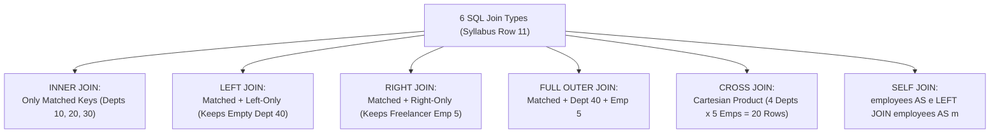

---
tags:
  - sql
  - sql-joins
  - joins-grouping-subqueries
---

# Joining Tables (INNER, LEFT, RIGHT, FULL, CROSS, SELF) in SQL

#### TL;DR (Quick Revision)

**SQL Joins** = Horizontally stitch columns from two or more tables at **Step 1 (`FROM / JOIN`)** based on a related key (`ON a.dept_id = b.dept_id`) + Choose `INNER` (matches only), `LEFT`/`RIGHT`/`FULL OUTER` (matches + unmatched padded with `NULL`), `CROSS` (every combination), or `SELF` (table joined to itself).

> [!abstract] Core Idea
> Because normalized databases split entities into separate tables (`departments` and `employees`) to prevent redundancy, **Joins** recombine those tables side by side at query time ([Why Combine Data? - ApX Machine Learning](https://apxml.com/courses/sql-for-data-science/chapter-5-combining-data-multiple-tables/why-combine-data)). This note covers all 6 join types in **Syllabus Row 11 (*Joining tables*)**: `INNER JOIN`, `LEFT JOIN`, `RIGHT JOIN`, `FULL OUTER JOIN`, `CROSS JOIN`, and `Self join` across [SQL Server Joins](https://learn.microsoft.com/en-us/sql/relational-databases/performance/joins?view=sql-server-ver17) and [MySQL 8.4 JOIN Clause](https://dev.mysql.com/doc/refman/8.4/en/join.html).

> [!question] Why Use It?
>
> - **Combine Related Entities (`INNER JOIN`)**: Pair every employee with their matching department name and city ([Practice Writing SQL INNER JOIN Queries](https://apxml.com/courses/sql-for-data-science/chapter-5-combining-data-multiple-tables/practice-inner-join)).
> - **Preserve Zero-Match Parent Records (`LEFT JOIN`)**: Keep all 4 departments in your report—even `'Quantum R&D'` (`Dept 40`), which currently has 0 employees!
> - **Reconcile Mismatches in Both Directions (`FULL OUTER JOIN`)**: Show matched staff, empty departments (`Dept 40`), and unassigned freelancers (`Emp 5`) in one unified query.
> - **Query Hierarchies & Grids (`SELF JOIN` & `CROSS JOIN`)**: Match each employee's `manager_id` to their manager's `emp_id` inside the same `employees` table, or generate all `(Department x Quarter)` pairs.

#### Quick Comparison Table

| Syllabus Join Type | ANSI SQL / SQL Server (T-SQL) | MySQL 8.4+ Equivalent | Unmatched Row Behavior |
| :--- | :--- | :--- | :--- |
| **`INNER JOIN`** | `FROM departments AS d INNER JOIN employees AS e ON d.dept_id = e.dept_id` | `FROM departments AS d INNER JOIN employees AS e ON d.dept_id = e.dept_id` ([JOIN Clause MySQL](https://dev.mysql.com/doc/refman/8.4/en/join.html)) | Drops unmatched rows from **both** tables (`Dept 40` and `Emp 5` are excluded). |
| **`LEFT JOIN` (`LEFT OUTER JOIN`)** | `FROM departments AS d LEFT JOIN employees AS e ON d.dept_id = e.dept_id` | `FROM departments AS d LEFT JOIN employees AS e ON d.dept_id = e.dept_id` ([Outer Join Optimization](https://dev.mysql.com/doc/refman/8.4/en/outer-join-optimization.html)) | Keeps 100% of left table (`d`); pads unmatched right columns (`e.*`) with `NULL`. |
| **`RIGHT JOIN` (`RIGHT OUTER JOIN`)** | `FROM departments AS d RIGHT JOIN employees AS e ON d.dept_id = e.dept_id` | `FROM departments AS d RIGHT JOIN employees AS e ON d.dept_id = e.dept_id` | Keeps 100% of right table (`e`); pads unmatched left columns (`d.*`) with `NULL`. |
| **`FULL OUTER JOIN` (Dialect Bridge!)** | `FROM departments AS d FULL OUTER JOIN employees AS e ON d.dept_id = e.dept_id` | **Not natively supported in MySQL 8.4!** Emulate via `LEFT JOIN ... UNION ALL ... LEFT JOIN WHERE d.dept_id IS NULL` | Keeps 100% of rows from **both** tables, padding missing sides with `NULL`. |
| **`CROSS JOIN`** | `FROM departments AS d CROSS JOIN quarters AS q` (No `ON` clause!) | `FROM departments AS d CROSS JOIN quarters AS q` | Cartesian product: returns $N_d 	imes N_q$ rows (every row in `d` paired with every row in `q`). |
| **`Self join`** | `FROM employees AS e LEFT JOIN employees AS m ON e.manager_id = m.emp_id` | `FROM employees AS e LEFT JOIN employees AS m ON e.manager_id = m.emp_id` | Joins a table to itself using **two mandatory table aliases** (`e` for employee, `m` for manager). |

---

## The Learning Concept

### What Problem Does It Solve?

The most infamous join bug in SQL happens when you write a `LEFT JOIN` to keep all departments (including empty `Dept 40`), and then add a filter on the right-hand table (`WHERE e.salary_usd >= 120000`) inside the **`WHERE` clause** instead of the **`ON` clause**:

```sql
-- BAD - Filtering the right-hand table 'e' in WHERE destroys the LEFT JOIN and drops Dept 30 & Dept 40!
SELECT
    d.dept_id,
    d.dept_name,
    COUNT(e.emp_id) AS high_earners
FROM departments AS d
LEFT JOIN employees AS e
    ON d.dept_id = e.dept_id
WHERE e.salary_usd >= 120000.00 -- BUG: For empty Dept 40, e.salary_usd is NULL -> WHERE discards Dept 40!
GROUP BY d.dept_id, d.dept_name;
```

Why did `Dept 40` vanish? Because in Step 1 (`LEFT JOIN`), `Dept 40` is padded with `e.salary_usd = NULL`. Then in Step 2 (`WHERE`), `NULL >= 120000.00` evaluates to `UNKNOWN`, and `WHERE` deletes the row—silently converting your `LEFT JOIN` into an `INNER JOIN` ([Outer Join Optimization](https://dev.mysql.com/doc/refman/8.4/en/outer-join-optimization.html))! Here is the fix:

```sql
-- GOOD - Moving 'AND e.salary_usd >= 120000.00' into the ON clause preserves all 4 departments!
SELECT
    d.dept_id,
    d.dept_name,
    COUNT(e.emp_id) AS high_earners
FROM departments AS d
LEFT JOIN employees AS e
    ON d.dept_id = e.dept_id
   AND e.salary_usd >= 120000.00 -- SAFE: Filters employees BEFORE padding unmatched departments with NULL!
GROUP BY d.dept_id, d.dept_name
ORDER BY d.dept_id ASC;
```

### How SQL Implements It

> [!tip] How the Engine Evaluates Outer Joins in 3 Sub-Steps
>
> 1. **Step 1A (Cartesian Pair & `ON` Filter)**: Match rows between the left and right tables where the `ON` condition is `TRUE`.
> 2. **Step 1B (Outer Row Preservation)**: For a `LEFT JOIN`, any row from the left table that found **zero** matches in Step 1A is added back into the working set with all right-table columns set to `NULL`.
> 3. **Step 2 (`WHERE` Filter)**: Finally, `WHERE` filters the combined result set. (Only put `WHERE e.emp_id IS NULL` here when you intentionally want an **Anti-Join** to find empty departments!)

#### Full Runnable Example

```sql
-- Step 1: Create departments and employees tables
CREATE TABLE departments (
    dept_id INT PRIMARY KEY,
    dept_name VARCHAR(40) NOT NULL,
    city_name VARCHAR(30) NOT NULL
);

CREATE TABLE employees (
    emp_id INT PRIMARY KEY,
    emp_name VARCHAR(50) NOT NULL,
    dept_id INT,
    manager_id INT,
    salary_usd DECIMAL(10, 2) NOT NULL
);

-- Step 2: Insert 4 departments (Dept 40 has 0 staff) and 5 employees (Emp 5 has NULL dept_id; Emp 1 has NULL manager_id)
INSERT INTO departments VALUES
(10, 'Core Database', 'Chennai'),
(20, 'AI Platform', 'Bengaluru'),
(30, 'FinOps Audit', 'Hyderabad'),
(40, 'Quantum R&D', 'Mumbai');

INSERT INTO employees VALUES
(1, 'Rajeshwari Iyer', 10, NULL, 165000.00),
(2, 'Arjun Nair', 10, 1, 120000.00),
(3, 'Sneha Reddy', 20, 1, 130000.00),
(4, 'Mohammed Farooq', 30, 3, 95000.00),
(5, 'Vikram Freelance', NULL, 2, 110000.00);

-- Step 3A: FULL OUTER JOIN (Using portable MySQL 8.4 / ANSI UNION ALL anti-join emulation)
-- In SQL Server T-SQL: FROM departments AS d FULL OUTER JOIN employees AS e ON d.dept_id = e.dept_id
SELECT
    COALESCE(CAST(d.dept_id AS VARCHAR), 'NO_DEPT') AS dept_id,
    COALESCE(d.dept_name, 'UNASSIGNED_DEPT') AS dept_name,
    COALESCE(CAST(e.emp_id AS VARCHAR), 'NO_EMP') AS emp_id,
    COALESCE(e.emp_name, 'EMPTY_DEPARTMENT') AS emp_name,
    CASE
        WHEN d.dept_id IS NOT NULL AND e.emp_id IS NOT NULL THEN 'MATCHED (INNER)'
        WHEN d.dept_id IS NOT NULL AND e.emp_id IS NULL THEN 'LEFT_ONLY (Dept 40)'
        ELSE 'RIGHT_ONLY (Emp 5)'
    END AS join_type
FROM departments AS d
LEFT JOIN employees AS e
    ON d.dept_id = e.dept_id
UNION ALL
SELECT
    COALESCE(CAST(d.dept_id AS VARCHAR), 'NO_DEPT') AS dept_id,
    COALESCE(d.dept_name, 'UNASSIGNED_DEPT') AS dept_name,
    COALESCE(CAST(e.emp_id AS VARCHAR), 'NO_EMP') AS emp_id,
    COALESCE(e.emp_name, 'EMPTY_DEPARTMENT') AS emp_name,
    'RIGHT_ONLY (Emp 5)' AS join_type
FROM employees AS e
LEFT JOIN departments AS d
    ON e.dept_id = d.dept_id
WHERE d.dept_id IS NULL
ORDER BY dept_id ASC, emp_id ASC;
```

**Output (Query 3A - Full Outer Join Showing Matched, Left-Only Dept 40, and Right-Only Emp 5):**

```
+-----------+-----------------+----------+------------------+---------------------+
| dept_id   | dept_name       | emp_id   | emp_name         | join_type           |
|-----------+-----------------+----------+------------------+---------------------|
| 10        | Core Database   | 1        | Rajeshwari Iyer  | MATCHED (INNER)     |
| 10        | Core Database   | 2        | Arjun Nair       | MATCHED (INNER)     |
| 20        | AI Platform     | 3        | Sneha Reddy      | MATCHED (INNER)     |
| 30        | FinOps Audit    | 4        | Mohammed Farooq  | MATCHED (INNER)     |
| 40        | Quantum R&D     | NO_EMP   | EMPTY_DEPARTMENT | LEFT_ONLY (Dept 40) |
| NO_DEPT   | UNASSIGNED_DEPT | 5        | Vikram Freelance | RIGHT_ONLY (Emp 5)  |
+-----------+-----------------+----------+------------------+---------------------+
```

```sql
-- Step 3B: Self Join (Employee -> Manager org chart using LEFT JOIN so the CEO is not dropped!)
SELECT
    e.emp_id,
    e.emp_name AS employee_name,
    COALESCE(m.emp_name, 'TOP_EXECUTIVE (CEO)') AS manager_name,
    e.salary_usd AS emp_salary,
    COALESCE(CAST(m.salary_usd AS VARCHAR), 'N/A') AS mgr_salary
FROM employees AS e
LEFT JOIN employees AS m
    ON e.manager_id = m.emp_id
ORDER BY e.emp_id ASC;
```

**Output (Query 3B - Hierarchical Self Join):**

```
+----------+------------------+---------------------+--------------+--------------+
| emp_id   | employee_name    | manager_name        | emp_salary   | mgr_salary   |
|----------+------------------+---------------------+--------------+--------------|
| 1        | Rajeshwari Iyer  | TOP_EXECUTIVE (CEO) | 165000       | N/A          |
| 2        | Arjun Nair       | Rajeshwari Iyer     | 120000       | 165000       |
| 3        | Sneha Reddy      | Rajeshwari Iyer     | 130000       | 165000       |
| 4        | Mohammed Farooq  | Sneha Reddy         | 95000        | 130000       |
| 5        | Vikram Freelance | Arjun Nair          | 110000       | 120000       |
+----------+------------------+---------------------+--------------+--------------+
```

### Visual Diagram: All 6 SQL Join Types in Action



### Key Terminology

1. **Equi-Join vs. Non-Equi Join**: An **equi-join** connects tables using equality (`ON d.dept_id = e.dept_id`), whereas a **non-equi join** uses `<`, `>`, or `BETWEEN` (e.g., `ON e.salary_usd BETWEEN b.min_sal AND b.max_sal`).
   Syntax: `FROM departments AS d INNER JOIN employees AS e ON d.dept_id = e.dept_id`
2. **Anti-Join (`LEFT JOIN ... WHERE right.pk IS NULL`)**: A `LEFT JOIN` filtered in `WHERE` to return **only** rows from the left table that have zero matches in the right table ([Outer Join Optimization](https://dev.mysql.com/doc/refman/8.4/en/outer-join-optimization.html)).
   Syntax: `SELECT d.dept_name FROM departments AS d LEFT JOIN employees AS e ON d.dept_id = e.dept_id WHERE e.emp_id IS NULL;`
3. **Self Join**: Joining a table to itself by assigning two distinct table aliases (`employees AS e` and `employees AS m`) to compare rows within the same table.
   Syntax: `FROM employees AS e LEFT JOIN employees AS m ON e.manager_id = m.emp_id`
4. **Cartesian Product (`CROSS JOIN`)**: Pairing every row of Table A with every row of Table B ($N_A 	imes N_B$ rows). Useful for generating date/department reporting grids, dangerous if done by accident on million-row tables!
   Syntax: `SELECT d.dept_name, q.qtr FROM departments AS d CROSS JOIN quarters AS q;`

> [!important] Key Rules to Remember
>
> - **`ON` vs. `WHERE` in `LEFT JOIN`** → Put filters on the **right** table inside `ON` if you still want unmatched left rows to appear with `NULL`s. Putting `WHERE e.salary_usd > 100000` in `WHERE` eliminates `NULL`-padded rows and turns your `LEFT JOIN` into an `INNER JOIN`!
> - **Count `right.pk`, Never `COUNT(*)` After a `LEFT JOIN`** → For empty `Dept 40`, `LEFT JOIN` outputs 1 row with `e.emp_id = NULL`. `COUNT(*)` counts that row and returns **`1`**, whereas `COUNT(e.emp_id)` ignores `NULL` and returns **`0`**!
> - **`NULL = NULL` Never Matches in `ON`** → If two rows both have `dept_id = NULL`, `ON d.dept_id = e.dept_id` evaluates to `UNKNOWN` and does **not** join them.
> - **Emulating `FULL OUTER JOIN` in MySQL 8.4** → Use `LEFT JOIN` combined with `UNION ALL` and `LEFT JOIN ... WHERE d.dept_id IS NULL` (faster and safer than bare `UNION`).

---

## Edge Case Analysis

### 1. Using `COUNT(*)` Instead of `COUNT(e.emp_id)` After a `LEFT JOIN`
**Problem:** If you group by department after a `LEFT JOIN` and write `COUNT(*) AS staff_count`, `'Quantum R&D'` (`Dept 40`, which has 0 employees) is reported as having **`1` employee** because `COUNT(*)` counts the `NULL`-padded outer row!
**Fix:** Always count the right-hand table's primary key (`COUNT(e.emp_id)`).

```sql
-- Safe child row counting after a LEFT JOIN
SELECT
    d.dept_id,
    d.dept_name,
    COUNT(*) AS wrong_count_star,
    COUNT(e.emp_id) AS correct_staff_count
FROM departments AS d
LEFT JOIN employees AS e
    ON d.dept_id = e.dept_id
GROUP BY d.dept_id, d.dept_name;
```

### 2. Breaking a `LEFT JOIN` Chain with a Downstream `INNER JOIN`
**Problem:** If you write `FROM departments AS d LEFT JOIN employees AS e ON d.dept_id = e.dept_id INNER JOIN badges AS b ON e.emp_id = b.emp_id`, the downstream `INNER JOIN` sees `e.emp_id = NULL` for `Dept 40` and drops `Dept 40`!
**Fix:** Once you use `LEFT JOIN` to preserve unmatched rows, continue using `LEFT JOIN` for any downstream tables that depend on the nullable table.

```sql
-- Keep the chain as LEFT JOIN so Dept 40 stays preserved
SELECT d.dept_name, e.emp_name
FROM departments AS d
LEFT JOIN employees AS e ON d.dept_id = e.dept_id;
```

### 3. MySQL `CROSS JOIN` with `ON` vs. ANSI/T-SQL Strictness
**Problem:** In MySQL 8.4, `JOIN`, `INNER JOIN`, and `CROSS JOIN` are syntactic synonyms if you attach an `ON` clause ([JOIN Clause MySQL](https://dev.mysql.com/doc/refman/8.4/en/join.html)), whereas SQL Server T-SQL throws a syntax error if you put `ON` after `CROSS JOIN`!
**Fix:** Always write `INNER JOIN ... ON ...` for filtered joins and `CROSS JOIN` (with **no `ON` clause**) for Cartesian products.

```sql
-- Portable ANSI / MySQL / T-SQL CROSS JOIN (no ON clause)
SELECT d.dept_name, r.region_label
FROM departments AS d
CROSS JOIN (SELECT 'APAC' AS region_label UNION ALL SELECT 'EMEA') AS r;
```

---

## Going Deeper (Intermediate -> Advanced)

### 1. Physical Join Algorithms Used by SQL Server & MySQL 8.4

When you write a logical `JOIN`, the Query Optimizer chooses one of three physical algorithms ([Joins SQL Server](https://learn.microsoft.com/en-us/sql/relational-databases/performance/joins?view=sql-server-ver17) & [MySQL Hash/BKA Joins](https://dev.mysql.com/doc/refman/8.4/en/bnl-bka-optimization.html)):

| Physical Algorithm | How It Works Internally | Best Workload Scenario |
| :--- | :--- | :--- |
| **Nested Loops Join** | For each row in the outer table, probes the inner table's B-Tree index | Small outer input joined to a large indexed inner table (OLTP queries). |
| **Hash Join (`Hash Match`)** | Builds an in-memory hash table on the smaller input, then scans the larger input to probe the hash buckets | Large unindexed inputs or analytical queries scanning large tables (supported in MySQL 8.0.18+/8.4 and T-SQL). |
| **Merge Join** | Walks through both inputs simultaneously in sorted key order | Both inputs are already pre-sorted on the join key via clustered/covering indexes (T-SQL). |

---

## Interview Corner

### Common Questions & Concise Answers

**Q1: Table A has rows `(1, 1, NULL)` and Table B has rows `(1, 2, NULL)`. How many rows are returned by `INNER`, `LEFT`, `RIGHT`, `FULL OUTER`, and `CROSS JOIN` on `A.val = B.val`?**  
A: **`INNER JOIN` = 2 rows** (each `1` in A matches the `1` in B; `NULL` never matches `NULL`); **`LEFT JOIN` = 3 rows** (2 matched + 1 unmatched `NULL` from A); **`RIGHT JOIN` = 4 rows** (2 matched + `2` and `NULL` from B); **`FULL OUTER JOIN` = 5 rows**; **`CROSS JOIN` = 9 rows** ($3 	imes 3$).

**Q2: Why does putting `WHERE e.salary_usd > 100000` after `departments d LEFT JOIN employees e` turn the `LEFT JOIN` into an `INNER JOIN`?**  
A: Because `LEFT JOIN` pads unmatched departments with `e.salary_usd = NULL` at Step 1, and `WHERE` evaluates `NULL > 100000` as `UNKNOWN` at Step 2, discarding the unmatched departments. Moving `AND e.salary_usd > 100000` into the `ON` clause filters `e` before outer padding occurs.

**Q3: How do you emulate `FULL OUTER JOIN` in MySQL 8.4?**  
A: Combine `SELECT ... FROM A LEFT JOIN B ON A.id = B.id` with `UNION ALL` and `SELECT ... FROM B LEFT JOIN A ON B.id = A.id WHERE A.id IS NULL`.

**Q4: Why should you use `LEFT JOIN` instead of `INNER JOIN` when self-joining `employees` to find each employee's manager?**  
A: The top executive (CEO) has `manager_id = NULL`. An `INNER JOIN` drops the CEO from the result set, whereas a `LEFT JOIN` preserves the CEO with `manager_name = NULL`.

**Q5: How do you find all departments that have ZERO employees using a Join?**  
A: Use a **Left Anti-Join**: `SELECT d.dept_id, d.dept_name FROM departments AS d LEFT JOIN employees AS e ON d.dept_id = e.dept_id WHERE e.emp_id IS NULL;`.

### Interactive Revision Quiz

**Q1: Table `X` has 4 rows `(10, 10, 20, NULL)` and Table `Y` has 3 rows `(10, 30, NULL)`. How many rows does `SELECT * FROM X INNER JOIN Y ON X.id = Y.id;` return?**
- [ ] A) 1 row
- [ ] B) 2 rows
- [ ] C) 3 rows
- [ ] D) 12 rows

**Q2: You run `SELECT d.dept_name, COUNT(*) FROM departments d LEFT JOIN employees e ON d.dept_id = e.dept_id GROUP BY d.dept_name;`. If `'Quantum R&D'` has 0 employees, what number does `COUNT(*)` display for `'Quantum R&D'`?**
- [ ] A) `0`
- [ ] B) `1` (because `LEFT JOIN` emits 1 `NULL`-padded row for `'Quantum R&D'`, and `COUNT(*)` counts rows regardless of `NULL`s!)
- [ ] C) `NULL`
- [ ] D) The query throws an error

**Q3: Where should you place the condition `e.salary_usd >= 120000` in a `departments d LEFT JOIN employees e` query if you want departments with zero $120k+ earners to still appear in the output?**
- [ ] A) In the `WHERE` clause (`WHERE e.salary_usd >= 120000`)
- [ ] B) In the `ON` clause (`ON d.dept_id = e.dept_id AND e.salary_usd >= 120000`)
- [ ] C) In the `HAVING` clause (`HAVING e.salary_usd >= 120000`)
- [ ] D) In the `ORDER BY` clause

**Q4: Which join type is NOT natively supported as a keyword in MySQL 8.4 and must be emulated using `LEFT JOIN` and `UNION ALL`?**
- [ ] A) `CROSS JOIN`
- [ ] B) `RIGHT OUTER JOIN`
- [ ] C) `FULL OUTER JOIN`
- [ ] D) `SELF JOIN`

**Q5: What is a `Self join` in SQL?**
- [ ] A) A special keyword `SELF JOIN` available only in SQL Server T-SQL
- [ ] B) Joining a table to itself using standard `INNER JOIN` or `LEFT JOIN` and two distinct table aliases
- [ ] C) Automatically duplicating every row in a table
- [ ] D) A join that requires no `ON` condition

<details>
<summary>Show Quiz Answers & Explanations</summary>

1. **B** — The two `10`s in Table `X` each match the single `10` in Table `Y` ($2 	imes 1 = 2$ rows); `NULL` never matches `NULL` in an `ON` equality check.
2. **B** — `COUNT(*)` counts rows, not non-null values, so the single `NULL`-padded outer row for `'Quantum R&D'` yields `1`. Use `COUNT(e.emp_id)` to get `0`!
3. **B** — Filtering the right table inside the `ON` clause applies before outer-row padding, preserving all left-table rows.
4. **C** — MySQL 8.4 supports `INNER`, `LEFT`, `RIGHT`, and `CROSS JOIN`, but requires `LEFT JOIN ... UNION ALL ...` to emulate `FULL OUTER JOIN`.
5. **B** — A self join uses standard `INNER`/`LEFT JOIN` syntax with two mandatory table aliases (`FROM employees AS e LEFT JOIN employees AS m`).

</details>

---

## Practice Exercises

**Exercise 1: Find Empty Departments (Left Anti-Join)**
- Using `departments` and `employees`, write a `LEFT JOIN` query that returns only the `dept_id` and `dept_name` of departments that have **zero** assigned employees.

**Exercise 2: Self Join — Employees Earning More Than Their Manager**
- Write a `Self join` query on `employees` that returns `emp_name`, `emp_salary`, `manager_name`, and `mgr_salary` for any employee whose `salary_usd` is strictly greater than their manager's `salary_usd`.

**Exercise 3: Dialect Bridge (`FULL OUTER JOIN` in T-SQL vs. MySQL 8.4)**
- Write the native SQL Server T-SQL `FULL OUTER JOIN` query between `departments` and `employees`, and then write its exact MySQL 8.4 `UNION ALL` equivalent.

---

## Memory Trick / One-Liner

> [!tip] Velcro Strap Analogy
> **`ON` is the Velcro that attaches the right table to the left table; `WHERE` is the pair of scissors that cuts rows out of the final sheet**—if you use the scissors (`WHERE`) on a `NULL` right-table column after a `LEFT JOIN`, you cut off the left table's preserved rows too!

---

## Warning Block (Best Practice)

> [!warning] Common Mistake (Avoid This!)
>
> ```sql
> -- BAD - Using COUNT(*) after a LEFT JOIN (falsely reports 1 employee for empty departments!)
> SELECT d.dept_name, COUNT(*) AS staff_count
> FROM departments AS d
> LEFT JOIN employees AS e ON d.dept_id = e.dept_id
> GROUP BY d.dept_name;
> ```
>
> ```sql
> -- GOOD - Counting the right table's non-null primary key COUNT(e.emp_id)
> SELECT d.dept_name, COUNT(e.emp_id) AS staff_count
> FROM departments AS d
> LEFT JOIN employees AS e ON d.dept_id = e.dept_id
> GROUP BY d.dept_name;
> ```
