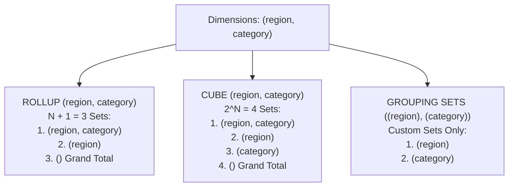

---
tags:
  - sql
  - grouping-rollup-cube
  - joins-grouping-subqueries
---

# Grouping Data (GROUP BY, HAVING, ROLLUP, CUBE, GROUPING SETS) in SQL

#### TL;DR (Quick Revision)

**Grouping & Multi-Dimensional Subtotals** = Collapse detail rows into summary buckets at **Step 3 (`GROUP BY`)**, filter those buckets at **Step 4 (`HAVING`)**, and generate hierarchical or cross-tab subtotals in a single pass using **`ROLLUP`**, **`CUBE`**, and **`GROUPING SETS`**.

> [!abstract] Core Idea
> This note covers every sub-topic in **Syllabus Row 12 (*Grouping data*)**: `GROUP BY`, `HAVING`, `GROUPING SETS`, `CUBE`, and `ROLLUP` across [SQL Server SELECT - GROUP BY (Transact-SQL)](https://learn.microsoft.com/en-us/sql/t-sql/queries/select-group-by-transact-sql?view=sql-server-ver17) and [MySQL 8.4 GROUP BY Modifiers](https://dev.mysql.com/doc/refman/8.4/en/json-search-functions.html). While standard `GROUP BY` produces a single level of aggregation, OLAP extensions (`ROLLUP`, `CUBE`, `GROUPING SETS`) calculate subtotals and grand totals without scanning the base table multiple times.

> [!question] Why Use It?
>
> - **Summarize Detail Rows (`GROUP BY` + Aggregates)**: Compute `COUNT()`, `SUM()`, `AVG()`, `MIN()`, and `MAX()` per department, region, or month ([Using MIN and MAX Functions in SQL](https://apxml.com/courses/sql-for-data-science/chapter-4-aggregating-data/finding-min-max)).
> - **Filter Summary Buckets (`HAVING`)**: Keep only groups that pass an aggregate threshold (`HAVING SUM(revenue_usd) >= 50000.00`).
> - **Hierarchical Subtotals + Grand Total (`ROLLUP`)**: Automatically compute `(region, category)` details, `(region)` subtotals, and the `()` grand total in one query.
> - **All Possible Cross-Tab Combinations (`CUBE` & `GROUPING SETS`)**: Generate every subset of dimensions (`CUBE`) or a custom hand-picked list of subtotal combinations (`GROUPING SETS`).

#### Quick Comparison Table

| Syllabus Sub-Topic (Row 12: *Grouping data*) | ANSI SQL / SQL Server (T-SQL) | MySQL 8.4+ Equivalent | Grouping Combinations Produced for `(A, B)` |
| :--- | :--- | :--- | :--- |
| **`GROUP BY A, B`** | `GROUP BY region, category` ([GROUP BY T-SQL](https://learn.microsoft.com/en-us/sql/t-sql/queries/select-group-by-transact-sql?view=sql-server-ver17)) | `GROUP BY region, category` | **1 grouping set**: `(A, B)` only. |
| **`HAVING`** | `HAVING SUM(revenue_usd) >= 50000` ([HAVING T-SQL](https://learn.microsoft.com/en-us/sql/t-sql/queries/select-having-transact-sql?view=sql-server-ver17)) | `HAVING SUM(revenue_usd) >= 50000` | Filters the grouped rows at **Step 4** after `GROUP BY` (Step 3). |
| **`ROLLUP (A, B)`** | `GROUP BY ROLLUP (region, category)` | `GROUP BY region, category WITH ROLLUP` | **$N + 1 = 3$ hierarchical sets**: `(A, B)`, `(A)`, and grand total `()`. Order of columns matters! |
| **`CUBE (A, B)` (Dialect Bridge!)** | `GROUP BY CUBE (region, category)` | **Not natively supported in MySQL 8.4!** Emulate via `WITH ROLLUP` + `UNION ALL` | **$2^N = 4$ all-combination sets**: `(A, B)`, `(A)`, `(B)`, and grand total `()`. |
| **`GROUPING SETS` (Dialect Bridge!)** | `GROUP BY GROUPING SETS ((region), (category), ())` | **Not natively supported in MySQL 8.4!** Emulate via `UNION ALL` of `GROUP BY` queries | Only the exact custom sets you list. |
| **`GROUPING(col)` Function** | `GROUPING(region)` (returns `1` for super-aggregate `NULL`, `0` for real value/real `NULL`) | `GROUPING(region)` (supported in MySQL 8.0.1+ / 8.4!) | Distinguishes a `ROLLUP`/`CUBE` subtotal `NULL` (`1`) from an actual stored `NULL` (`0`). |

---

## The Learning Concept

### What Problem Does It Solve?

Two traps catch developers when grouping data:
1. Forgetting that `AVG(discount_usd)` **ignores `NULL` rows**—so if only 1 out of 2 deals in `'APAC Cloud'` had a `$2,000` discount and the other had `NULL`, `AVG(discount_usd)` returns **`$2,000`** instead of **`$1,000`**!
2. Confusing a real stored `NULL` value in a column with the `NULL` marker generated by `ROLLUP` or `CUBE` on a subtotal row:

```sql
-- BAD - Confusing AVG(nullable_col) with true average, and misreading ROLLUP NULLs
SELECT
    region,
    AVG(discount_usd) AS misleading_avg -- Ignores NULL rows completely (divides by 1 instead of 2)!
FROM regional_sales
GROUP BY region WITH ROLLUP;            -- Subtotal row has region = NULL; is that a real NULL or Grand Total?
```

Using `COALESCE(discount_usd, 0.00)` inside `AVG()` includes zero-discount deals in the denominator, and using `GROUPING(region)` tells you with 100% certainty whether a `NULL` was produced by `ROLLUP` (`GROUPING(region) = 1`):

```sql
-- GOOD - Explicit COALESCE inside AVG() and GROUPING() function to label ROLLUP subtotals
-- (Runnable in both MySQL 8.4 with 'GROUP BY region, category WITH ROLLUP'
--  and SQL Server T-SQL with 'GROUP BY ROLLUP (region, category)')
SELECT
    IF(GROUPING(region) = 1, 'ALL_REGIONS', region) AS region_label,
    IF(GROUPING(category) = 1, 'ALL_CATEGORIES', category) AS category_label,
    SUM(revenue_usd) AS total_revenue,
    ROUND(AVG(COALESCE(discount_usd, 0.00)), 2) AS true_avg_discount
FROM regional_sales
GROUP BY region, category WITH ROLLUP;
```

### How SQL Implements It

> [!tip] Understanding `ROLLUP` vs. `CUBE` vs. `GROUPING SETS`
>
> 1. **`ROLLUP(A, B)` (Hierarchy)**: Peels columns off from **right to left**: first groups by `(A, B)`, then drops `B` to group by `(A)`, then drops `A` for the grand total `()`. ($N + 1$ groupings).
> 2. **`CUBE(A, B)` (All Combinations)**: Computes every possible subset: `(A, B)`, `(A)`, `(B)`, and `()`. ($2^N$ groupings).
> 3. **`GROUPING SETS((A), (B))` (Custom Pick-List)**: Computes **only** the exact combinations you specify—saving CPU when you want `(A)` and `(B)` subtotals without computing `(A, B)`!

#### Full Runnable Example

```sql
-- Step 1: Create regional_sales table and insert 6 rows (including NULL discounts)
CREATE TABLE regional_sales (
    sale_id INT PRIMARY KEY,
    region VARCHAR(20) NOT NULL,
    category VARCHAR(20) NOT NULL,
    revenue_usd DECIMAL(10, 2) NOT NULL,
    discount_usd DECIMAL(8, 2)
);

INSERT INTO regional_sales VALUES
(1, 'APAC', 'Cloud', 40000.00, 2000.00),
(2, 'APAC', 'Cloud', 35000.00, NULL),
(3, 'APAC', 'Security', 25000.00, 1000.00),
(4, 'EMEA', 'Cloud', 50000.00, 2500.00),
(5, 'EMEA', 'Security', 30000.00, NULL),
(6, 'AMER', 'Security', 18000.00, 500.00);

-- Step 2A: GROUP BY & HAVING comparing AVG(discount_usd) vs AVG(COALESCE(discount_usd, 0.00))
SELECT
    region,
    COUNT(*) AS deal_count,
    SUM(revenue_usd) AS total_revenue,
    ROUND(AVG(discount_usd), 2) AS avg_non_null_discount,
    ROUND(AVG(COALESCE(discount_usd, 0.00)), 2) AS avg_all_deals_discount
FROM regional_sales
GROUP BY region
HAVING SUM(revenue_usd) >= 50000.00
ORDER BY total_revenue DESC;
```

**Output (Query 2A - `GROUP BY` & `HAVING` with `AVG` NULL Comparison):**

```
+----------+--------------+-----------------+-------------------------+--------------------------+
| region   | deal_count   | total_revenue   | avg_non_null_discount   | avg_all_deals_discount   |
|----------+--------------+-----------------+-------------------------+--------------------------|
| APAC     | 3            | 100000          | 1500.0                  | 1000.0                   |
| EMEA     | 2            | 80000           | 2500.0                  | 1250.0                   |
+----------+--------------+-----------------+-------------------------+--------------------------+
```

```sql
-- Step 2B: Exact 3-level hierarchy produced by ROLLUP (region, category)
-- MySQL 8.4 syntax:   GROUP BY region, category WITH ROLLUP
-- T-SQL / ANSI syntax: GROUP BY ROLLUP (region, category)
SELECT
    region,
    category,
    SUM(revenue_usd) AS subtotal_revenue,
    'DETAIL_GROUP' AS grouping_level
FROM regional_sales
GROUP BY region, category
UNION ALL
SELECT
    region,
    'ALL_CATEGORIES (ROLLUP)',
    SUM(revenue_usd),
    'REGION_SUBTOTAL'
FROM regional_sales
GROUP BY region
UNION ALL
SELECT
    'ALL_REGIONS (GRAND TOTAL)',
    'ALL_CATEGORIES',
    SUM(revenue_usd),
    'GRAND_TOTAL'
FROM regional_sales;
```

**Output (Query 2B - Hierarchical Subtotals & Grand Total Produced by `ROLLUP`):**

```
+---------------------------+-------------------------+--------------------+------------------+
| region                    | category                | subtotal_revenue   | grouping_level   |
|---------------------------+-------------------------+--------------------+------------------|
| AMER                      | Security                | 18000              | DETAIL_GROUP     |
| APAC                      | Cloud                   | 75000              | DETAIL_GROUP     |
| APAC                      | Security                | 25000              | DETAIL_GROUP     |
| EMEA                      | Cloud                   | 50000              | DETAIL_GROUP     |
| EMEA                      | Security                | 30000              | DETAIL_GROUP     |
| AMER                      | ALL_CATEGORIES (ROLLUP) | 18000              | REGION_SUBTOTAL  |
| APAC                      | ALL_CATEGORIES (ROLLUP) | 100000             | REGION_SUBTOTAL  |
| EMEA                      | ALL_CATEGORIES (ROLLUP) | 80000              | REGION_SUBTOTAL  |
| ALL_REGIONS (GRAND TOTAL) | ALL_CATEGORIES          | 198000             | GRAND_TOTAL      |
+---------------------------+-------------------------+--------------------+------------------+
```

### Visual Diagram: `ROLLUP` vs. `CUBE` vs. `GROUPING SETS` on `(region, category)`



### Key Terminology

1. **Aggregate Functions (`COUNT`, `SUM`, `AVG`, `MIN`, `MAX`)**: Functions that collapse multiple rows in a group into a single summary value. All aggregate functions **except `COUNT(*)`** ignore `NULL` values ([Using MIN and MAX Functions in SQL](https://apxml.com/courses/sql-for-data-science/chapter-4-aggregating-data/finding-min-max)).
   Syntax: `SELECT region, SUM(revenue_usd), AVG(revenue_usd) FROM regional_sales GROUP BY region;`
2. **`ROLLUP`**: An extension to `GROUP BY` that produces hierarchical subtotals from right to left plus a grand total ($N + 1$ grouping combinations for $N$ columns) ([SELECT - GROUP BY Transact-SQL](https://learn.microsoft.com/en-us/sql/t-sql/queries/select-group-by-transact-sql?view=sql-server-ver17)).
   Syntax: `GROUP BY ROLLUP (region, category)` (T-SQL) / `GROUP BY region, category WITH ROLLUP` (MySQL 8.4)
3. **`CUBE`**: An extension to `GROUP BY` that produces subtotals for **all $2^N$ possible combinations** of the specified $N$ dimensions.
   Syntax: `GROUP BY CUBE (region, category)` (T-SQL)
4. **`GROUPING SETS`**: Allows you to explicitly list the exact subtotal combinations you want in a single query without writing multiple `UNION ALL` blocks.
   Syntax: `GROUP BY GROUPING SETS ((region, category), (region), ())` (T-SQL)

> [!important] Key Rules to Remember
>
> - **How `GROUP BY` Treats `NULL`s** → Even though `NULL = NULL` is `UNKNOWN` in `WHERE` and `JOIN`, **`GROUP BY` treats all `NULL` values in a grouping column as equal** and puts them together into a single `NULL` group!
> - **`AVG(col)` Ignores `NULL`s** → `AVG(discount_usd)` divides `SUM(discount_usd)` by `COUNT(discount_usd)` (non-null rows only), **not** `COUNT(*)`. Use `AVG(COALESCE(discount_usd, 0))` if `NULL` represents zero!
> - **Column Order Matters in `ROLLUP`, Not in `CUBE`** → `ROLLUP(region, category)` computes `(region)` subtotals but **not** `(category)` subtotals. `CUBE(region, category)` and `CUBE(category, region)` compute the exact same 4 sets.
> - **Distinguishing Super-Aggregate `NULL`s with `GROUPING(col)`** → When `ROLLUP` or `CUBE` summarizes a dimension, it places `NULL` in that column. Call `GROUPING(col)` (returns `1` if collapsed by `ROLLUP`/`CUBE`, `0` if it is a normal row) to label subtotals cleanly.

---

## Edge Case Analysis

### 1. Multiple `NULL` Rows in a `GROUP BY` Column
**Problem:** Students often wonder: since `NULL = NULL` is `UNKNOWN`, does `GROUP BY discount_usd` put every `NULL` row into its own separate group, or combine them into one `NULL` bucket?
**Fix:** According to the ANSI SQL standard ([SELECT - GROUP BY T-SQL](https://learn.microsoft.com/en-us/sql/t-sql/queries/select-group-by-transact-sql?view=sql-server-ver17)), `GROUP BY` places all `NULL` values into **one single `NULL` group**.

```sql
-- All rows where discount_usd IS NULL are grouped into a single NULL bucket (Count = 2)
SELECT discount_usd, COUNT(*) AS rows_in_bucket
FROM regional_sales
GROUP BY discount_usd;
```

### 2. Emulating T-SQL `CUBE(region, category)` in MySQL 8.4
**Problem:** MySQL 8.4 supports `GROUP BY region, category WITH ROLLUP` (which gives `(region, category)`, `(region)`, and `()`), but does **not** support `GROUP BY CUBE(region, category)`—so the `(category)`-only subtotal is missing!
**Fix:** In MySQL 8.4, combine `GROUP BY region, category WITH ROLLUP` with `UNION ALL` and a `GROUP BY category` query:

```sql
-- Emulating CUBE(region, category) in MySQL 8.4
SELECT region, category, SUM(revenue_usd) AS total_rev
FROM regional_sales
GROUP BY region, category WITH ROLLUP
UNION ALL
SELECT NULL AS region, category, SUM(revenue_usd) AS total_rev
FROM regional_sales
GROUP BY category;
```

### 3. Rewriting Any `ROLLUP` or `CUBE` as Explicit `GROUPING SETS` (T-SQL / ANSI Equivalence)
**Problem:** Interviewers love asking you to rewrite `ROLLUP` and `CUBE` using `GROUPING SETS`.
**Fix:** Memorize these two exact equivalences ([SELECT - GROUP BY Transact-SQL](https://learn.microsoft.com/en-us/sql/t-sql/queries/select-group-by-transact-sql?view=sql-server-ver17)):

```sql
-- 1. GROUP BY ROLLUP (region, category) is 100% equivalent to:
-- GROUP BY GROUPING SETS ( (region, category), (region), () )

-- 2. GROUP BY CUBE (region, category) is 100% equivalent to:
-- GROUP BY GROUPING SETS ( (region, category), (region), (category), () )
```

---

## Going Deeper (Intermediate -> Advanced)

### 1. Counting Grouping Combinations: $N + 1$ (`ROLLUP`) vs. $2^N$ (`CUBE`)

If you group across $N = 3$ dimensions `(year, region, category)`:
- **`ROLLUP(year, region, category)`** generates **$N + 1 = 4$** grouping sets:
  1. `(year, region, category)`
  2. `(year, region)`
  3. `(year)`
  4. `()` (Grand Total)
- **`CUBE(year, region, category)`** generates **$2^3 = 8$** grouping sets:
  1. `(year, region, category)`
  2. `(year, region)`, `(year, category)`, `(region, category)`
  3. `(year)`, `(region)`, `(category)`
  4. `()` (Grand Total)

---

## Interview Corner

### Common Questions & Concise Answers

**Q1: How many grouping sets are generated by `ROLLUP(a, b, c)` vs. `CUBE(a, b, c)`?**  
A: For $N = 3$ columns, `ROLLUP(a, b, c)` generates **$N + 1 = 4$** hierarchical grouping sets (`(a,b,c)`, `(a,b)`, `(a)`, `()`), whereas `CUBE(a, b, c)` generates **$2^N = 2^3 = 8$** grouping sets (every possible subset of the 3 columns).

**Q2: How do you tell the difference between a real `NULL` stored in a column and a `NULL` generated by `ROLLUP` or `CUBE`?**  
A: Use the **`GROUPING(column_name)`** function (supported in both SQL Server T-SQL and MySQL 8.4): it returns **`1`** when the `NULL` indicates a super-aggregate subtotal row created by `ROLLUP`/`CUBE`, and **`0`** when the row is a normal group (even if the underlying value stored in the table is `NULL`).

**Q3: Why did `AVG(discount_usd)` return `1500.00` instead of `1000.00` for `APAC` in our lab?**  
A: `APAC` had 3 sales: `$2000`, `NULL`, and `$1000`. Because `AVG()` ignores `NULL` rows completely, it computed $(2000 + 1000) / 2 = 1500.00$. Wrapping the column in `AVG(COALESCE(discount_usd, 0.00))` computes $(2000 + 0 + 1000) / 3 = 1000.00$.

**Q4: How does `GROUP BY` handle multiple `NULL` values in the grouping column?**  
A: Unlike `WHERE` or `INNER JOIN` (where `NULL = NULL` is `UNKNOWN`), `GROUP BY` treats all `NULL`s as equal and places them into a single `NULL` summary group.

**Q5: What is the syntax difference for `ROLLUP` between SQL Server (T-SQL) and MySQL 8.4?**  
A: SQL Server uses ANSI syntax `GROUP BY ROLLUP (region, category)` (and also supports legacy `WITH ROLLUP`), whereas MySQL 8.4 uses the modifier syntax `GROUP BY region, category WITH ROLLUP`.

### Interactive Revision Quiz

**Q1: If a table has 4 rows with values `(10, 20, NULL, NULL)` in column `bonus`, what do `SUM(bonus)`, `AVG(bonus)`, and `COUNT(bonus)` return?**
- [ ] A) `SUM = 30`, `AVG = 7.5`, `COUNT = 4`
- [ ] B) `SUM = 30`, `AVG = 15.0`, `COUNT = 2`
- [ ] C) `SUM = NULL`, `AVG = NULL`, `COUNT = 2`
- [ ] D) `SUM = 30`, `AVG = 15.0`, `COUNT = 4`

**Q2: How many grouping sets does `GROUP BY CUBE (region, quarter, channel)` produce?**
- [ ] A) 3
- [ ] B) 4
- [ ] C) 6
- [ ] D) 8 ($2^3 = 8$)

**Q3: Which `GROUPING SETS` clause is 100% equivalent to `GROUP BY ROLLUP (region, category)`?**
- [ ] A) `GROUP BY GROUPING SETS ((region, category), (region), (category), ())`
- [ ] B) `GROUP BY GROUPING SETS ((region, category), (region), ())`
- [ ] C) `GROUP BY GROUPING SETS ((region), (category))`
- [ ] D) `GROUP BY GROUPING SETS ((region, category), (category), ())`

**Q4: What does `GROUPING(region)` return on a Grand Total row generated by `ROLLUP`?**
- [ ] A) `NULL`
- [ ] B) `0`
- [ ] C) `1`
- [ ] D) `'GRAND_TOTAL'`

**Q5: If 3 rows in `employees` have `dept_id = NULL`, how many rows for `NULL` will appear in `SELECT dept_id, COUNT(*) FROM employees GROUP BY dept_id;`?**
- [ ] A) 0 rows (`GROUP BY` automatically deletes `NULL`s)
- [ ] B) 1 row with `dept_id = NULL` and `COUNT(*) = 3`
- [ ] C) 3 separate rows each with `dept_id = NULL` and `COUNT(*) = 1`
- [ ] D) The query fails with a NULL grouping error

<details>
<summary>Show Quiz Answers & Explanations</summary>

1. **B** — `SUM`, `AVG`, and `COUNT(bonus)` all ignore the two `NULL` rows, so `COUNT(bonus) = 2`, `SUM(bonus) = 30`, and `AVG(bonus) = 30 / 2 = 15.0`.
2. **D** — `CUBE` on $N = 3$ columns produces $2^3 = 8$ grouping combinations.
3. **B** — `ROLLUP(region, category)` peels columns from right to left: `(region, category) -> (region) -> ()`.
4. **C** — `GROUPING(col)` returns `1` when the column has been aggregated into a subtotal/grand total row, and `0` otherwise.
5. **B** — `GROUP BY` groups all `NULL` values together into a single bucket (`COUNT(*) = 3`).

</details>

---

## Practice Exercises

**Exercise 1: `GROUP BY` and `HAVING` Filter**
- Using `regional_sales`, write a query that groups by `category`, calculates the number of sales (`sale_count`) and total revenue (`SUM(revenue_usd)`), and filters for categories with `SUM(revenue_usd) > 50000.00`.

**Exercise 2: Write a `ROLLUP` Query in Both MySQL 8.4 and T-SQL**
- Write a query that computes `(region, category)` revenue subtotals, `(region)` subtotals, and the overall grand total using (a) MySQL 8.4 `WITH ROLLUP` and (b) SQL Server T-SQL `GROUP BY ROLLUP (...)`.

**Exercise 3: Custom `GROUPING SETS`**
- Write a SQL Server T-SQL `GROUPING SETS` query that outputs **only** the subtotal by `(region)` and the subtotal by `(category)` (without the detailed `(region, category)` rows or grand total), and write its MySQL 8.4 `UNION ALL` equivalent.

---

## Memory Trick / One-Liner

> [!tip] Folding a Map (`ROLLUP`) vs. Rubik's Cube (`CUBE`) Analogy
> **`ROLLUP(A, B, C)` is like rolling up a telescope from right to left (`ABC -> AB -> A -> ()` = $N+1$ stops), while `CUBE(A, B, C)` twists a Rubik's Cube to show every possible face combination ($2^N$ stops)!**

---

## Warning Block (Best Practice)

> [!warning] Common Mistake (Avoid This!)
>
> ```sql
> -- BAD - Using COALESCE(region, 'TOTAL') on a nullable column with ROLLUP (confuses real NULLs with subtotals!)
> SELECT COALESCE(region, 'GRAND_TOTAL') AS region, SUM(revenue_usd)
> FROM regional_sales
> GROUP BY region WITH ROLLUP;
> ```
>
> ```sql
> -- GOOD - Using GROUPING(region) = 1 to detect genuine ROLLUP super-aggregate rows
> SELECT
>     CASE WHEN GROUPING(region) = 1 THEN 'GRAND_TOTAL' ELSE region END AS region,
>     SUM(revenue_usd) AS total_revenue
> FROM regional_sales
> GROUP BY region WITH ROLLUP;
> ```
