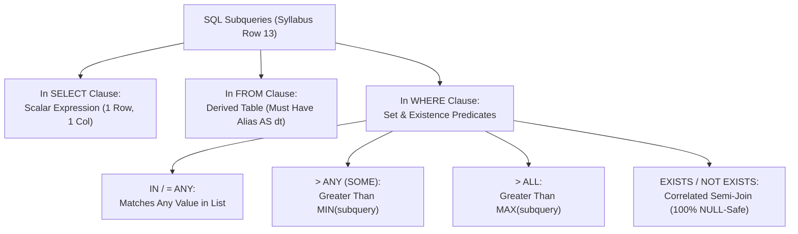

---
tags:
  - sql
  - sql-subqueries
  - joins-grouping-subqueries
---

# Subqueries (IN, ANY, ALL, EXISTS, Derived Tables) in SQL

#### TL;DR (Quick Revision)

**SQL Subquery** = A query nested inside parentheses `(SELECT ...)` inside another query's `SELECT`, `FROM`, `WHERE`, or `HAVING` clause + Categorized by shape (**Scalar**, **Column/List**, **Row**, **Table**) and correlation (**Self-Contained** vs. **Correlated**).

> [!abstract] Core Idea
> A **Subquery** (or inner query) is a `SELECT` statement nested inside an outer SQL statement ([MySQL 8.4 Subqueries](https://dev.mysql.com/doc/refman/8.4/en/subqueries.html)). This note covers all **9 sub-topics in Syllabus Row 13 (*Subquery*)**: Introduction to SQL Server subquery, Nesting subquery, Subquery types, Subquery used in place of an expression (`SELECT`), Subquery with `IN`, Subquery with `ANY` (`SOME`), Subquery with `ALL`, Subquery with `EXISTS` or `NOT EXISTS` ([Correlated Subqueries](https://dev.mysql.com/doc/refman/8.4/en/correlated-subqueries.html)), and Subquery in the `FROM` clause (**Derived Tables**).

> [!question] Why Use It?
>
> - **Compare Rows Against Dynamic Aggregates (`WHERE salary > (SELECT AVG(...))`)**: Filter employees against the company-wide or department-wide average salary without hardcoding numbers.
> - **Safe Existence & Anti-Join Checks (`EXISTS` / `NOT EXISTS`)**: Test whether related child rows exist without duplicating parent rows or falling into the `NOT IN (NULL)` trap!
> - **Pre-Aggregate in the `FROM` Clause (Derived Tables)**: Compute summary metrics inside `FROM (SELECT dept_id, AVG(salary) ... GROUP BY dept_id) AS dept_avg` and join them back to detail rows.
> - **Multi-Value Threshold Comparisons (`IN`, `ANY`, `ALL`)**: Check if a salary is greater than *at least one* (`> ANY`) or *every single one* (`> ALL`) of the salaries in another department.

#### Quick Comparison Table

| Syllabus Subquery Type / Operator | Syntax Pattern | What It Returns & Expects | `NULL` Safety & Key Rule |
| :--- | :--- | :--- | :--- |
| **1. Expression / Scalar Subquery (`SELECT` or `WHERE =`)** | `WHERE salary_usd > (SELECT AVG(salary_usd) FROM employees)` | Must return **at most 1 row and 1 column** (a single scalar value). | If it returns `0` rows, it evaluates to `NULL`; if it returns `> 1` row, the query crashes (`Subquery returned more than 1 value`)! |
| **2. `IN` / `NOT IN` Subquery** | `WHERE dept_id IN (SELECT dept_id FROM departments WHERE ...)` | Expects a **1-column list** of 0 or more values. | `IN` is safe with `NULL`s; **`NOT IN` returns 0 rows if the subquery contains even a single `NULL`!** |
| **3. `ANY` / `SOME` Subquery** | `WHERE salary_usd > ANY (SELECT salary_usd FROM employees WHERE dept_id = 20)` | Compares a value to a 1-column list (`> ANY` means **greater than the minimum** value in the list!). | `= ANY (...)` is identical to `IN (...)`. `> ANY` ignores `NULL`s if at least one match is `TRUE`. |
| **4. `ALL` Subquery** | `WHERE salary_usd > ALL (SELECT salary_usd FROM employees WHERE dept_id = 20)` | Compares a value to every row in a 1-column list (`> ALL` means **greater than the maximum** value!). | **NULL Trap**: Like `NOT IN`, if the subquery returns even one `NULL`, `> ALL` and `<> ALL` never evaluate to `TRUE`! |
| **5. `EXISTS` / `NOT EXISTS` (Correlated)** | `WHERE NOT EXISTS (SELECT 1 FROM employees AS e WHERE e.dept_id = d.dept_id)` ([Correlated Subqueries MySQL](https://dev.mysql.com/doc/refman/8.4/en/correlated-subqueries.html)) | Returns boolean **`TRUE` or `FALSE`** based on whether at least 1 row matches. | **100% `NULL`-safe!** Never returns `UNKNOWN`; short-circuits as soon as the 1st matching row is found. |
| **6. Subquery in `FROM` (Derived Table)** | `FROM (SELECT dept_id, AVG(salary_usd) AS avg_sal FROM employees GROUP BY dept_id) AS dt` | Returns a virtual **table** (rows and columns). | **Mandatory Alias Rule**: Every derived table in `FROM` **must** have an alias (`AS dt`) in both MySQL 8.4 and SQL Server T-SQL! |

---

## The Learning Concept

### What Problem Does It Solve?

Suppose you want to find all departments in `departments` that have **zero employees** in `employees`. If `employees` contains even **one contractor row where `dept_id IS NULL`** (`emp_id = 6`), look at what happens when you use `NOT IN` versus `NOT EXISTS`:

```sql
-- BAD - Using NOT IN when the subquery column (employees.dept_id) can contain NULL!
SELECT dept_id, dept_name
FROM departments
WHERE dept_id NOT IN (
    SELECT dept_id FROM employees -- Contains (10, 20, 30, NULL) -> Returns 0 ROWS!
);
```

Because `employees.dept_id` contains `NULL` for Contractor `6`, `dept_id NOT IN (10, 20, 30, NULL)` expands to `dept_id <> 10 AND dept_id <> 20 AND dept_id <> 30 AND dept_id <> NULL`. Since `40 <> NULL` is `UNKNOWN`, `Dept 40` (`'Empty Innovation Lab'`) is **completely swallowed** and the query returns 0 rows! Now compare `NOT EXISTS`:

```sql
-- GOOD - Using NOT EXISTS is 100% immune to NULLs and stops at the first match!
SELECT d.dept_id, d.dept_name
FROM departments AS d
WHERE NOT EXISTS (
    SELECT 1
    FROM employees AS e
    WHERE e.dept_id = d.dept_id
);
```

### How SQL Implements It

> [!tip] Self-Contained vs. Correlated Subqueries
>
> 1. **Self-Contained (Uncorrelated) Subquery**: Has **no reference** to the outer table (`SELECT AVG(salary_usd) FROM employees`). You can highlight it and run it by itself! The engine executes it once and caches the result.
> 2. **Correlated Subquery**: References a column from the outer query (`WHERE e.dept_id = d.dept_id`). Conceptually, it is evaluated for each row of the outer query (though modern MySQL 8.4 and SQL Server optimizers often rewrite `EXISTS` into a fast **Semi-Join / Anti-Semi-Join**!).
> 3. **Derived Table (`FROM (SELECT ...) AS alias`)**: Materializes or merges an inline view at Step 1 (`FROM`). Always give it a table alias (`AS dept_avg`) and give every computed column inside it a column alias (`AS avg_dept_salary`).

#### Full Runnable Example

```sql
-- Step 1: Create departments and employees (including Dept 40 with 0 staff, and Emp 6 with NULL dept_id)
CREATE TABLE departments (
    dept_id INT PRIMARY KEY,
    dept_name VARCHAR(40) NOT NULL
);

CREATE TABLE employees (
    emp_id INT PRIMARY KEY,
    emp_name VARCHAR(50) NOT NULL,
    dept_id INT,
    salary_usd DECIMAL(10, 2) NOT NULL
);

INSERT INTO departments VALUES
(10, 'Data Engineering'),
(20, 'Cloud Platform'),
(30, 'Security Ops'),
(40, 'Empty Innovation Lab');

INSERT INTO employees VALUES
(1, 'Ananya', 10, 150000.00),
(2, 'Vikram', 10, 110000.00),
(3, 'Siddharth', 20, 135000.00),
(4, 'Kavya', 20, 95000.00),
(5, 'Prashanth', 30, 88000.00),
(6, 'Contractor_NullDept', NULL, 92000.00);

-- Step 2A: Subquery in the FROM clause (Derived Table) finding employees earning above their department average
SELECT
    e.emp_id,
    e.emp_name,
    e.dept_id,
    e.salary_usd,
    dept_avg.avg_dept_salary,
    ROUND(e.salary_usd - dept_avg.avg_dept_salary, 2) AS above_dept_avg_by
FROM employees AS e
INNER JOIN (
    SELECT
        dept_id,
        ROUND(AVG(salary_usd), 2) AS avg_dept_salary
    FROM employees
    WHERE dept_id IS NOT NULL
    GROUP BY dept_id
) AS dept_avg
    ON e.dept_id = dept_avg.dept_id
WHERE e.salary_usd > dept_avg.avg_dept_salary
ORDER BY e.emp_id ASC;
```

**Output (Query 2A - Derived Table in `FROM` Clause):**

```
+----------+------------+-----------+--------------+-------------------+---------------------+
| emp_id   | emp_name   | dept_id   | salary_usd   | avg_dept_salary   | above_dept_avg_by   |
|----------+------------+-----------+--------------+-------------------+---------------------|
| 1        | Ananya     | 10        | 150000       | 130000.0          | 20000.0             |
| 3        | Siddharth  | 20        | 135000       | 115000.0          | 20000.0             |
+----------+------------+-----------+--------------+-------------------+---------------------+
```

```sql
-- Step 2B: Proving the NOT IN (NULL) Trap vs Safe NOT EXISTS on Department 40
SELECT
    d.dept_id,
    d.dept_name,
    CASE
        WHEN d.dept_id NOT IN (SELECT dept_id FROM employees) THEN 'MATCHED_NOT_IN'
        ELSE 'SWALLOWED_BY_NULL_TRAP!'
    END AS not_in_result,
    CASE
        WHEN NOT EXISTS (
            SELECT 1 FROM employees AS e WHERE e.dept_id = d.dept_id
        ) THEN 'SAFE_EMPTY_DEPT_FOUND'
        ELSE 'HAS_EMPLOYEES'
    END AS not_exists_result
FROM departments AS d
ORDER BY d.dept_id ASC;
```

**Output (Query 2B - `NOT IN` Swallows Dept 40, while `NOT EXISTS` Finds Dept 40 Cleanly):**

```
+-----------+----------------------+-------------------------+-----------------------+
| dept_id   | dept_name            | not_in_result           | not_exists_result     |
|-----------+----------------------+-------------------------+-----------------------|
| 10        | Data Engineering     | SWALLOWED_BY_NULL_TRAP! | HAS_EMPLOYEES         |
| 20        | Cloud Platform       | SWALLOWED_BY_NULL_TRAP! | HAS_EMPLOYEES         |
| 30        | Security Ops         | SWALLOWED_BY_NULL_TRAP! | HAS_EMPLOYEES         |
| 40        | Empty Innovation Lab | SWALLOWED_BY_NULL_TRAP! | SAFE_EMPTY_DEPT_FOUND |
+-----------+----------------------+-------------------------+-----------------------+
```

### Visual Diagram: Subquery Locations & Operator Equivalence



### Key Terminology

1. **Scalar Subquery**: A subquery that returns a single value (**1 row, 1 column**) and can be used anywhere a single column or number is expected (such as `SELECT`, `WHERE col = (...)`, or `SET`).
   Syntax: `SELECT emp_name, (SELECT AVG(salary_usd) FROM employees) AS company_avg FROM employees;`
2. **Derived Table (Subquery in `FROM`)**: A subquery placed inside the `FROM` clause that acts as a temporary inline view for the duration of the query ([MySQL Subqueries](https://dev.mysql.com/doc/refman/8.4/en/subqueries.html)).
   Syntax: `SELECT dt.dept_id, dt.avg_sal FROM (SELECT dept_id, AVG(salary_usd) AS avg_sal FROM employees GROUP BY dept_id) AS dt;`
3. **`ANY` (`SOME`) vs. `ALL` Operators**: `> ANY (subquery)` returns `TRUE` if the value is greater than **at least one** value in the subquery (equivalent to `> MIN(...)`); `> ALL (subquery)` returns `TRUE` only if the value is greater than **every** value in the subquery (equivalent to `> MAX(...)`).
   Syntax: `WHERE salary_usd > ALL (SELECT salary_usd FROM employees WHERE dept_id = 20)`
4. **Correlated Subquery with `EXISTS`**: A subquery that depends on the current row of the outer query (`WHERE e.dept_id = d.dept_id`). Writing `SELECT 1` inside `EXISTS (SELECT 1 FROM ...)` is standard because `EXISTS` only checks whether a row exists and ignores the selected column list ([Correlated Subqueries](https://dev.mysql.com/doc/refman/8.4/en/correlated-subqueries.html)).
   Syntax: `WHERE EXISTS (SELECT 1 FROM employees AS e WHERE e.dept_id = d.dept_id)`

> [!important] Key Rules to Remember
>
> - **Never Use `NOT IN` on a Nullable Subquery Column** → Prefer `NOT EXISTS` (or add `WHERE col IS NOT NULL` inside the `NOT IN` subquery) so a single `NULL` never wipes out your entire result set!
> - **Derived Tables Require an Alias** → Writing `SELECT * FROM (SELECT emp_id FROM employees);` without `AS dt` at the end fails in both MySQL 8.4 (`Error 1248: Every derived table must have its own alias`) and SQL Server (`Msg 102`).
> - **Quick Mental Translation for `ANY` and `ALL`**:
>   - `x = ANY (...)` $\iff$ `x IN (...)`
>   - `x <> ALL (...)` $\iff$ `x NOT IN (...)` (shares the exact same `NULL` trap!)
>   - `x > ANY (...)` $\iff$ `x > (SELECT MIN(...) ...)`
>   - `x > ALL (...)` $\iff$ `x > (SELECT MAX(...) ...)`
> - **MySQL Same-Table DML Subquery Restriction** → In MySQL, `DELETE FROM employees WHERE salary_usd < (SELECT AVG(salary_usd) FROM employees);` fails with `Error 1093: You can't specify target table 'employees' for update in FROM clause`. Fix it by wrapping the subquery in an extra derived table: `(SELECT avg_sal FROM (SELECT AVG(salary_usd) AS avg_sal FROM employees) AS tmp)`!

---

## Edge Case Analysis

### 1. Scalar Subquery Returning `> 1` Row vs. `0` Rows
**Problem:** In `WHERE dept_id = (SELECT dept_id FROM departments WHERE dept_name LIKE '%a%')`, if 2 departments match, the query crashes at runtime (`Subquery returned more than 1 value`). Conversely, if `0` departments match, the scalar subquery returns `NULL`!
**Fix:** Use `IN` instead of `=` whenever a subquery could return more than 1 row.

```sql
-- Safe multi-row comparison using IN
SELECT emp_id, emp_name
FROM employees
WHERE dept_id IN (
    SELECT dept_id FROM departments WHERE dept_name LIKE '%a%'
);
```

### 2. Why `> ALL (subquery)` Fails When the Subquery Contains `NULL`
**Problem:** Suppose you run `WHERE salary_usd > ALL (SELECT salary_usd FROM bonus_pool)`. If `bonus_pool` contains `(95000, 135000, NULL)`, then for Ananya (`150000`), `150000 > 95000` is `TRUE`, `150000 > 135000` is `TRUE`, and `150000 > NULL` is `UNKNOWN`. Because `TRUE AND TRUE AND UNKNOWN` is `UNKNOWN`, `> ALL` returns **0 rows**!
**Fix:** Filter `WHERE salary_usd IS NOT NULL` inside the `ALL` subquery, or use `WHERE salary_usd > (SELECT MAX(salary_usd) FROM bonus_pool)` (since `MAX()` automatically ignores `NULL`s!).

```sql
-- Safe alternative to > ALL that ignores NULLs automatically
SELECT emp_id, emp_name, salary_usd
FROM employees
WHERE salary_usd > (
    SELECT MAX(salary_usd) FROM employees WHERE dept_id = 20
);
```

### 3. Nesting Subqueries (Subquery Inside Another Subquery)
**Problem:** Your syllabus includes **Nesting subquery** (placing a subquery inside another subquery). While SQL Server allows up to 32 levels of nesting, deeply nested subqueries become hard to read.
**Fix:** Keep nested subqueries clean and indented (or refactor 3+ levels into Common Table Expressions `WITH` CTEs, covered in Folder 06).

```sql
-- Nested Subquery: Find employees in departments whose average salary exceeds the company-wide average
SELECT emp_id, emp_name, dept_id, salary_usd
FROM employees
WHERE dept_id IN (
    SELECT dept_id
    FROM employees
    WHERE dept_id IS NOT NULL
    GROUP BY dept_id
    HAVING AVG(salary_usd) > (
        SELECT AVG(salary_usd) FROM employees
    )
);
```

---

## Going Deeper (Intermediate -> Advanced)

### 1. Performance Comparison: `IN` vs. `EXISTS` vs. `INNER JOIN`

| Approach | How the Optimizer Executes It | When to Prefer It |
| :--- | :--- | :--- |
| **`EXISTS` / `NOT EXISTS`** | Executes as a **Semi-Join / Anti-Semi-Join**: stops scanning the inner table the instant the **first** matching row is found, and never duplicates outer rows! | Best when checking existence against a large child table (`1:N`) or when nullable columns exist. |
| **`IN (SELECT ...)`** | Modern SQL Server and MySQL 8.4 optimizers automatically convert `IN` into a Semi-Join when the subquery is small/indexed. | Cleanest readability for small, non-null lookup lists. |
| **`INNER JOIN`** | Combines columns from both tables, but **multiplies outer rows** if the joined table has multiple matches per key (`1:N`) unless `DISTINCT` is added! | Use when you actually need to display columns from both tables in `SELECT`. |

---

## Interview Corner

### Common Questions & Concise Answers

**Q1: Why does `WHERE dept_id NOT IN (SELECT dept_id FROM employees)` return 0 rows when `employees.dept_id` has a single `NULL`, whereas `NOT EXISTS` works properly?**  
A: `NOT IN` uses Three-Valued Logic (`dept_id <> 10 AND dept_id <> NULL`), which evaluates to `UNKNOWN` for every row when a `NULL` is present. `NOT EXISTS` uses Two-Valued Logic (`TRUE`/`FALSE`): it simply checks whether the correlated `WHERE e.dept_id = d.dept_id` returns any rows, ignoring `NULL`s completely.

**Q2: What is the difference between `> ANY` and `> ALL`?**  
A: `x > ANY (subquery)` means $x$ is greater than **at least one** value in the subquery (i.e., $x > \min(	ext{subquery})$). `x > ALL (subquery)` means $x$ is strictly greater than **every** value in the subquery (i.e., $x > \max(	ext{subquery})$).

**Q3: What is a Derived Table, and what syntax rule is mandatory when using one in `FROM`?**  
A: A Derived Table is a subquery used as a table source in the `FROM` clause (`FROM (SELECT ...) AS dt`). Both MySQL 8.4 and SQL Server require every derived table to have an explicit **table alias** (`AS dt`), and every calculated expression inside it must have a **column alias**.

**Q4: What is the difference between a Self-Contained Subquery and a Correlated Subquery?**  
A: A **Self-Contained Subquery** has no dependency on the outer query and executes once. A **Correlated Subquery** references one or more columns from the outer query (e.g., `WHERE e.dept_id = d.dept_id`) and is logically evaluated per outer row.

**Q5: Why do developers write `SELECT 1` inside `EXISTS (SELECT 1 FROM ...)` instead of `SELECT *`?**  
A: Both `EXISTS (SELECT 1 ...)` and `EXISTS (SELECT * ...)` produce identical execution plans because the optimizer ignores the `SELECT` list of an `EXISTS` subquery and only checks row existence; writing `SELECT 1` signals clearly to human readers that no column values are being returned.

### Interactive Revision Quiz

**Q1: Department 20 has two employees with salaries `(95000, 135000)`. Which condition is equivalent to `WHERE salary_usd > ANY (SELECT salary_usd FROM employees WHERE dept_id = 20)`?**
- [ ] A) `WHERE salary_usd > 135000`
- [ ] B) `WHERE salary_usd > 95000`
- [ ] C) `WHERE salary_usd BETWEEN 95000 AND 135000`
- [ ] D) `WHERE salary_usd = 95000 OR salary_usd = 135000`

**Q2: Using the same Department 20 salaries `(95000, 135000)`, which condition is equivalent to `WHERE salary_usd > ALL (SELECT salary_usd FROM employees WHERE dept_id = 20)`?**
- [ ] A) `WHERE salary_usd > 135000`
- [ ] B) `WHERE salary_usd > 95000`
- [ ] C) `WHERE salary_usd < 95000`
- [ ] D) `WHERE salary_usd = 135000`

**Q3: Why does `SELECT * FROM (SELECT dept_id, COUNT(*) AS cnt FROM employees GROUP BY dept_id);` fail in both MySQL 8.4 and SQL Server?**
- [ ] A) `GROUP BY` is not allowed inside a subquery
- [ ] B) `COUNT(*)` is not allowed inside a subquery
- [ ] C) Every derived table in the `FROM` clause must be given a table alias (e.g., `) AS dept_counts;`)
- [ ] D) Subqueries can only appear in the `WHERE` clause

**Q4: What happens if a scalar subquery `WHERE dept_id = (SELECT dept_id FROM departments)` returns 4 rows?**
- [ ] A) It automatically compares against the first row only
- [ ] B) It automatically acts like `IN` and checks all 4 rows
- [ ] C) It fails with a runtime error (`Subquery returned more than 1 value`)
- [ ] D) It returns `NULL`

**Q5: Which operator is 100% immune to `NULL` values in the inner table when finding parent rows that have no matching child rows?**
- [ ] A) `NOT IN`
- [ ] B) `<> ALL`
- [ ] C) `NOT EXISTS`
- [ ] D) `!= ANY`

<details>
<summary>Show Quiz Answers & Explanations</summary>

1. **B** — `> ANY` means greater than *at least one* value in the set `(95000, 135000)`, which is satisfied by any salary strictly greater than the minimum (`95000`).
2. **A** — `> ALL` means greater than *every* value in the set `(95000, 135000)`, which requires exceeding the maximum (`135000`).
3. **C** — Both MySQL 8.4 and SQL Server require an explicit alias (`AS alias_name`) on every subquery in the `FROM` clause.
4. **C** — A scalar subquery used with `=` must return at most 1 row and 1 column; use `IN` when multiple rows can be returned.
5. **C** — `NOT EXISTS` evaluates a boolean existence check (`TRUE`/`FALSE`) and never suffers from the `UNKNOWN` (`NULL`) trap that breaks `NOT IN` and `<> ALL`.

</details>

---

## Practice Exercises

**Exercise 1: Subquery in `SELECT` & `WHERE`**
- Write a query on `employees` that displays `emp_id`, `emp_name`, `salary_usd`, and a scalar subquery column `company_max_salary`, filtering in `WHERE` for employees who earn within `$40,000` of the company's maximum salary.

**Exercise 2: Correlated Subquery vs. Derived Table**
- Find all employees whose `salary_usd` is strictly greater than the average salary of **their own department** using (a) a correlated subquery in `WHERE` and (b) a derived table in `FROM`.

**Exercise 3: `ANY` and `ALL` Practice**
- Write a query using `> ALL` (or `MAX`) to find any employee in Department `10` who earns more than **every** employee in Department `20`.

---

## Memory Trick / One-Liner

> [!tip] High-Jump Bar Analogy for `ANY` vs. `ALL`
> **`> ANY` is clearing the LOWEST high-jump bar in the room (`> MIN`), `> ALL` is clearing the HIGHEST high-jump bar in the room (`> MAX`), and `NOT EXISTS` is the metal detector that never gets fooled by `NULL` ghosts!**

---

## Warning Block (Best Practice)

> [!warning] Common Mistake (Avoid This!)
>
> ```sql
> -- BAD - Using NOT IN on a subquery column that might contain NULL
> SELECT d.dept_id, d.dept_name
> FROM departments AS d
> WHERE d.dept_id NOT IN (
>     SELECT e.dept_id FROM employees AS e -- Returns 0 rows if any e.dept_id is NULL!
> );
> ```
>
> ```sql
> -- GOOD - Using NOT EXISTS for NULL-safe anti-joins
> SELECT d.dept_id, d.dept_name
> FROM departments AS d
> WHERE NOT EXISTS (
>     SELECT 1
>     FROM employees AS e
>     WHERE e.dept_id = d.dept_id
> );
> ```
