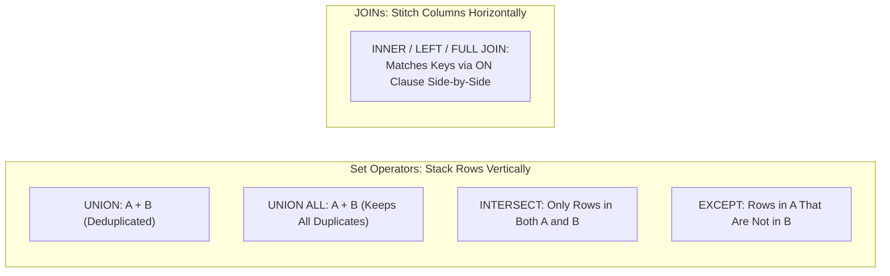

---
tags:
  - sql
  - set-operators
  - joins-grouping-subqueries
---

# Set Operators (UNION, UNION ALL, INTERSECT, EXCEPT) in SQL

#### TL;DR (Quick Revision)

**Set Operators (`UNION`, `UNION ALL`, `INTERSECT`, `EXCEPT`)** = Stack or compare the **rows** of two or more independent `SELECT` queries **vertically** + Both queries must have the **exact same number of columns** with compatible data types, and a single `ORDER BY` goes at the very end.

> [!abstract] Core Idea
> While `JOIN` combines tables **horizontally** (adding columns side by side), **Set Operators** combine result sets **vertically** (stacking, intersecting, or subtracting rows) ([Set Operations with UNION, INTERSECT, and EXCEPT in MySQL 8.4](https://dev.mysql.com/doc/refman/8.4/en/set-operations.html) & [EXCEPT and INTERSECT Transact-SQL](https://learn.microsoft.com/en-us/sql/t-sql/language-elements/set-operators-except-and-intersect-transact-sql?view=sql-server-ver17)). This note covers all 5 sub-topics in **Syllabus Row 14 (*Set Operators*)**: Introduction to `UNION`, `UNION` vs. `UNION ALL`, `UNION` vs. `JOIN`, `INTERSECT`, and `EXCEPT`.

> [!question] Why Use It?
>
> - **Combine Historical & Active Tables Vertically (`UNION ALL` / `UNION`)**: Stack `orders_2025` and `orders_2026` into a single unified feed.
> - **Find Overlapping Records Across Two Queries (`INTERSECT`)**: Identify customers who exist in **both** `legacy_crm_users` and `cloud_app_users`.
> - **Find Missing / Unmigrated Records (`EXCEPT`)**: Identify rows present in `legacy_crm_users` that have **not yet been migrated** to `cloud_app_users`.
> - **100% `NULL`-Safe Row Comparisons**: Unlike `WHERE` or `JOIN ON`, all SQL set operators treat two `NULL` values in the same column position as **equal**!

#### Quick Comparison Table

| Syllabus Sub-Topic (Row 14: *Set Operators*) | ANSI SQL / SQL Server (T-SQL) | MySQL 8.4+ Equivalent | Duplicate & Precedence Behavior |
| :--- | :--- | :--- | :--- |
| **`UNION`** | `SELECT a, b FROM T1 UNION SELECT x, y FROM T2` | `SELECT a, b FROM T1 UNION SELECT x, y FROM T2` ([Set Operations MySQL 8.4](https://dev.mysql.com/doc/refman/8.4/en/set-operations.html)) | Combines rows from both queries and **removes duplicates** (both across tables and within the same table!). |
| **`UNION ALL`** | `SELECT a, b FROM T1 UNION ALL SELECT x, y FROM T2` | `SELECT a, b FROM T1 UNION ALL SELECT x, y FROM T2` | Appends all rows **without deduplicating**; much faster than `UNION` because it skips sorting/hashing! |
| **`UNION` vs. `JOIN`** | `UNION` stacks rows **vertically** (same columns); `JOIN` stitches columns **horizontally** (via `ON`) | Same in MySQL 8.4 | Use `UNION` when merging similar entity lists; use `JOIN` when enriching a row with related attributes. |
| **`INTERSECT`** | `SELECT a, b FROM T1 INTERSECT SELECT x, y FROM T2` ([EXCEPT and INTERSECT T-SQL](https://learn.microsoft.com/en-us/sql/t-sql/language-elements/set-operators-except-and-intersect-transact-sql?view=sql-server-ver17)) | `SELECT a, b FROM T1 INTERSECT SELECT x, y FROM T2` (Added in **MySQL 8.0.31+ / 8.4**; also supports `INTERSECT ALL`) | Returns distinct rows that appear in **both** `T1` and `T2`. **`INTERSECT` has higher precedence than `UNION` and `EXCEPT`!** |
| **`EXCEPT` (Oracle `MINUS`)** | `SELECT a, b FROM T1 EXCEPT SELECT x, y FROM T2` | `SELECT a, b FROM T1 EXCEPT SELECT x, y FROM T2` (Added in **MySQL 8.0.31+ / 8.4**; `MINUS` is not supported) | Returns distinct rows from `T1` that do **not** appear in `T2`. Order of queries matters ($T_1 - T_2 
eq T_2 - T_1$)! |

---

## The Learning Concept

### What Problem Does It Solve?

Two mistakes happen constantly with set operators:
1. Using bare `UNION` when `UNION ALL` is what you actually want—forcing the database engine to run an expensive deduplication sort over millions of rows (and accidentally deleting valid duplicate rows within the first table!).
2. Putting `ORDER BY` after the first `SELECT` query instead of at the very end of the combined set operation, or mismatching column counts/types:

```sql
-- BAD - Using slow UNION when duplicates are impossible, and placing ORDER BY on the first query!
SELECT user_email, country_code
FROM legacy_crm_users
ORDER BY user_email ASC        -- SYNTAX ERROR: ORDER BY can only appear once at the very end of the set!
UNION
SELECT email_address
FROM cloud_app_users;          -- ERROR: First query has 2 columns, second query has only 1 column!
```

Every `SELECT` block in a set operation must have the **exact same number of columns**, compatible data types in each position, and a single `ORDER BY` at the very bottom referencing the column names/aliases of the **first** `SELECT` query:

```sql
-- GOOD - Matching column counts, column names taken from the 1st SELECT, and ORDER BY at the very end
SELECT
    user_email AS email,
    country_code AS country
FROM legacy_crm_users
UNION
SELECT
    email_address,
    iso_country
FROM cloud_app_users
ORDER BY email ASC;
```

### How SQL Implements It

> [!tip] Four Rules of SQL Set Operations
>
> 1. **Equal Column Count & Positional Type Compatibility**: Query 1 and Query 2 must project the same number of columns, and Column $i$ of Query 1 must be type-compatible with Column $i$ of Query 2 ([Data Type Precedence T-SQL](https://learn.microsoft.com/en-us/sql/t-sql/data-types/data-type-precedence-transact-sql?view=sql-server-ver17)).
> 2. **First Query Names the Output Columns**: The column names (or aliases) of the **first `SELECT` statement** become the column headers of the final result set (and are the names you must use in the final `ORDER BY`).
> 3. **Precedence (`INTERSECT` Before `UNION` and `EXCEPT`)**: In both ANSI SQL, SQL Server, and MySQL 8.4, `A UNION B INTERSECT C` is evaluated as `A UNION (B INTERSECT C)` ([Set Operations MySQL 8.4](https://dev.mysql.com/doc/refman/8.4/en/set-operations.html))!
> 4. **`NULL` Equals `NULL` in Set Operators**: Unlike `WHERE` or `JOIN`, `UNION`, `INTERSECT`, and `EXCEPT` treat two `NULL` values as equal duplicates!

#### Full Runnable Example

```sql
-- Step 1: Create two user tables to compare across systems
CREATE TABLE legacy_crm_users (
    user_email VARCHAR(60) NOT NULL,
    country_code CHAR(2) NOT NULL
);

CREATE TABLE cloud_app_users (
    email_address VARCHAR(60) NOT NULL,
    iso_country CHAR(2) NOT NULL
);

-- Step 2: Insert sample records (note 'ananya@example.com' appears twice in legacy_crm_users)
INSERT INTO legacy_crm_users VALUES
('ananya@example.com', 'IN'),
('vikram@example.com', 'IN'),
('siddharth@example.com', 'US'),
('ananya@example.com', 'IN');

INSERT INTO cloud_app_users VALUES
('vikram@example.com', 'IN'),
('kavya@example.com', 'SG'),
('siddharth@example.com', 'US');

-- Step 3A: UNION (combines both tables and removes all duplicate rows, including Ananya's duplicate!)
SELECT user_email AS email, country_code AS country, 'UNION_DEDUPED' AS op
FROM legacy_crm_users
UNION
SELECT email_address, iso_country, 'UNION_DEDUPED'
FROM cloud_app_users
ORDER BY email ASC;
```

**Output (Query 3A - `UNION` Deduplicated Result Set):**

```
+-----------------------+-----------+---------------+
| email                 | country   | op            |
|-----------------------+-----------+---------------|
| ananya@example.com    | IN        | UNION_DEDUPED |
| kavya@example.com     | SG        | UNION_DEDUPED |
| siddharth@example.com | US        | UNION_DEDUPED |
| vikram@example.com    | IN        | UNION_DEDUPED |
+-----------------------+-----------+---------------+
```

```sql
-- Step 3B: INTERSECT (users in BOTH systems) and EXCEPT (users in legacy_crm_users but NOT in cloud_app_users)
SELECT
    email,
    country,
    'IN_BOTH_SYSTEMS (INTERSECT)' AS audit_status
FROM (
    SELECT user_email AS email, country_code AS country FROM legacy_crm_users
    INTERSECT
    SELECT email_address AS email, iso_country AS country FROM cloud_app_users
)
UNION ALL
SELECT
    email,
    country,
    'LEGACY_ONLY (EXCEPT)' AS audit_status
FROM (
    SELECT user_email AS email, country_code AS country FROM legacy_crm_users
    EXCEPT
    SELECT email_address AS email, iso_country AS country FROM cloud_app_users
)
ORDER BY audit_status ASC, email ASC;
```

**Output (Query 3B - `INTERSECT` and `EXCEPT` Audit Comparison):**

```
+-----------------------+-----------+-----------------------------+
| email                 | country   | audit_status                |
|-----------------------+-----------+-----------------------------|
| siddharth@example.com | US        | IN_BOTH_SYSTEMS (INTERSECT) |
| vikram@example.com    | IN        | IN_BOTH_SYSTEMS (INTERSECT) |
| ananya@example.com    | IN        | LEGACY_ONLY (EXCEPT)        |
+-----------------------+-----------+-----------------------------+
```

### Visual Diagram: `UNION`, `UNION ALL`, `INTERSECT`, and `EXCEPT` vs. `JOIN`



### Key Terminology

1. **`UNION` vs. `UNION ALL`**: `UNION` merges two result sets and performs a distinct sort/hash pass to remove duplicates; `UNION ALL` simply streams the rows of the second query after the first with zero deduplication cost ([Set Operations MySQL 8.4](https://dev.mysql.com/doc/refman/8.4/en/set-operations.html)).
   Syntax: `SELECT email FROM t1 UNION ALL SELECT email FROM t2;`
2. **`INTERSECT`**: Returns only the rows that appear in **both** the first and second query results (deduplicated by default).
   Syntax: `SELECT user_email FROM legacy_crm_users INTERSECT SELECT email_address FROM cloud_app_users;`
3. **`EXCEPT`**: Returns the distinct rows from the **left (first)** query that do **not** appear in the **right (second)** query ([EXCEPT and INTERSECT Transact-SQL](https://learn.microsoft.com/en-us/sql/t-sql/language-elements/set-operators-except-and-intersect-transact-sql?view=sql-server-ver17)).
   Syntax: `SELECT user_email FROM legacy_crm_users EXCEPT SELECT email_address FROM cloud_app_users;`
4. **Set Operator Precedence**: `INTERSECT` binds tighter than `UNION` and `EXCEPT` (just like `AND` binds tighter than `OR`). `UNION` and `EXCEPT` have equal precedence and evaluate left-to-right.
   Syntax: `SELECT a FROM t1 UNION (SELECT a FROM t2 INTERSECT SELECT a FROM t3);`

> [!important] Key Rules to Remember
>
> - **Default to `UNION ALL` Unless You Need Deduplication** → If two queries come from mutually exclusive partitions (e.g., `'2025'` and `'2026'`), never use bare `UNION`—use `UNION ALL` to avoid an unnecessary sort/hash pass over the entire dataset.
> - **Column Matching Is Positional, Not By Name!** → If you write `SELECT user_email, country_code FROM t1 UNION ALL SELECT iso_country, email_address FROM t2`, SQL will happily stack `iso_country` into the `user_email` column! Always verify column order matches 1-to-1.
> - **MySQL 8.0.31+ / 8.4 Added Native `INTERSECT` and `EXCEPT`** → Prior to MySQL 8.0.31, MySQL only supported `UNION` and `UNION ALL`. In MySQL 8.4, `INTERSECT`, `INTERSECT ALL`, `EXCEPT`, and `EXCEPT ALL` are all natively supported ([Set Operations MySQL 8.4](https://dev.mysql.com/doc/refman/8.4/en/set-operations.html)). (SQL Server supports `UNION`, `UNION ALL`, `INTERSECT`, and `EXCEPT`.)
> - **`EXCEPT` Is Non-Commutative ($A - B 
eq B - A$)** → `A UNION B` and `A INTERSECT B` return the same rows regardless of whether `A` or `B` is written first, but `A EXCEPT B` returns rows in `A` missing from `B`, whereas `B EXCEPT A` returns rows in `B` missing from `A`!

---

## Edge Case Analysis

### 1. Bare `UNION` Deleting Valid Duplicate Rows Inside a Single Table!
**Problem:** In our lab, `'ananya@example.com'` appeared **twice** inside `legacy_crm_users` and **zero times** inside `cloud_app_users`. When we ran `legacy_crm_users UNION cloud_app_users`, Ananya's two rows inside `legacy_crm_users` were collapsed into **1 row**!
**Fix:** Remember that `UNION`, `INTERSECT`, and `EXCEPT` deduplicate rows **within** each input table as well as **across** the two tables. Use `UNION ALL` if intra-table duplicates must be preserved.

```sql
-- UNION ALL preserves all 4 rows from legacy_crm_users + all 3 rows from cloud_app_users (7 rows total)
SELECT user_email AS email FROM legacy_crm_users
UNION ALL
SELECT email_address AS email FROM cloud_app_users;
```

### 2. Why `EXCEPT` Beats `NOT IN` When Columns Are Nullable
**Problem:** Earlier we saw that `WHERE col NOT IN (SELECT col FROM t2)` returns **0 rows** if `t2.col` contains a `NULL`. How does `EXCEPT` behave when `NULL`s are present?
**Fix:** Because set operators treat `NULL` as equal to `NULL` ([EXCEPT and INTERSECT T-SQL](https://learn.microsoft.com/en-us/sql/t-sql/language-elements/set-operators-except-and-intersect-transact-sql?view=sql-server-ver17)), `SELECT dept_id FROM departments EXCEPT SELECT dept_id FROM employees;` is **100% immune to `NULL`s** and cleanly returns `40`!

```sql
-- Safe, concise alternative to NOT EXISTS for comparing key columns
SELECT user_email FROM legacy_crm_users
EXCEPT
SELECT email_address FROM cloud_app_users;
```

### 3. Sorting Individual Branches Before Combining (`TOP` / `LIMIT` in Parentheses)
**Problem:** What if you want the **Top 2 highest-paid employees from Dept 10** combined with the **Top 2 highest-paid employees from Dept 20**? You cannot put a bare `ORDER BY` inside the first `SELECT` without wrapping each branch!
**Fix:** Wrap each `SELECT ... ORDER BY ... LIMIT 2` (or `SELECT TOP (2) ... ORDER BY ...` in T-SQL) inside parentheses `(...)` or a derived table before applying `UNION ALL`:

```sql
-- Combining Top-N from two separate groups using derived tables + UNION ALL
SELECT * FROM (
    SELECT user_email, country_code FROM legacy_crm_users ORDER BY user_email ASC LIMIT 2
) AS top_legacy
UNION ALL
SELECT * FROM (
    SELECT email_address, iso_country FROM cloud_app_users ORDER BY email_address ASC LIMIT 2
) AS top_cloud;
```

---

## Going Deeper (Intermediate -> Advanced)

### 1. Syllabus Sub-Topic: `UNION` vs. `JOIN` — Complete Architectural Comparison

| Dimension | `JOIN` (`INNER`, `LEFT`, `FULL`) | Set Operators (`UNION`, `INTERSECT`, `EXCEPT`) |
| :--- | :--- | :--- |
| **Direction of Combination** | **Horizontal** (adds more columns side by side) | **Vertical** (stacks or filters rows top-to-bottom) |
| **Column Requirement** | Tables can have completely different column counts and types | Every `SELECT` must have the **exact same number of columns** and compatible positional types |
| **How `NULL`s Are Matched** | `NULL = NULL` is `UNKNOWN` (rows with `NULL` keys do **not** match in `ON a.id = b.id`) | `NULL` is treated as **equal** to `NULL` (`(1, NULL)` matches `(1, NULL)` in `UNION`/`INTERSECT`/`EXCEPT`!) |
| **Typical Use Case** | Enriching `orders` with `customer_name` from `customers` | Merging `sales_2025` and `sales_2026` rows, or auditing diffs between two tables with `EXCEPT`. |

---

## Interview Corner

### Common Questions & Concise Answers

**Q1: What is the difference between `UNION` and `UNION ALL`, and which one is faster?**  
A: `UNION` removes duplicate rows across the combined result set (requiring an extra sort or hash deduplication step), whereas `UNION ALL` retains all rows including duplicates. `UNION ALL` is significantly faster and uses less memory/tempdb because it streams rows directly without deduplicating.

**Q2: What is the structural difference between a `JOIN` and a `UNION`?**  
A: A `JOIN` combines columns from two tables **horizontally** based on a matching `ON` condition, producing wider rows. A `UNION` stacks rows from two `SELECT` queries **vertically**, requiring both queries to have the exact same number of columns and compatible data types.

**Q3: How do `UNION`, `INTERSECT`, and `EXCEPT` handle `NULL` values compared to `JOIN` and `WHERE`?**  
A: Set operators (`UNION`, `INTERSECT`, `EXCEPT`) use **distinctness comparison** rather than equality comparison—so two rows `(101, NULL)` and `(101, NULL)` are treated as **equal duplicates**!

**Q4: In `Query_A UNION Query_B INTERSECT Query_C`, which set operator executes first?**  
A: **`INTERSECT` executes first!** Both ANSI SQL, SQL Server T-SQL, and MySQL 8.4 give `INTERSECT` higher operator precedence than `UNION` and `EXCEPT`, so the expression is evaluated as `Query_A UNION (Query_B INTERSECT Query_C)`.

**Q5: If `Query_1` selects `SELECT emp_id AS id, full_name AS name` and `Query_2` selects `SELECT contractor_id, contractor_name`, which column names must you use in the final `ORDER BY` clause?**  
A: You must use the column names/aliases from the **first `SELECT` query** (`ORDER BY id, name`), because the first query defines the output schema of the entire set operation.

### Interactive Revision Quiz

**Q1: Table `A` has 3 rows `('X'), ('X'), ('Y')` and Table `B` has 2 rows `('Y'), ('Z')`. How many rows are returned by `SELECT col FROM A UNION SELECT col FROM B;` vs. `UNION ALL`?**
- [ ] A) `UNION` returns 5 rows; `UNION ALL` returns 3 rows
- [ ] B) `UNION` returns 3 rows (`'X'`, `'Y'`, `'Z'`); `UNION ALL` returns 5 rows
- [ ] C) `UNION` returns 4 rows (`'X'`, `'X'`, `'Y'`, `'Z'`); `UNION ALL` returns 5 rows
- [ ] D) Both return 4 rows

**Q2: Using the same Table `A` `('X', 'X', 'Y')` and Table `B` `('Y', 'Z')`, what does `SELECT col FROM A EXCEPT SELECT col FROM B;` return?**
- [ ] A) Two rows: `('X'), ('X')`
- [ ] B) One row: `('X')` (because `EXCEPT` removes rows present in `B` AND deduplicates the remaining rows!)
- [ ] C) Two rows: `('X'), ('Z')`
- [ ] D) One row: `('Z')`

**Q3: Which set operator has the HIGHEST precedence when multiple set operators are combined without parentheses?**
- [ ] A) `UNION`
- [ ] B) `UNION ALL`
- [ ] C) `EXCEPT`
- [ ] D) `INTERSECT`

**Q4: If `Table_1` has a row `(1, NULL)` and `Table_2` has a row `(1, NULL)`, what does `SELECT * FROM Table_1 INTERSECT SELECT * FROM Table_2;` return?**
- [ ] A) 0 rows (because `NULL` never equals `NULL`)
- [ ] B) 1 row `(1, NULL)` (because set operators treat `NULL` values as equal!)
- [ ] C) 2 rows
- [ ] D) An error because `INTERSECT` forbids `NULL` columns

**Q5: Which of the following rules is REQUIRED for two `SELECT` statements combined with `UNION`, `INTERSECT`, or `EXCEPT`?**
- [ ] A) The two tables must have a `FOREIGN KEY` relationship
- [ ] B) The columns in both `SELECT` lists must have the exact same column names
- [ ] C) Both `SELECT` lists must have the exact same number of columns with compatible data types in each position
- [ ] D) Each `SELECT` statement must have its own `ORDER BY` clause

<details>
<summary>Show Quiz Answers & Explanations</summary>

1. **B** — `UNION` deduplicates across both tables and within Table `A`, leaving the 3 distinct values `('X', 'Y', 'Z')`; `UNION ALL` keeps all $3 + 2 = 5$ rows.
2. **B** — `EXCEPT` subtracts `'Y'` (since `'Y'` is in `B`) and deduplicates the remaining `'X'` rows into a single `'X'` row.
3. **D** — `INTERSECT` has higher precedence than `UNION` and `EXCEPT` ([Set Operations MySQL 8.4](https://dev.mysql.com/doc/refman/8.4/en/set-operations.html)).
4. **B** — All SQL set operators treat `NULL` values in corresponding columns as equal duplicates.
5. **C** — Set operators match columns by position and require identical column counts and compatible types (column names can differ; the first query's names win).

</details>

---

## Practice Exercises

**Exercise 1: `UNION` vs. `UNION ALL` Row Count Prediction**
- Using `legacy_crm_users` and `cloud_app_users`, write a query that combines all Indian (`'IN'`) users from both tables keeping duplicates (`UNION ALL`), and a second query that removes duplicates (`UNION`).

**Exercise 2:双向 Audit with `EXCEPT`**
- Write two queries: (a) find users in `legacy_crm_users` who are missing from `cloud_app_users` (`legacy EXCEPT cloud`), and (b) find new users in `cloud_app_users` who were never in `legacy_crm_users` (`cloud EXCEPT legacy`).

**Exercise 3: Symmetric Difference (`(A EXCEPT B) UNION ALL (B EXCEPT A)`)**
- Combine the two `EXCEPT` queries from Exercise 2 using `UNION ALL` to produce a single report of all users who exist in **only one** of the two systems (not both).

---

## Memory Trick / One-Liner

> [!tip] Burger Patty (`UNION`) vs. Side-by-Side Combo (`JOIN`) Analogy
> **`JOIN` puts fries next to your burger on the tray (horizontal columns); `UNION` stacks a second burger patty on top of the first bun (vertical rows—so both patties must be the exact same width)!**

---

## Warning Block (Best Practice)

> [!warning] Common Mistake (Avoid This!)
>
> ```sql
> -- BAD - Swapping column order between the two SELECT statements in a UNION!
> SELECT user_email, country_code FROM legacy_crm_users
> UNION ALL
> SELECT iso_country, email_address FROM cloud_app_users; -- Scrambles countries into the email column!
> ```
>
> ```sql
> -- GOOD - Aligning column positions 1-to-1 across every SELECT block
> SELECT user_email AS email, country_code AS country FROM legacy_crm_users
> UNION ALL
> SELECT email_address AS email, iso_country AS country FROM cloud_app_users;
> ```
