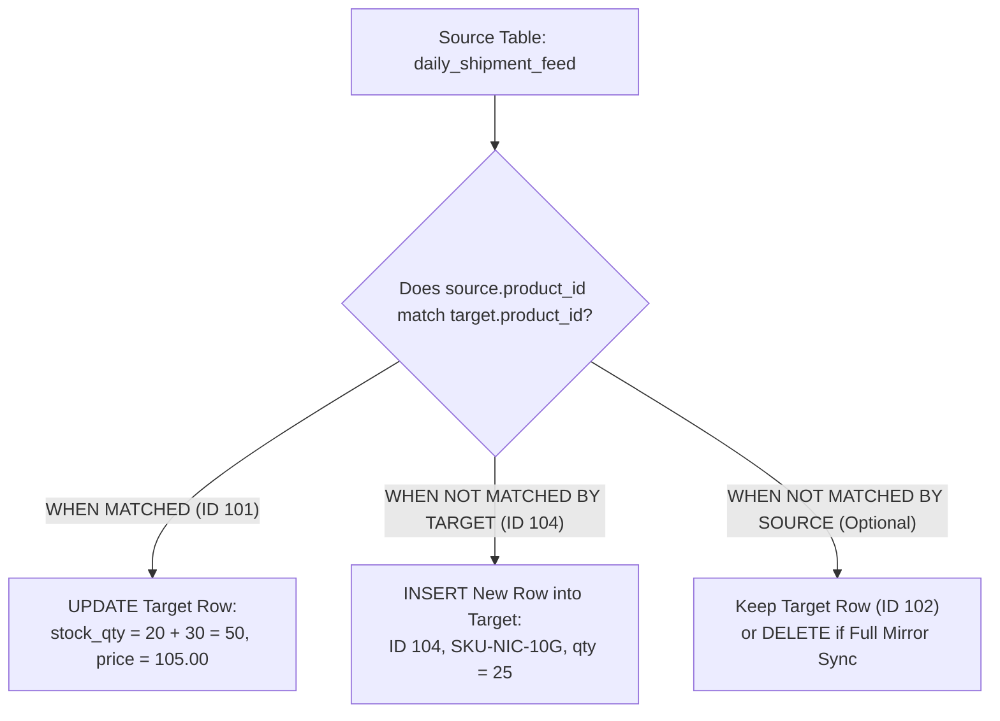

---
tags:
  - sql
  - dml-modifying-data
  - modifying-data-and-expressions
---

# Modifying Data (INSERT, UPDATE JOIN, DELETE, MERGE) in SQL

#### TL;DR (Quick Revision)

**Modifying Data (`DML`)** = Add new rows (`INSERT`, multi-row `INSERT`, `INSERT INTO ... SELECT`), modify existing rows (`UPDATE`, cross-table `UPDATE JOIN`), remove rows (`DELETE`), or synchronize a target table with a source feed in one pass (`MERGE` in T-SQL / `INSERT ... ON DUPLICATE KEY UPDATE` in MySQL 8.4).

> [!abstract] Core Idea
> This note covers all **7 sub-topics in Syllabus Row 15a (*Modifying data*)**: `INSERT`, `INSERT multiple rows`, `INSERT INTO SELECT`, `UPDATE`, `UPDATE JOIN`, `DELETE`, and `MERGE` across [SQL Server MERGE (Transact-SQL)](https://learn.microsoft.com/en-us/sql/t-sql/statements/merge-transact-sql?view=sql-server-ver17) and [MySQL 8.4 INSERT ... ON DUPLICATE KEY UPDATE](https://dev.mysql.com/doc/refman/8.4/en/insert-on-duplicate.html). Because two of these sub-topics (`UPDATE JOIN` and `MERGE`) have **completely different syntax in MySQL 8.4 vs. SQL Server T-SQL**, mastering the dialect bridge here is essential for interviews and real-world engineering!

> [!question] Why Use It?
>
> - **High-Speed Batch Inserts (`INSERT multiple rows` & `INSERT INTO ... SELECT`)**: Inserting 1,000 rows in a single multi-row `INSERT` statement is up to 20x faster than running 1,000 separate single-row `INSERT` statements.
> - **Cross-Table Price & Status Updates (`UPDATE JOIN`)**: Update a target table using values looked up from another joined table.
> - **Safe Row Removal (`DELETE` vs. `TRUNCATE`)**: Remove specific rows matching a `WHERE` filter while firing triggers and respecting foreign keys ([DELETE Statement MySQL](https://dev.mysql.com/doc/refman/8.4/en/delete.html)).
> - **Atomic Upserts / Data Warehouse Sync (`MERGE` / `ON DUPLICATE KEY UPDATE`)**: Insert new records and update existing records in a single atomic statement.

#### Quick Comparison Table

| Syllabus Sub-Topic (*Modifying data*) | ANSI SQL / SQL Server (T-SQL) | MySQL 8.4+ Equivalent | Key Behavior & Dialect Rule |
| :--- | :--- | :--- | :--- |
| **1. `INSERT` (Single Row)** | `INSERT INTO tbl (c1, c2) VALUES (1, 'A');` | `INSERT INTO tbl (c1, c2) VALUES (1, 'A');` | Always list target columns explicitly `(c1, c2)` so future schema changes never break your insert! |
| **2. `INSERT` Multiple Rows** | `INSERT INTO tbl (c1, c2) VALUES (1, 'A'), (2, 'B');` (Up to 1,000 rows per `VALUES` batch in T-SQL) | `INSERT INTO tbl (c1, c2) VALUES (1, 'A'), (2, 'B');` | Executes as a single atomic statement with one index/log flush. |
| **3. `INSERT INTO ... SELECT`** | `INSERT INTO target (c1, c2) SELECT s1, s2 FROM source WHERE ...;` | `INSERT INTO target (c1, c2) SELECT s1, s2 FROM source WHERE ...;` | Copies filtered/transformed rows from a query into an **existing** table (unlike T-SQL `SELECT ... INTO new_tbl`, which creates a new table). |
| **4. `UPDATE`** | `UPDATE tbl SET price = price * 1.05 WHERE id = 101;` | `UPDATE tbl SET price = price * 1.05 WHERE id = 101;` ([UPDATE Statement MySQL](https://dev.mysql.com/doc/refman/8.4/en/update.html)) | **Critical**: Omitting `WHERE` updates **100% of the rows** in the table! |
| **5. `UPDATE JOIN` (Major Dialect Bridge!)** | `UPDATE p SET p.price = s.new_price FROM product_inventory AS p INNER JOIN shipment AS s ON p.id = s.id;` | `UPDATE product_inventory AS p INNER JOIN shipment AS s ON p.id = s.id SET p.price = s.new_price;` | **T-SQL puts `FROM ... JOIN` *after* `SET`**; **MySQL 8.4 puts `INNER JOIN` *before* `SET`**! |
| **6. `DELETE`** | `DELETE FROM tbl WHERE status = 'DISCONTINUED';` | `DELETE FROM tbl WHERE status = 'DISCONTINUED';` ([DELETE MySQL](https://dev.mysql.com/doc/refman/8.4/en/delete.html)) | Removes matching rows; logs each row in undo/transaction log so it can be rolled back. |
| **7. `MERGE` / Upsert (Major Dialect Bridge!)** | `MERGE INTO target AS t USING source AS s ON t.id = s.id WHEN MATCHED THEN UPDATE ... WHEN NOT MATCHED THEN INSERT ...;` ([MERGE T-SQL](https://learn.microsoft.com/en-us/sql/t-sql/statements/merge-transact-sql?view=sql-server-ver17)) | `INSERT INTO target (id, qty) VALUES (101, 30) AS new_row ON DUPLICATE KEY UPDATE qty = target.qty + new_row.qty;` ([INSERT ON DUPLICATE](https://dev.mysql.com/doc/refman/8.4/en/insert-on-duplicate.html)) | T-SQL `MERGE` can `INSERT`, `UPDATE`, and `DELETE` in one pass (must end with `;`!). MySQL uses `ON DUPLICATE KEY UPDATE`. |

---

## The Learning Concept

### What Problem Does It Solve?

Imagine running an `UPDATE` or `DELETE` without testing your `WHERE` clause first, or writing SQL Server `UPDATE ... FROM ... JOIN` syntax on a MySQL database:

```sql
-- BAD - Forgetting the WHERE clause on UPDATE/DELETE wipes out the entire production table!
UPDATE product_inventory
SET unit_price = 105.00; -- CATASTROPHE: Every single product in the store now costs $105.00!
```

Always test your `WHERE` condition with a `SELECT * FROM product_inventory WHERE ...` first (or enable `SET sql_safe_updates = 1;` in MySQL, which rejects any `UPDATE` or `DELETE` that lacks a key-based `WHERE` clause!). Now compare the side-by-side **Dialect Bridge** for **`UPDATE JOIN`** and **`MERGE`**:

```sql
-- GOOD (Dialect 1: SQL Server T-SQL UPDATE JOIN & MERGE)
-- A) T-SQL UPDATE JOIN (FROM ... JOIN goes AFTER SET):
UPDATE p
SET p.stock_qty = p.stock_qty + s.incoming_qty,
    p.unit_price = s.new_unit_price
FROM dbo.product_inventory AS p
INNER JOIN dbo.daily_shipment_feed AS s
    ON p.product_id = s.product_id;

-- B) T-SQL MERGE Statement (Must terminate with a semicolon!):
MERGE INTO dbo.product_inventory AS target
USING dbo.daily_shipment_feed AS source
    ON target.product_id = source.product_id
WHEN MATCHED THEN
    UPDATE SET
        target.stock_qty = target.stock_qty + source.incoming_qty,
        target.unit_price = source.new_unit_price
WHEN NOT MATCHED BY TARGET THEN
    INSERT (product_id, sku_code, stock_qty, unit_price, status_note)
    VALUES (source.product_id, source.sku_code, source.incoming_qty, source.new_unit_price, 'NEW');
```

```sql
-- GOOD (Dialect 2: MySQL 8.4+ UPDATE JOIN & ON DUPLICATE KEY UPDATE)
-- A) MySQL 8.4 UPDATE JOIN (JOIN goes BEFORE SET):
UPDATE product_inventory AS p
INNER JOIN daily_shipment_feed AS s
    ON p.product_id = s.product_id
SET p.stock_qty = p.stock_qty + s.incoming_qty,
    p.unit_price = s.new_unit_price;

-- B) MySQL 8.4 Upsert (Using row alias 'AS new_row' introduced in MySQL 8.0.19+ / 8.4):
INSERT INTO product_inventory (product_id, sku_code, stock_qty, unit_price, status_note)
SELECT product_id, sku_code, incoming_qty, new_unit_price, 'NEW'
FROM daily_shipment_feed AS new_row
ON DUPLICATE KEY UPDATE
    stock_qty = product_inventory.stock_qty + new_row.incoming_qty,
    unit_price = new_row.new_unit_price;
```

### How SQL Implements It

> [!tip] Safe Production Workflow for Any DML Change
>
> 1. **Preview with `SELECT` First**: Write `SELECT * FROM table WHERE ...` to inspect the exact rows your `UPDATE` or `DELETE` will touch.
> 2. **Wrap in an Explicit Transaction**: Run `START TRANSACTION;` (`BEGIN TRANSACTION;` in T-SQL), execute the `UPDATE`/`DELETE`/`MERGE`, verify the affected row count, and only then run `COMMIT;` (or `ROLLBACK;` if the row count looks wrong!).
> 3. **Use Set-Based `INSERT INTO ... SELECT` / `MERGE`**: Avoid looping row-by-row in application code when synchronizing staging tables.

#### Full Runnable Example

```sql
-- Step 1: Create product_inventory and daily_shipment_feed tables
CREATE TABLE product_inventory (
    product_id INT PRIMARY KEY,
    sku_code VARCHAR(20) NOT NULL UNIQUE,
    stock_qty INT NOT NULL,
    unit_price DECIMAL(10, 2) NOT NULL,
    status_note VARCHAR(30) NOT NULL
);

CREATE TABLE daily_shipment_feed (
    product_id INT PRIMARY KEY,
    sku_code VARCHAR(20) NOT NULL,
    incoming_qty INT NOT NULL,
    new_unit_price DECIMAL(10, 2) NOT NULL
);

-- Step 2: Demonstrate single-row INSERT and multi-row INSERT
INSERT INTO product_inventory VALUES
(101, 'SKU-NVME-1T', 20, 110.00, 'IN_STOCK');

INSERT INTO product_inventory VALUES
(102, 'SKU-DDR5-32G', 15, 95.00, 'IN_STOCK'),
(103, 'SKU-PSU-850W', 0, 130.00, 'DISCONTINUED');

INSERT INTO daily_shipment_feed VALUES
(101, 'SKU-NVME-1T', 30, 105.00),
(104, 'SKU-NIC-10G', 25, 75.00);

-- Step 3: DELETE discontinued zero-stock item (103), UPDATE existing item (101), and INSERT INTO ... SELECT new item (104)
DELETE FROM product_inventory
WHERE stock_qty = 0 AND status_note = 'DISCONTINUED';

UPDATE product_inventory
SET stock_qty = stock_qty + (
        SELECT s.incoming_qty FROM daily_shipment_feed AS s WHERE s.product_id = product_inventory.product_id
    ),
    unit_price = (
        SELECT s.new_unit_price FROM daily_shipment_feed AS s WHERE s.product_id = product_inventory.product_id
    ),
    status_note = 'RESTOCKED_VIA_MERGE'
WHERE EXISTS (
    SELECT 1 FROM daily_shipment_feed AS s WHERE s.product_id = product_inventory.product_id
);

INSERT INTO product_inventory (product_id, sku_code, stock_qty, unit_price, status_note)
SELECT s.product_id, s.sku_code, s.incoming_qty, s.new_unit_price, 'NEW_VIA_INSERT_SELECT'
FROM daily_shipment_feed AS s
WHERE NOT EXISTS (
    SELECT 1 FROM product_inventory AS p WHERE p.product_id = s.product_id
);

-- Step 4: Inspect final synchronized product_inventory table
SELECT
    product_id,
    sku_code,
    stock_qty,
    unit_price,
    status_note
FROM product_inventory
ORDER BY product_id ASC;
```

**Output:**

```
+--------------+--------------+-------------+--------------+-----------------------+
| product_id   | sku_code     | stock_qty   | unit_price   | status_note           |
|--------------+--------------+-------------+--------------+-----------------------|
| 101          | SKU-NVME-1T  | 50          | 105          | RESTOCKED_VIA_MERGE   |
| 102          | SKU-DDR5-32G | 15          | 95           | IN_STOCK              |
| 104          | SKU-NIC-10G  | 25          | 75           | NEW_VIA_INSERT_SELECT |
+--------------+--------------+-------------+--------------+-----------------------+
```

### Visual Diagram: How `MERGE` (T-SQL) / Upsert Synchronizes Source & Target



### Key Terminology

1. **`INSERT INTO ... SELECT` vs. `SELECT ... INTO`**: `INSERT INTO target_tbl (cols) SELECT ...` inserts rows into an **existing** table (supported in ANSI SQL, MySQL 8.4, and T-SQL). By contrast, `SELECT ... INTO new_tbl FROM source` is a T-SQL DDL/DML shortcut that creates a **brand-new** table on the fly (in MySQL 8.4, use `CREATE TABLE new_tbl AS SELECT ...`!).
   Syntax: `INSERT INTO product_inventory (product_id, sku_code) SELECT product_id, sku_code FROM staging;`
2. **`UPDATE JOIN`**: Updating columns in a target table using values from a joined source table. Remember the clause order flip: **MySQL 8.4** writes `UPDATE t1 JOIN t2 ON ... SET ...`; **SQL Server T-SQL** writes `UPDATE t1 SET ... FROM t1 JOIN t2 ON ...`.
   Syntax: `UPDATE product_inventory AS p JOIN daily_shipment_feed AS s ON p.product_id = s.product_id SET p.unit_price = s.new_unit_price;` (MySQL 8.4)
3. **`MERGE` Statement (ANSI SQL:2003 / SQL Server T-SQL)**: Compares a `target` table with a `source` table on a join condition and executes `UPDATE` (`WHEN MATCHED`), `INSERT` (`WHEN NOT MATCHED BY TARGET`), or `DELETE` (`WHEN NOT MATCHED BY SOURCE`) in one pass ([MERGE Transact-SQL](https://learn.microsoft.com/en-us/sql/t-sql/statements/merge-transact-sql?view=sql-server-ver17)).
   Syntax: `MERGE INTO target USING source ON target.id = source.id WHEN MATCHED THEN UPDATE ... WHEN NOT MATCHED THEN INSERT ...;`
4. **`INSERT ... ON DUPLICATE KEY UPDATE` (MySQL 8.4 Upsert)**: MySQL's native upsert statement: if an inserted row would cause a duplicate value in a `PRIMARY KEY` or `UNIQUE` index, MySQL updates the existing row instead ([INSERT ... ON DUPLICATE KEY UPDATE](https://dev.mysql.com/doc/refman/8.4/en/insert-on-duplicate.html)).
   Syntax: `INSERT INTO tbl (id, cnt) VALUES (1, 10) AS new ON DUPLICATE KEY UPDATE cnt = tbl.cnt + new.cnt;`

> [!important] Key Rules to Remember
>
> - **All-at-Once `SET` Evaluation in Standard SQL vs. MySQL Left-to-Right Quirk** → If you write `UPDATE tbl SET a = b, b = a;` to swap two columns, **ANSI SQL and SQL Server T-SQL** evaluate all right-hand expressions using the **original** row values (swapping `a` and `b` cleanly!). However, **MySQL evaluates `SET` assignments left-to-right** ([UPDATE Statement MySQL](https://dev.mysql.com/doc/refman/8.4/en/update.html))—so in MySQL, `a = b` overwrites `a` first, and then `b = a` sets `b` to the new `a` (making both columns equal to `b`)!
> - **Why MySQL `REPLACE INTO` Is Dangerous** → Never confuse `INSERT ... ON DUPLICATE KEY UPDATE` with MySQL's `REPLACE INTO`. On a duplicate key, `REPLACE INTO` physically **deletes** the old row and **inserts** a new row—which fires `ON DELETE CASCADE` on child tables and generates a brand-new `AUTO_INCREMENT` ID!
> - **Deprecation of `VALUES(col)` in MySQL 8.0.20+ / 8.4** → In older MySQL versions, `ON DUPLICATE KEY UPDATE qty = VALUES(qty)` was used. In MySQL 8.4, `VALUES(col)` is deprecated; declare a row alias `VALUES (101, 30) AS new_row` and write `ON DUPLICATE KEY UPDATE qty = new_row.qty` ([INSERT ON DUPLICATE](https://dev.mysql.com/doc/refman/8.4/en/insert-on-duplicate.html)).
> - **T-SQL `MERGE` Requires a Trailing Semicolon (`;`)** → In SQL Server, `MERGE` is one of the few T-SQL statements where omitting the terminating `;` raises an immediate syntax error (`Msg 10713`).

---

## Edge Case Analysis

### 1. All-at-Once Column Swap in T-SQL vs. Left-to-Right `SET` Evaluation in MySQL 8.4
**Problem:** Suppose `x = 10` and `y = 20`. Running `UPDATE coords SET x = y, y = x;`:
- In **SQL Server T-SQL / PostgreSQL / SQLite**, `x` becomes `20` and `y` becomes `10` (swapped!).
- In **MySQL 8.4**, `x = y` sets `x` to `20` immediately, and then `y = x` reads the **already-modified** `x` (`20`), leaving both `x = 20` and `y = 20`!
**Fix:** Avoid order-dependent assignments in `UPDATE ... SET`, or use arithmetic/temporary expressions if swapping in MySQL.

```sql
-- Safe portable swap or explicit value assignment
UPDATE product_inventory
SET stock_qty = stock_qty + 5,
    status_note = 'UPDATED'
WHERE product_id = 101;
```

### 2. Non-Deterministic `UPDATE JOIN` When Source Has Duplicate Keys (`1:N`)
**Problem:** In `UPDATE target JOIN source ON target.id = source.id`, what happens if `source` accidentally has **two rows** with `id = 101` (one with `price = 90.00` and one with `price = 120.00`)?
- **SQL Server `MERGE`** throws an error (`The MERGE statement attempted to UPDATE or DELETE the same row more than once`).
- **SQL Server `UPDATE ... FROM ... JOIN`** and **MySQL `UPDATE JOIN`** silently pick one arbitrary row to win!
**Fix:** Always deduplicate or aggregate the source table inside a derived table (`GROUP BY product_id`) before running `UPDATE JOIN` or `MERGE`.

```sql
-- Deduplicating the source feed by product_id before joining
SELECT product_id, SUM(incoming_qty) AS total_incoming, MAX(new_unit_price) AS latest_price
FROM daily_shipment_feed
GROUP BY product_id;
```

### 3. Deleting Rows From a Joined Table (`DELETE JOIN`) in MySQL 8.4 vs. T-SQL
**Problem:** How do you delete rows from `product_inventory` that match a condition in another table?
**Fix:** Either use portable `DELETE FROM product_inventory WHERE EXISTS (...)` (works in every database!), or note the `DELETE JOIN` syntax:

```sql
-- 100% Portable ANSI / MySQL 8.4 / T-SQL DELETE using EXISTS:
DELETE FROM product_inventory
WHERE EXISTS (
    SELECT 1 FROM daily_shipment_feed AS s
    WHERE s.product_id = product_inventory.product_id
      AND s.incoming_qty < 0
);
```

---

## Going Deeper (Intermediate -> Advanced)

### 1. Complete Comparison: `DELETE` vs. `TRUNCATE TABLE` vs. `DROP TABLE`

| Feature | `DELETE FROM tbl [WHERE ...]` | `TRUNCATE TABLE tbl` | `DROP TABLE tbl` |
| :--- | :--- | :--- | :--- |
| **SQL Sub-Language** | `DML` | `DDL` | `DDL` |
| **Supports `WHERE` Filter?** | **Yes** | **No** (always removes all rows) | **No** (removes entire table + structure) |
| **Resets `AUTO_INCREMENT` / `IDENTITY`?** | **No** (keeps counting from high-water mark) | **Yes** (resets seed back to `1`) | Table no longer exists |
| **Fires `ON DELETE` Triggers?** | **Yes** | **No** | **No** |
| **Allowed When Referenced by a `FOREIGN KEY`?** | Yes (checks rows / cascades) | **No** (blocked even if child table is empty!) | **No** (must drop FK first) |
| **Can Be Rolled Back?** | **Yes** (in both MySQL & T-SQL) | **Yes in T-SQL**; **No in MySQL 8.4** (implicit commit!) | **Yes in T-SQL**; **No in MySQL 8.4** |

---

## Interview Corner

### Common Questions & Concise Answers

**Q1: What is the difference between `INSERT INTO ... SELECT` and `SELECT ... INTO` in SQL Server (and how do you do `SELECT ... INTO` in MySQL 8.4)?**  
A: `INSERT INTO existing_table (cols) SELECT ...` appends rows into a table that **already exists** (standard across ANSI SQL, MySQL, and T-SQL). `SELECT ... INTO new_table FROM ...` in T-SQL creates a **brand-new table** with the query's column structure and populates it; in MySQL 8.4, the equivalent syntax is `CREATE TABLE new_table AS SELECT ...;` ([CREATE TABLE ... SELECT MySQL](https://dev.mysql.com/doc/refman/8.4/en/create-table-select.html)).

**Q2: Compare the syntax of `UPDATE JOIN` in MySQL 8.4 vs. Microsoft SQL Server (T-SQL).**  
A: In **MySQL 8.4**, the `JOIN` clause comes **before** `SET`: `UPDATE t1 INNER JOIN t2 ON t1.id = t2.id SET t1.val = t2.val;`. In **SQL Server (T-SQL)**, the `SET` clause comes first and `FROM ... INNER JOIN` comes **after** `SET`: `UPDATE t1 SET t1.val = t2.val FROM dbo.t1 INNER JOIN dbo.t2 ON t1.id = t2.id;`.

**Q3: How does SQL Server's `MERGE` statement work, and what is its equivalent in MySQL 8.4?**  
A: T-SQL's `MERGE INTO target USING source ON ...` joins a target and source table and runs `WHEN MATCHED THEN UPDATE`, `WHEN NOT MATCHED BY TARGET THEN INSERT`, and optionally `WHEN NOT MATCHED BY SOURCE THEN DELETE` in one atomic pass. MySQL 8.4 performs upserts via `INSERT INTO target ... VALUES (...) AS new ON DUPLICATE KEY UPDATE col = new.col;`.

**Q4: Why should you use `INSERT ... ON DUPLICATE KEY UPDATE` in MySQL 8.4 instead of `REPLACE INTO`?**  
A: On a key collision, `REPLACE INTO` physically **deletes** the existing row and **inserts** a new row—which increments the `AUTO_INCREMENT` counter, rebuilds secondary indexes, and can accidentally trigger `ON DELETE CASCADE` or `ON DELETE SET NULL` on child foreign key tables! `ON DUPLICATE KEY UPDATE` updates the existing row in place.

**Q5: What happens if you run `UPDATE tbl SET a = b, b = a;` when `a = 1` and `b = 2` in SQL Server vs. MySQL 8.4?**  
A: SQL Server evaluates `SET` expressions **all-at-once** using the original row values, so `a` becomes `2` and `b` becomes `1`. MySQL 8.4 evaluates `SET` assignments **left-to-right**, so `a = b` sets `a` to `2`, and then `b = a` sets `b` to the new `a` (`2`), leaving both columns as `2`!

### Interactive Revision Quiz

**Q1: Which syntax correctly performs an `UPDATE JOIN` in MySQL 8.4?**
- [ ] A) `UPDATE p SET p.unit_price = s.new_price FROM product_inventory p INNER JOIN shipment s ON p.id = s.id;`
- [ ] B) `UPDATE product_inventory AS p INNER JOIN shipment AS s ON p.id = s.id SET p.unit_price = s.new_price;`
- [ ] C) `UPDATE JOIN product_inventory p ON shipment s SET p.unit_price = s.new_price;`
- [ ] D) MySQL 8.4 does not support joining tables in an `UPDATE` statement

**Q2: Which syntax correctly performs an `UPDATE JOIN` in Microsoft SQL Server (T-SQL)?**
- [ ] A) `UPDATE p SET p.unit_price = s.new_price FROM dbo.product_inventory AS p INNER JOIN dbo.shipment AS s ON p.id = s.id;`
- [ ] B) `UPDATE dbo.product_inventory AS p INNER JOIN dbo.shipment AS s ON p.id = s.id SET p.unit_price = s.new_price;`
- [ ] C) `MERGE UPDATE dbo.product_inventory FROM dbo.shipment;`
- [ ] D) SQL Server does not support `UPDATE` with `JOIN`

**Q3: In a SQL Server `MERGE` statement, which clause handles rows that exist in the `source` table but do NOT yet exist in the `target` table?**
- [ ] A) `WHEN MATCHED THEN INSERT`
- [ ] B) `WHEN NOT MATCHED BY TARGET THEN INSERT`
- [ ] C) `WHEN NOT MATCHED BY SOURCE THEN INSERT`
- [ ] D) `ON DUPLICATE KEY INSERT`

**Q4: What is a major danger of using `TRUNCATE TABLE` instead of `DELETE FROM` on a parent table?**
- [ ] A) `TRUNCATE TABLE` is much slower than `DELETE FROM`
- [ ] B) `TRUNCATE TABLE` does not fire `ON DELETE` triggers, resets `AUTO_INCREMENT`/`IDENTITY`, causes an implicit commit in MySQL, and fails if a `FOREIGN KEY` references the table
- [ ] C) `TRUNCATE TABLE` deletes the table's columns and schema definition
- [ ] D) `TRUNCATE TABLE` requires a `WHERE` clause

**Q5: If `x = 5` and `y = 10`, what are the values of `x` and `y` after running `UPDATE t SET x = y, y = x;` in MySQL 8.4?**
- [ ] A) `x = 10, y = 5`
- [ ] B) `x = 5, y = 5`
- [ ] C) `x = 10, y = 10` (because MySQL evaluates `SET` left-to-right!)
- [ ] D) Syntax error

<details>
<summary>Show Quiz Answers & Explanations</summary>

1. **B** — In MySQL 8.4, the `JOIN` clause goes **immediately after `UPDATE`** and **before `SET`** ([UPDATE Statement MySQL](https://dev.mysql.com/doc/refman/8.4/en/update.html)).
2. **A** — In SQL Server (T-SQL), `SET` comes first, followed by `FROM ... INNER JOIN`.
3. **B** — `WHEN NOT MATCHED [BY TARGET]` triggers for new rows present in `source` that have no match in `target` ([MERGE Transact-SQL](https://learn.microsoft.com/en-us/sql/t-sql/statements/merge-transact-sql?view=sql-server-ver17)).
4. **B** — `TRUNCATE TABLE` is a page-deallocating DDL operation that bypasses row-level `DELETE` triggers, resets identity counters, and cannot run on FK-referenced tables.
5. **C** — Unlike ANSI SQL/T-SQL (which swaps `x` and `y` to `10` and `5`), MySQL evaluates `SET` left-to-right, setting `x = 10` first and then setting `y = x` (`10`).

</details>

---

## Practice Exercises

**Exercise 1: Multi-Row `INSERT` and `INSERT INTO ... SELECT`**
- Write a single `INSERT` statement that adds 3 new rows into `daily_shipment_feed`, and then write an `INSERT INTO product_inventory ... SELECT` query that copies only shipments with `incoming_qty >= 20` that do not yet exist in `product_inventory`.

**Exercise 2: Write `UPDATE JOIN` in Both MySQL 8.4 and SQL Server T-SQL**
- Write the exact `UPDATE JOIN` statement to increase `product_inventory.stock_qty` by `daily_shipment_feed.incoming_qty` in (a) MySQL 8.4 and (b) SQL Server T-SQL.

**Exercise 3: Write `MERGE` (T-SQL) and `ON DUPLICATE KEY UPDATE` (MySQL 8.4)**
- Write a SQL Server `MERGE` statement synchronizing `product_inventory` from `daily_shipment_feed` (updating matched rows, inserting unmatched target rows, and deleting target rows when `stock_qty = 0` and not matched by source), and write the MySQL 8.4 `INSERT ... ON DUPLICATE KEY UPDATE` equivalent.

---

## Memory Trick / One-Liner

> [!tip] Clause Order Flip Mnemonic for `UPDATE JOIN`
> **MySQL joins BEFORE it sets (`UPDATE t1 JOIN t2 ON ... SET ...`); SQL Server sets BEFORE it joins (`UPDATE t1 SET ... FROM t1 JOIN t2 ON ...`)—and NEVER press Enter on `UPDATE` or `DELETE` before reading your `WHERE` clause twice!**

---

## Warning Block (Best Practice)

> [!warning] Common Mistake (Avoid This!)
>
> ```sql
> -- BAD - Using MySQL REPLACE INTO for upserts (deletes & re-inserts the row, breaking child FKs!)
> REPLACE INTO product_inventory (product_id, sku_code, stock_qty, unit_price, status_note)
> VALUES (101, 'SKU-NVME-1T', 50, 105.00, 'IN_STOCK');
> ```
>
> ```sql
> -- GOOD - Using MySQL 8.4 INSERT ... AS new_row ON DUPLICATE KEY UPDATE (in-place update!)
> INSERT INTO product_inventory (product_id, sku_code, stock_qty, unit_price, status_note)
> VALUES (101, 'SKU-NVME-1T', 30, 105.00, 'IN_STOCK') AS new_row
> ON DUPLICATE KEY UPDATE
>     stock_qty = product_inventory.stock_qty + new_row.stock_qty,
>     unit_price = new_row.unit_price;
> ```
