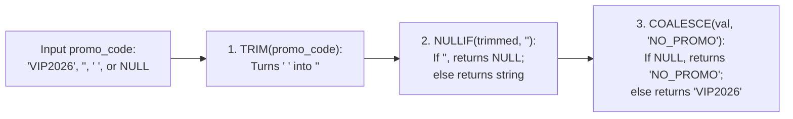

---
tags:
  - sql
  - conditional-expressions
  - modifying-data-and-expressions
---

# Conditional Expressions (CASE, COALESCE, NULLIF) in SQL

#### TL;DR (Quick Revision)

**Conditional Expressions (`CASE`, `COALESCE`, `NULLIF`)** = ANSI SQL's built-in `if/else` logic (`CASE WHEN ... THEN ... ELSE ... END`), first-non-null fallback (`COALESCE(a, b, 0)`), and division-by-zero / empty-string guard (`NULLIF(divisor, 0)`).

> [!abstract] Core Idea
> This note covers all **3 sub-topics in Syllabus Row 15b (*Expressions*)**: `CASE`, `COALESCE`, and `NULLIF` across [MySQL 8.4 Flow Control Functions](https://dev.mysql.com/doc/refman/8.4/en/help.html) and [SQL Server Transact-SQL Expressions](https://learn.microsoft.com/en-us/sql/t-sql/language-reference?view=sql-server-ver17). Because these three expressions are 100% ANSI SQL standard, they work identically in MySQL 8.4, SQL Server T-SQL, PostgreSQL, and SQLite—allowing you to categorize data, replace `NULL`s, pivot rows into columns, and prevent division-by-zero crashes directly inside `SELECT`, `WHERE`, `GROUP BY`, and `ORDER BY`.

> [!question] Why Use It?
>
> - **Dynamic Bucketing & Categorization (`CASE WHEN`)**: Turn raw numbers (`mrr_usd`) into human-readable business segments (`'Tier 1: Whale'`, `'Tier 2: Growth'`).
> - **Conditional Aggregation / Pivoting (`SUM(CASE WHEN ... THEN 1 ELSE 0 END)`)**: Count or sum multiple filtered categories side by side in a single table scan!
> - **Safe Default Fallbacks (`COALESCE`)**: Return the first non-null value from a list of arguments (`COALESCE(custom_discount_usd, 0.00)`).
> - **Prevent Division-by-Zero & Blank-String Bugs (`NULLIF`)**: `total_api_calls / NULLIF(active_seats, 0)` turns a `0` denominator into `NULL` so the query returns `NULL` instead of crashing with a division-by-zero error!

#### Quick Comparison Table

| Syllabus Expression | ANSI SQL / SQL Server (T-SQL) | MySQL 8.4+ Equivalent | Key Behavior & Evaluation Rule |
| :--- | :--- | :--- | :--- |
| **1a. Searched `CASE`** | `CASE WHEN mrr >= 2000 THEN 'High' WHEN mrr >= 500 THEN 'Mid' ELSE 'Low' END` | Same in MySQL 8.4 | Evaluates boolean conditions **top-to-bottom** and **short-circuits** at the FIRST `TRUE` branch! If `ELSE` is omitted and no branch matches, returns `NULL`. |
| **1b. Simple `CASE`** | `CASE plan_tier WHEN 'PRO' THEN 1 WHEN 'FREE' THEN 0 END` | Same in MySQL 8.4 | Compares one expression for equality (`=`) against each `WHEN` value. **Trap**: `CASE col WHEN NULL` never matches because `col = NULL` is `UNKNOWN`! |
| **2. `COALESCE(v1, v2, ...)`** | `COALESCE(custom_discount_usd, 0.00)` | `COALESCE(custom_discount_usd, 0.00)` | ANSI standard; takes **2 or more** arguments and returns the **first non-NULL** argument (short-circuits left-to-right). |
| **3. `NULLIF(expr1, expr2)`** | `NULLIF(active_seats, 0)` | `NULLIF(active_seats, 0)` | Returns **`NULL` if `expr1 = expr2`**; otherwise returns `expr1`. Essential for `x / NULLIF(y, 0)` and `NULLIF(TRIM(str), '')`. |
| **Dialect Shorthands (`ISNULL` / `IFNULL` / `IIF`)** | `ISNULL(a, b)` (2 args only), `IIF(cond, true_val, false_val)` | `IFNULL(a, b)` (2 args only), `IF(cond, true_val, false_val)` | Proprietary shorthands; always prefer ANSI **`COALESCE()`** and **`CASE WHEN`** for cross-database portability! |

---

## The Learning Concept

### What Problem Does It Solve?

Look at three classic bugs that crash production dashboards when `CASE`, `COALESCE`, and `NULLIF` are misused:
1. Dividing by a column (`total_api_calls / active_seats`) when a free-tier tenant has `active_seats = 0`—which crashes SQL Server with **`Msg 8134: Divide by zero error encountered`**!
2. Writing `CASE promo_code WHEN NULL THEN 'NO_PROMO'` (Simple `CASE` with `NULL`), which never matches because `promo_code = NULL` evaluates to `UNKNOWN`!
3. Putting a less restrictive `WHEN` condition (`WHEN mrr_usd >= 500`) **above** a more restrictive condition (`WHEN mrr_usd >= 2000`) in a `CASE` statement:

```sql
-- BAD - Wrong WHEN order (steals rows!), Simple CASE WHEN NULL bug, and Division by Zero crash!
SELECT
    tenant_name,
    CASE
        WHEN mrr_usd >= 500.00 THEN 'Growth'   -- BUG: Matches $2,500 tenants first; 'Whale' is unreachable!
        WHEN mrr_usd >= 2000.00 THEN 'Whale'
    END AS bad_segment,
    CASE promo_code
        WHEN NULL THEN 'NO_PROMO'              -- BUG: Simple CASE uses '=', so WHEN NULL NEVER matches!
        ELSE promo_code
    END AS bad_promo,
    total_api_calls / active_seats AS crash_div -- CRASHES on Tenant 3 where active_seats = 0!
FROM SaaS_metrics;
```

Because `CASE` evaluates `WHEN` branches from **top to bottom** and stops at the very first `TRUE` condition, ordering `>= 500` before `>= 2000` makes the `>= 2000` branch dead code! And dividing by `0` without `NULLIF(active_seats, 0)` crashes the query. Here is the clean, bulletproof pattern:

```sql
-- GOOD - Most specific WHEN first, COALESCE + NULLIF for blank strings, and NULLIF(divisor, 0)
SELECT
    tenant_name,
    CASE
        WHEN mrr_usd >= 2000.00 THEN 'Tier 1: Whale'
        WHEN mrr_usd >= 500.00 THEN 'Tier 2: Growth'
        ELSE 'Tier 3: Starter'
    END AS customer_segment,
    COALESCE(NULLIF(TRIM(promo_code), ''), 'NO_PROMO') AS clean_promo,
    COALESCE(ROUND(CAST(total_api_calls AS REAL) / NULLIF(active_seats, 0), 1), 0.0) AS calls_per_seat
FROM SaaS_metrics;
```

### How SQL Implements It

> [!tip] Three Superpowers of `CASE`, `COALESCE`, and `NULLIF`
>
> 1. **Top-Down Short-Circuit in `CASE`**: Put your **most specific/highest threshold** first (`>= 2000`, then `>= 500`, then `ELSE`), and always use **Searched `CASE`** (`CASE WHEN col IS NULL ...`) whenever checking for `NULL`s.
> 2. **Normalizing Blank/Whitespace Strings + `NULL`s Together**: `COALESCE(NULLIF(TRIM(promo_code), ''), 'NO_PROMO')` trims spaces `'   '` to `''`, `NULLIF(..., '')` turns `''` into `NULL`, and `COALESCE(..., 'NO_PROMO')` replaces both original `NULL`s and blank strings with `'NO_PROMO'`!
> 3. **Safe Division Idiom**: `numerator / NULLIF(denominator, 0)` turns `0` into `NULL` so division by `0` safely yields `NULL` (which you can wrap in `COALESCE(..., 0.0)`).

#### Full Runnable Example

```sql
-- Step 1: Create SaaS_metrics table with NULLs, empty strings '', whitespace '   ', and 0 active_seats
CREATE TABLE SaaS_metrics (
    tenant_id INT PRIMARY KEY,
    tenant_name VARCHAR(40) NOT NULL,
    plan_tier VARCHAR(15) NOT NULL,
    mrr_usd DECIMAL(10, 2) NOT NULL,
    custom_discount_usd DECIMAL(8, 2),
    promo_code VARCHAR(20),
    active_seats INT NOT NULL,
    total_api_calls INT NOT NULL
);

INSERT INTO SaaS_metrics VALUES
(1, 'Acme FinTech', 'ENTERPRISE', 2500.00, 300.00, 'VIP2026', 50, 125000),
(2, 'Beta Health', 'PRO', 600.00, NULL, '', 12, 36000),
(3, 'Gamma Sandbox', 'FREE', 0.00, NULL, '   ', 0, 0),
(4, 'Delta Retail', 'PRO', 850.00, 50.00, NULL, 20, 50000);

-- Step 2A: Searched CASE, COALESCE for NULL math, COALESCE+NULLIF for blank strings, and NULLIF for 0 division
SELECT
    tenant_id,
    tenant_name,
    CASE
        WHEN mrr_usd >= 2000.00 THEN 'Tier 1: Whale'
        WHEN mrr_usd >= 500.00 THEN 'Tier 2: Growth'
        ELSE 'Tier 3: Starter'
    END AS customer_segment,
    mrr_usd - COALESCE(custom_discount_usd, 0.00) AS net_mrr,
    COALESCE(NULLIF(TRIM(promo_code), ''), 'NO_PROMO') AS clean_promo,
    COALESCE(ROUND(CAST(total_api_calls AS REAL) / NULLIF(active_seats, 0), 1), 0.0) AS calls_per_seat
FROM SaaS_metrics
ORDER BY tenant_id ASC;
```

**Output (Query 2A - `CASE`, `COALESCE`, and `NULLIF` in Action):**

```
+-------------+---------------+--------------------+-----------+---------------+------------------+
| tenant_id   | tenant_name   | customer_segment   | net_mrr   | clean_promo   | calls_per_seat   |
|-------------+---------------+--------------------+-----------+---------------+------------------|
| 1           | Acme FinTech  | Tier 1: Whale      | 2200      | VIP2026       | 2500.0           |
| 2           | Beta Health   | Tier 2: Growth     | 600.0     | NO_PROMO      | 3000.0           |
| 3           | Gamma Sandbox | Tier 3: Starter    | 0.0       | NO_PROMO      | 0.0              |
| 4           | Delta Retail  | Tier 2: Growth     | 800       | NO_PROMO      | 2500.0           |
+-------------+---------------+--------------------+-----------+---------------+------------------+
```

```sql
-- Step 2B: Conditional Aggregation (Pivoting rows into columns using SUM + CASE WHEN)
SELECT
    COUNT(*) AS total_tenants,
    SUM(CASE WHEN plan_tier = 'ENTERPRISE' THEN 1 ELSE 0 END) AS enterprise_count,
    SUM(CASE WHEN plan_tier = 'PRO' THEN 1 ELSE 0 END) AS pro_count,
    SUM(CASE WHEN plan_tier = 'FREE' THEN 1 ELSE 0 END) AS free_count,
    SUM(CASE WHEN plan_tier = 'PRO' THEN mrr_usd ELSE 0.00 END) AS pro_tier_mrr
FROM SaaS_metrics;
```

**Output (Query 2B - Pivoting Rows into Summary Columns with `SUM(CASE WHEN ...)`):**

```
+-----------------+--------------------+-------------+--------------+----------------+
| total_tenants   | enterprise_count   | pro_count   | free_count   | pro_tier_mrr   |
|-----------------+--------------------+-------------+--------------+----------------|
| 4               | 1                  | 2           | 1            | 1450.0         |
+-----------------+--------------------+-------------+--------------+----------------+
```

### Visual Diagram: How `CASE`, `NULLIF`, and `COALESCE` Evaluate Values



### Key Terminology

1. **Simple `CASE` vs. Searched `CASE`**: **Simple `CASE`** (`CASE col WHEN 'A' THEN 1 ... END`) compares one expression for equality against literal values; **Searched `CASE`** (`CASE WHEN col >= 100 OR col IS NULL THEN 1 ... END`) evaluates arbitrary boolean predicates in each `WHEN` clause.
   Syntax: `CASE WHEN mrr_usd >= 2000 THEN 'Whale' ELSE 'Standard' END`
2. **`COALESCE(val1, val2, ..., valN)`**: Standard ANSI SQL function that evaluates its arguments in order from left to right and returns the **first non-null** value (or `NULL` if all arguments are `NULL`). Internally rewritten by the engine as `CASE WHEN val1 IS NOT NULL THEN val1 WHEN val2 IS NOT NULL THEN val2 ... END`.
   Syntax: `COALESCE(mobile_phone, work_phone, home_phone, 'NO_PHONE')`
3. **`NULLIF(expr1, expr2)`**: Standard ANSI SQL function that compares two expressions: if `expr1 = expr2`, it returns **`NULL`**; otherwise, it returns **`expr1`**. Internally equivalent to `CASE WHEN expr1 = expr2 THEN NULL ELSE expr1 END`.
   Syntax: `total_revenue / NULLIF(order_count, 0)`
4. **Conditional Aggregation (Pivot Pattern)**: Placing a `CASE WHEN` expression *inside* an aggregate function (`SUM(CASE WHEN ... THEN 1 ELSE 0 END)` or `COUNT(CASE WHEN ... THEN 1 END)`) to pivot row categories into separate summary columns in a single pass.
   Syntax: `SUM(CASE WHEN status = 'PAID' THEN amount ELSE 0 END) AS paid_total`

> [!important] Key Rules to Remember
>
> - **Omitted `ELSE` Defaults to `NULL`** → If you write `CASE WHEN a = 1 THEN 'One' END` without an `ELSE` clause and `a = 2`, the `CASE` expression returns **`NULL`**!
> - **All `THEN` and `ELSE` Branches Must Have Compatible Data Types** → In `CASE WHEN flag = 1 THEN 100 ELSE 'Not Applicable' END`, SQL Server throws **`Msg 245: Conversion failed when converting the varchar value 'Not Applicable' to data type int`** because `INT` has higher [Data Type Precedence](https://learn.microsoft.com/en-us/sql/t-sql/data-types/data-type-precedence-transact-sql?view=sql-server-ver17) than `VARCHAR`! Cast numbers to `VARCHAR` if mixing text and numbers in `CASE`.
> - **`COALESCE` vs. T-SQL `ISNULL` Data Type Difference** → In SQL Server, `ISNULL(nullable_varchar_3, 'DEFAULT_LONG')` truncates `'DEFAULT_LONG'` to 3 characters (`'DEF'`) because `ISNULL` takes the data type of its **first** argument! `COALESCE` follows standard [Data Type Precedence](https://learn.microsoft.com/en-us/sql/t-sql/data-types/data-type-precedence-transact-sql?view=sql-server-ver17) and returns the full `'DEFAULT_LONG'`.
> - **Division by Zero in MySQL 8.4 vs. SQL Server T-SQL** → In SQL Server T-SQL, `10 / 0` throws a fatal runtime error (`Msg 8134`). In MySQL 8.4 (by default in `SELECT`), `10 / 0` returns `NULL` without throwing an error—but using `10 / NULLIF(divisor, 0)` makes your code 100% safe in both databases!

---

## Edge Case Analysis

### 1. Mixing Incompatible Data Types Across `THEN` and `ELSE` Branches
**Problem:** Writing `SELECT CASE WHEN custom_discount_usd IS NOT NULL THEN custom_discount_usd ELSE 'NO_DISCOUNT' END FROM SaaS_metrics;` crashes in SQL Server because `custom_discount_usd` is `DECIMAL(8,2)` and `'NO_DISCOUNT'` is `VARCHAR`!
**Fix:** Explicitly `CAST(custom_discount_usd AS VARCHAR(20))` so all branches of the `CASE` expression return the same data type.

```sql
-- All branches return VARCHAR so SQL Server never throws a type conversion error
SELECT
    tenant_name,
    CASE
        WHEN custom_discount_usd IS NOT NULL THEN CAST(custom_discount_usd AS VARCHAR(20))
        ELSE 'NO_DISCOUNT'
    END AS discount_display
FROM SaaS_metrics;
```

### 2. Why `COUNT(CASE WHEN ... THEN 1 ELSE 0 END)` Is a Bug!
**Problem:** Look closely at `COUNT(CASE WHEN plan_tier = 'PRO' THEN 1 ELSE 0 END)`. Because `COUNT(expr)` counts **every non-null value**, and `0` is **not `NULL`**, `COUNT(CASE ... THEN 1 ELSE 0 END)` counts every single row in the table (`4` instead of `2`)!
**Fix:** Either use **`SUM(CASE WHEN ... THEN 1 ELSE 0 END)`** OR omit `ELSE 0` inside `COUNT` (**`COUNT(CASE WHEN ... THEN 1 END)`**, where unmatched rows become `NULL` and are ignored by `COUNT`!).

```sql
-- Two 100% correct ways to count conditional rows (vs the COUNT(... ELSE 0) bug)
SELECT
    SUM(CASE WHEN plan_tier = 'PRO' THEN 1 ELSE 0 END) AS correct_sum_pattern,
    COUNT(CASE WHEN plan_tier = 'PRO' THEN 1 END) AS correct_count_null_pattern,
    COUNT(CASE WHEN plan_tier = 'PRO' THEN 1 ELSE 0 END) AS buggy_count_zero_pattern
FROM SaaS_metrics;
```

### 3. Volatile Functions (`RAND()` / `NEWID()`) Inside `COALESCE`
**Problem:** Because `COALESCE(expr1, expr2)` is expanded internally into `CASE WHEN expr1 IS NOT NULL THEN expr1 ELSE expr2 END`, if `expr1` is a subquery or a volatile function like `RAND()` or `NEWID()`, the engine may evaluate `expr1` **twice** (once in the `WHEN IS NOT NULL` check, and a second time in `THEN`)!
**Fix:** When `expr1` is an expensive subquery, compute it once in a CTE or derived table before applying `COALESCE`.

```sql
-- Pre-computing an expression in a derived table before applying COALESCE
SELECT tenant_id, COALESCE(net_val, 0.00) AS safe_val
FROM (
    SELECT tenant_id, mrr_usd - custom_discount_usd AS net_val
    FROM SaaS_metrics
) AS dt;
```

---

## Going Deeper (Intermediate -> Advanced)

### 1. Using `CASE` Inside `UPDATE` Statements for Bulk Conditional Updates

Instead of running 3 separate `UPDATE` queries (which scans the table 3 times), you can update multiple tiers in **1 single pass** using `CASE` inside `SET`:

```sql
-- Updating multiple pricing tiers in a single table scan using CASE inside UPDATE ... SET
UPDATE SaaS_metrics
SET mrr_usd = CASE
    WHEN plan_tier = 'ENTERPRISE' THEN ROUND(mrr_usd * 1.10, 2)
    WHEN plan_tier = 'PRO'        THEN ROUND(mrr_usd * 1.05, 2)
    ELSE mrr_usd
END;
```

*(Notice the `ELSE mrr_usd` at the end! If you omit `ELSE mrr_usd` inside an `UPDATE ... SET`, any row that doesn't match `ENTERPRISE` or `PRO` will have its `mrr_usd` overwritten with `NULL`!)*

---

## Interview Corner

### Common Questions & Concise Answers

**Q1: What is the difference between Simple `CASE` and Searched `CASE`, and why can't Simple `CASE` check for `NULL`?**  
A: Simple `CASE` (`CASE col WHEN 'A' THEN ...`) compares one expression for equality (`=`) against each `WHEN` value; Searched `CASE` (`CASE WHEN col = 'A' THEN ...`) evaluates any boolean condition per branch. Simple `CASE col WHEN NULL` fails because it translates to `col = NULL`, which is always `UNKNOWN`.

**Q2: What does `NULLIF(a, b)` do, and what are its two most common real-world uses?**  
A: `NULLIF(a, b)` returns `NULL` if `a = b`, and returns `a` otherwise. Its two top uses are (1) preventing division-by-zero errors via `numerator / NULLIF(denominator, 0)` and (2) converting empty strings `''` into `NULL` via `COALESCE(NULLIF(TRIM(col), ''), 'Default')`.

**Q3: Why does `COUNT(CASE WHEN status = 'ACTIVE' THEN 1 ELSE 0 END)` return the total number of rows in the table instead of just active rows?**  
A: `COUNT(expr)` counts every row where `expr` is **not `NULL`**. Because `0` is a non-null integer, `COUNT()` counts both the `1`s and the `0`s! To count only active rows, use `SUM(CASE WHEN status = 'ACTIVE' THEN 1 ELSE 0 END)` or `COUNT(CASE WHEN status = 'ACTIVE' THEN 1 END)`.

**Q4: What happens if you omit `ELSE` in `UPDATE employees SET salary = CASE WHEN dept_id = 10 THEN salary * 1.10 END;` (without a `WHERE` clause)?**  
A: Because a `CASE` expression without an `ELSE` branch defaults to `NULL`, every employee **not** in Department `10` will have their `salary` overwritten with `NULL` (or fail if `salary` is `NOT NULL`)! Always include `ELSE salary` in an `UPDATE`.

**Q5: Compare ANSI `COALESCE(a, b, c)` with SQL Server's `ISNULL(a, b)` and MySQL's `IFNULL(a, b)`.**  
A: `COALESCE` is ANSI standard, accepts **2 or more** arguments, and determines its return type using data type precedence. `ISNULL` (T-SQL) and `IFNULL` (MySQL) are proprietary, accept **exactly 2** arguments, and `ISNULL` forces the return type and length to match its first argument (which can silently truncate longer fallback strings!).

### Interactive Revision Quiz

**Q1: What does `SELECT COALESCE(NULL, NULL, 'Third', 'Fourth');` return?**
- [ ] A) `NULL`
- [ ] B) `'Third'`
- [ ] C) `'Fourth'`
- [ ] D) `'Third, Fourth'`

**Q2: What does `SELECT NULLIF(25, 25), NULLIF(25, 0);` return?**
- [ ] A) `25` and `0`
- [ ] B) `NULL` and `25`
- [ ] C) `0` and `NULL`
- [ ] D) `NULL` and `NULL`

**Q3: A table has 10 rows (4 rows have `plan_tier = 'PRO'`, 6 rows have other tiers). What does `SELECT COUNT(CASE WHEN plan_tier = 'PRO' THEN 1 ELSE 0 END) FROM tbl;` return?**
- [ ] A) `4`
- [ ] B) `6`
- [ ] C) `10` (because `0` is not `NULL`, so `COUNT()` counts all 10 rows!)
- [ ] D) `0`

**Q4: Why does `SELECT CASE WHEN score >= 60 THEN 'Pass' WHEN score >= 90 THEN 'Distinction' ELSE 'Fail' END` never output `'Distinction'` for a score of `95`?**
- [ ] A) Because `95` is greater than `90`
- [ ] B) Because `CASE` evaluates top-to-bottom and short-circuits on the first `TRUE` condition (`95 >= 60` is `TRUE`, so it immediately returns `'Pass'`)
- [ ] C) Because `CASE` cannot use `>=` operators
- [ ] D) Because `ELSE` overrides `WHEN`

**Q5: In SQL Server (T-SQL), if `@code` is declared as `VARCHAR(3)` and its value is `NULL`, what does `SELECT ISNULL(@code, 'UNKNOWN'), COALESCE(@code, 'UNKNOWN');` return?**
- [ ] A) Both return `'UNKNOWN'`
- [ ] B) `ISNULL` truncates to `'UNK'` (matching `VARCHAR(3)` of `@code`), whereas `COALESCE` returns the full `'UNKNOWN'`
- [ ] C) `ISNULL` returns `'UNKNOWN'`, whereas `COALESCE` truncates to `'UNK'`
- [ ] D) Both throw a truncation error

<details>
<summary>Show Quiz Answers & Explanations</summary>

1. **B** — `COALESCE` scans from left to right and returns the **first non-null** argument (`'Third'`).
2. **B** — `NULLIF(25, 25)` returns `NULL` because the two arguments are equal; `NULLIF(25, 0)` returns `25` because `25 != 0`.
3. **C** — `COUNT(expr)` counts every non-null evaluation; since both `1` and `0` are non-null, all 10 rows are counted. Use `SUM(CASE ... THEN 1 ELSE 0 END)` or `COUNT(CASE ... THEN 1 END)`.
4. **B** — `CASE` stops at the very first matching `WHEN` branch; always place the most specific condition (`score >= 90`) above the broader condition (`score >= 60`).
5. **B** — T-SQL `ISNULL` inherits the exact data type and length (`VARCHAR(3)`) of its first parameter, silently truncating `'UNKNOWN'` to `'UNK'`, whereas `COALESCE` expands to `VARCHAR(7)`.

</details>

---

## Practice Exercises

**Exercise 1: Categorize & Clean with `CASE`, `COALESCE`, and `NULLIF`**
- Using `SaaS_metrics`, write a query that displays `tenant_name`, `net_mrr` (`mrr_usd - COALESCE(custom_discount_usd, 0)`), and a `seat_efficiency` label (`'High'` if `total_api_calls / NULLIF(active_seats, 0) >= 2500`, `'Normal'` if `< 2500`, and `'No Active Seats'` if `active_seats = 0`).

**Exercise 2: Conditional Aggregation (Pivot Report)**
- Write a single `SELECT` query on `SaaS_metrics` (with no `GROUP BY`) that outputs two columns side by side: `discounted_tenants_mrr` (total `mrr_usd` of tenants where `custom_discount_usd IS NOT NULL`) and `full_price_tenants_mrr` (total `mrr_usd` of tenants where `custom_discount_usd IS NULL`).

**Exercise 3: Single-Pass Conditional `UPDATE`**
- Write an `UPDATE` statement on `SaaS_metrics` using a `CASE` expression that sets `custom_discount_usd = 100.00` for `'PRO'` tenants with `active_seats >= 20`, sets `custom_discount_usd = 25.00` for `'PRO'` tenants with `active_seats < 20`, and leaves all other tenants' `custom_discount_usd` unchanged.

---

## Memory Trick / One-Liner

> [!tip] Waterfall Sieve (`CASE`), Spare Tire (`COALESCE`), and Airbag (`NULLIF`) Analogy
> **`CASE WHEN` is a top-down waterfall sieve (biggest rocks caught on top first!), `COALESCE` is your trunk's spare tire (grabs the first tire that isn't flat/`NULL`), and `NULLIF(divisor, 0)` is the airbag that turns a fatal `0` crash into a harmless `NULL` cushion!**

---

## Warning Block (Best Practice)

> [!warning] Common Mistake (Avoid This!)
>
> ```sql
> -- BAD - Omitting ELSE in an UPDATE ... SET CASE (wipes out unmatched rows with NULL!)
> UPDATE SaaS_metrics
> SET mrr_usd = CASE
>     WHEN plan_tier = 'ENTERPRISE' THEN mrr_usd * 1.10
> END; -- BUG: PRO and FREE tenants now have mrr_usd = NULL!
> ```
>
> ```sql
> -- GOOD - Always include ELSE <column_name> when using CASE inside UPDATE ... SET
> UPDATE SaaS_metrics
> SET mrr_usd = CASE
>     WHEN plan_tier = 'ENTERPRISE' THEN mrr_usd * 1.10
>     ELSE mrr_usd
> END;
> ```
