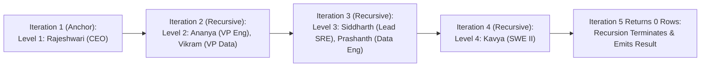

---
tags:
  - sql
  - common-table-expressions-cte
  - advanced-sql
---

# Common Table Expressions (CTEs & Recursive Queries) in SQL

#### TL;DR (Quick Revision)

**Common Table Expression (`WITH` CTE)** = A named, temporary result set (`WITH cte_name AS (SELECT ...)`) scoped to a single SQL statement + Turns messy nested subqueries into clean top-to-bottom pipelines and unlocks hierarchical tree traversal via **Recursive CTEs**!

> [!abstract] Core Idea
> A **Common Table Expression (CTE)** defines one or more named temporary views at the very top of a query using the **`WITH` clause** ([WITH Common Table Expressions in MySQL 8.4](https://dev.mysql.com/doc/refman/8.4/en/with.html) & [WITH common_table_expression Transact-SQL](https://learn.microsoft.com/en-us/sql/t-sql/queries/with-common-table-expression-transact-sql?view=sql-server-ver17)). Unlike a derived table (`FROM (SELECT ...) AS dt`), a CTE can be referenced **multiple times** in the same query, can chain sequentially (`WITH cte1 AS (...), cte2 AS (SELECT ... FROM cte1)`), and can reference **itself** to traverse org charts, bill-of-materials trees, and date series ([Recursive Queries Using CTEs in SQL Server](https://learn.microsoft.com/en-us/sql/t-sql/queries/recursive-common-table-expression-transact-sql?view=sql-server-ver17)). `[VERIFY]`

> [!question] Why Use It?
>
> - **Readable Top-to-Bottom Stepwise Logic**: Replace 4-level inside-out nested subqueries with clean, named building blocks (`WITH step_1 AS (...), step_2 AS (...)`).
> - **Reuse the Same Subquery Multiple Times**: Define `dept_summary` once in `WITH` and join it twice in the main query without copy-pasting the SQL block.
> - **Traverse Arbitrary-Depth Hierarchies (Recursive CTEs)**: Walk a 10-level employee-manager org chart or category tree in a single query (`WITH RECURSIVE` in MySQL 8.4 / `WITH` in T-SQL).
> - **Generate Calendar Date & Number Sequences**: Replace missing `generate_series` tables by generating sequential dates or numbers on the fly.

#### Quick Comparison Table

| CTE Feature / Aspect | ANSI SQL /MySQL 8.4+ ([MySQL WITH Docs](https://dev.mysql.com/doc/refman/8.4/en/with.html)) | Microsoft SQL Server (T-SQL) ([T-SQL WITH Docs](https://learn.microsoft.com/en-us/sql/t-sql/queries/with-common-table-expression-transact-sql?view=sql-server-ver17)) | Key Execution Rule |
| :--- | :--- | :--- | :--- |
| **Non-Recursive CTE Syntax** | `WITH cte_name AS (SELECT ...) SELECT * FROM cte_name;` | `;WITH cte_name AS (SELECT ...) SELECT * FROM cte_name;` | In T-SQL, if a statement precedes `WITH` in the same batch, it **must** end with a semicolon `;`! |
| **Chaining Multiple CTEs** | `WITH cte1 AS (...), cte2 AS (SELECT * FROM cte1) SELECT ...` | `WITH cte1 AS (...), cte2 AS (SELECT * FROM cte1) SELECT ...` | Write `WITH` **only once** at the top, separating CTE definitions with a comma `,`! Forward referencing is forbidden. |
| **Recursive CTE Keyword** | **`WITH RECURSIVE`** `tree AS (Anchor UNION ALL Recursive)` | **`WITH`** `tree AS (Anchor UNION ALL Recursive)` (No `RECURSIVE` keyword in T-SQL!) | Both require an **Anchor Member** connected via `UNION ALL` to a **Recursive Member** that references `tree`. |
| **Default Recursion Depth Limit** | **1,000 iterations** (`cte_max_recursion_depth = 1000`) | **100 iterations** (`OPTION (MAXRECURSION 100)`) | Protects the server from infinite loops if your hierarchy has a circular cycle! |
| **Allowed Following Statements** | `SELECT`, `INSERT`, `UPDATE`, `DELETE`, `CREATE VIEW` | `SELECT`, `INSERT`, `UPDATE`, `DELETE`, `MERGE`, `CREATE VIEW` | A CTE exists **only** for the single statement immediately following it! |

---

## The Learning Concept

### What Problem Does It Solve?

Imagine trying to read a query with 3 nested derived tables, or trying to query a 5-level employee-manager org chart using fixed self-joins (`e1 LEFT JOIN e2 LEFT JOIN e3 LEFT JOIN e4`):

```sql
-- BAD - Repeating the same derived table twice and writing WITH twice (syntax error!)
WITH cte1 AS (SELECT dept_name, AVG(salary_usd) AS avg_sal FROM org_employees GROUP BY dept_name)
WITH cte2 AS (SELECT * FROM cte1 WHERE avg_sal > 120000) -- SYNTAX ERROR: Never write 'WITH' twice!
SELECT * FROM cte2;
```

When chaining multiple CTEs, you write the keyword `WITH` **only once** and separate each named CTE block with a comma `,`. And for hierarchical data of unknown depth, a **Recursive CTE** traverses every level automatically:

```sql
-- GOOD - Chained CTEs separated by a comma, or a Recursive CTE for arbitrary-depth org charts
WITH dept_summary AS (
    SELECT dept_name, AVG(salary_usd) AS avg_dept_sal
    FROM org_employees
    GROUP BY dept_name
),
high_budget_depts AS (
    SELECT dept_name, avg_dept_sal
    FROM dept_summary
    WHERE avg_dept_sal >= 120000.00
)
SELECT e.emp_name, e.dept_name, h.avg_dept_sal
FROM org_employees AS e
INNER JOIN high_budget_depts AS h
    ON e.dept_name = h.dept_name;
```

### How SQL Implements It

> [!tip] Anatomy of a Recursive CTE (3 Mandatory Parts)
>
> 1. **Anchor Member**: The base `SELECT` query that runs **once** to find the root rows (e.g., `WHERE manager_id IS NULL` for the CEO, setting `hierarchy_level = 1`).
> 2. **`UNION ALL` Connector**: Joins the Anchor Member to the Recursive Member.
> 3. **Recursive Member**: A `SELECT` query that joins the base table (`org_employees`) to the **CTE itself** (`org_chart_tree`) to fetch the next level (`hierarchy_level + 1`), repeating until a level returns **0 rows**!

#### Full Runnable Example

```sql
-- Step 1: Create org_employees table with a 4-level reporting hierarchy
CREATE TABLE org_employees (
    emp_id INT PRIMARY KEY,
    emp_name VARCHAR(50) NOT NULL,
    manager_id INT,
    dept_name VARCHAR(30) NOT NULL,
    salary_usd DECIMAL(10, 2) NOT NULL
);

INSERT INTO org_employees VALUES
(1, 'Rajeshwari (CEO)', NULL, 'Executive', 220000.00),
(2, 'Ananya (VP Eng)', 1, 'Engineering', 175000.00),
(3, 'Vikram (VP Data)', 1, 'Data Science', 170000.00),
(4, 'Siddharth (Lead SRE)', 2, 'Engineering', 140000.00),
(5, 'Kavya (SWE II)', 4, 'Engineering', 105000.00),
(6, 'Prashanth (Data Eng)', 3, 'Data Science', 115000.00);

-- Step 2A: Chained Non-Recursive CTEs (dept_summary -> high_budget_depts -> main SELECT)
WITH dept_summary AS (
    SELECT
        dept_name,
        COUNT(*) AS staff_count,
        ROUND(AVG(salary_usd), 2) AS avg_dept_sal
    FROM org_employees
    GROUP BY dept_name
),
high_budget_depts AS (
    SELECT dept_name, staff_count, avg_dept_sal
    FROM dept_summary
    WHERE avg_dept_sal >= 120000.00
)
SELECT
    e.emp_id,
    e.emp_name,
    e.dept_name,
    e.salary_usd,
    h.avg_dept_sal
FROM org_employees AS e
INNER JOIN high_budget_depts AS h
    ON e.dept_name = h.dept_name
ORDER BY e.emp_id ASC;
```

**Output (Query 2A - Chained Multi-CTE Pipeline):**

```
+----------+----------------------+--------------+--------------+----------------+
| emp_id   | emp_name             | dept_name    | salary_usd   | avg_dept_sal   |
|----------+----------------------+--------------+--------------+----------------|
| 1        | Rajeshwari (CEO)     | Executive    | 220000       | 220000.0       |
| 2        | Ananya (VP Eng)      | Engineering  | 175000       | 140000.0       |
| 3        | Vikram (VP Data)     | Data Science | 170000       | 142500.0       |
| 4        | Siddharth (Lead SRE) | Engineering  | 140000       | 140000.0       |
| 5        | Kavya (SWE II)       | Engineering  | 105000       | 140000.0       |
| 6        | Prashanth (Data Eng) | Data Science | 115000       | 142500.0       |
+----------+----------------------+--------------+--------------+----------------+
```

```sql
-- Step 2B: Recursive CTE walking the 4-level CEO -> VP -> Lead -> Engineer hierarchy
-- (Note: Use 'WITH RECURSIVE' in MySQL 8.4 / ANSI SQL; use 'WITH' in SQL Server T-SQL)
WITH RECURSIVE org_chart_tree AS (
    -- 1. Anchor Member: Top Executive (CEO where manager_id IS NULL)
    SELECT
        emp_id,
        emp_name,
        manager_id,
        1 AS hierarchy_level,
        emp_name AS reporting_chain
    FROM org_employees
    WHERE manager_id IS NULL

    UNION ALL

    -- 2. Recursive Member: Join child employees to their parent in org_chart_tree
    SELECT
        e.emp_id,
        e.emp_name,
        e.manager_id,
        t.hierarchy_level + 1 AS hierarchy_level,
        t.reporting_chain || ' -> ' || e.emp_name AS reporting_chain
    FROM org_employees AS e
    INNER JOIN org_chart_tree AS t
        ON e.manager_id = t.emp_id
)
SELECT
    emp_id,
    hierarchy_level,
    emp_name,
    reporting_chain
FROM org_chart_tree
ORDER BY hierarchy_level ASC, emp_id ASC;
```

**Output (Query 2B - 4-Level Recursive CTE Org Chart):**

```
+----------+-------------------+----------------------+-------------------------------------------------------------------------------+
| emp_id   | hierarchy_level   | emp_name             | reporting_chain                                                               |
|----------+-------------------+----------------------+-------------------------------------------------------------------------------|
| 1        | 1                 | Rajeshwari (CEO)     | Rajeshwari (CEO)                                                              |
| 2        | 2                 | Ananya (VP Eng)      | Rajeshwari (CEO) -> Ananya (VP Eng)                                           |
| 3        | 2                 | Vikram (VP Data)     | Rajeshwari (CEO) -> Vikram (VP Data)                                          |
| 4        | 3                 | Siddharth (Lead SRE) | Rajeshwari (CEO) -> Ananya (VP Eng) -> Siddharth (Lead SRE)                   |
| 6        | 3                 | Prashanth (Data Eng) | Rajeshwari (CEO) -> Vikram (VP Data) -> Prashanth (Data Eng)                  |
| 5        | 4                 | Kavya (SWE II)       | Rajeshwari (CEO) -> Ananya (VP Eng) -> Siddharth (Lead SRE) -> Kavya (SWE II) |
+----------+-------------------+----------------------+-------------------------------------------------------------------------------+
```

### Visual Diagram: How a Recursive CTE Iterates Until Termination



### Key Terminology

1. **Common Table Expression (CTE)**: A named temporary result set defined with `WITH cte_name AS (...)` that exists only for the execution of the single SQL statement that follows it ([WITH Common Table Expressions MySQL](https://dev.mysql.com/doc/refman/8.4/en/with.html)).
   Syntax: `WITH top_earners AS (SELECT * FROM org_employees WHERE salary_usd > 150000) SELECT * FROM top_earners;`
2. **Anchor Member vs. Recursive Member**: In a recursive CTE, the **Anchor Member** is the non-recursive base query that seeds Level 1, and the **Recursive Member** is the query after `UNION ALL` that references the CTE's own name to produce Levels $2, 3, \dots, k$ ([Recursive CTEs T-SQL](https://learn.microsoft.com/en-us/sql/t-sql/queries/recursive-common-table-expression-transact-sql?view=sql-server-ver17)).
   Syntax: `WITH RECURSIVE nums AS (SELECT 1 AS n UNION ALL SELECT n + 1 FROM nums WHERE n < 10) SELECT * FROM nums;`
3. **`MAXRECURSION` (T-SQL) vs. `cte_max_recursion_depth` (MySQL 8.4)**: Safety guards that abort a recursive CTE if it exceeds a set number of iterations (default `100` in T-SQL; default `1000` in MySQL 8.4).
   Syntax: `OPTION (MAXRECURSION 500)` (T-SQL) / `SET SESSION cte_max_recursion_depth = 500;` (MySQL 8.4)
4. **Updatable CTE in SQL Server T-SQL**: In SQL Server (and MySQL 8.4 for `UPDATE JOIN` / `DELETE`), you can follow a CTE directly with `DELETE` or `UPDATE`—vital for deleting duplicate rows when combined with `ROW_NUMBER()`!
   Syntax: `WITH dupes AS (SELECT *, ROW_NUMBER() OVER (...) AS rn FROM tbl) DELETE FROM dupes WHERE rn > 1;` (T-SQL)

> [!important] Key Rules to Remember
>
> - **A CTE Scope Lasts for ONE Statement Only** → Once the `SELECT`, `INSERT`, `UPDATE`, or `DELETE` immediately after `WITH ...` finishes, the CTE no longer exists! You cannot reference it in a second `SELECT` statement below.
> - **Forbidden Clauses Inside a Recursive Member** → Both SQL Server ([WITH common_table_expression T-SQL](https://learn.microsoft.com/en-us/sql/t-sql/queries/with-common-table-expression-transact-sql?view=sql-server-ver17)) and MySQL 8.4 forbid `GROUP BY`, `HAVING`, `SELECT DISTINCT`, aggregate functions (`SUM`, `COUNT`), `LEFT/RIGHT/FULL OUTER JOIN` (only `INNER JOIN` to the CTE is allowed), and `TOP`/`LIMIT` inside the recursive member!
> - **String Column Width in MySQL 8.4 Recursive CTEs** → In MySQL 8.4, the data type and max length of a recursive CTE's column are determined **solely by the Anchor Member**! If the Anchor Member selects `emp_name` (`VARCHAR(50)`) and the Recursive Member concatenates `CONCAT(t.reporting_chain, ' -> ', e.emp_name)`, MySQL will throw `Data too long for column 'reporting_chain'` unless you wrap the Anchor Member column in `CAST(emp_name AS CHAR(500))`!
> - **Always Include a Termination Condition (`WHERE n < ...`)** → Without a `WHERE` filter or finite tree depth in the recursive member, the CTE will loop until it hits `MAXRECURSION` (100 in T-SQL) or `cte_max_recursion_depth` (1,000 in MySQL) and abort with an error.

---

## Edge Case Analysis

### 1. MySQL 8.4 `CAST(... AS CHAR(500))` Requirement on Recursive Path Strings
**Problem:** In MySQL 8.4, if your Anchor Member writes `SELECT emp_name AS reporting_chain`, MySQL locks `reporting_chain` to `VARCHAR(50)`. On Level 3, when the path exceeds 50 characters, MySQL aborts with `ERROR 1406 (22001): Data too long for column 'reporting_chain'`!
**Fix:** Always widen path/string columns in the **Anchor Member** using `CAST(emp_name AS CHAR(500))` in MySQL 8.4 (or `CAST(emp_name AS VARCHAR(500))` in T-SQL).

```sql
-- Widening the Anchor Member path column in MySQL 8.4 so recursive concatenation never overflows:
-- SELECT emp_id, CAST(emp_name AS CHAR(500)) AS reporting_chain FROM org_employees WHERE manager_id IS NULL
```

### 2. Generating a Sequential Date or Number Series with a Recursive CTE
**Problem:** Suppose you want a table of numbers from `1` to `365` (or every calendar date in November 2026) to `LEFT JOIN` against daily sales so zero-sale days still appear.
**Fix:** Use a 5-line Recursive CTE number/date generator:

```sql
-- Generating numbers 1 to 10 in MySQL 8.4 / SQLite (In T-SQL, omit 'RECURSIVE' and add OPTION (MAXRECURSION 1000))
WITH RECURSIVE number_series AS (
    SELECT 1 AS num
    UNION ALL
    SELECT num + 1
    FROM number_series
    WHERE num < 10
)
SELECT num FROM number_series;
```

### 3. Does a CTE Always Materialize a Temp Table, or Does It Re-Run?
**Problem:** If a CTE is referenced **3 times** in the outer `SELECT` query, does the database run the CTE query once or 3 times?
**Fix:** In **SQL Server T-SQL**, a CTE is purely an inline macro (like a view)—referencing it 3 times can execute the underlying query **3 times**! In **MySQL 8.4**, the optimizer may either merge the CTE or materialize it into an internal temporary table once if referenced multiple times ([Derived Table and CTE Optimization](https://dev.mysql.com/doc/refman/8.4/en/derived-table-optimization.html)). If a complex CTE is referenced multiple times in T-SQL and runs slowly, materialize it into a `#temp_table`.

---

## Going Deeper (Intermediate -> Advanced)

### 1. Comparing Subqueries vs. Derived Tables vs. CTEs vs. Temporary Tables vs. Views

| Construct | Scope / Lifetime | Can Be Referenced Multiple Times in 1 Query? | Supports Recursion? | Stored in Database Catalog? |
| :--- | :--- | :--- | :--- | :--- |
| **Derived Table (`FROM (SELECT ...) AS dt`)** | Single `FROM` clause | No (must copy-paste SQL) | No | No |
| **CTE (`WITH cte AS (...)`)** | Single SQL statement | **Yes** | **Yes** | No |
| **Temporary Table (`CREATE TEMPORARY TABLE` / `#temp`)** | Entire session / connection | **Yes** (across multiple statements!) | No (requires loop) | Stored in `tempdb` / temp storage |
| **View (`CREATE VIEW v AS ...`)** | Permanent until `DROP VIEW` | **Yes** (across all users/queries) | Can wrap a recursive CTE | **Yes** |

---

## Interview Corner

### Common Questions & Concise Answers

**Q1: What are the three main advantages of a CTE (`WITH` clause) over a Derived Table (`FROM (SELECT ...)` subquery)?**  
A: (1) **Readability**: CTEs are defined top-to-bottom at the start of the query rather than nested inside-out; (2) **Reusability within a statement**: A CTE can be referenced multiple times in the main query; (3) **Recursion**: A CTE can reference itself to traverse hierarchical trees (`WITH RECURSIVE`).

**Q2: What is the syntax difference for a Recursive CTE between MySQL 8.4 and SQL Server (T-SQL)?**  
A: MySQL 8.4 (following ANSI SQL) requires the **`RECURSIVE`** keyword (`WITH RECURSIVE cte AS (...)`), whereas SQL Server (T-SQL) omits the `RECURSIVE` keyword (`WITH cte AS (...)`).

**Q3: What are the default recursion limits in SQL Server and MySQL 8.4, and how do you override them?**  
A: SQL Server defaults to **100** recursive levels (overridden via query hint `OPTION (MAXRECURSION 500)` or `0` for unlimited). MySQL 8.4 defaults to **1,000** recursive levels (overridden via `SET SESSION cte_max_recursion_depth = 5000;`).

**Q4: Why must a statement preceding a `WITH` CTE in SQL Server (T-SQL) end with a semicolon `;`?**  
A: Because T-SQL also uses the keyword `WITH` for table hints (`FROM tbl WITH (NOLOCK)`) and index options. Without a semicolon terminating the previous statement, the T-SQL parser cannot tell whether `WITH` starts a new CTE or modifies the previous statement!

**Q5: Can you reference a CTE in a second `SELECT` statement later in the same script?**  
A: **No.** A CTE's scope is strictly limited to the **single** `SELECT`, `INSERT`, `UPDATE`, `DELETE`, or `MERGE` statement immediately following the `WITH` clause. To reuse a result set across multiple separate statements, use a `TEMPORARY TABLE` (MySQL) or `#temp` table (T-SQL).

### Interactive Revision Quiz

**Q1: How do you define two sequential CTEs (`cte_a` and `cte_b`) at the top of a single query?**
- [ ] A) `WITH cte_a AS (...) WITH cte_b AS (...) SELECT ...`
- [ ] B) `WITH cte_a AS (...), cte_b AS (...) SELECT ...`
- [ ] C) `CREATE CTE cte_a AS (...); CREATE CTE cte_b AS (...);`
- [ ] D) A query can only have one CTE

**Q2: What are the two query blocks inside a Recursive CTE called, and what operator connects them?**
- [ ] A) Left Member and Right Member, connected by `INNER JOIN`
- [ ] B) Anchor Member and Recursive Member, connected by `UNION ALL` (or `UNION`)
- [ ] C) Parent Query and Child Subquery, connected by `EXISTS`
- [ ] D) Base Table and Derived Table, connected by `CROSS JOIN`

**Q3: What is the default maximum recursion depth in SQL Server (T-SQL) vs. MySQL 8.4?**
- [ ] A) 100 in SQL Server; 1,000 in MySQL 8.4
- [ ] B) 1,000 in SQL Server; 100 in MySQL 8.4
- [ ] C) 32 in both databases
- [ ] D) Unlimited in both databases

**Q4: Which of the following is NOT allowed inside the Recursive Member of a recursive CTE in SQL Server and MySQL 8.4?**
- [ ] A) `WHERE` clause
- [ ] B) `INNER JOIN` to the CTE
- [ ] C) `GROUP BY`, `HAVING`, and aggregate functions like `SUM()` or `COUNT()`
- [ ] D) Arithmetic expressions like `hierarchy_level + 1`

**Q5: How long does a Common Table Expression (`WITH cte AS (...)`) remain available in memory/scope?**
- [ ] A) Until you disconnect from the database session
- [ ] B) Only for the single SQL statement (`SELECT`, `INSERT`, `UPDATE`, `DELETE`, or `MERGE`) immediately following `WITH`
- [ ] C) Until you run `DROP CTE cte`
- [ ] D) For the duration of the active transaction (`COMMIT`)

<details>
<summary>Show Quiz Answers & Explanations</summary>

1. **B** — Write `WITH` only once at the start of the query and separate multiple CTE definitions with a comma `,`.
2. **B** — Every recursive CTE consists of an **Anchor Member** (base case) and a **Recursive Member** joined by `UNION ALL` ([Recursive CTEs T-SQL](https://learn.microsoft.com/en-us/sql/t-sql/queries/recursive-common-table-expression-transact-sql?view=sql-server-ver17)).
3. **A** — SQL Server defaults to `MAXRECURSION 100`, while MySQL 8.4 defaults to `cte_max_recursion_depth = 1000`.
4. **C** — Aggregate functions, `GROUP BY`, `HAVING`, `DISTINCT`, and outer joins to the recursive target are forbidden inside the recursive member.
5. **B** — A CTE is scoped strictly to the single statement immediately following the `WITH` clause.

</details>

---

## Practice Exercises

**Exercise 1: Refactor a Derived Table into Chained CTEs**
- Using `org_employees`, write a 2-step CTE query where `cte_dept_totals` computes the total salary per department, and `cte_top_dept` selects the department with the highest total salary, then join `org_employees` to `cte_top_dept` to list all employees in that top department.

**Exercise 2: Write a Recursive Date Generator**
- Write a recursive CTE (`WITH RECURSIVE dates_cte` in MySQL 8.4; `WITH dates_cte` in T-SQL) that generates all 7 dates from `'2026-11-01'` to `'2026-11-07'` using `DATE_ADD(dt, INTERVAL 1 DAY)` (MySQL) / `DATEADD(DAY, 1, dt)` (T-SQL).

**Exercise 3: Traverse Only a Sub-Tree in `org_employees`**
- Modify the recursive org chart query from our lab so the **Anchor Member** starts at `emp_id = 2` (`'Ananya (VP Eng)'`) instead of the CEO, returning only Ananya and everyone in her downward reporting chain.

---

## Memory Trick / One-Liner

> [!tip] Scaffolding & Russian Nesting Dolls Analogy
> **Subqueries are Russian Nesting Dolls (you have to pry open the innermost doll first to understand the query); CTEs are numbered recipe prep bowls laid out in a clean row (`Bowl 1 -> Bowl 2 -> Final Dish`), and a Recursive CTE is a staircase that climbs one step per `UNION ALL` until it reaches the roof!**

---

## Warning Block (Best Practice)

> [!warning] Common Mistake (Avoid This!)
>
> ```sql
> -- BAD - Writing 'WITH' twice and forgetting the termination condition in a Recursive CTE!
> WITH RECURSIVE counter AS (
>     SELECT 1 AS n
>     UNION ALL
>     SELECT n + 1 FROM counter -- INFINITE LOOP: Missing 'WHERE n < 10' termination guard!
> )
> SELECT * FROM counter;
> ```
>
> ```sql
> -- GOOD - Always include a strict WHERE termination condition in the Recursive Member
> WITH RECURSIVE counter AS (
>     SELECT 1 AS n
>     UNION ALL
>     SELECT n + 1
>     FROM counter
>     WHERE n < 10
> )
> SELECT * FROM counter;
> ```
